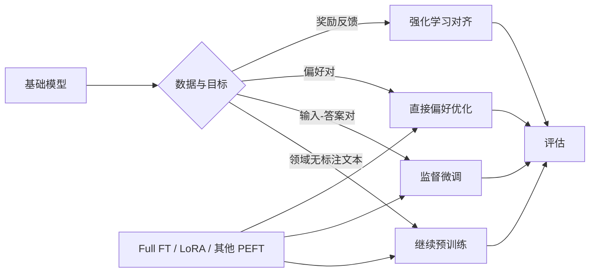

# Training Paradigms

> 一句话摘要：训练范式说明数据和优化目标，独立于 Full FT、LoRA 等参数更新方法。**优先级：P0**。前置：[训练生命周期](LLM-Training-Lifecycle.md)；后续：[SFT](SFT.md)、[PEFT](../03-Fine-Tuning-Methods/PEFT/README.md)。

## 1. 概念定义

训练一个 LLM 至少要回答两个问题：**优化什么目标**，以及**更新哪些参数**。前者是本页的训练范式，后者见[微调方法](../03-Fine-Tuning-Methods/README.md)。不同资料可能把 CPT 叫训练阶段、把 DPO 叫目标函数；这里以“数据与目标”作为检索维度，并不主张唯一术语体系。

| 范式 / 目标 | 数据形式 | 常见损失或反馈 | 用途 |
| --- | --- | --- | --- |
| Pretraining | 大规模未标注文本 | 下一个 token 等自监督目标 | 学到通用语言能力 |
| CPT | 领域未标注文本 | 继续语言建模 | 吸收领域分布 |
| SFT | 输入与目标输出 | 监督交叉熵 | 学会任务/指令格式 |
| DPO | prompt、chosen、rejected | 偏好对目标 | 偏好对齐 |
| RLHF | 偏好反馈/奖励信号 | 奖励建模与策略优化 | 对齐人类偏好 |

## 2. 基础原理与工作流程



这里的箭头表示可组合选择，不表示每个项目必须依次经历所有阶段。RLHF 是一类流程，PPO 只是可能的策略优化算法；DPO 不需要显式训练奖励模型，但仍需要偏好数据和参考策略相关计算。

## 3. 数学与代码连接

SFT 的 token 交叉熵可写为 $\mathcal L_{\mathrm{SFT}}=-\sum_{t\in\mathcal T}\log p_\theta(y_t\mid x,y_{<t})$，其中 $\mathcal T$ 是实际计损失的位置。**关键工程检查**是数据模板、padding 和 loss mask 是否与任务一致。下面只展示目标 token 的基本构造，完整训练请见后续实践项目：

```python
labels = input_ids.clone()
labels[attention_mask == 0] = -100  # CrossEntropyLoss 忽略 padding
# 若仅训练回答部分，还须把 prompt 对应位置置为 -100。
```

## 4. 典型应用、易混淆概念

- 领域术语缺失时可研究 CPT；回答格式不稳时优先检查 SFT 数据；偏好问题需要偏好数据和对应评估。
- `LoRA + SFT` 与 `Full FT + SFT` 的训练目标可以相同，更新范围不同。
- BF16/INT4 是数值表示，FSDP/DeepSpeed 是执行基础设施，不定义训练目标。

## 5. 资料与延伸

[TRL 文档（官方）](https://huggingface.co/docs/trl)、[Direct Preference Optimization（原论文）](https://arxiv.org/abs/2305.18290)、[Training language models to follow instructions with human feedback（原论文）](https://arxiv.org/abs/2203.02155)。访问日期：2026-11-05。继续读[SFT](SFT.md)与[Alignment](Alignment.md)。
