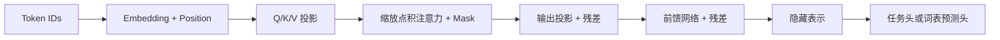

# Transformer Architecture

> 一句话摘要：Transformer 通过注意力在序列位置间交换信息，再以逐位置前馈网络变换表示。**优先级：P0**。前置：[深度学习基础](Deep-Learning-Basics.md)；后续：[模型架构](../02-Model-Architectures/README.md)、[LoRA](../03-Fine-Tuning-Methods/PEFT/Low-Rank-Adaptation/LoRA.md)。

## 1. 概念定义与为什么需要

序列建模要让一个 token 获取上下文信息。自注意力允许每个位置按内容对其他位置加权，避免固定大小卷积窗口；因果掩码则阻止解码器看到未来 token。原始 Transformer 包含 Encoder 与 Decoder；现代 LLM 也常采用仅 Decoder 的变体，不能把原论文结构等同于所有 LLM。

## 2. 基础原理与网络结构

输入 token ID 经 embedding 与位置信息进入注意力层。每个注意力头通过可学习投影得到 Query、Key、Value；注意力输出再经输出投影、残差路径、归一化和前馈网络。具体归一化位置、位置编码、FFN 形式随模型架构变化。



## 3. 数学公式

对单头注意力，$Q=XW_Q,\ K=XW_K,\ V=XW_V$，并有

$$\operatorname{Attention}(Q,K,V)=\operatorname{softmax}\left(\frac{QK^\top}{\sqrt{d_k}}+M\right)V.$$

$M$ 是可选掩码；被禁止的位置在 softmax 前加上负无穷。多头注意力将多个头拼接后再投影。因果语言模型通常最小化有效 token 的交叉熵：$\mathcal L=-\sum_{t\in\mathcal V}\log p_\theta(x_t\mid x_{<t})$。实际 SFT 会按模板只对指定输出 token 计损失，需检查具体数据整理器。

## 4. 工作流程与代码

以下代码只展示 PyTorch 的注意力输入/掩码语义，不代表任何特定 LLM 的完整 block：

```python
import torch
from torch.nn import functional as F

q = torch.randn(2, 4, 8, 16)  # batch, heads, seq, head_dim
k = torch.randn_like(q)
v = torch.randn_like(q)
out = F.scaled_dot_product_attention(q, k, v, is_causal=True)
assert out.shape == q.shape
```

## 5. 典型应用与易混淆概念

- Encoder-only 用双向上下文表示输入，常用于分类；Decoder-only 用因果目标生成文本；Encoder-Decoder 先编码输入再交叉注意力解码。
- Attention 结构决定 LoRA 的常见注入点，例如 Q/V 投影，但 `target_modules` 必须按实际模型模块名核实。
- FlashAttention 是 attention 计算实现的优化，不是新训练范式；位置编码不是微调方法。

## 6. 关联与资料

继续读[模型架构](../02-Model-Architectures/README.md)与[训练范式](Training-Paradigms.md)。依据：[Attention Is All You Need（原论文）](https://arxiv.org/abs/1706.03762)、[PyTorch scaled dot product attention 文档](https://docs.pytorch.org/docs/stable/generated/torch.nn.functional.scaled_dot_product_attention.html)。访问日期：2026-11-05。
