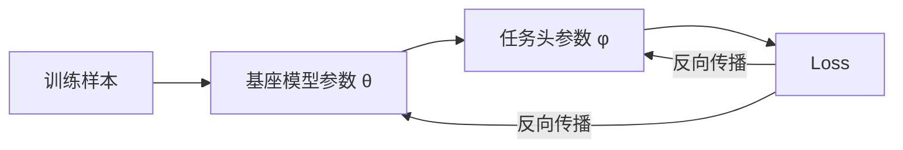

# Full Fine-Tuning

> 一句话摘要：全参数微调对选定模型的所有可训练权重计算并应用梯度更新。**优先级：P0**。前置：[训练循环](../../07-Training-Engineering/Training-Loop.md)；后续：[LoRA](../PEFT/Low-Rank-Adaptation/LoRA.md)、[显存计算](../../08-Compute-and-Memory/Full-FT-Memory.md)。

## 1. 技术定义与解决的问题

Full FT 不引入额外的低秩适配器，直接让模型权重适应新任务。它适用于数据和算力足够、需要充分改变底层表征的实验，也提供与 PEFT 比较的基线。它并不保证一定优于 PEFT，结果受数据规模、正则化、超参数与评价集影响。

## 2. 核心原理与数学表达式

对可训练参数集合 $\theta$，执行 $\theta_{t+1}=\theta_t-\eta_t\nabla_\theta\mathcal L_t$（实际优化器如 AdamW 会有额外状态）。例如分类任务把 Encoder 输出送入分类头，并对基座和头同时反向传播。



## 3. 参数更新、训练过程与代码

更新范围通常为基座与新任务头的全部 `requires_grad=True` 参数，但权重共享、显式冻结层和非参数缓冲需单独核实。训练步骤是 token 化、batch、前向、损失、反向、优化器更新、验证和 checkpoint。

```python
from transformers import AutoModelForSequenceClassification
model = AutoModelForSequenceClassification.from_pretrained(model_id, num_labels=2)
assert all(p.requires_grad for p in model.parameters())
trainable = sum(p.numel() for p in model.parameters() if p.requires_grad)
```

`model_id` 应选已授权、兼容任务和硬件的实际模型；示例没有指定下载或运行结果。

## 4. 显存与算力

单纯权重下界约为“参数数 × 每参数字节”，但训练还需梯度、优化器状态、激活、临时张量和可能的主权重副本。分片、卸载、优化器类型与序列长度会显著改变峰值，不能从参数量推出通用 GPU 门槛。见[分项估算](../../08-Compute-and-Memory/GPU-Memory-Calculation.md)。

## 5. 优势、局限与场景

优势是更新空间完整、不依赖额外适配器推理逻辑；局限是状态与 checkpoint 成本高，数据不足时易过拟合。先建立小模型的 Full FT 基线，再评估 LoRA 节省资源的实际收益。

## 6. 与相关方法、框架和资料

[Partial FT](Partial-FT.md)冻结部分原权重；[LoRA](../PEFT/Low-Rank-Adaptation/LoRA.md)冻结基座并训练增量矩阵。实现可选 PyTorch 原生训练循环或 Transformers Trainer；两者是工具层，不是 Full FT 的子方法。官方资料：[Transformers 训练文档](https://huggingface.co/docs/transformers/training)、[PyTorch Autograd](https://docs.pytorch.org/tutorials/beginner/basics/autogradqs_tutorial.html)。访问日期：2026-11-05。推荐顺序：训练循环 → Full FT → LoRA → 显存对比。
