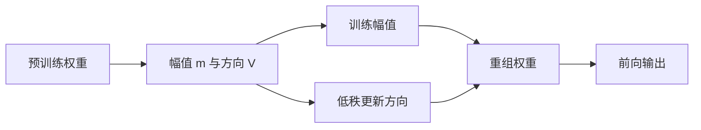

# DoRA：Weight-Decomposed Low-Rank Adaptation

> 一句话摘要：DoRA 分开处理权重的幅值与方向，方向部分结合低秩更新。**优先级：P1**。前置：[LoRA](LoRA.md)；后续：[方法比较](../../../12-Comparisons/PEFT-Methods-Comparison.md)。

## 定义、问题、原理与公式

LoRA 直接近似权重增量。DoRA 观察 Full FT 中幅值与方向的更新差异，将权重表达为幅值与归一化方向：$W=m\frac{V}{\lVert V\rVert_c}$，其中范数沿论文约定的列方向计算；方向 $V$ 再由低秩增量适配。具体广播与实现细节应以原论文和框架代码核实。

## 更新范围、过程与资源

冻结基础权重，训练低秩方向参数与幅值参数。相比 LoRA 多维护幅值参数与相应运算，性能/显存收益需要在具体任务测量。适合有资源做同预算验证、希望研究 LoRA 与 Full FT 行为差异的场景；它不改变 SFT/DPO 等训练目标。

## 框架、区别、论文与顺序

HF PEFT 的 LoRA 配置支持 DoRA 选项（具体版本和受支持模块需核实），不要假定所有量化或合并组合都兼容。[DoRA: Weight-Decomposed Low-Rank Adaptation（原论文）](https://arxiv.org/abs/2402.09353)；[PEFT LoRA 文档](https://huggingface.co/docs/peft/developer_guides/lora)。访问日期：2026-11-05。建议 LoRA → 权重方向/范数 → DoRA → 同条件实验。
