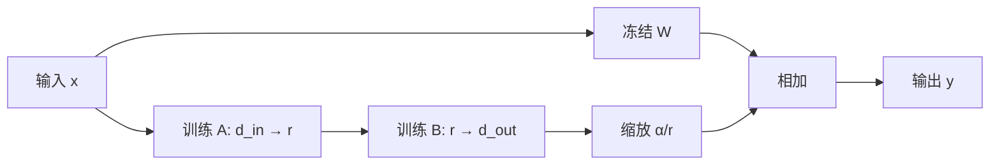

# LoRA：Low-Rank Adaptation

> 一句话摘要：冻结原权重，用两个低秩矩阵表示任务相关权重增量。**优先级：P0**。前置：[Transformer](../../../01-Foundations/Transformer-Architecture.md)、[Full FT](../../Full-Fine-Tuning/Full-FT.md)；后续：[QLoRA](QLoRA.md)、[AdaLoRA](AdaLoRA.md)。

## 1. 技术定义与解决的问题

Full FT 对大量权重和优化器状态付费。LoRA 假设适配所需增量可以由低秩矩阵近似，因此冻结原线性层权重，只训练小矩阵。每个任务可保存单独适配器，也可在适用时把增量合并进基础权重。低秩是设计假设，并非保证所有任务都能同等有效适配。

## 2. 核心原理、公式与结构

原线性层 $y=Wx$ 变为 $y=(W+\Delta W)x$，其中 $\Delta W=\frac{\alpha}{r}BA$，$A\in\mathbb R^{r\times d_{in}}$、$B\in\mathbb R^{d_{out}\times r}$，$r\ll\min(d_{in},d_{out})$。相对新增参数量是 $r(d_{in}+d_{out})$，而不是 $d_{in}d_{out}$。实际缩放和初始化由实现配置决定。



## 3. 参数更新、训练过程、显存

通常只训练注入模块的 $A,B$，可选训练 task head、bias 或指定保留模块。目标层不能机械套用：BERT、Qwen 的投影模块命名和任务头不同，应先查看 `model.named_modules()`。训练依然要为反向传播保存/重算激活；基础权重虽然冻结，仍需驻留或卸载。峰值显存还取决于精度、序列长度、batch、优化器、激活重计算与设备布局。

## 4. 框架实现示意

```python
from peft import LoraConfig, TaskType, get_peft_model

# 先用 model.named_modules() 确认目标层名称。
config = LoraConfig(
    task_type=TaskType.CAUSAL_LM,
    r=8,
    lora_alpha=16,
    lora_dropout=0.05,
    target_modules=["q_proj", "v_proj"],
)
model = get_peft_model(model, config)
model.print_trainable_parameters()
```

示例的 `model` 需是已加载的兼容因果语言模型，`q_proj`/`v_proj` 仅为具有这些模块名的架构示例；此片段**未运行验证**，实际 API 以安装版本的 [PEFT 文档](https://huggingface.co/docs/peft)为准。

## 5. 优势、局限、场景与区别

LoRA 适合多任务适配器、资源有限的 SFT 基线与实验迭代。限制包括 rank/注入位置选择、与不兼容模块的集成、合并后与原基座版本的配套管理。相较 [Adapter](../Adapter-Based/Houlsby-Adapter.md)，LoRA 对现有线性层增加并行权重增量；相较 [Prompt Tuning](../Prompt-Based/Prompt-Tuning.md)，它作用在层内权重映射；[QLoRA](QLoRA.md)则加入量化冻结基座。LoRA 不规定 SFT、DPO 或其他训练目标。

## 6. 论文、官方资料与学习顺序

[LoRA: Low-Rank Adaptation of Large Language Models（原论文）](https://arxiv.org/abs/2106.09685)；[PEFT LoRA 官方文档](https://huggingface.co/docs/peft/developer_guides/lora)。访问日期：2026-11-05。建议：线性层与梯度 → Full FT → LoRA 公式/注入位置 → 参数量实测 → QLoRA。
