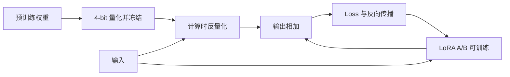

# QLoRA：量化基座上的 LoRA

> 一句话摘要：QLoRA 组合 4-bit 冻结基座与 LoRA 适配器训练，以降低基座权重的显存占用。**优先级：P0**。前置：[LoRA](LoRA.md)、[量化](../../../05-Training-Optimization/Quantization/Quantization-Overview.md)；后续：[显存计算](../../../08-Compute-and-Memory/QLoRA-Memory.md)。

## 1. 定义、问题与分类

QLoRA 是**低秩适配与量化训练配置的组合**，不是仅换一种 LoRA 矩阵。原论文的重要设计包括 4-bit NormalFloat（NF4）、双重量化和 paged optimizers。实际框架支持、硬件条件与配置随版本变化；不应把所有 `load_in_4bit + LoRA` 配置等同于论文完整实验设置。

## 2. 原理与数学表达

计算时从量化表示 $Q(W)$ 恢复参与矩阵乘法的近似权重 $\widehat W=\operatorname{dequant}(Q(W))$，训练输出近似为 $y=(\widehat W+\frac{\alpha}{r}BA)x$。冻结 $Q(W)$，梯度流向 $A,B$；量化误差与 LoRA 适配误差可能共同影响结果。



## 3. 训练与框架配置

在兼容的 GPU、Transformers、bitsandbytes 与 PEFT 环境中，先配置 `BitsAndBytesConfig` 加载冻结的 4-bit 模型，再准备 k-bit 训练并注入 LoRA。示意：

```python
import torch
from transformers import BitsAndBytesConfig

quant_config = BitsAndBytesConfig(
    load_in_4bit=True,
    bnb_4bit_quant_type="nf4",
    bnb_4bit_compute_dtype=torch.bfloat16,
    bnb_4bit_use_double_quant=True,
)
# from_pretrained(model_id, quantization_config=quant_config, device_map=...)
# prepare_model_for_kbit_training(model) 后再 get_peft_model(model, lora_config)
```

BF16 计算需硬件支持；device map、目标模块、训练 API 和软件版本要在项目中锁定并验证。这里的片段**未运行验证**，不代表完整训练脚本。

## 4. 显存与算力、优缺点

4-bit 仅描述某类基座权重的存储表示，不是整个训练过程的统一精度。量化元数据、未量化模块、LoRA 参数/梯度/优化器状态、激活、临时缓冲仍占显存。它可降低基座权重驻留成本，但反量化与量化核可能改变速度；不在此承诺固定显存数值。QLoRA 适合受基座权重显存约束的实验；如果任务敏感于量化误差，应与非量化 LoRA 或 Full FT 做同条件评估。

## 5. 区别、资料与学习顺序

[LoRA](LoRA.md)不要求基座 4-bit；[LoftQ](LoftQ.md)侧重在量化模型上选择/初始化 LoRA 权重以减小量化误差。原论文：[QLoRA: Efficient Finetuning of Quantized LLMs](https://arxiv.org/abs/2305.14314)；官方实现资料：[Transformers bitsandbytes 量化](https://huggingface.co/docs/transformers/quantization/bitsandbytes)、[PEFT 量化指南](https://huggingface.co/docs/peft/developer_guides/quantization)。访问日期：2026-11-05。建议 LoRA → 量化 → QLoRA → 实际峰值测量。
