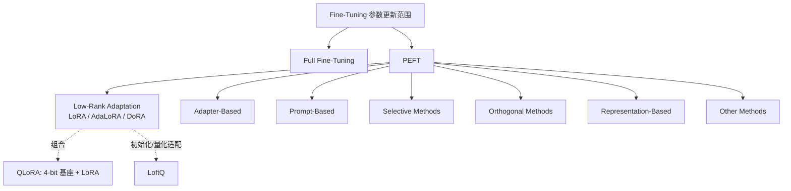

# PEFT：参数高效微调方法族

> 一句话摘要：PEFT 通过少量可训练参数适配冻结或部分冻结的基础模型。**优先级：P0**。前置：[Full FT](../Full-Fine-Tuning/Full-FT.md)；后续：[LoRA](Low-Rank-Adaptation/LoRA.md)与各分支。

## 技术定义与解决的问题

PEFT 是一类**参数更新策略**，并非训练目标、单一算法或同名 Python 库。它降低可训练权重、优化器状态和每任务适配器存储成本，但基础模型权重与训练激活仍占显存；参数少不等于训练显存一定低。实际效果依赖任务、目标模块、rank、数据与算力。

## 方法族与更新位置

| 方法族 | 主要可训练对象 | 重点入口 |
| --- | --- | --- |
| Low-Rank | 权重增量的低秩因子，或其变体参数 | [LoRA](Low-Rank-Adaptation/LoRA.md) |
| Adapter-Based | 插入层内的小模块 | [Houlsby Adapter](Adapter-Based/Houlsby-Adapter.md) |
| Prompt-Based | 连续提示向量或层间前缀 | [Prompt Tuning](Prompt-Based/Prompt-Tuning.md) |
| Selective | 偏置、缩放向量、部分层或掩码选中的参数 | [BitFit](Selective-Methods/BitFit.md) |
| Orthogonal | 受正交约束的变换 | [OFT](Orthogonal-Methods/OFT.md) |
| Representation-Based | 隐藏表示的干预参数 | [ReFT](Representation-Based/ReFT.md) |
| Other | 其他结构化参数化 | [FourierFT](Other-Methods/FourierFT.md) |

Layer Freezing/Partial FT 的归属有争议：它只是限制更新范围，是否纳入 PEFT 取决于分类标准；本库在两处建立交叉索引，不宣称它是与 LoRA 相同的算法。QLoRA 与 LoftQ 放在 Low-Rank 目录是为了检索，正文必须保留其量化维度。

## 工程与资料

先学[LoRA 原理](Low-Rank-Adaptation/LoRA.md)，再看[HF PEFT 软件库](../../04-Framework-Ecosystem/04-PEFT-and-Quantization/PEFT.md)。官方资料：[PEFT 文档](https://huggingface.co/docs/peft)；原论文：[LoRA](https://arxiv.org/abs/2106.09685)。访问日期：2026-11-05。

## 官方学习入口

- [PEFT 官方文档](https://huggingface.co/docs/peft)
- [PEFT 方法列表（官方）](https://huggingface.co/docs/peft/package_reference/index)
