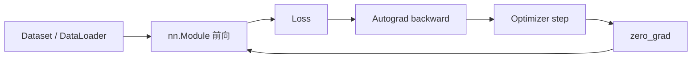

# PyTorch

> 一句话摘要：PyTorch 提供张量计算、自动求导、模块、优化器与分布式训练底座。**优先级：P0**。前置：Python、线性代数；后续：[Transformer](../../01-Foundations/Transformer-Architecture.md)、[训练循环](../../07-Training-Engineering/Training-Loop.md)。

## 是什么、层次与职责

它是深度学习计算框架，而不是 LLM 微调算法。`torch.Tensor` 承载数据，Autograd 记录可微操作，`nn.Module` 组织参数，`torch.optim` 应用更新。Transformers、PEFT、Trainer 等常在其上建立更高层能力。CUDA 可作为 GPU 执行后端，但 PyTorch 也能在 CPU 等设备运行。

## 工作流程



## 可运行的最小例子

下例只用随机张量演示梯度更新，运行环境需已安装兼容的 PyTorch；它不是 LLM 微调，也未在本次环境执行。

```python
import torch

model = torch.nn.Linear(4, 2)
optimizer = torch.optim.AdamW(model.parameters(), lr=1e-3)
x = torch.randn(8, 4)
y = torch.randint(0, 2, (8,))
optimizer.zero_grad()
loss = torch.nn.functional.cross_entropy(model(x), y)
loss.backward()
optimizer.step()
print(float(loss.detach()))
```

## 安装、API、限制与关系

安装命令取决于 OS、Python、CUDA/驱动组合，应以[官方安装选择器](https://pytorch.org/get-started/locally/)生成，不在笔记中固定版本。重点 API 是 `nn.Module`、`Dataset`/`DataLoader`、`backward()`、`Optimizer.step()`、`torch.distributed`。手写循环灵活，但需要自行处理数据、日志、恢复和分布式边界；Trainer、Accelerate 等封装部分流程。

资料：[PyTorch 官方文档](https://docs.pytorch.org/docs/stable/index.html)、[Learn the Basics](https://pytorch.org/tutorials/beginner/basics/intro.html)。访问日期：2026-11-05。顺序：张量/Autograd → 模块和训练循环 → Transformers。
