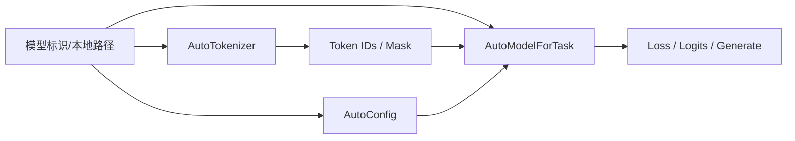

# Transformers

> 一句话摘要：Transformers 是预训练模型架构、加载、分词与任务接口库。**优先级：P0**。前置：[PyTorch](../01-Deep-Learning-Frameworks/PyTorch.md)；后续：[Trainer](../05-Training-Frameworks/Trainer.md)、[PEFT](../04-PEFT-and-Quantization/PEFT.md)。

## 是什么、层次、解决的问题

它将模型配置、权重加载、tokenizer、任务头和生成接口统一为可复用 API。它不是 PyTorch 本身，也不是 LoRA 算法；`Trainer` 是其训练 API，`PEFT` 是独立适配器库。模型仓库的许可证、权重格式和自定义代码信任要求必须在项目选型时核实。



## API 与可运行最小例子

下面演示随机初始化小 BERT 分类模型的前向；不下载权重，需安装兼容 `transformers` 与 `torch`。本次未执行。

```python
import torch
from transformers import BertConfig, BertForSequenceClassification

config = BertConfig(vocab_size=100, hidden_size=32, num_hidden_layers=1,
                    num_attention_heads=4, intermediate_size=64, num_labels=2)
model = BertForSequenceClassification(config)
batch = {"input_ids": torch.randint(0, 100, (2, 8)),
         "attention_mask": torch.ones(2, 8, dtype=torch.long),
         "labels": torch.tensor([0, 1])}
print(model(**batch).logits.shape)
```

真实模型用 `AutoTokenizer.from_pretrained(model_id)` 与任务相符的 `AutoModelFor...from_pretrained(model_id)`，加载前记录模型 revision、许可证和实际软件版本。对于 causal LM 与分类模型，任务头和损失不同。

## 安装、优缺点与资料

安装步骤见[官方安装页](https://huggingface.co/docs/transformers/installation)。优势是模型与任务接口统一；限制是各模型特殊结构、可选依赖和随版本变化的配置仍需核对。资料：[Transformers 官方文档](https://huggingface.co/docs/transformers)、[Auto Classes](https://huggingface.co/docs/transformers/model_doc/auto)。访问日期：2026-11-05。建议从任务模型和 tokenizer 学起，再接 Datasets、Trainer。
