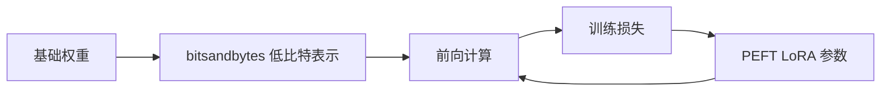

# bitsandbytes

> 一句话摘要：bitsandbytes 提供低精度量化层及优化器实现，常用于量化基座加载。**优先级：P0**。前置：[量化总览](../../05-Training-Optimization/Quantization/Quantization-Overview.md)；后续：[QLoRA](../../03-Fine-Tuning-Methods/PEFT/Low-Rank-Adaptation/QLoRA.md)。

## 是什么、层次与问题

它是数值计算/量化工具，不是 SFT、LoRA 或 QLoRA 本身。在 Transformers 集成中，`BitsAndBytesConfig` 可配置 8-bit 或 4-bit 加载。这样可降低某些模型权重驻留显存；训练的激活、适配器及其他状态不会自动变成 4-bit。

## API、环境与使用

常见配置由 Transformers `BitsAndBytesConfig(load_in_4bit=True, bnb_4bit_quant_type="nf4", ...)` 提供，完整示例见[QLoRA](../../03-Fine-Tuning-Methods/PEFT/Low-Rank-Adaptation/QLoRA.md)。硬件、驱动、PyTorch 与 bitsandbytes 支持矩阵随版本变化，安装前查[官方量化文档](https://huggingface.co/docs/transformers/quantization/bitsandbytes)；不要为所有平台写通用安装命令。

## 关系、限制与资料

PEFT 决定更新哪些参数；bitsandbytes 决定部分张量如何低精度存储/计算；Trainer/TRL 运行训练循环。量化有精度、内核与支持限制，推理量化与训练时量化加载也应分别评估。[Transformers bitsandbytes 官方文档](https://huggingface.co/docs/transformers/quantization/bitsandbytes)。访问日期：2026-11-05。
