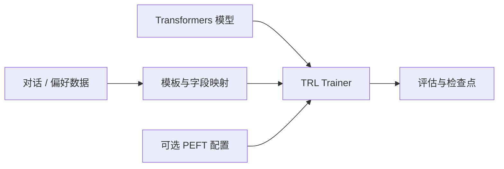

# TRL

> 一句话摘要：TRL 提供 LLM 后训练目标相关训练器，包括 SFT 与偏好优化工作流。**优先级：P0**。前置：[训练范式](../../01-Foundations/Training-Paradigms.md)、[Trainer](Trainer.md)；后续：[Qwen QLoRA 项目](../../11-Practical-Projects/05-Qwen-QLoRA/README.md)。

## 是什么、层次与职责

TRL 是 Hugging Face 的后训练软件库。它提供针对 SFT、DPO 等目标的训练器与配置，常组合 Transformers、Datasets、PEFT 和 Accelerate。它实现训练目标的工作流，不应把 TRL 与 LoRA 算法库混同。

## 关键 API 与配置

SFT 通常使用 `SFTTrainer`、`SFTConfig`；DPO 使用相应偏好训练器。关键配置包括数据字段、聊天模板、最大长度、loss mask、packing、模型与 tokenizer 版本。**这些参数随 TRL 版本变动较快**，在写可运行项目时应先锁定版本并按[官方 SFTTrainer 文档](https://huggingface.co/docs/trl/sft_trainer)重核字段。本页不提供伪装成完整可运行的 SFT 脚本；完整训练还需可访问模型、合规数据和硬件环境。

## 关系、限制与资料

Trainer 适合通用监督任务；TRL 更聚焦 LLM 后训练数据格式和目标。PEFT 决定参数更新范围，TRL 决定训练目标对应的循环。错误聊天模板或把 prompt token 错计入 loss 会使训练表面运行但目标偏移。[TRL 官方文档](https://huggingface.co/docs/trl)、[SFTTrainer 官方文档](https://huggingface.co/docs/trl/sft_trainer)。访问日期：2026-11-05。学习顺序：SFT 目标 → Trainer → TRL → 偏好优化。
