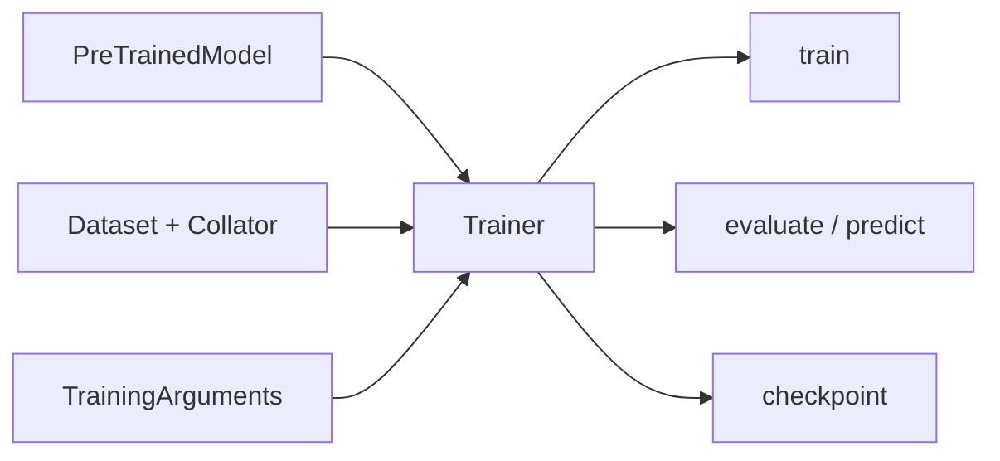

# Trainer

> 一句话摘要：Transformers Trainer 封装常见 PyTorch 模型的训练、评估、日志和 checkpoint 循环。**优先级：P0**。前置：[PyTorch](../01-Deep-Learning-Frameworks/PyTorch.md)、[Transformers](../02-Model-Libraries/Transformers.md)；后续：[TRL](TRL.md)。

## 层次、职责与工作流程

Trainer 是**训练 API**，不是独立算法；给定模型、数据、参数配置与可选指标计算函数后，它组织前向/反向、评估和保存。对于需要特殊损失/采样/对齐逻辑的任务，需检查子类、回调或改用更适合的训练器。



## 关键 API 与最小例子

```python
from transformers import BertConfig, BertForSequenceClassification, Trainer, TrainingArguments
from datasets import Dataset

model = BertForSequenceClassification(BertConfig(
    vocab_size=100, hidden_size=32, num_hidden_layers=1,
    num_attention_heads=4, intermediate_size=64, num_labels=2))
train_ds = Dataset.from_dict({"input_ids": [[1, 2, 0], [3, 4, 5]],
                              "attention_mask": [[1, 1, 0], [1, 1, 1]],
                              "labels": [0, 1]})
args = TrainingArguments(output_dir="./tmp-trainer-demo", max_steps=1,
                         per_device_train_batch_size=2, report_to="none")
trainer = Trainer(model=model, args=args, train_dataset=train_ds)
trainer.train()
```

这段示例需安装兼容 `torch`、`transformers`、`datasets`、`accelerate`，会写本地输出目录；**本次未运行验证**。用于真实分类时应另设 validation、指标函数与固定数据划分；`TrainingArguments` 字段可能随版本变化。

## 关系、优缺点与资料

Trainer 使用模型库、数据工具和执行层；PEFT 适配器可作为其模型输入。优点是减少样板代码，局限是特殊训练目标可能需定制。[Trainer 官方文档](https://huggingface.co/docs/transformers/main_classes/trainer)、[Transformers 训练指南](https://huggingface.co/docs/transformers/training)。访问日期：2026-11-05。学习顺序：手写循环 → Trainer → TRL。
