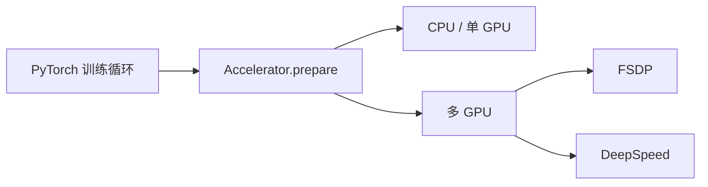

# Accelerate

> 一句话摘要：Accelerate 为 PyTorch 训练循环提供设备放置、混合精度和分布式执行抽象。**优先级：P0**。前置：[PyTorch](../01-Deep-Learning-Frameworks/PyTorch.md)、[训练循环](../../07-Training-Engineering/Training-Loop.md)；后续：[FSDP](FSDP.md)、[DeepSpeed](DeepSpeed.md)。

## 是什么、层次与职责

Accelerate 是**执行抽象层**，不实现 LoRA、SFT 或模型架构。通过 `Accelerator` 将模型、优化器和数据加载器准备到目标设备，并为多卡训练、混合精度和部分后端集成提供统一入口。真实扩展仍须理解梯度同步、batch 语义和 checkpoint。



## 最小用法

```python
from accelerate import Accelerator
import torch

accelerator = Accelerator()
model = torch.nn.Linear(4, 2)
optimizer = torch.optim.AdamW(model.parameters())
model, optimizer = accelerator.prepare(model, optimizer)
x = torch.randn(8, 4, device=accelerator.device)
y = torch.randint(0, 2, (8,), device=accelerator.device)
loss = torch.nn.functional.cross_entropy(model(x), y)
accelerator.backward(loss)
optimizer.step()
optimizer.zero_grad()
```

需已安装兼容 `accelerate` 与 `torch`；本次未执行。实际项目应把 DataLoader 一并传给 `prepare`，并用 `accelerate launch` 及相应配置启动分布式任务。

## 关系、限制与资料

Accelerate 抽象设备执行；FSDP/DeepSpeed 是可用的分布式后端或系统；Trainer/TRL 可利用 Accelerate。抽象层不能替代硬件容量与通信分析。[Accelerate 官方文档](https://huggingface.co/docs/accelerate)、[Quicktour](https://huggingface.co/docs/accelerate/quicktour)。访问日期：2026-11-05。
