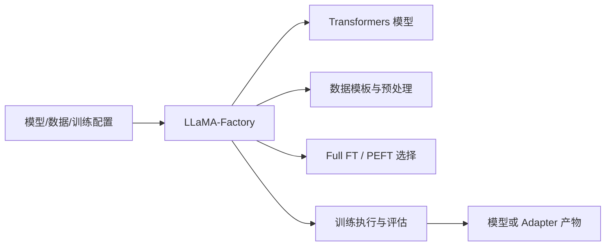

# LLaMA-Factory

> 一句话摘要：LLaMA-Factory 将模型、数据、训练方法、评估与导出组织成配置化微调流程。**优先级：P1**。前置：[Transformers](../02-Model-Libraries/Transformers.md)、[PEFT](../04-PEFT-and-Quantization/PEFT.md)；后续：[实践项目](../../11-Practical-Projects/README.md)。

## 是什么、层次与职责

它是集成式微调工具链，组合底层模型、数据、PEFT 与训练执行能力，减少实验配置和脚本拼接工作。它不是一种与 LoRA 并列的算法，也不是计算框架。应通过官方支持矩阵确认具体模型、数据格式、训练阶段和导出能力。

## 使用、环境、API 与局限

实际 Quickstart 以[官方文档](https://llamafactory.readthedocs.io/en/latest/)为准：先核对支持平台、Python/CUDA/依赖组合，再选模型和数据模板，明确训练目标与适配方式，检查输出产物。CLI/配置字段随版本变化，本页不提供未经锁定版本验证的命令。集成工具能提高试验速度，但隐藏默认值会影响 loss mask、目标模块和评估，应保留配置与日志。

## 关系与资料

PyTorch 是计算底座，Transformers 供模型，PEFT 供适配算法，Accelerate/DeepSpeed 等提供执行能力，LLaMA-Factory 负责组织工作流。[官方文档](https://llamafactory.readthedocs.io/en/latest/)、[官方仓库](https://github.com/hiyouga/LLaMA-Factory)。访问日期：2026-11-05。学习顺序：先理解手写/Trainer 微调，再使用集成平台。
