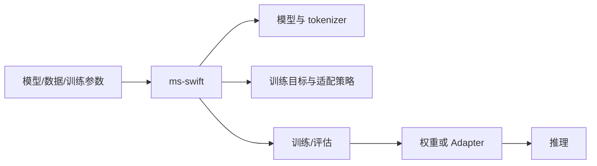

# ms-swift

> 一句话摘要：ms-swift 是 ModelScope 生态的模型训练、微调与推理工具链。**优先级：P1**。前置：[Transformers](../02-Model-Libraries/Transformers.md)、[PEFT](../04-PEFT-and-Quantization/PEFT.md)；后续：[实践项目](../../11-Practical-Projects/README.md)。

## 是什么、层次与职责

ms-swift 集成模型加载、数据处理、训练配置、适配器及推理/部署相关流程；它属于平台工具链，不是 LoRA、QLoRA 或 SFT 本身。支持模型、硬件和命令会演化，项目需锁定仓库版本与模型 revision。

## 使用、环境与局限

从[官方仓库 README](https://github.com/modelscope/ms-swift)进入当前 Quickstart，先检查安装、训练数据格式、模型清单与 CLI 参数，再运行小样本 smoke test。这里不固定安装命令或配置名，以免滚动版本误导。配置化训练要显式记录数据模板、loss 位置、适配目标、精度、随机种子和保存格式。

## 关系与资料

与 LLaMA-Factory 类似，它组织底层模型、PEFT 和执行层；选型应以目标模型支持、可定制性、团队已有生态及复现需要为准。[ms-swift 官方仓库](https://github.com/modelscope/ms-swift)。访问日期：2026-11-05；具体 API 版本待项目锁定。学习顺序：Transformers/PEFT → Trainer/TRL → ms-swift。
