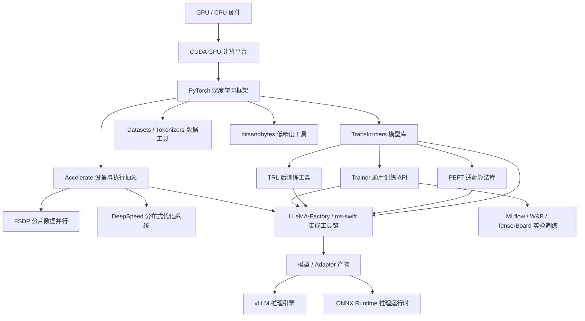

# Framework Ecosystem

> 一句话摘要：从底层计算到数据、模型、训练执行与推理服务，分别看清软件工具的职责。**优先级：P0**。前置：[知识地图](../KNOWLEDGE-MAP.md)；后续：[框架比较](../12-Comparisons/Framework-Comparison.md)。

箭头表示典型使用关系，不表示所有工具必须同时安装，也不承诺每个工具仅有一种后端。**FSDP 是分片执行技术，CUDA 是计算平台，LoRA 是方法，Trainer 是 API，vLLM 是推理引擎**；它们不能被当作同一类“训练框架”。更多交叉比较见[Framework Comparison](../12-Comparisons/Framework-Comparison.md)。

## 官方入口

[PyTorch](https://docs.pytorch.org/docs/stable/index.html) · [Transformers](https://huggingface.co/docs/transformers) · [PEFT](https://huggingface.co/docs/peft) · [Accelerate](https://huggingface.co/docs/accelerate) · [DeepSpeed](https://www.deepspeed.ai/) · [vLLM](https://docs.vllm.ai/)。访问记录见 [SOURCES](../SOURCES.md)。
