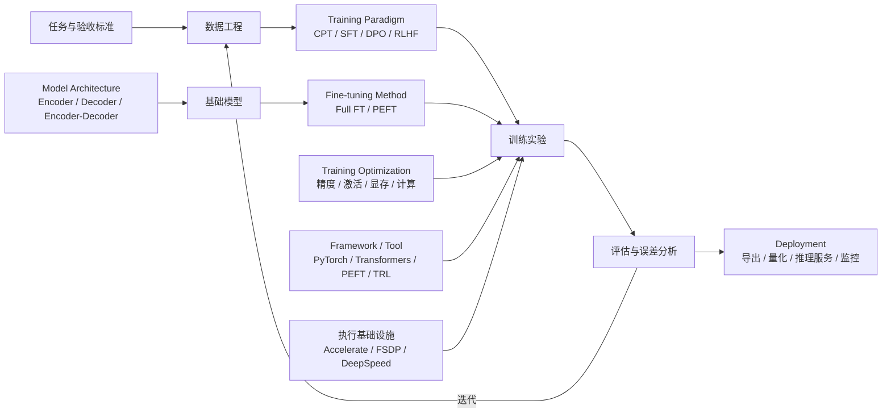

# 微调知识地图

> 一句话摘要：用独立维度表达一次 LLM 微调实验的选择。**优先级：P0**。前置：[训练生命周期](01-Foundations/LLM-Training-Lifecycle.md)；后续：[方法比较](12-Comparisons/Fine-Tuning-Methods-Comparison.md)。

| 组合示例 | 所在维度 | 不能推断什么 |
| --- | --- | --- |
| SFT + LoRA | 训练目标 + 更新策略 | LoRA 不限定 SFT |
| DPO + Full FT | 偏好目标 + 更新策略 | DPO 不等于 PEFT |
| QLoRA + NF4 | 量化基座 + 低秩适配 | 不能从参数量直接推出显存需求 |
| BF16 + FSDP | 数值格式 + 分片执行 | FSDP 不是微调算法 |

分类只是工程检索坐标。例如 QLoRA 常放在 LoRA 方法目录中以便查找，但其核心还包含 4-bit 基座量化；CUDA 是计算平台，不是深度学习框架。参见[框架生态图](04-Framework-Ecosystem/Framework-Ecosystem.md)。

## 对应的一手资料

[Transformer 原论文](https://arxiv.org/abs/1706.03762)、[LoRA 原论文](https://arxiv.org/abs/2106.09685)、[QLoRA 原论文](https://arxiv.org/abs/2305.14314)、[PyTorch 官方文档](https://docs.pytorch.org/docs/stable/index.html)、[PEFT 官方文档](https://huggingface.co/docs/peft)。资料的访问状态与日期统一见 [SOURCES](SOURCES.md)。
