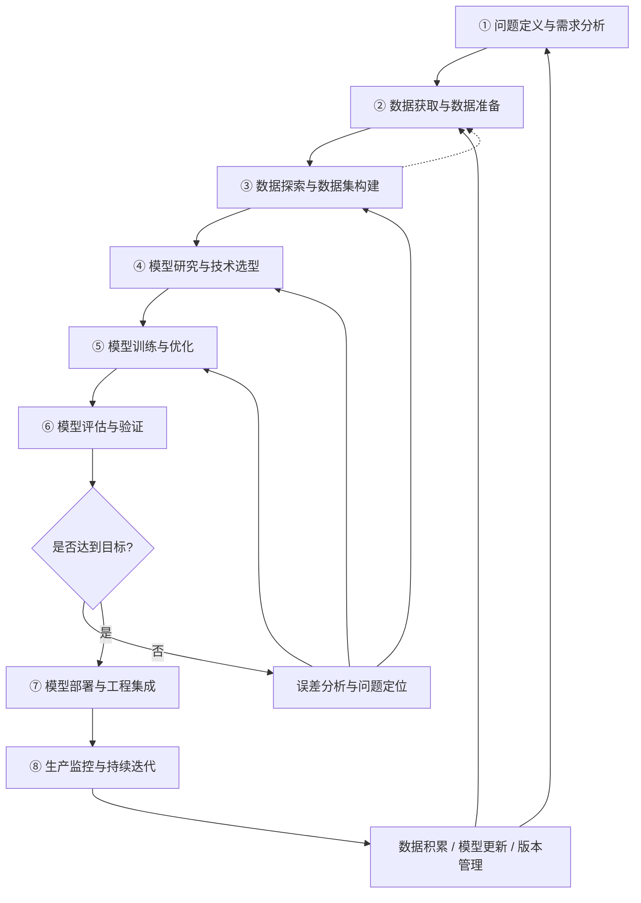

明白。你想要的应该不是数宝分类分级项目的流程图，而是一个通用的 AI/ML 模型研发与工程落地全生命周期，以后无论做文本分类、图像识别、预测模型、LLM 微调，还是企业 AI 模型应用，都能参考。

我建议把它抽象成 8 个核心阶段。

# 一、通用 AI/ML 模型研发全景图

这是一条主流程，但实际工程中，数据、模型、实验通常是反复迭代的，而不是严格的一次性线性流程。

# 二、八个阶段分别做什么？

| 阶段      | 核心工作               | 关键问题            | 主要产出        |
| ------- | ------------------ | --------------- | ----------- |
| 1. 问题定义 | 业务目标、任务定义、输入输出、约束  | 要解决什么问题？如何判断成功？ | 任务定义、指标要求   |
| 2. 数据获取 | 数据采集、数据来源、数据授权     | 数据从哪里来？是否可用？    | 原始数据        |
| 3. 数据准备 | 清洗、解析、标注、转换、数据集划分  | 如何让数据满足模型训练要求？  | 训练数据集       |
| 4. 模型研究 | 模型架构、预训练模型、算法、技术选型 | 什么模型适合当前任务？     | 模型方案、技术选型报告 |
| 5. 模型训练 | 训练、微调、超参数调整、优化     | 如何让模型学会目标任务？    | 训练好的模型      |
| 6. 模型评估 | 指标评估、对比实验、误差分析     | 模型是否达到预期？       | 评估报告、模型版本   |
| 7. 模型部署 | 推理服务、接口、资源管理、工程集成  | 如何让其他系统使用模型？    | 可运行的模型服务    |
| 8. 生产迭代 | 监控、反馈、数据积累、模型更新    | 模型上线后如何持续改进？    | 新版本模型       |

# 三、其中有几个容易混淆的阶段

## 1. 数据获取 ≠ 数据集构建

这是两个不同的工作。

数据获取（Data Acquisition）

从各种来源获取原始数据：

- 数据库
    
- API
    
- 公开数据集
    
- 企业内部文件
    
- 业务系统日志
    
- 传感器及设备
    

数据处理（Data Processing）

- 数据清洗
    
- 格式转换
    
- 缺失值处理
    
- 去重
    
- 特征提取
    
- 数据标注
    

数据集构建（Dataset Construction）

- 定义样本结构
    
- 定义标签及标注规范
    
- 训练集、验证集、测试集划分
    
- 数据质量检查
    

最终产出：可用于实验的数据集

不同学习范式的数据要求也不同：

|学习范式|典型数据要求|
|---|---|
|监督学习|输入数据 + 人工标签|
|无监督学习|输入数据，不要求人工标签|
|自监督学习|从原始数据构造训练目标|
|强化学习|状态、动作、奖励及交互过程|
|指令微调|指令、输入上下文、目标输出|

## 2. 模型研究 ≠ 模型训练

模型研究主要解决：

- 使用什么模型？
    
- 采用什么架构？
    
- 使用什么预训练模型？
    
- 是否需要微调？
    
- 采用什么损失函数？
    
- 需要哪些辅助组件？
    

模型训练才是具体执行：

- 加载数据。
    
- 初始化模型。
    
- 配置训练参数。
    
- 执行训练。
    
- 保存权重。
    
- 调整参数并重复实验。
    

## 3. 模型评估 ≠ 模型部署

模型评估关注模型本身的能力：

- 准确率、召回率、F1。
    
- 泛化能力。
    
- 鲁棒性。
    
- 推理速度。
    
- 资源消耗。
    

模型部署关注如何把模型变成可使用的工程能力：

- 模型加载。
    
- 推理接口。
    
- GPU/CPU 资源管理。
    
- 批量推理。
    
- 并发处理。
    
- 容器化部署。
    
- 服务监控。
    

# 四、模型研发过程中还存在三条贯穿全程的工作线

这三条不应该被当作独立的最后阶段，而是贯穿整个研发过程。

数据工程（Data Engineering）

数据采集、解析、清洗、标注、存储、版本管理、数据质量。

实验工程（Experiment Engineering）

实验配置、参数管理、实验记录、模型对比、指标追踪、可复现性。

模型工程（Model Engineering / MLOps）

模型注册、版本管理、部署、推理、监控、反馈、持续训练。

# 五、不同类型的 AI 项目，主流程有什么区别？

虽然整体生命周期相似，但不同任务的重点不同。

|项目类型|数据准备重点|模型研发重点|评估重点|
|---|---|---|---|
|文本分类|文本 + 分类标签|Encoder + 分类头|Precision、Recall、F1|
|图像识别|图片 + 标注|CNN、ViT 等|Accuracy、mAP|
|时间序列预测|历史时序数据|Transformer、LSTM 等|MAE、RMSE|
|LLM 指令微调|指令 + 目标回答|SFT、LoRA、QLoRA|任务效果、生成质量|
|RAG|文档 + 检索知识库|Embedding、Reranker、LLM|Recall@K、MRR、忠实度|
|强化学习|环境交互、奖励|Policy、Value 等|Reward、成功率|

注意，RAG 与传统监督学习模型训练并不是完全相同的流程，但同样需要数据准备、技术选型、实验评估和工程部署。

# 六、建议你沉淀成一份通用认知笔记

我建议标题就叫：

《AI/ML 模型研发与工程落地全生命周期》

以后你遇到一个新的模型任务，都可以先问自己：

1. Problem：我要解决什么问题？
    
2. Data：需要什么数据？数据从哪里来？
    
3. Dataset：如何处理数据、构建数据集？
    
4. Model：使用什么模型和架构？
    
5. Training：如何训练或微调？
    
6. Evaluation：如何验证模型效果？
    
7. Deployment：如何提供推理服务？
    
8. Iteration：如何监控、反馈和持续优化？
    