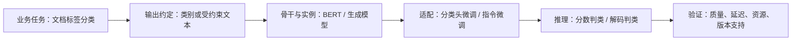

# NLP 模型多维分类体系

> 第一阶段的定位图。这里回答“一个名称究竟是什么”以及“不同层次如何组合”；具体模型性能、版本和选型结论留给后续专题。

## 1. 先辨认术语所在层次

“NLP 模型”常被用来统称不同对象，直接把名称排成单层树会造成错位。下面的维度是**描述同一系统的不同切面**，多数并不互斥。一个实际系统可以写成：

**任务需求 → 输入与输出约定 → 骨干架构与具体模型 → 训练目标和适配方法 → 推理与验证。**

| 层次      | 回答的问题                  | 例子                                        | 常见误判                          |
| ------- | ---------------------- | ----------------------------------------- | ----------------------------- |
| 骨干架构    | 信息怎样在网络中流动？            | 线性模型、CNN、RNN、Transformer、状态空间模型           | 把 Transformer 当成所有 NLP 模型的总称  |
| 结构形态    | Transformer 的哪种结构用于读写？ | Encoder-only、Decoder-only、Encoder-Decoder | 把这三项当成任务分类                    |
| 模型实例    | 使用哪一组具体模型设计和权重？        | BERT-base、T5-base、某个 Qwen checkpoint      | 用家族名称推断每个版本的能力                |
| 学习目标    | 训练时模型根据什么信号更新？         | MLM、下一词预测、span corruption、对比学习            | 把目标当成网络架构                     |
| 输出或交互机制 | 系统怎样给出结果？              | 向量、类别分数、逐 token 标签、文本生成、文本对分数             | 把 Embedding 或 Reranker 当成唯一架构 |
| 业务任务    | 结果要解决什么问题？             | 分类、NLI、NER、检索、摘要、抽取                       | 把任务名当成具体模型名                   |
| 适配与训练   | 如何得到所需能力、更新哪些参数？       | 全量微调、冻结骨干加任务头、LoRA、SFT                    | 把 LoRA 或 SFT 当成推理模型           |

## 2. 维度 A：骨干架构

这一维描述模型的**计算结构**，适用于传统方法和神经网络。`Seq2Seq` 更严格地说是“输入序列映射到输出序列”的建模框架，可由 RNN 或 Transformer 实现，因而与其余条目有交叉。

| 类别               | 核心机制                     | 常见位置                            |
| ---------------- | ------------------------ | ------------------------------- |
| 规则、统计与传统机器学习     | 人工规则、词频特征、线性分类器或其他浅层学习器  | 词典规则、TF-IDF + SVM、CRF 等基线       |
| 静态词向量与浅层网络       | 词有相对固定的向量，使用浅层结构汇聚文本     | word2vec 词向量、fastText           |
| CNN              | 局部卷积提取 n-gram 样式特征，再汇聚   | TextCNN 文本分类                    |
| RNN / LSTM / GRU | 逐步更新状态；门控结构改善长距离信息保留     | 序列标注、早期编码器与解码器                  |
| Seq2Seq          | 将输入编码为条件信息，再生成输出序列       | RNN Seq2Seq、Transformer 编码器-解码器 |
| Transformer      | 以注意力为核心组合序列表示；具体可选不同结构形态 | BERT、T5、众多生成模型                  |
| 状态空间模型           | 以状态更新建模序列，具体机制取决于实现      | Mamba 系列                        |
| 混合架构             | 在同一系统中结合不同模块             | 需按具体版本说明组合方式                    |

这些类别不是一条“旧模型被新模型淘汰”的排他序列。传统方法仍可在少量数据、严格延迟或可解释性需求下作为基线；是否适用要用同一业务数据验证。[Transformer 原论文](https://arxiv.org/abs/1706.03762)提出基于注意力的序列转换结构；[Mamba 原论文](https://arxiv.org/abs/2312.00752)给出选择性状态空间模型的实例。

## 3. 维度 B：Transformer 内部结构

此维度**只对 Transformer 及其变体适用**，不能用于 SVM、TextCNN 等模型。名称描述主要的信息流设计，不保证某任务自动可用。

| 结构 | 信息流与典型输出 | 常见实例 | 边界 |
| --- | --- | --- | --- |
| Encoder-only | 输入位置之间进行双向上下文编码，输出各位置表示 | BERT | 通常接分类、标注、向量化或打分模块；原始 BERT 不是通用自回归生成器 |
| Decoder-only | 使用因果掩码，根据先前 token 预测后续 token | GPT 类、Llama、Qwen 的许多语言模型版本 | 可通过提示或训练做分类、抽取；输出仍需格式与质量验证 |
| Encoder-Decoder | 编码输入，解码器在输入条件下逐步生成输出 | 原始 Transformer、T5、BART | 适于序列到序列任务，也能将分类转写为文本生成 |

## 4. 维度 C：预训练目标

预训练目标定义学习信号，**与架构相关但不是同义词**。一个模型可能组合多个目标，训练阶段也可能更换目标。

| 目标                            | 训练信号               | 典型关系                               |
| ----------------------------- | ------------------ | ---------------------------------- |
| Masked Language Modeling（MLM） | 遮盖部分输入 token 并预测它们 | BERT 的重要预训练目标；不等于 Encoder-only 的定义 |
| Causal Language Modeling（CLM） | 根据前缀预测下一个 token    | 常用于 Decoder-only 语言模型              |
| Denoising / Span Corruption   | 扰动或遮盖连续片段并重建       | T5 等文本到文本模型                        |
| 对比学习                          | 拉近相关样本表示、区分不相关样本   | 常用于句向量、检索模型的适配                     |
| 其他自监督或监督目标                    | 如句间关系、排序、指令响应等     | 必须查具体模型及训练阶段，不能仅凭家族名推断             |

依据：[BERT 原论文](https://arxiv.org/abs/1810.04805)、[T5 原论文](https://arxiv.org/abs/1910.10683)。

## 5. 维度 D：输出与交互机制

这一维描述模型**如何产生可消费的结果**。它可能包含任务头、池化方法、文本对输入组织或解码策略。

| 机制                | 输入 → 输出               | 典型用途                    |
| ----------------- | --------------------- | ----------------------- |
| 文本向量表示（Embedding） | 单段文本 → 向量；两段文本分别编码后比较 | 大规模召回、聚类、相似度            |
| 分类或评分头            | 一段文本或文本对 → 类别分数、标量    | 分类、NLI、相关性打分            |
| Token 级标签         | 文本 → 每个 token 的标签或跨度  | NER、序列标注                |
| 文本生成              | 输入/提示 → 输出 token 序列   | 问答、摘要、翻译、生成式分类          |
| 结构化抽取             | 文本 → 实体、关系、字段或结构化文本   | 信息抽取、UIE；可由标注、跨度预测或生成实现 |

**Bi-Encoder / Cross-Encoder** 是文本对的编码组织方式：前者分别编码、便于预计算和向量检索；后者联合编码文本对，常对候选结果逐对打分。`Reranker` 是重排角色，常由 Cross-Encoder 实现，但不限定只能使用这一架构；两阶段系统可先召回再重排。[Sentence Transformers 官方说明](https://www.sbert.net/examples/cross_encoder/applications/README.html)。

## 6. 维度 E：业务任务

任务由**输入、期望输出和评价标准**定义，不由某个模型名称定义。同一任务可由多种机制实现；同一骨干也可适配多个任务。

| 任务簇 | 示例 | 常见输出机制 |
| --- | --- | --- |
| 文本判别 | 单标签、多标签、层级分类、情感分析 | 类别分数或受约束的类别文本 |
| 文本对理解 | 匹配、NLI、语义相似度 | 文本对分类、相似度或生成答案 |
| 序列与结构化抽取 | NER、字段抽取、关系抽取、UIE | Token 标签、跨度、结构化生成 |
| 检索与排序 | 语义检索、候选重排 | 向量相似度或文本对分数 |
| 序列到序列 | 摘要、翻译、改写 | 文本生成 |
| 问答与生成 | 阅读理解、开放问答、文本生成 | 答案跨度或生成文本 |

几个易混边界：`NLI` 是判断前提与假设关系的文本对任务，可用分类头实现；`NER` 是实体识别任务；`UIE` 指更广的信息抽取框架或具体实现，需说明实体、关系和事件等目标范围。`Sequence Classification`、`Token Classification` 则通常描述输出头所服务的预测粒度，不能与 NLI、NER 简单列成同一层级。

## 7. 维度 F：训练阶段与适配方式

此维度本身还须分两层：**训练处于哪个阶段**，以及**哪些参数被更新**。这些方法可组合。例如，用标注样本进行 SFT，同时用 LoRA 更新部分参数。

| 子维度     | 项目                                                          | 含义                    |
| ------- | ----------------------------------------------------------- | --------------------- |
| 学习阶段/信号 | 从头监督训练、自监督预训练、监督微调（含 SFT）、偏好优化、蒸馏                           | 说明数据与目标怎样产生训练信号       |
| 参数更新范围  | 全量微调、冻结骨干只训练任务头、Adapter、LoRA / QLoRA、Prompt / Prefix Tuning | 说明更新模型的哪一部分、怎样节约训练资源  |
| 推理方式    | 分类头、向量相似度、Cross-Encoder 打分、自回归生成、约束解码                       | 说明训练后怎样得到最终答案；不属于微调方法 |

`PEFT` 是参数高效微调方法集合，LoRA 是其中一种；QLoRA 将量化基座与 LoRA 微调结合。方法是否适配某模型结构与实现，需要检查具体框架和 checkpoint。[LoRA 原论文](https://arxiv.org/abs/2106.09685)、[QLoRA 原论文](https://arxiv.org/abs/2305.14314)。

## 8. 将维度组合成具体模型说明

**例：BERT 做三种任务。** BERT 是具体的 Transformer Encoder-only 模型家族，原始预训练包含 MLM 等目标。[BERT 原论文](https://arxiv.org/abs/1810.04805)描述了其表示及下游适配。给它接序列分类头，可用带标签数据训练文本分类或 NLI；接 Token 分类头，可做 NER；接池化与适当的句向量训练目标，可形成 Embedding 模型。若把文本对联合输入并训练相关性打分头，可作为 Reranker。这些是**基于同一类骨干的不同训练与实现路径**，不是声称原始 BERT 权重直接具备所有效果。

**例：生成模型做分类。** 一个 Decoder-only 模型可把“输入文本 → 规定标签”写成生成任务，经提示或监督微调输出类别文本。此时架构仍是 Decoder-only，任务仍是分类，机制变成自回归生成；实际使用还要验证标签约束、稳定性、吞吐和成本。

## 9. 后续专题的研究顺序

1. **01 技术演进**：按问题与突破梳理规则、统计、静态向量、CNN/RNN、Attention/Seq2Seq、Transformer、PLM/LLM、状态空间与混合架构；同时注明当今适用场景。
2. **03 架构与原理**：逐类说明输入表示、token 流、信息交互、训练目标、输出、优势与限制，配简例。
3. **05 能力与任务映射**：集中拆解 Base Model、任务头、Embedding/Reranker、分类/NLI、NER/UIE 和生成式分类。
4. **06 训练微调与推理**：以训练阶段、参数范围、推理机制三张表避免混层。
5. **04 代表模型图谱**：在上述口径稳定后逐版本记录 BERT、T5、Qwen、BGE、Mamba 等；查原始论文、官方模型卡和发布版本。
6. **07 选型方法**：建立从业务任务、样本、文本长度、语言、指标、资源到候选与实验验证的 SOP，并用企业文档分类与综合评分作演示。
7. **08 总结**：整合分类图、任务映射及验证边界，建立导航。

研究时先固定维度，再填充模型实例。性能指标、参数量、上下文长度和语言支持只在核对具体版本后记录；对“架构可行”“官方实现支持”“实际实验验证”分别标注。
