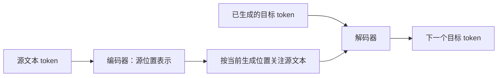
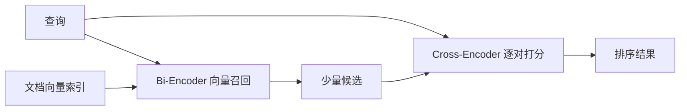

# 主要模型架构与原理

> 目标：看到一个 NLP 系统时，能说明文本如何进入模型、信息如何在 token 间流动、模型如何产出任务结果。本文讨论机制；具体模型版本与实测效果留给模型图谱和选型专题。先阅读[多维分类体系](02-NLP模型多维分类体系.md)可以避免把架构、任务和训练目标混为一谈。

## 1. 一条共同的处理链

以“这份合同缺少签署日期”为输入，目标是判断是否存在“日期缺失”问题。不同模型通常都要经过下面四步，但每步的实现不同：

- **切分与表示**：传统方法可用词或字符 n-gram 的稀疏计数；神经模型一般先切成 token ID，再查表得到向量。token 不必等同于汉字、词或完整单词，具体边界由 tokenizer 决定。
- **位置与上下文**：顺序敏感模型需要区分“甲影响乙”和“乙影响甲”。CNN 由局部窗口保留局部顺序，RNN 由递推顺序引入位置，Transformer 则需显式或隐式的位置机制；具体实现不能一概而论。
- **任务输出**：骨干产生表示，任务头或解码过程把表示转为分类分数、token 标签、向量、文本对分数或下一个 token 的概率。这个环节决定“同一骨干如何做不同任务”。

## 2. 传统特征模型与浅层网络：先把文本变成可学习的数值

### TF-IDF + SVM

输入文档先切分为词或 n-gram，再计算每个特征的权重：文档中较常见、整个语料中较稀有的词通常得到更高权重。于是每篇文档成为一个**稀疏向量**，SVM 在标注样本上学习分类边界，预测时输出类别或决策分数。这里没有 token 之间的深层上下文编码；交换词序后，如使用词袋特征，表示可能几乎不变。加入 n-gram 可保留部分局部顺序。[Joachims 的文本分类论文](https://www.cs.cornell.edu/people/tj/publications/joachims_98a.pdf)给出稀疏文本特征与 SVM 的早期实例。

**适用与局限**：训练和推理成本低，容易检查高权重词，适合作为分类基线；对复杂语义、否定和长距离依赖需要靠特征设计弥补。例如“必须签字”和“不得签字”若只保留单词计数，可能过于接近。

### 静态词向量与 fastText

词向量方法为词学习稠密表示，使相似用法的词可共享统计信息。[word2vec 论文](https://arxiv.org/abs/1301.3781)展示了从大规模语料学习词表示。fastText 文本分类把词及词组表示汇聚后接线性分类器，追求高效训练和预测。[fastText 分类论文](https://arxiv.org/abs/1607.01759)。

它们与 TF-IDF 的主要差异是**学习到可复用的稠密表示**；与 BERT 一类上下文化编码器的主要差异是：静态词表示通常不会因一句话里其他词改变自身含义。注意 fastText 也有词向量相关实现，看到名称时要先查明讨论的是哪一种模型/任务。

## 3. CNN：从局部片段抽取特征

TextCNN 的典型流程是：`token → 词向量序列 → 多种宽度的卷积核 → 非线性变换 → 池化 → 分类头`。[Kim 的 TextCNN 论文](https://aclanthology.org/D14-1181/)展示了用预训练词向量和卷积做句子分类。

假设窗口宽度为 3，卷积核会扫描“合同 / 缺少 / 日期”“缺少 / 日期 / 签署”等连续片段，学习对标签有用的局部模式。最大池化从各位置选出强响应，使句长不同的输入也能形成固定长度表示。它擅长捕捉局部 n-gram 样式线索；如果判断依赖相隔很远的两处证据，单层局部卷积并不直接解决这一问题，需要更深层、扩张卷积或其他机制。

**关键定位**：CNN 是骨干计算机制；TextCNN 是将它用于文本的模型设计；“文本分类”是任务。CNN 也可参与其他 NLP 任务，不能把三者等同。

## 4. RNN / LSTM / GRU：顺序更新状态

RNN 逐步读入 token，用上一步状态与当前输入产生新状态。可用简化式表示为 `h_t = f(h_{t-1}, x_t)`：`x_t` 是当前位置的向量，`h_t` 是读到该位置后的上下文状态。输入“合同 → 缺少 → 签署 → 日期”时，后面的状态可以携带前面的信息。

普通 RNN 的长距离依赖训练较困难。**LSTM** 引入记忆单元和门控，控制什么信息被写入、保留和输出；**GRU** 使用另一种较简洁的门控设计。[LSTM 原论文（作者提供）](https://people.idsia.ch/~juergen/lstm1997-2024head.pdf)、[GRU 所在的 RNN Encoder–Decoder 论文](https://aclanthology.org/D14-1179/)。门控缓解长依赖问题，但不意味着能够无损记住任意长文本。

单向 RNN 在时刻 `t` 只利用已读前缀；**BiLSTM** 让正反两个方向分别读完整输入，再合并位置表示，适合 NER 等“先读完整段文本再标注”的任务。序列计算有前后依赖，难以像 Transformer 编码器那样在所有位置上完全并行。

**输出怎么来**：整句分类可对最终状态或所有状态汇聚后接分类头；逐 token 标注则对每个位置状态接标签预测头，必要时再加 CRF 等结构化解码组件。

## 5. Seq2Seq 与 Attention：输入序列条件下生成输出

Seq2Seq 是一种**输入序列到输出序列的建模框架**，不是专指某种网络。早期实现用 RNN/LSTM 编码输入，再由另一个 RNN/LSTM 逐步生成译文。[Sutskever 等的 Seq2Seq 论文](https://arxiv.org/abs/1409.3215)。

若解码器只得到一个固定长度的输入摘要，长句的细节容易被压缩。Attention 让解码器生成第 `t` 个词时，对输入各位置计算不同权重，再汇总当前需要的信息。例如译出日期时可重点参考原文的日期片段。[Bahdanau 等的注意力论文](https://arxiv.org/abs/1409.0473)。

Attention 可以嵌入 RNN Seq2Seq，也可以出现在 Transformer 内部；**“有 Attention”并不自动等于 Transformer**。这一框架适合翻译、摘要等长度可变的输出。训练通常需要输入—目标输出配对；具体损失和解码算法需看实现。

## 6. Transformer：用注意力组织位置间的信息交互

### Self-Attention 到底做了什么

每个位置的输入表示经可学习映射形成 `Q`（查询）、`K`（键）、`V`（值）。一个位置的 `Q` 与可见位置的 `K` 比较，得到权重，再加权汇总这些位置的 `V`。原论文的缩放点积形式为：

`Attention(Q, K, V) = softmax(QKᵀ / √dₖ + M)V`

其中 `dₖ` 是键的维度；`M` 表示可选的加性可见性掩码，不可见位置取负无穷并在 softmax 后得到零权重。多头注意力让多组投影并行学习不同关系。该式描述**信息怎么混合**，并不表示注意力权重必然是可靠的因果解释。[Transformer 原论文](https://arxiv.org/abs/1706.03762)。

### 位置、掩码与输出

纯粹的位置间加权本身不能充分表达词序，因此模型还需要位置编码或其他位置机制；原始 Transformer 使用位置编码。Transformer 层通常还有前馈网络、残差连接和归一化。模型能看到哪些位置由结构及掩码决定：编码器通常允许输入位置相互可见；自回归解码器用因果掩码阻止当前位置看到未来目标 token；编码器—解码器还通过交叉注意力读取源文本。

训练时可在多个输入位置并行计算，但标准全局注意力对序列长度有较高计算/内存成本；实际开销受注意力实现、缓存、硬件和长度影响。推理时自回归生成仍须逐步产生后续 token。

| 结构 | 输入位置能看见什么 | 常见输出路径 | 代表模型 |
| --- | --- | --- | --- |
| Encoder-only | 完整输入中的左右上下文 | 位置表示/汇聚表示 → 任务头 | BERT |
| Decoder-only | 先前输入与已生成内容 | 下一 token 概率 → 逐步解码 | GPT 类模型 |
| Encoder-Decoder | 编码器看源文本；解码器看历史目标并读取编码器输出 | 条件下一 token 概率 → 逐步解码 | T5、原始 Transformer |

这是**Transformer 内部结构维度**，不是 NLP 全部架构的分类。三者可用于相同业务任务，但训练目标、输入格式和输出约束会不同。

## 7. BERT：双向编码与任务头

BERT 是 Encoder-only Transformer 模型家族。它对完整输入做双向上下文编码；原始 BERT 的预训练使用 Masked Language Modeling（MLM）及句间关系目标。MLM 把部分位置遮盖，让模型结合左右信息恢复内容，这与“只用前缀预测下一个 token”不同。[BERT 原论文](https://arxiv.org/abs/1810.04805)。

对“合同缺少签署日期”，BERT 会先产生各 token 的上下文化表示。若接**序列分类头**，可汇聚整段信息并输出“日期缺失”的分数；若接**token 分类头**，可给“签署日期”等位置打标签；若接问答跨度头，则预测答案起止位置。任务头与目标标注数据决定训练后的具体能力。原始 BERT 权重**不能因架构允许就视为已训练好的高质量句向量或 Reranker**。

## 8. GPT 类：因果语言建模与自回归生成

Decoder-only 模型使用因果掩码，让当前位置依据先前 token 预测后续 token。训练目标可写成 `P(x₁, …, xₙ) = ∏ₜ P(xₜ | x₍₁:ₜ₋₁₎)`；生成时反复采样或选择下一个 token，直到满足停止条件。[GPT 早期论文](https://cdn.openai.com/research-covers/language-unsupervised/language_understanding_paper.pdf)。

做分类时可写提示：“判断是否缺少日期，只输出 是/否：合同缺少签署日期”。模型继续生成类别文本。此时**任务是分类，机制是生成**；“只输出”是期望，不等于模型一定遵守，生产使用需验证约束、解析失败和误判。生成也可写出摘要、翻译或结构化字段，但效果依赖具体 checkpoint、训练与解码设置。

## 9. T5：编码器—解码器与文本到文本

T5 使用 Encoder-Decoder Transformer，将不同 NLP 任务统一表述为文本输入与文本输出。其预训练采用去噪方式，常见形式是遮盖连续片段，让解码器重建缺失内容。[T5 原论文](https://jmlr.org/papers/v21/20-074.html)。

例如 `classify: 合同缺少签署日期` → `日期缺失`，或者 `summarize: ...` → 一段摘要。输入先由编码器形成上下文表示，解码器逐步生成目标文本，并通过交叉注意力利用输入。**“文本到文本”是任务表达与输出机制**，不是说 T5 只能生成自由文本；分类标签也可作为短文本输出。能否稳定输出指定标签，仍需具体训练和评估。

## 10. Embedding、Bi-Encoder 与 Cross-Encoder：文本对怎么比较

**Embedding 模型**的目标是把一段文本变成可比较的向量。常见 Bi-Encoder 把查询 `q` 与候选文档 `d` 分别编码：`u = f(q)`、`v = f(d)`，再算余弦相似度或点积。候选向量可提前计算并建立索引，适合从大量文档中召回候选。但仅从原始 BERT 输出做平均池化，不能保证向量空间符合语义检索需求；通常还需相应训练目标。[Sentence-BERT 原论文](https://arxiv.org/abs/1908.10084)。

**Cross-Encoder** 将 `q` 和 `d` 联合送入模型，使两段文本在编码过程中直接交互，再输出相关性分数或类别。它可以细看词与词的对应，但每个候选都要单独计算，通常用于对已召回的较少候选做重排。Cross-Encoder 是**文本对组织方式**，Reranker 是系统中的**重排角色**；某些生成模型也可对文本对打分，不能把 Reranker 等同于 BERT 或唯一的 Cross-Encoder 架构。[Sentence Transformers 官方说明](https://www.sbert.net/examples/cross_encoder/applications/README.html)。

## 11. 状态空间模型：另一种序列信息流

状态空间模型通过状态递推携带序列信息。用示意式表示：`hₜ = Aₜhₜ₋₁ + Bₜxₜ`，`yₜ = Cₜhₜ`。其中状态如何更新、参数是否随输入变化，取决于具体模型。Mamba 的关键设计是**选择性**：让部分状态空间参数依赖当前输入，以便决定哪些信息进入或退出状态。[Mamba 原论文](https://arxiv.org/abs/2312.00752)。

这一式子只帮助理解信息流，不是完整的 Mamba 实现。Mamba 与 Transformer 是骨干机制的不同路线；混合模型也可把两种模块组合。某论文在特定长度和硬件上得到的速度、内存或质量结论，不能直接套用到自己的文档任务。

## 12. 用同一任务检查差异

给定“合同缺少签署日期”，目标都可以是“日期缺失”，但实现路径不同：

| 路径 | 主要输入表示与交互 | 如何得到答案 | 特别需要验证 |
| --- | --- | --- | --- |
| TF-IDF + SVM | 稀疏词/n-gram 特征；无深层上下文交互 | 分类边界分数 | 否定、同义表达、分词与特征覆盖 |
| TextCNN | 词向量 + 局部卷积 + 池化 | 分类头 | 长距离依赖、窗口与文本长度 |
| BiLSTM | 顺序状态 + 双向上下文 | 汇聚后分类头 | 长文信息保留、训练/推理成本 |
| BERT | 双向自注意力编码 | 微调后的分类头 | 训练数据、截断长度、版本支持 |
| 生成模型 | 因果自注意力或编码器—解码器 | 生成指定标签文本 | 格式约束、误判、延迟与成本 |

上表只解释机制，不给出普遍性能排名。下一步研究具体模型时，应分别记录**架构可行、公开权重/框架支持、业务数据验证**三个证据层级；同一架构下的不同版本也要分别核对。
