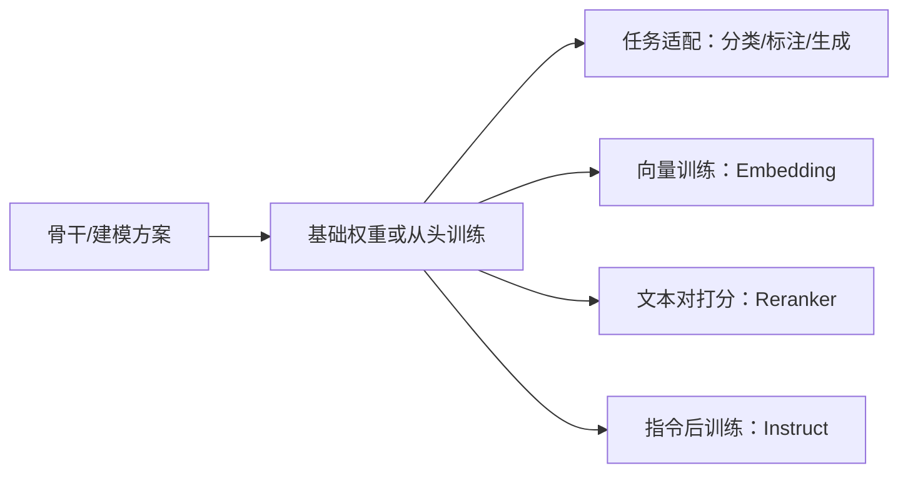

# 代表模型知识图谱

> 这是按**具体版本或明确的模型方案**组织的认知卡片，不是性能排行榜。每张卡说明发布者、骨干与训练目标、输入输出、基础/任务模型身份、适配方式、语言与长度边界及来源。架构机制见[03](03-主要模型架构与原理.md)；同一骨干怎样转成任务模型见[05](05-模型能力与NLP任务映射.md)。

## 读卡约定

- **模型家族 ≠ checkpoint**：不同大小、代际、Base/Instruct、Embedding/Reranker 的权重和能力不能混用。卡片内的版本只代表该条目。
- **“可适配” ≠ “已验证”**：加任务头、全量微调、LoRA 等是可能路径，是否支持须检查具体实现；性能、延迟和资源需在目标数据与设备上实测。
- **长度和语言**：只引用模型卡明确声明的支持范围；若卡片没有充分信息，就写“待按配置与实测核对”。长文还涉及 tokenizer 截断、训练长度、推理内存和任务质量，不能只看一个数字。
- **论文方案**：TF-IDF + SVM、TextCNN、BiLSTM-CRF、fastText 分类器是可复现的方法/模型设计，不存在统一的一个官方预训练 checkpoint。

## A. 传统与较早的神经模型

### 1. TF-IDF + SVM（方案，无统一权重）

- **发布与定位**：TF-IDF 特征结合 SVM 文本分类；[Joachims 1998 原论文](https://www.cs.cornell.edu/people/tj/publications/joachims_98a.pdf)是代表性实例。属于监督训练的任务模型方案，不是预训练基础模型。
- **架构、目标与输入输出**：词或 n-gram → 稀疏加权向量 → SVM 分类边界；以标注类别训练，输出决策分数/类别，不适用 MLM、CLM 等语言模型预训练目标。
- **适配与边界**：改标签需重新训练分类器；多标签可采用相应多输出策略。语言由分词和训练语料决定，长文可编码但特征与质量要验证；适合作为低成本文档分类基线。

### 2. fastText 监督分类器（方案，无统一权重）

- **发布与定位**：Facebook AI Research 的浅层文本分类方法；不是“fastText 的某一个公共预训练分类权重”。[原论文](https://arxiv.org/abs/1607.01759)、[官方监督训练教程](https://fasttext.cc/docs/en/supervised-tutorial.html)。
- **架构、目标与输入输出**：词/词组特征经稠密表示和汇聚，接线性分类器；用带标签样本监督训练，输入文本、输出类别/分数。
- **适配与边界**：更换业务标签需要重新训练；语言与文本长度效果取决于分词/字符 n-gram、训练样本和实现设置。适合追求轻量、CPU 吞吐的分类基线；fastText 词向量是另一种用法。

### 3. TextCNN（Kim 2014 方案，无统一权重）

- **发布与定位**：Yoon Kim 的句子分类 CNN 设计；论文中的方案不是一个可通用于所有语言的 checkpoint。[原论文](https://aclanthology.org/D14-1181/)。
- **架构、目标与输入输出**：词向量序列 → 多窗口卷积 → 池化 → 分类头；目标是标注类别的监督学习，输入句子、输出类别分数。
- **适配与边界**：可使用预训练词向量或任务数据训练，分类头与卷积参数按任务更新；语言由词表/词向量决定，长文和远距离证据需实测，适合局部模式明显的分类任务。

### 4. BiLSTM-CRF（序列标注方案，无统一权重）

- **发布与定位**：双向 LSTM 提取上下文、CRF 建模标签序列约束的组合；[Huang 等原论文](https://arxiv.org/abs/1508.01991)、[Ma 与 Hovy 的词/字符特征实例](https://aclanthology.org/P16-1101/)。
- **架构、目标与输入输出**：token/字符表示 → 正反向递推 → 每位置标签分数 → CRF 解码标签序列；需要带边界与类别的监督标注，输出实体等序列标签。
- **适配与边界**：换实体体系需重训输出层与相关参数；语言和文本长度能力由词表、分段及训练范围决定。适合 NER 等结构化标注，不能把 BiLSTM 当成单一预训练模型家族。

## B. Encoder-only 预训练模型

### 5. BERT：`google-bert/bert-base-uncased`

- **发布与身份**：Google 的英文 uncased 基础权重；Transformer Encoder-only，属于可适配的基础模型。[BERT 原论文](https://arxiv.org/abs/1810.04805)、[该版本模型卡](https://huggingface.co/google-bert/bert-base-uncased)。
- **目标与输入输出**：原始 BERT 采用 MLM 与 NSP 预训练；文本或文本对 → 上下文化 token 表示。接任务头后可输出分类、token 标签、问答跨度；这些不是基础权重自动完成的业务结果。
- **适配与边界**：可全量微调或冻结骨干训练任务头，LoRA 等须核对框架；此卡是英文版本，长文超过配置长度需切分或选经验证的长文模型。适合编码理解任务基线，不能据此声称高质量语义检索向量。

### 6. RoBERTa：`FacebookAI/roberta-base`

- **发布与身份**：Facebook AI/Meta 的英文基础权重，BERT 路线的 Encoder-only 模型。[RoBERTa 原论文](https://arxiv.org/abs/1907.11692)、[该版本模型卡](https://huggingface.co/FacebookAI/roberta-base)。
- **目标与输入输出**：优化 BERT 式预训练，主要使用动态 MLM，原论文移除 NSP；输入文本或文本对，输出上下文化表示，需任务头才能得到分类或标注结果。
- **适配与边界**：可按任务微调、冻结头或检查 PEFT 实现；英文卡片不等于中文版本。标准输入长度以 tokenizer/配置为准，长文需另行验证。适合作为分类、NLI、序列标注等编码器候选。

### 7. MacBERT：`hfl/chinese-macbert-base`

- **发布与身份**：哈工大讯飞联合实验室（HFL）的中文基础权重，Encoder-only BERT 路线。[MacBERT 原论文](https://arxiv.org/abs/2004.13922)、[该版本模型卡](https://huggingface.co/hfl/chinese-macbert-base)。
- **目标与输入输出**：使用 correction 风格的掩码语言建模改进中文预训练；输入中文文本/文本对，输出 token 表示，分类或 NER 仍需相应任务头与训练。
- **适配与边界**：可微调分类/标注头；中文预训练方向更贴近中文任务，但不是长文或任意行业语料效果保证。输入长度按该 checkpoint 配置核对。

### 8. DeBERTa v1：`microsoft/deberta-base`

- **发布与身份**：Microsoft 的英文基础权重，Encoder-only Transformer 变体；此处明确为 **v1 base**，不与 DeBERTa-v3 混称。[DeBERTa 原论文](https://arxiv.org/abs/2006.03654)、[该版本模型卡](https://huggingface.co/microsoft/deberta-base)。
- **目标与输入输出**：采用解耦内容/位置表示的注意力与增强的 mask decoder；以掩码预训练为主，输入文本/文本对，输出上下文化表示。
- **适配与边界**：下游分类、NLI 等需任务头及监督微调；英文模型，长度按版本配置核查。论文中其他版本或任务分数不可自动转记到 `deberta-base`。

### 9. ModernBERT：`answerdotai/ModernBERT-base`

- **发布与身份**：Answer.AI 等推出的英文 Encoder-only 基础权重。[ModernBERT 论文](https://arxiv.org/abs/2412.13663)、[该版本模型卡](https://huggingface.co/answerdotai/ModernBERT-base)。
- **目标与输入输出**：MLM 预训练；输入文本，输出上下文化 token 表示，任务分类、检索等仍需相应训练/头部或专用权重。
- **适配与边界**：官方论文/模型卡说明原生较长输入支持（8,192 token）；是否适合某长文任务需测实际质量与内存。此版本以英文为主，不能据“长上下文”标签推断中文文档可用性。

## C. Encoder-Decoder 与生成模型

### 10. T5：`google-t5/t5-base`

- **发布与身份**：Google 的英文 T5 基础权重，Transformer Encoder-Decoder。[T5 原论文](https://jmlr.org/papers/v21/20-074.html)、[该版本模型卡](https://huggingface.co/google-t5/t5-base)。
- **目标与输入输出**：以 span corruption 等去噪目标预训练；输入任务前缀/源文本，解码器输出目标文本。分类、摘要、翻译等可被写成 text-to-text，但基础权重的具体任务效果仍需适配与评估。
- **适配与边界**：可用任务输入—输出对微调，参数更新范围可全量或检查 PEFT 支持；该卡不能代表所有 T5 大小及中文能力，输入/输出长度需按配置和任务测试。

### 11. mT5：`google/mt5-base`

- **发布与身份**：Google 的多语言 T5 基础权重，Encoder-Decoder；与英文 `t5-base` 是不同权重。[mT5 原论文](https://arxiv.org/abs/2010.11934)、[该版本模型卡](https://huggingface.co/google/mt5-base)。
- **目标与输入输出**：在多语言语料上用去噪目标预训练；文本输入 → 文本输出，需针对翻译、分类、摘要等目标任务微调。
- **适配与边界**：论文描述覆盖 101 种语言；覆盖不等于每种语言效果相同。具体语言/长文表现和最大输入设置以该版本配置与实测为准；适合作为多语言 text-to-text 候选。

### 12. BART：`facebook/bart-base`

- **发布与身份**：Facebook AI/Meta 的英文 Encoder-Decoder 基础权重。[BART 原论文](https://arxiv.org/abs/1910.13461)、[该版本模型卡](https://huggingface.co/facebook/bart-base)。
- **目标与输入输出**：扰动输入文本后重建原文的去噪预训练；编码器读受扰动输入，解码器生成目标文本。摘要、翻译等任务通常需要对应微调权重。
- **适配与边界**：可针对文本生成任务全量/参数高效微调（依实现）；此卡不是摘要专用的 `bart-large-cnn`，不能继承后者的能力声明。语言为英文，长文按配置/实测核对。

### 13. GPT-2：`openai-community/gpt2`

- **发布与身份**：OpenAI GPT-2 的基础英文权重，Decoder-only Transformer；链接是社区托管的权重页面，原始发布来自 OpenAI。[GPT-2 原论文](https://cdn.openai.com/better-language-models/language_models_are_unsupervised_multitask_learners.pdf)、[该权重页面](https://huggingface.co/openai-community/gpt2)、[原始代码仓库](https://github.com/openai/gpt-2)。
- **目标与输入输出**：因果语言建模，输入文本前缀，输出后续 token 分布/生成文本；也可在适当训练与输出设计下用于分类。它不是现代指令聊天 checkpoint。
- **适配与边界**：可做任务微调或训练分类头，具体 PEFT 支持依实现；主要英文，输入长度按该版本配置。不能把 GPT-2 的上下文、质量和训练方式推断给整个 GPT 家族。

### 14. Qwen2.5-7B：Base 与 Instruct 分开

- **发布与身份**：Qwen 团队的 Decoder-only 因果语言模型；[`Qwen/Qwen2.5-7B` 基础权重](https://huggingface.co/Qwen/Qwen2.5-7B)与[`Qwen/Qwen2.5-7B-Instruct` 指令权重](https://huggingface.co/Qwen/Qwen2.5-7B-Instruct)是不同 checkpoint，不可混用结果。
- **目标与输入输出**：Base 处于预训练阶段，输入前缀 → 后续 token；Instruct 经后训练用于指令式文本输入 → 回答。分类、抽取和 JSON 输出属于任务化使用，需格式约束、数据与质量验证。
- **适配与边界**：可按具体权重做 SFT、LoRA 或任务头训练（依实现）。两张模型卡均给出多语言支持及长上下文声明；实际可用长度还受推理配置、显存、性能和任务数据影响。适合探索开放式生成，不能把其 Base 权重当作已对齐聊天模型。

### 15. Llama 3.1 8B：`meta-llama/Llama-3.1-8B`

- **发布与身份**：Meta 的基础版 Decoder-only 自回归语言模型；与 `Llama-3.1-8B-Instruct` 区分。[官方模型卡](https://huggingface.co/meta-llama/Llama-3.1-8B)。
- **目标与输入输出**：因果语言建模；输入文本前缀、输出后续 token。下游分类/抽取可通过适配或生成式接口实现，但此 Base 卡不是指令遵循效果证明。
- **适配与边界**：可按任务全量/LoRA/SFT（依实现）；模型卡声明 128K 上下文和 8 种明确支持语言。其他语言、长文任务质量与部署内存要另测，并核对该版本许可。

## D. 专用检索、重排与状态空间模型

### 16. BGE Embedding：`BAAI/bge-large-zh-v1.5`

- **发布与身份**：北京智源人工智能研究院（BAAI）的**中文向量专用权重**；区别于未针对向量目标适配的普通 BERT 基础权重。[该版本模型卡](https://huggingface.co/BAAI/bge-large-zh-v1.5)。
- **目标与输入输出**：文本 → 可比较的稠密向量；通过检索/相似度训练获得向量空间，文档向量可预先计算。它不直接输出分类标签或文本对联合相关性分数。
- **适配与边界**：可用领域查询—文档正负样本继续训练（依框架）；主要中文，查询指令、池化/归一化要按模型卡使用。输入长度以卡片/配置为准，长文通常需切块聚合；适合语义召回。

### 17. BGE Reranker：`BAAI/bge-reranker-large`

- **发布与身份**：BAAI 的**文本对重排专用权重**，与上一条 Embedding 权重并非同一个输出模型。[该版本模型卡](https://huggingface.co/BAAI/bge-reranker-large)。
- **目标与输入输出**：查询与候选文本联合编码（Cross-Encoder）→ 相关性分数；按排序/相关性目标适配，用于候选重排，不适合预计算每篇文档的独立向量。
- **适配与边界**：可用领域相关性样本再训练（依实现）；模型卡标注中文与英文。逐候选评分的延迟随候选数增加，输入长度按配置核查；适合在召回之后做精排。

### 18. Mamba：`state-spaces/mamba-130m`

- **发布与身份**：Albert Gu、Tri Dao 等提出的选择性状态空间模型基础权重；不是 Transformer，也不是指令聊天模型。[Mamba 原论文](https://arxiv.org/abs/2312.00752)、[官方代码仓库](https://github.com/state-spaces/mamba)、[该权重页面](https://huggingface.co/state-spaces/mamba-130m)。
- **目标与输入输出**：状态随序列更新，并按输入选择信息；该基础权重用于语言建模，输入前缀、输出后续 token 分布/文本。
- **适配与边界**：任务分类或抽取需新增训练与合适输出机制，具体框架支持需核对。该权重页面对语言覆盖与可用上下文缺少充分声明，不能据架构或论文实验直接给出通用保证；适合作为状态空间路线的研究实例。

## 版本之间的关系

这张图表示**可能的适配路径**，不表示每个模型都有全部分支。完整记录某个模型时，至少保留版本/修订号、官方来源、输入与输出、训练目标、语言与长度证据、任务训练方式、许可证和本地评估结果；若来源未说明，就明确标为“未核实”。
