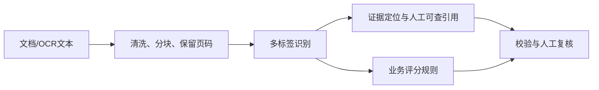

# NLP 模型选型方法论

> 本文给出可复用的筛选与验证流程。后半部分以“企业非结构化文档标签分类 + 多标签综合评分”为**方法演示**，不充当该项目的最终选型报告。技术概念见[02](02-NLP模型多维分类体系.md)，能力映射见[05](05-模型能力与NLP任务映射.md)。

## 1. 先把业务需求写成可检验的任务合同

| 输入项   | 必须澄清的问题                              | 对选型的影响            |
| ----- | ------------------------------------ | ----------------- |
| 任务与输出 | 单标签、多标签、层级标签、实体/字段，还是生成文本？输出是否必须可审计？ | 决定分类头、抽取头或生成机制    |
| 文本    | 语言、长度分布、版式/OCR 质量、跨页关联、是否有表格         | 决定切分、长文处理及模型输入能力  |
| 标签    | 标签数、定义、层级、互斥关系、变更频率、长尾比例             | 决定多标签策略、阈值与重训成本   |
| 数据    | 可用标注量、标注一致性、训练/验证/测试划分、数据泄漏风险        | 决定能否可靠微调和比较       |
| 质量    | 漏报与误报的相对代价、最低召回/精确率、是否需概率校准          | 决定指标与阈值，而不只看整体准确率 |
| 资源    | CPU/GPU、显存、吞吐、延迟、部署位置、模型许可           | 过滤不可落地的候选         |
| 运维    | 监控、回滚、标签变更、版本追溯、人工复核                 | 决定系统复杂度与上线门槛      |

不要先拿模型排行榜挑一个名称。先固定**输入、输出、测试集和业务错误成本**，否则不同路线的分数无法比较。模型卡只证明发布者说明的能力；最终效果须由自己的数据验证。

## 2. 候选路线与训练前提

| 任务条件 | 首批候选 | 数据与训练前提 | 主要风险 |
| --- | --- | --- | --- |
| 标签固定、成本敏感、可获得标注 | TF-IDF + 线性分类器；小型编码器 + 分类头 | 标签定义清晰；类别分布可统计 | 复杂语义、长文截断、领域差异 |
| 标签多且常变、标注少 | NLI/零样本作为探索基线；生成式分类 | 标签描述、假设模板和输出约束；仍需人工验证集 | 标签措辞敏感、分数不可校准 |
| 需语义召回大量材料 | Embedding 召回，必要时接 Reranker | 相关/不相关样本；索引与重排预算 | 召回遗漏、领域偏移、候选成本 |
| 需实体/字段及关系 | NER/跨度抽取；schema 引导的结构化生成 | 边界与 schema 标注；格式校验 | 漏字段、关系错配、生成幻觉 |
| 文本超过模型输入限制 | 分块 + 聚合；层次模型；经验证的长上下文模型 | 文档级标签与块级证据对齐 | 关键信息跨块、聚合丢失、成本上升 |

这些是**候选类别**，不是性能排名。现成 checkpoint 的语言、上下文长度、许可证和训练接口，以对应官方模型卡和本地试验为准；不可把家族名当成版本证据。

## 3. 实验 SOP

1. **定义数据单位**：明确一条样本是一段、一页还是整份文档；按来源、时间、模板、机构等维度划分，防止近重复文档跨训练与测试集。
2. **写标签规范**：每个标签包含正反例、边界例和互斥/层级规则；抽样复标，记录分歧。
3. **建立最低成本基线**：规则与 TF-IDF + 线性模型；记录同一测试集上的结果。
4. **比较 2–3 条机制路线**：如编码器分类、生成式标签、检索/重排；先保持相同输入和标签口径。
5. **只在必要时微调**：记录起始 checkpoint、tokenizer、数据版本、训练目标、全量/PEFT 方式和随机种子。
6. **评估错误类型**：按标签、长度、语言、文档模板、时间和置信度分桶；专看业务高代价漏报。
7. **测部署条件**：真实批量下测 P50/P95 延迟、吞吐、峰值内存、成本与失败回退。
8. **锁定可复现版本**：保存模型、阈值、预处理、提示词、schema、评估集版本；上线后监控漂移与人工复核量。

多标签任务至少分别看每标签 Precision/Recall/F1、宏/微平均、漏报率和阈值曲线。若业务关注“高风险必须查全”，应优先约束该类的召回，再衡量人工复核成本。层级标签还要检查子标签出现时父标签是否一致。生成模型另外统计无效格式、越界标签和不稳定输出。不能只用一个总准确率比较所有路线。

## 4. 示例：企业文档标签分类与综合评分

**需求假设**：输入为可能较长的企业文档；输出多个主题/风险标签，附证据片段，并据标签与业务规则计算综合分。这里的“综合分”是业务规则产物，不等于语言模型的类别概率。

**初筛路线**：先以规则/TF-IDF + 线性多标签模型建立成本基线；再比较编码器分类头。若证据分散在长文中，测试“分块分类 → 文档级聚合”，并核对跨块信息损失。若标签描述经常变化、需要解释或字段抽取，再增加生成式方案，但其输出须做 schema 校验和证据核对。不同路线应共用同一文档级测试集与评分口径。

**训练前提**：需要可复核的文档级标签、边界案例、时间/模板隔离的数据划分；若要定位证据，还需片段级标注或人工验证流程。评分公式、缺失值处理、标签冲突和人工覆盖规则应由业务方单独定义，不能让模型自行“猜分”。

**实验验证**：比较每标签漏报/误报、证据定位命中率、综合分与人工评分的偏差、长文/表格/OCR 噪声分桶、P95 延迟和每文档成本。遇到低置信度、标签冲突或缺失证据时进入复核队列。此例只演示如何用方法论筛选；具体模型、阈值和评分权重必须以真实数据实验确定。

## 5. 决策记录模板

| 字段 | 应记录的内容 |
| --- | --- |
| 业务任务 | 输入、输出、标签版本、错误成本 |
| 候选模型 | 精确 checkpoint、来源、许可证、语言/长度支持 |
| 任务机制 | 分类头、向量召回、重排、生成或混合 |
| 训练方式 | 从头/微调/SFT；全量/冻结头/LoRA 等 |
| 评估证据 | 数据版本、划分方式、指标、分桶与典型错误 |
| 部署证据 | 设备、吞吐、P95、内存、成本、回退 |
| 决策 | 采用/拒绝理由、复测条件、负责人 |

只记录“某论文或模型卡报告有效”属于**公开资料证据**；要形成工程选型结论，还需完成同一业务场景下的实际验证。
