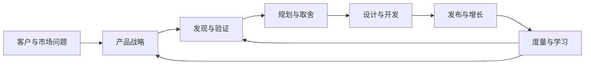

# 产品管理专题：从客户问题走到可验证的结果

> 来源范围：[Atlassian Product Management 专题](https://www.atlassian.com/agile/product-management)及其导航中的 43 篇文章。整理时间：2026-10-28。以下是主题化学习笔记，并非逐篇译文；文中的“贯穿示例”是为了帮助理解而自拟的情境。

产品管理像驾驶一艘船：**战略**决定目的地，**发现**确认海图没有画错，**路线图**安排航程，**研发与发布**让船真正前进，**指标和反馈**告诉我们是否抵达了对客户有价值的地方。只把功能做出来，相当于船开得很快，却没有确认方向。

## 学习路径与章节编号

正文按第 1—8 章组织，每章使用 `1.1`、`1.1.1` 这样的层级。目录名前的 `00—07` 只用于文件排序；阅读时以正文的章节编号为准。

| 想回答的问题 | 先读 | 阅读后应能说清 |
| --- | --- | --- |
| 产品经理到底负责什么？ | [第 1 章：产品管理与角色协作](00-总览与角色/产品管理与角色协作.md) | PM、PO、项目经理和其他职能的边界 |
| 为什么做这个产品？ | [第 2 章：产品战略与生命周期](01-战略与定位/产品战略与生命周期.md) | 目标客户、差异化、业务目标与产品方向 |
| 客户说想要功能，该不该做？ | [第 3 章：从反馈到问题验证](02-发现与需求/从反馈到问题验证.md) | 将请求还原为问题，并用最小实验验证 |
| 这么多想法，先做哪个？ | [第 4 章：路线图与优先级](03-规划与优先级/路线图与优先级.md) | 如何取舍、如何表达计划及其不确定性 |
| 怎样让想法变成可用产品？ | [第 5 章：从定义到交付](04-设计与开发/从定义到交付.md) | Brief、PRD、规格、设计和研发的衔接 |
| 上线等于成功吗？ | [第 6 章：发布上市与增长](05-发布与增长/发布上市与增长.md) | 技术发布、市场上市、增长实验的区别 |
| 怎么知道产品是否有效？ | [第 7 章：指标与持续运营](06-度量与运营/指标与持续运营.md) | 指标、行为数据、客户声音和运营机制 |
| 工具、远程协作和 AI 怎么用？ | [第 8 章：工具与协作](07-工具与协作/工具与协作.md) | 先定义协作问题，再决定工具配置 |

**贯穿示例（自拟）**：某团队做一款协作知识库。新用户注册不少，但很少邀请同事共同编辑。用户提出“增加更多模板”，团队是否应立即开发？以下各篇都用这个例子展示从识别问题到检验结果的过程。

## 原文阅读索引

每篇原文只归入一个最主要的主题；一个知识点可能在多篇笔记中交叉引用。

想逐篇回看原文的重点与适用场景，可读[Atlassian 43 篇逐篇导读](Atlassian-43篇逐篇导读.md)。

| 主题 | Atlassian 原文 |
| --- | --- |
| 总览与角色 | [产品管理总览](https://www.atlassian.com/agile/product-management)、[产品经理](https://www.atlassian.com/agile/product-management/product-manager)、[新任产品经理第一周](https://www.atlassian.com/agile/product-management/tips-for-new-product-manager)、[Product Owner](https://www.atlassian.com/agile/product-management/product-owner) |
| 战略与定位 | [产品战略](https://www.atlassian.com/agile/product-management/product-strategy)、[产品开发战略](https://www.atlassian.com/agile/product-management/product-development-strategy)、[产品差异化](https://www.atlassian.com/agile/product-management/product-differentiation)、[产品组合管理](https://www.atlassian.com/agile/product-management/portfolio-management)、[产品生命周期管理](https://www.atlassian.com/agile/product-management/plm) |
| 发现与需求 | [产品发现](https://www.atlassian.com/agile/product-management/discovery)、[功能请求](https://www.atlassian.com/agile/product-management/feature-request)、[最小可行产品](https://www.atlassian.com/agile/product-management/minimum-viable-product)、[产品简报](https://www.atlassian.com/agile/product-management/product-brief) |
| 规划与优先级 | [产品路线图](https://www.atlassian.com/agile/product-management/product-roadmaps)、[敏捷路线图](https://www.atlassian.com/agile/product-management/roadmaps)、[路线图展示](https://www.atlassian.com/agile/product-management/tips-for-presenting-product-roadmaps)、[产品规划](https://www.atlassian.com/agile/product-management/product-planning)、[优先级框架](https://www.atlassian.com/agile/product-management/prioritization-framework)、[产品功能](https://www.atlassian.com/agile/product-management/product-features)、[用户故事地图](https://www.atlassian.com/agile/product-management/story-mapping) |
| 设计与开发 | [产品需求文档](https://www.atlassian.com/agile/product-management/requirements)、[产品规格](https://www.atlassian.com/agile/product-management/product-specification)、[产品设计](https://www.atlassian.com/agile/product-management/product-design)、[产品开发](https://www.atlassian.com/agile/product-management/product-development)、[新产品开发流程](https://www.atlassian.com/agile/product-management/new-product-development-process)、[产品工程](https://www.atlassian.com/agile/product-management/product-engineering)、[产品评审](https://www.atlassian.com/agile/product-management/product-critique) |
| 发布与增长 | [产品发布](https://www.atlassian.com/agile/product-management/product-release)、[上市](https://www.atlassian.com/agile/product-management/product-launch)、[上市清单](https://www.atlassian.com/agile/product-management/product-launch-checklist)、[上市时间线](https://www.atlassian.com/agile/product-management/product-launch-timeline)、[上市活动](https://www.atlassian.com/agile/product-management/product-launch-event)、[增长产品管理](https://www.atlassian.com/agile/product-management/growth-product-management)、[产品驱动增长](https://www.atlassian.com/agile/product-management/product-led-growth) |
| 度量与运营 | [产品分析](https://www.atlassian.com/agile/product-management/product-analytics)、[产品管理 KPI](https://www.atlassian.com/agile/product-management/product-management-kpis)、[产品指标](https://www.atlassian.com/agile/product-management/product-metrics)、[NPS](https://www.atlassian.com/agile/product-management/nps-score)、[产品运营](https://www.atlassian.com/agile/product-management/product-operations) |
| 工具与协作 | [产品管理工具](https://www.atlassian.com/agile/product-management/product-management-tools)、[产品开发软件](https://www.atlassian.com/agile/product-management/product-development-software)、[路线图软件](https://www.atlassian.com/agile/product-management/roadmap-software)、[远程产品管理](https://www.atlassian.com/agile/product-management/remote-product-management)、[AI 与产品管理](https://www.atlassian.com/agile/product-management/pm-and-ai) |

> 边界：`Teammates` 记录职位、职责及上下游；本目录记录产品管理知识体系。`Workflows` 记录你们实际采用的工作流程；`SystemDesign` 记录技术架构。原文中的 Jira Product Discovery 等工具推荐具有产品营销背景，阅读时应把方法与具体软件分开判断。
