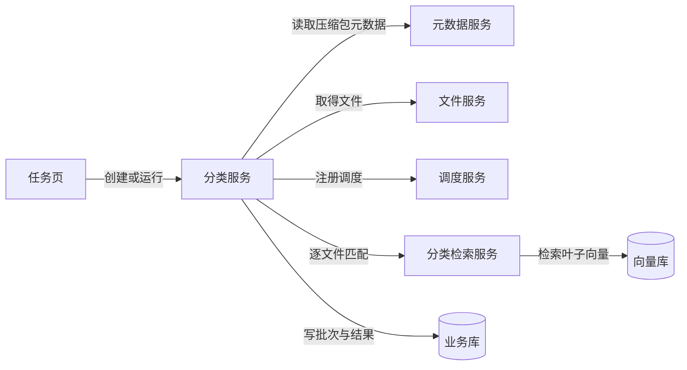
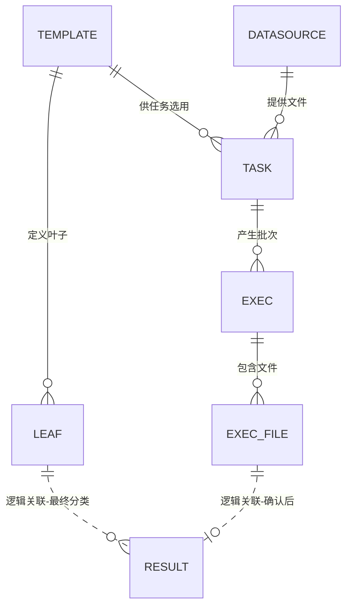

# 评审关联图

关联图回答“有哪些对象、它们是什么关系、现状如何变成目标”。关系必须有语义，图形不按写作顺序把节点串成一条线。按问题选图型：服务与职责用 `flowchart`，表与基数用 `erDiagram`，状态迁移用 `stateDiagram-v2`；跨参与者的时间顺序交给时序图。

## 工作步骤

1. 从代码、配置、表结构和 SPEC 形成节点清单与关系清单。每条关系记录起点、终点、方向、含义、证据、现状/目标；不确定的关系标注“待确认”。
2. 明确视角与边界。系统架构的“现状”需覆盖与目标能力有关的完整服务组织，包括入口、鉴权、业务服务、基础服务、存储与外部系统；目标图保持同一视角，便于比较。
3. 按业务域或部署边界分组，区分“复用”“改造”“新增”。实线表示已确定调用或依赖，虚线表示设计中新增/异步/可选关系时，必须在图例写清具体含义；不要让一种线型承担多个含义。
4. 数据关系图先核对主键、外键或逻辑关联，再标基数。现有表与新增表、历史事实与当前正式结果分别展示；逻辑关联要在关系标签或图注明示，不能画成已存在的物理外键。Mermaid ER 的实线/虚线表示标识关系/非标识关系，不表示物理/逻辑外键。关键字段只保留理解关系必需的主键、关联键、状态和快照字段。
5. 在同一画面信息过密时拆为总览和专题图。优先保留决策关系，压缩重复节点；不靠缩小字体容纳所有接口或字段。
6. 保存 `.mmd`，渲染 SVG/PNG 并检查文字裁切、连线交叉、节点拥挤、箭头方向、图例和正常文档尺寸的可读性。修改源码后同步更新渲染图。

## 内容规范

| 图型 | 应回答的问题 | 必备信息 |
|---|---|---|
| 模块架构 | 哪个模块负责什么，谁调用谁 | 服务/模块名、职责、调用方向、复用/改造/新增、存储归属 |
| 现状目标对比 | 哪些组织和职责变化 | 同一范围与粒度、现有入口、目标新增链路、保留能力 |
| 业务关联 | 用户、页面、任务、结果如何相连 | 多分支关系、关键门禁、事实源和消费方 |
| 数据关系 | 实体如何关联，哪条是一对多 | 基数、关联键、历史/当前边界、物理或逻辑关系 |
| 状态图 | 状态何时、因何变化 | 初始态、触发事件、拒绝或失败回退、终态 |

## 版面规则

- 主阅读方向固定为从左到右或从上到下；布局可以分叉、汇聚和回环，不强迫关系线性化。
- 节点标题用模块/表/业务对象的真实名称；节点内只写职责与关键数据，不堆接口清单。
- 连线写动词或数据含义，例如“查询数据源”“写执行批次”“同步叶子向量”；避免无标签箭头造成误读。
- 用一致的颜色标注现有复用、现有改造和新增，并给图例；颜色不代替文字标注。
- 现状图不画目标组件，目标图不暗示尚未实现的接口已经存在。图下注明“据代码核对”或“目标设计”。

## 示例

示例只表达写法；真实基数和关系必须核对。Mermaid 的 `flowchart` 支持分组与带标签连线，`erDiagram` 使用乌鸦脚基数并区分实线与虚线；语法分别参照[官方流程图文档](https://mermaid.js.org/syntax/flowchart.html)和[官方 ER 文档](https://mermaid.js.org/syntax/entityRelationshipDiagram.html)。`architecture-beta` 仍标为 beta，除非交付环境已验证其版本，否则优先用稳定的 `flowchart` 表达模块架构。

## 交付与自检

- 交付 `.mmd` 和渲染 `.svg`；嵌入 Word 时提供 `.png`。每张图附标题、视角、现状/目标标记、图例及来源。
- 每个节点在关系清单中有职责，每条连线有语义和证据；与代码冲突的 SPEC 差异单列，不能悄悄合并。
- 同一组现状/目标图应可逐模块对照：保留、改造和新增一眼能找出。最终渲染图必须肉眼检查。
