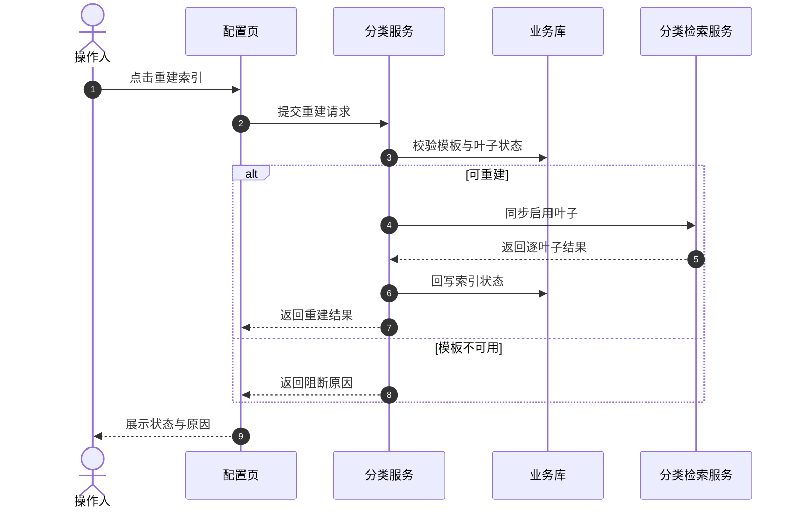

# 评审时序图

把一张图限定为一个可命名的场景，例如“模板重建索引”或“文件候选人工确认”。用时间轴说明谁发起、谁处理、何时持久化、失败后如何返回。图中的调用必须能由需求、代码或明确标注的目标设计支持。

## 工作步骤

1. 读取用户提供的需求、SPEC、代码和已有图。先记录场景边界、现状与目标、参与者、触发条件、主路径、异常路径、状态写入点。来源冲突时保留“代码现状 / 目标设计”两列，不用一张图暗示已经实现。
2. 以界面、业务服务、基础服务、数据库、外部系统为候选参与者；只保留对本场景的决策有作用的参与者。通常 4–8 个，过多时按阶段拆图。参与者使用实际模块或服务名，避免笼统的“后端”“系统”。
3. 先写主路径，再补 `alt/else` 的业务分支、`loop` 的批量处理、`par/and` 的真实并发、`opt` 的可选动作。明确同步返回、异步触发、失败回写与最终可见结果。不要为了展示语法添加不存在的分支。
4. 给关键消息命名为动作或接口；在消息或 `Note` 中标明门禁、幂等键、状态迁移、数据事实源。接口详细字段留在接口表，不把字段清单塞进箭头。
5. 保存 `.mmd`，用当前项目可用的 Mermaid 渲染器生成 SVG，并按目标文档需要导出 PNG。检查语法、文字、箭头方向、分支闭合、裁切和缩小后的可读性。编辑后重渲染。

## 内容规范

| 检查点 | 合格条件 |
|---|---|
| 图名 | 标明场景及“现状”或“目标”；一个图回答一个主要问题 |
| 参与者 | 与模块边界一致；数据库只在确有读写决策时出现 |
| 主路径 | 从用户触发到页面反馈或结果落库闭合，编号可用 `autonumber` |
| 分支 | 每个关键门禁有通过与拒绝/失败结果；分支名称写条件而非“成功/失败”空话 |
| 批量 | 用 `loop` 明确逐项处理、局部失败与汇总；整体失败与单项失败区分 |
| 异步 | 图上能看出“请求已受理”和“后台完成”不是同一时刻 |
| 证据 | 现有接口、服务和表名按代码核对；设计中尚未实现的部分标为目标 |
| 可读性 | 关键消息能在文档正常阅读尺寸读清；太密则拆成概览和阶段图 |

## Mermaid 写法

这是语法示例，图中的参与者和动作应替换为当前任务证据。Mermaid 支持 `alt`、`opt`、`loop`、`par` 和 `autonumber`；以[官方时序图语法](https://mermaid.js.org/syntax/sequenceDiagram.html)为准。

## 交付与自检

- 交付同名 `.mmd` 与已渲染 `.svg`；嵌入 Word 时另交付或嵌入 `.png`。
- 在图注或紧邻说明写明“现状/目标”、场景和来源。必要时列出设计假设与待确认差异。
- 逐条追踪关键箭头：发起方、接收方、触发条件、响应与状态变化都能解释；渲染后肉眼检查一次。
