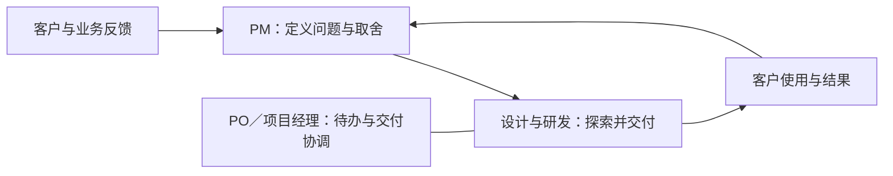

# 1 产品经理：职责与上下游

> 本页按职位组织，供团队协作时快速查阅。系统学习参见[产品管理专题](../ProductManagement/README.md)；Atlassian 原文的详细转述见[产品管理入门笔记](../ProductManagement/00-总览与角色/Atlassian-产品管理入门.md)。

产品经理主要负责让团队持续回答：**服务谁、解决什么问题、为什么现在做、如何判断有效**。他不应独自替设计师定交互、替工程师定技术方案，也不应仅靠收集需求充当各方的传话筒。

## 1.1 这个职位交付的不是功能清单

产品经理最重要的贡献，是让不同职能围绕同一个客户问题作出一致、可检验的取舍。比如“新用户想要更多模板”，不能直接等同于“研发需要做模板库”；先要判断用户在哪个任务上卡住、模板是否解决主要障碍、其他方案是否更有效。

一个能被团队使用的产品判断，至少要包含**问题证据、优先级原因、预期结果**。如果只剩下一张排期表，接手的人就无法理解为什么某项工作值得做。

## 1.2 上下游协作地图

| 协作对象 | 从对方获得 | 向对方提供或共同决定 |
| --- | --- | --- |
| 客户、销售、支持 | 场景、痛点、市场反馈 | 问题理解、产品方向与反馈闭环 |
| 用户研究、设计 | 行为证据、可用性发现、方案探索 | 目标用户、问题边界、优先级与验证标准 |
| 研发、测试 | 技术约束、实现选项、质量风险 | 背景、预期结果、范围取舍和验收依据 |
| 产品营销 | 市场定位、传播反馈 | 核心价值、目标受众、上市节奏 |
| Product Owner／项目经理 | 待办与交付状态、依赖和风险 | 优先级及原因、关键结果、范围变化决策 |

这里的“上游”和“下游”是信息流视角，不是职位高低：客户反馈、商业目标和研究证据流向产品判断；产品判断进入设计与研发；交付后的行为数据和客户声音又返回下一轮判断。

### 1.2.1 与 PO、项目经理最容易混淆的边界

| 出现的情况 | PM 重点判断 | PO／项目经理重点推进 |
| --- | --- | --- |
| 候选需求太多 | 哪个问题最值得解决，为什么 | 把已确定方向拆成可执行工作，识别依赖 |
| 交付延期 | 缩范围或延期会怎样影响客户结果 | 评估进度、资源和风险，协调执行 |
| 上线后采用率低 | 原假设哪里不成立，下一步学什么 | 汇总交付事实与问题，支持后续调整 |

各组织可能把这些职责合并到同一人身上，但**问题判断**与**交付协调**仍是两类不同工作，不能因为职位合并就忽略其中一种。

## 1.3 从需求到结果的一次完整交接

一项工作从“有人提需求”走到“交付后得到结果”，产品经理至少应留下三件可追溯的东西：**客户问题的证据、取舍的原因、结果的检验方式**。具体方法参见专题中的[发现与需求](../ProductManagement/02-发现与需求/从反馈到问题验证.md)、[规划与优先级](../ProductManagement/03-规划与优先级/路线图与优先级.md)和[度量与运营](../ProductManagement/06-度量与运营/指标与持续运营.md)。

在知识库“首次协作率低”的例子里，可以这样交接：PM 与研究、支持核对问题证据，和设计、研发讨论可行方案；PO 将最小可验证方案转成待办；项目经理协调时间和依赖；发布后 PM 与分析、支持一起复盘行为与反馈。若没有改善，返回问题定义或方案假设，而不是把“已上线”当作结束。

## 1.4 与团队约定的三个问题

1. 当不同客户与业务方提出冲突诉求时，谁作最终优先级决定，依据在哪里记录？
2. 研发发现原方案不可行时，谁组织替代方案讨论、谁决定范围变化？
3. 发布后谁查看客户结果，什么时候复盘，又怎样把发现带回路线图？

这些问题有明确答案，职位边界才会在实际协作中发挥作用。
