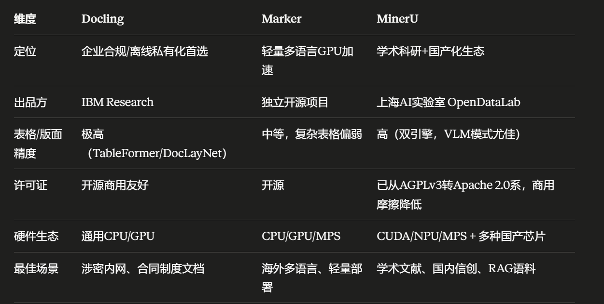

# 一、整体概括
上面全部是**文档解析工具/框架**，专门用于 RAG 流水线「多格式文件解析」环节，核心作用：把 PDF、Word、扫描件、带图表的文档转成结构化干净文本/Markdown，是你前面数据处理流程第三步「特殊文件处理」的技术选型库。

按能力强弱分两大类：
1. **重型工业级解析框架**：Docling、Marker、MinerU（带布局分析、表格识别、OCR，企业RAG首选）
2. **轻量底层PDF库**：PyMuPDF、PyMuPDF4LLM、PyPDF2、Markitdown、Dolphin（仅纯文字提取，无布局/扫描件能力，仅简单文档使用）

# 二、逐个拆解核心定位、优缺点、适用场景
## 1. Docling（IBM出品，企业私有化重型复杂文档场景）
- 开发方：IBM Research，LF AI基金会托管，开源商用友好
- 核心能力：
  多格式解析 + DocLayNet版面布局模型 + TableFormer表格识别；
  内置多OCR后端（Tesseract/EasyOCR/RapidOCR），原生支持扫描PDF；
  输出结构化分层文档，区分标题、段落、表格、图片、脚注。
- 优势：完全离线私有化（air-gapped隔离内网环境）、合规友好、表格/版面精度极高；
- 适用：大型企业内网RAG、合同/制度/复杂版式PDF、涉密无外网场景。

## 2. Marker（轻量化多语言GPU加速解析，快速部署）
- 核心能力：基于Surya多语言OCR，PDF/电子书转标准Markdown；
  支持CPU/GPU/MPS苹果芯片加速，速度快。
- 优势：多语种友好、部署轻、推理速度高；
- 短板：复杂财务/学术表格识别弱于MinerU、Docling；
- 适用：中小型RAG、海外多语言文档、轻量化容器部署。

## 3. MinerU（学术论文，公式、研报、国产芯片等）
- 主打：中文、学术论文、财务报表、旋转表格；
- 底层：PaddleOCR + 混合规则版面模型；
- 优势：中文排版适配拉满，乱码少、表格还原度高，输出规整Markdown；
- 短板：外文文档效果一般；
- 适用：国内企业知识库、发票/财报/中文手册、论文RAG。

## 4. PyMuPDF（fitz，底层高速PDF库）
- 定位：底层轻量工具，纯文本极速抽取；
- 短板：**无OCR、无版面分析**，扫描PDF完全读不出文字，分不清标题/表格；
- 适用：纯电子文字PDF（无图片、无扫描件）简单文本提取。

## 5. PyMuPDF4LLM
PyMuPDF封装层，仅增加Markdown导出，**依然缺少OCR、高级版面识别**，只是方便直接喂给LLM，复杂文档不推荐。

## 6. PyPDF2
上古基础PDF读写库，功能最弱：只能粗暴提取文字，排版错乱、不识别表格、无OCR、无Markdown；仅老旧极简脚本临时使用。

## 7. Markitdown
极简PDF转MD工具，无OCR、无版面识别，只适合纯文字简单PDF，遇到图表、扫描件直接失效。

## 8. Dolphin
极简PDF提取工具，无命令行、无OCR、无布局分析，功能性最差，仅个人临时小脚本。

# 三、RAG落地选型对照（贴合你前面的数据处理流程）
1. 企业内网/涉密、多格式复杂文档 → **Docling**
2. 国内大量中文财务/论文PDF → **MinerU**
3. 多语言、轻量化GPU部署、追求速度 → **Marker**
4. 只有纯电子文字PDF、追求极速、无扫描件 → PyMuPDF / PyMuPDF4LLM
5. 不推荐：PyPDF2、Markitdown、Dolphin（排版差、无OCR，脏数据多，大幅降低RAG效果）

# 四、结合你之前的文档处理流程一句话总结
这一堆工具就是你「3.特殊文件处理」环节的技术备选：
- 带扫描件、表格、复杂版式的生产RAG：必须用 Docling / MinerU / Marker；
- 纯清晰电子PDF、简单Demo：用PyMuPDF系列即可；
- 剩下几个轻量工具生产环境不建议入库使用，提取文本杂质多，会加大后续清洗工作量。
