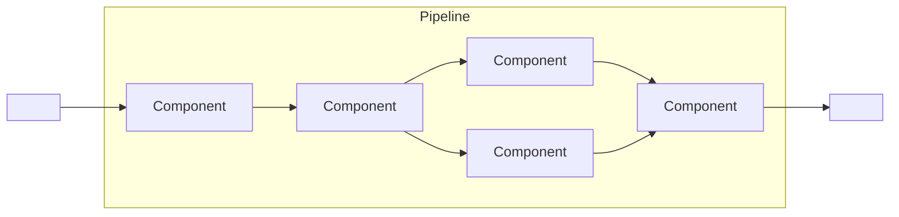

# Pipelines

>Pipeline = 一张图容器
>add_component：往图里放节点
>connect：增加单条端口到端口的有向边
>整张图可以是：单线、分支、多路汇聚、循环、并行子图。
>connect() 永远只增加一条边；但Pipeline 可以拥有大量 connect 构建出来的复杂图结构。

要使用大语言模型构建现代化的搜索流程，你需要两样东西：功能强大的组件，以及将它们整合起来的简便方式。Haystack 流程正是为此而设计的，它能让你设计并扩展与大语言模型的交互操作。

Haystack 中的管道是由不同 Haystack 组件和集成工具构成的有向多重图。它们让你可以自由地以多种方式连接这些组件。这意味着管道无需是连续的信息流。借助 Haystack 管道的灵活性，你可以实现并行流、独立组件、循环以及其他类型的连接方式。

## 灵活性

Haystack 管道远不止是查询和索引管道。管道的功能——无论是索引、查询、从 API 获取数据、预处理还是其他操作——完全取决于你如何设计管道以及使用哪些组件。虽然你仍然可以创建单功能管道，比如使用现成组件来清理、拆分文档并将其写入文档存储库的索引管道，或者仅接收查询并返回答案的查询管道，但 Haystack 也允许你将多个用例整合到一个管道中，同时搭配决策组件（例如条件路由器）

## 分支

一个管道可以拥有多个分支来并发处理数据。例如，要处理不同的文件类型，你可以搭建一个包含多个转换器的管道，每个转换器对应处理一种特定的文件类型。随后将所有文件输入管道，它会智能地对文件进行分类并一次性路由到对应的转换器上，无需你逐个发送文件进行处理。

**节点的输出可以作为并行节点的输入，每个输出可以当作网络的端口，自然可以相连(不是很恰当，因为正常端口TCP连接只能连接一个)**

## 循环

管道中的组件可以在迭代循环中运行，你可以为循环设置一个期望的次数上限。这在自修正循环等场景中非常实用，比如有一个生成器输出某些内容，随后由验证组件检查输出是否正确。若生成器的输出存在错误，验证组件会让循环回到生成器，获取修正后的输出。该循环会一直持续，直到输出通过验证，再被发送至管道的下一个环节。

## 异步执行与流式处理

当异步运行时，管道在其依赖项允许的情况下并行执行组件。这提高了具有独立操作的复杂管道中的性能。例如，管道可以同时运行多个Retrievers或LLM调用，并行执行独立的管道分支，并有效地处理否则会导致延迟的I/O绑定操作。您可以使用异步运行方法的concurrency_limit参数（run_async、run_async_generator和stream）来限制同时运行的组件数量。同步run方法按顺序执行组件。

除了阻塞run方法之外，每个管道还提供三种异步运行方式：
- run_async：在单个非阻塞调用中执行管道，非常适合将管道集成到更大的异步应用程序或服务中。

- run_async_generator：在组件完成其任务时产生部分输出，这对于监视进度、调试和增量处理输出很有用。

- stream：运行管道并返回一个句柄，该句柄会在生成 StreamingChunk 对象时对其进行流式处理——这是从异步应用（如 API 端点）流式传输 LLM 输出的便捷方式。使用 async for 迭代该句柄以获取数据块；迭代结束后，handle.result 会保存管道的最终输出（与 run_async 返回的字典相同）。

默认情况下，所有支持流式处理的组件的块都会被转发；传入 `streaming_components` 并附带组件名称列表，即可仅对特定组件进行流式处理。如果使用者放弃迭代，底层的管道运行会自动取消；传入 `cancel_on_abandon=False`，则可让其运行至完成。

## 错误处理&任务取消

如果组件在同级组件仍在并发运行时引发错误，管道会在重新引发原始错误之前取消并耗尽那些正在运行的任务，因此没有任务继续在后台运行。当您提前停止迭代run_async_generator时（例如，通过中断循环并关闭生成器）或运行本身被取消时，同样的清理也适用。

**请注意，取消操作仅会中断原生异步运行的组件。同步组件会被卸载到工作线程，该线程无法被中断，会在后台运行至完成。**其输出会被丢弃，因此流水线状态保持一致，但组件的副作用仍会执行完毕。

## 数据流

当数据（初始查询）流经整个管道时，单个值仅在连接时从一个组件传递到另一个组件。因此，并非所有组件都可以访问所有数据。这种方法提供了速度和易于调试的好处。

**要在管道中连接组件和集成，您必须知道它们的输入和输出的名称。一个组件的输出必须被以下组件接受为输入。**当您使用Pipeline.connect()连接管道中的组件时，它会验证输入和输出类型是否匹配。

## 智能管道连接

管道支持更智能的连接语义学，可以简化组件连接在一起的方式

当连接到单个输入时，可以隐式组合兼容输出。管道还在连接时为某些特定的类型执行隐式类型响应。

这些行为减少了对粘合组件的需求，保持管道的简洁和可读性。

## 管道创建步骤详解

创建所有组件并准备好在管道中组合之后，有四个步骤可以使其工作：

1. 使用Pipeline()创建管道。这将创建Pipeline对象

2. 使用.add_components({name:compnent})向管道中添加组件，或者使用.add_component(name,component)逐个添加组件，**这会将组件添加到管道中，尚未对其进行连接。这对循环操作尤其重要，接下来就是对这些组件的连接操作了。

3. 使用.connect_mand([(sender,receiver)])连接多个组件对，或者使用.connect("producer_component.output_name", "consumer_component.input_name")连接单个组件对。**在这一步，你需要明确地将一个组件的某个输出连接到下一个组件的某个输入。**此时管道还会在不运行组件的情况下验证连接，这使得验证过程非常快速。

4. 使用.run({"component_1": {"mandatory_inputs": value}})运行流水线。最后，你需要指定流水线中的第一个组件并传入其必填输入项来运行Pipeline。此外，你还可以向其他组件传入输入项，例如：.run({"component_1": {"mandatory_inputs": value}, "component_2": {"inputs": value}})。

## 验证

当你使用 .connect() 连接管道组件时，验证就会发生，但这是在运行组件之前进行的，以提高速度。管道会验证以下内容：
- 这些组件存在于管道中
- 各个组件的输入&输出匹配且均已明确标注。例如，若某组件有两个输出，在将其与另一组件连接时，必须指明哪个输出连接到哪个输入。
- 组件类型相匹配
- 对于Variadic之外的输入类型，检查是否已经被另一个占用

*所有这些检查都会生成详细的错误信息，帮助你快速修复检测到的任何问题。*

## 序列化

得益于序列化功能，你可以保存并加载你的管道。序列化是将 Haystack 管道转换为一种可以存储在磁盘上或通过网络传输的格式。它特别适用于以下场景：

- 编辑、存储和分享管道。
- 以非 Python 的格式修改现有管道。

Haystack 管道将序列化工作委托给其组件，因此序列化一个管道只需按顺序序列化管道中的每个组件及其连接。管道会被序列化为字典格式，这是一种中间格式，你可以将其转换为所需的最终格式。

要实现序列化，组件必须支持与 Python 字典之间的相互转换。所有 Haystack 组件都具备两种可序列化的方法：from_dict 和 to_dict。而 Pipeline 类则拥有自身专属的 from_dict 和 to_dict 方法，用于处理组件和连接的序列化工作。