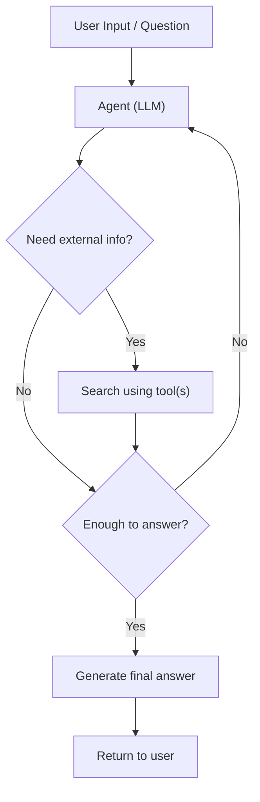
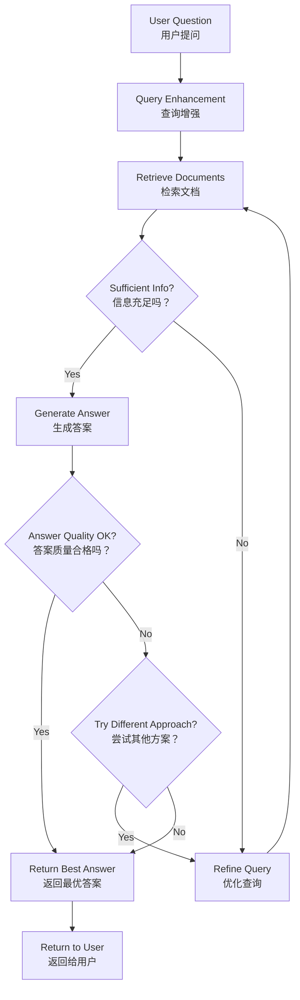

#  检索增强生成

*这节不是Deep agent的专属能力，是所有Agent都可以考虑检索增强生生成*


LLM虽然功能强大，但是有两个局限：
1. 优先的上下文(context window)
2. 静态知识(通过神经网络将海量的文本规律信息存储到神经节点当中，本质概率预测模型(通过“旧”的知识语料，所以始终会过时，还会有可能学不到真实的概率))

RAG可以通过提前检索对应的外部知识让LLM拥有“足够“推理的上下文，进而提高模型概率预测的能力(表现效果更好)

**任何提前给入模型前置输入的都可以被归类为RAG，不过常见的方式就是通过向量数据库提前建立知识库，后续通过相似度检索获取和问题相似的语料，进而达到增强

## 构建知识库

知识库是检索过程中使用的文档或结构化数据的存储库。


检索使大语言模型能够在运行时访问相关上下文。但大多数现实世界的应用更进一步：它们将检索与生成相结合，以生成有依据、感知上下文的答案。

### 基于向量数据库的RAG经典流程

1. 基础资源：图片，文本，pdf，word等等不同类型的资源
2. 加载资源(提取文字，加载资源扽等)
3. (数据清洗)
4. 进行分块
5. 分块向量化
6. 存储到向量数据库中

7. 用户请求
8. 同样的向量化模型进行向量化
9. 向量数据库检索
10. 结合输入给模型
11. 模型生成答案进行回复

**每个组件都是模块化的：你可以替换加载器、分割器、嵌入向量或向量存储，而无需重写应用的逻辑。当然每个过程都需要对应的筛选，比如使用什么加载器、如何清洗、分割、使用什么向量模型，以及什么向量数据库都需要根据实际结合+经验才能选择**


## 常见的三种RAG架构

| Architecture 架构 | Description 描述 | Control 控制 | Flexibility 灵活性 | Latency 延迟 |
| ---- | ---- | ---- | ---- | ---- |
| 2-Step RAG<br>两步检索增强生成 | Retrieval always happens before generation. Simple and predictable<br>检索始终发生在生成之前。简单且可预测 | ✅ High ✅ 高 | ❌ Low ❌ 低 | ⚡ Fast ⚡ |
| Agentic RAG<br>智能体增强检索生成 | An LLM-powered agent decides when and how to retrieve during reasoning<br>一个由大语言模型驱动的智能体在推理过程中决定何时进行检索以及如何进行检索 | ❌ Low ❌ 低 | ✅ High ✅ 高 | ⏳ Variable ⏳ |
| Hybrid 混合式 | Combines characteristics of both approaches with validation steps<br>结合两种方法的特点并包含验证步骤 | ⚖️ Medium ⚖️ 中等 | ⚖️ Medium ⚖️ 中等 | ⏳ Variable ⏳ |


### 2-step RAG

在两步检索增强生成中，检索步骤始终在生成步骤之前执行。该架构简单直接且可预测，适用于许多将相关文档检索作为生成答案的明确前提条件的应用场景。

1. 用户问题输入
2. 检索对应相关语料
3. 生成答案
4. 返回结果

```python
flowchart TD
    A["User Question"]:::greenbox --> B["Retrieve Relevant Documents"]:::bluebox
    B --> C["Generate Answer"]:::bluebox
    C --> D["Return Answer to User"]:::greenbox

    classDef greenbox fill:#e9f2c9,stroke:#708820,stroke-width:2px
    classDef bluebox fill:#d9e8ff,stroke:#3068b0,stroke-width:2px
```


### Agentic RAG

智能体增强检索生成（RAG）结合了检索增强生成与基于智能体推理的优势。与先检索文档再作答不同，由大语言模型（LLM）驱动的智能体会逐步推理，并在交互过程中决定何时以及如何检索信息。**将RAG作为工具输入给agent，agent自主决定是否需要调用其工具进行RAG**


1. 用户问题输入
2. 判断是否需要rag工具
3. (调用)
4. (检索增强生成)
5. 生成回复




```python
import requests
from langchain.tools import tool
from langchain.chat_models import init_chat_model
from langchain.agents import create_agent


@tool
def fetch_url(url: str) -> str:
    """Fetch text content from a URL"""
    response = requests.get(url, timeout=10.0)
    response.raise_for_status()
    return response.text

system_prompt = """\
Use fetch_url when you need to fetch information from a web-page; quote relevant snippets.
"""

agent = create_agent(
    model="claude-sonnet-4-6",
    tools=[fetch_url], # A tool for retrieval
    system_prompt=system_prompt,
)
```


### 混合架构

混合检索增强生成结合了两步检索增强生成和智能体检索增强生成的特点。它引入了查询预处理、检索验证和生成后检查等中间步骤。这类系统比固定流水线具备更高的灵活性，同时又能对执行过程保持一定的可控性。

经典组件包括：
1. 查询增强：修改输入问题以提升检索质量。这可以包括重写不清晰的查询、生成多个变体，或通过额外上下文扩展查询。
2. 检索验证：评估检索到的文档是否相关且充分。若不满足，系统可优化查询并再次检索。
3. 答案验证：检查生成答案的准确性、完整性以及与源内容的一致性。如有需要，系统可重新生成或修改答案。


适用场景：
- 适用于查询模糊或未明确指定的应用程序
- 需要验证或质量控制步骤的系统
- 涉及多个来源或迭代优化的工作流
