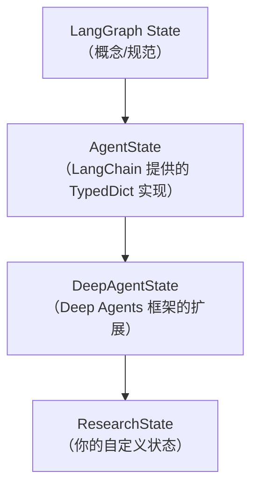

# Context engineering

**这里阐明一下提示词工程和上下文工程的区别**
1. 提示词工程：侧重优化、迭代提示词，让模型更好的输出(无论是系统提示词还是当前论的提示词)，比如可能会在用户输入的时候按照情节补充提示词，或者优化提示词之后再输入给模型，这样就属于**提示词工程范畴**

2. 上下工程：侧重系统设计、管理、组织上下文窗口(**编者认为不应该局限于上下文窗口，而是整个运行过程中所产生的上下文**)，比如当前阶段固化的系统提示词、工具描述、skills、长短期记忆如何管理（是否压缩）、工具输出这些内容在当前轮输入如何组织先后关系？等等属于**上下文工程**

## 上下文类型

主要包括以下类型：

1. 输入型上下文：启动时输入到agent提示中的内容（系统提示词、skills，记忆）
2. 运行时上下文：agent不断运行过程中产生的上下文，比如工具输出、当前节点信息，下一节点信息等等内容
3. 上下文压缩：内置的分流与摘要功能，可将上下文控制到窗口限制范围内
4. 上下文隔离：通过sub-agent的形式达到主agent获取结果信息，而不被大量冗余信息塞满
5. 长期记忆：相较于短期记忆，通过在适当的时机注入到上下文中

这里可以概括为主要两个大类（**任何一段上下文在被放入模型窗口的那一刻，要么已经是“既定事实”（静态），要么是“运行中生成或检索到的”（动态）**：
1. **静态上下文**：在单次运行之前已经去欸的那个、运行期间不发生变化的信息
    - input context(系统提示、记忆、skill，runtime context(元数据、API密钥、数据库连接))

2. **动态上下文**：对话历史、工具调用结果、sub-agent的摘要、压缩后的中间状态，检索的内容等等


### 输入上下文

输入上下文是在你的深度智能体启动时提供给它的信息，会成为其系统提示词的一部分。

#### 1. 系统提示词

```python
from deepagents import create_deep_agent

agent = create_deep_agent(
    model="openai:gpt-5.5",
    system_prompt=(
        "You are a research assistant specializing in scientific literature. "
        "Always cite sources. Use subagents for parallel research on different topics."
    ),
)
```

system_prompt 参数是静态的，这意味着它不会随每次调用而改变。在某些使用场景中，你可能需要动态提示词：例如，告知模型“你拥有管理员权限”而非“你只有只读权限”，或者从长期记忆中注入用户偏好，比如“用户偏好简洁的回复”。如果你的提示词依赖于上下文或runtime.store，请使用@dynamic_prompt来构建上下文感知的指令。你的中间件可以读取request.runtime.context和request.runtime.store。

#### 2. memory(AGENT.md)

记忆文件（AGENTS.md）会提供持久上下文，且始终会被加载到系统提示词中。请将适用于每次对话的项目约定、用户偏好和关键指导准则存入记忆中：

**我觉得这属于行为规范的CLAUDE.md类似，Deep agent把memory定义得太过宽泛，任何可复用的都称为memory，在编者看来，这属于系统提示词的一小部分，属于静态指导性提示词，而不能和长期记忆store/短期记忆checkpoint混淆了**

```python
agent = create_deep_agent(
    model="openai:gpt-5.5",
    memory=["/project/AGENTS.md", "~/.deepagents/preferences.md"],
)
```

与技能不同，AGENT.md会被直接注入——不存在渐进式披露的情况。


#### 3. SKILLS

技能提供按需功能。智能体在启动时会读取每个SKILL.md中的前置内容，仅在判定技能相关时才加载完整的技能内容。这既能减少令牌消耗，又能提供专用的工作流程：

```python
agent = create_deep_agent(
    model="openai:gpt-5.5",
    skills=["/skills/"],
)
```

**注意：如果不显示指定backend，上述skill/memory会直接到State.files当中寻找，而不是真实磁盘中，详细细节可以参考backend相关内容**

#### 4. tool 提示词

工具提示词是用于塑造模型如何使用工具的指令。所有工具都会向模型在其提示词中暴露元数据——通常是一个模式和一段描述。你通过tools参数传递的工具会将该工具的元数据（模式和描述）呈现给模型。


#### 完整的系统提示词

deepagents 框架的系统提示**不只是你写的那一段system_prompt**，框架会自动按顺序拼接多段文本，组合成完整系统消息传给大模型：
1. 用户自定义 system_prompt（可选）
2. 框架内置基础智能体提示（必带）
3. 记忆模块内容：AGENTS.md + 使用指南（传入memory才追加）
4. 技能模块内容：技能路径列表 + 每个技能前置元数据 + 使用方法（传入skills才追加）
5. 虚拟文件系统说明（和backend相关）
6. 子智能体、任务工具说明
7. 自定义中间件提示（配置后才追加）
8. 人工在环提示（设置interrupt_on才追加）


### Runtime context

运行时上下文是你调用智能体时传入的每次运行配置。它不会自动包含在模型提示词中；只有当工具、中间件或其他逻辑读取它并将其添加到消息或系统提示词中时，模型才能看到。将运行时上下文用于用户元数据（ID、偏好、角色）、API 密钥、数据库连接、功能标志或你的工具和框架所需的其他值。

```python
from dataclasses import dataclass

from deepagents import create_deep_agent
from langchain.tools import ToolRuntime, tool


@dataclass
class Context:
    user_id: str
    api_key: str


@tool
def fetch_user_data(query: str, runtime: ToolRuntime[Context]) -> str:
    """Fetch data for the current user."""
    user_id = runtime.context.user_id
    return f"Data for user {user_id}: {query}"


agent = create_deep_agent(
    model="openai:gpt-5.5",
    tools=[fetch_user_data],
    context_schema=Context,
)

result = agent.invoke(
    {"messages": [{"role": "user", "content": "Get my recent activity"}]},
    context=Context(user_id="user-123", api_key="sk-..."),
)
```

### 自定义状态模式

当你的智能体或中间件需要跟踪必须在整个智能体生命周期内持久存在、且能经受住检查点机制的影响的数据时，请使用自定义状态架构。自定义状态使你能够：

1. 全程跟踪状态：保留可在模型调用和工具调用间持续存在的计数器、标志或累积值
2. 在工具和中间件之间共享数据：工具可以将值写入状态，中间件钩子可以读取该值，反之亦然
3. 实现横切关注点：无需修改核心智能体逻辑，即可添加速率限制、使用情况跟踪或审计日志等功能
4. 在调用时传入初始值：在每次运行开始时为状态字段设置初始值，然后让智能体在执行过程中对其进行更新

```python
from deepagents import DeepAgentState, create_deep_agent
from langchain.tools import ToolRuntime, tool


class ResearchState(DeepAgentState):
    page_url: str
    file_urls: list[str]


@tool
def cite_page(runtime: ToolRuntime) -> str:
    """Return the current page URL."""
    return runtime.state["page_url"]


agent = create_deep_agent(
    model="openai:gpt-5.5",
    tools=[cite_page],
    state_schema=ResearchState,
)

result = agent.invoke(
    {
        "messages": [{"role": "user", "content": "Cite the current page"}],
        "page_url": "https://example.com/report",
        "file_urls": [],
    },
)
```

**这个DeepAgentState继承于langchain的AgentState，继承关系如下：**


### 上下文压缩

每次create_deep_agent调用都包含内置的上下文压缩功能。你无需添加中间件即可实现任务分流或摘要功能。

长时间运行的任务会产生大量工具输出和冗长的对话历史。上下文压缩可在保留与任务相关细节的同时，减小智能体工作记忆中的信息规模。以下技术是内置机制，用于确保传递给大语言模型（LLM）的上下文始终处于其上下文窗口限制范围内。

#### 1. Offloading

深度智能体使用内置文件系统工具来自动卸载内容，并根据需要搜索和检索已卸载的内容。当工具调用输入或结果超过令牌阈值（默认值为20,000）时，就会发生内容卸载：
1. 工具调用输入超过 20,000 个tokens：文件写入和编辑操作会在智能体的对话历史中留下包含完整文件内容的工具调用。由于这些内容已持久化到文件系统，这类信息通常是多余的。**当会话上下文超过模型可用窗口的 85% 时，深度智能体会截断较早的工具调用，并用指向磁盘上文件的指针替换它们，从而缩减活动上下文的大小。**

2. 工具调用结果超过 20,000 个标记：出现这种情况时，深度智能体会将响应转储到配置的后端，并以文件路径引用和前 10 行预览替代原响应。智能体随后可根据需要重新读取或搜索这些内容。

**工具调用和文件相关的输入和输出，通过引用的方式，而不直接保存到history当中**

#### 2. Summarization

每次调用create_deep_agent时，基础栈中都会包含SummarizationMiddleware。当上下文大小超过模型的上下文窗口限制（例如达到max_input_tokens的85%），且没有更多上下文可卸载时，深度智能体将自动汇总消息历史。

此过程包括两个组成部分：

1. 上下文摘要：大语言模型生成对话的结构化摘要，包括会话意图、生成的文档资料和后续步骤——该摘要会替代智能体工作记忆中的完整对话历史。**压缩会话->单条消息**
2. 文件系统保存：原始对话消息的文本渲染版本将作为规范记录写入文件系统。**文件保存原始消息内容**

这里主要是讲SummarizationToolMiddleware中间件

#### 3. 按需压缩工具

默认情况下，当达到上下文阈值时会自动运行摘要。此外，你可以为智能体提供一个compact_conversation 工具，使其能够按需触发对话精简操作，例如在任务之间进行，而无需等待85%的阈值。

添加压缩工具不会在模型上下文限制的85%时禁用自动摘要功能。两者共享同一个摘要引擎和状态。

| 特性 | create_summarization_tool_middleware | SummarizationMiddleware |
| ---- | ---- | ---- |
| 本质 | 工厂函数，返回 SummarizationToolMiddleware 实例 | 中间件类，可直接实例化 |
| 主要功能 | 为智能体提供一个 `compact_conversation` 工具，让智能体（或用户）能按需手动压缩上下文 | 自动监控 token 数量，在达到阈值时自动摘要历史消息 |
| 触发方式 | 工具调用（手动触发） | 阈值触发（自动触发） |
| 返回类型 | SummarizationToolMiddleware | SummarizationMiddleware |
| 内部实现 | 内部调用 `create_summarization_middleware` 创建引擎，并将其包装在工具中间件中 | 是摘要生成的“引擎”，负责实际的摘要逻辑和状态管理 |

SummarizationMiddleware：自动压缩引擎
这是负责“自动压缩”的核心中间件。它持续监控对话的 token 数量或消息数量，一旦达到你设定的触发阈值（如 5000 tokens 或 20 条消息），就会自动调用大模型对较早的对话历史进行摘要，并将摘要作为一条 HumanMessage 放回对话开头，从而释放上下文窗口。它还负责将完整的原始历史记录卸载（offload） 到后端存储（如 StateBackend），以便后续检索。该中间件支持灵活的触发条件配置，例如单一条件、多条件“与”组合（AND）或多条件“或”组合（OR）。

create_summarization_tool_middleware：手动工具层的便捷封装
这个工厂函数简化了添加“手动压缩”能力的过程。它内部会先通过 create_summarization_middleware 构建一个 SummarizationMiddleware 实例作为引擎，然后将其包装进一个 SummarizationToolMiddleware 中。最终，它只向智能体注册一个名为 compact_conversation 的工具。当智能体判断当前上下文过于冗长时，可以主动调用此工具来压缩自己的上下文窗口。工厂函数还包含一个“资格门槛”，防止工具在上下文还未达到约 50% 的自动摘要阈值时就过早压缩。

### sub-agent的上下文隔离


