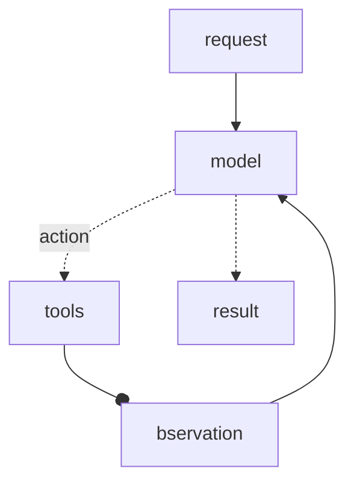
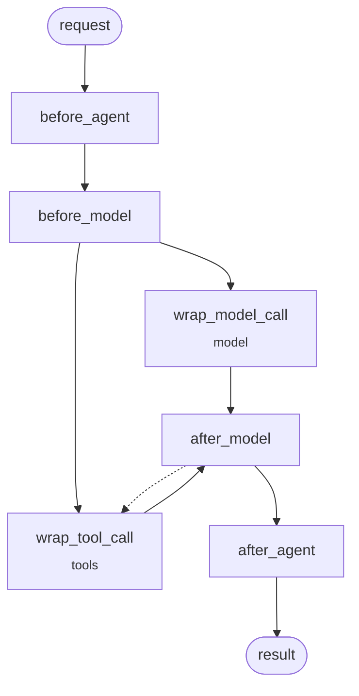

# 中间件概述

## The agent 循环

无论是Deep Agent还是Langchain agent，如果不添加其他节点的前提下就只有两个节点，一个是模型节点，一个是工具执行节点



内置中间件装饰器节点自定义：



## 在LangGraph工作流中使用中间件

比如使用HumanInTheLoopMiddleware中间件:

```python
from langchain.agents import AgentState, create_agent
from langchain.agents.middleware import HumanInTheLoopMiddleware
from langgraph.graph import START, StateGraph

# Assumes read_email, send_email, classify_node, and route are defined elsewhere.
email_agent = create_agent(
    model="claude-sonnet-4-6",
    tools=[read_email, send_email],
    middleware=[HumanInTheLoopMiddleware(interrupt_on={"send_email": True})],
)

graph = (
    StateGraph(AgentState)
    .add_node("classify", classify_node)
    .add_node("email_agent", email_agent)
    .add_edge(START, "classify")
    .add_conditional_edges("classify", route)
    .compile()
)
```

