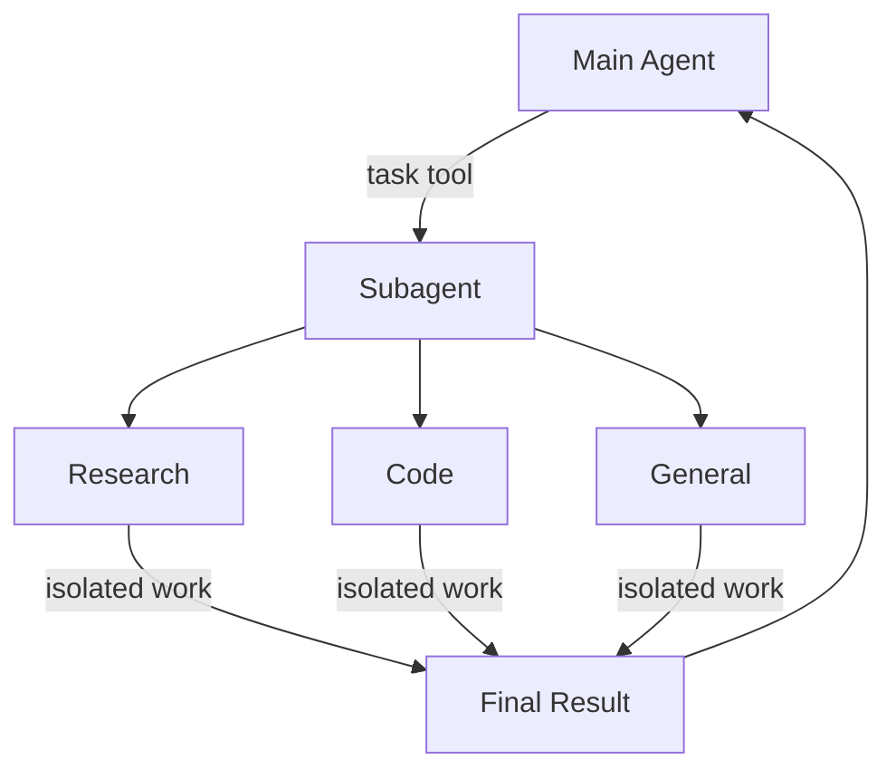

# Sub-agents

sub-agent 用于完成主agent的子任务，可以实现让主agent的上下文窗口干净整洁。

Deep agent有如下执行，通过中间件传入，然后生成task tool注册subagent工具，主agent通过调用工具方式的调用subagent。



## 为什么使用sub-agent?

sub-agent能够解决上下文膨胀问题。当agent输出内容较多的工具(web search、file read、db search)时，中间结果会迅速填满上下文窗口。**通过sub-agent将细节工作隔离出来，主agent只接收最终的结果，而非生成数十次工具调用结果**

1. 减少主agent上下文窗口开销
2. 领域精化，特殊领域指定特殊的专精agent，富有特殊能力
3. 不同sub-agent可以选择不同模型以减少成本

### 什么时候使用sub-agent?

- 会使主agent上下文变得杂乱的多步骤任务
- 需要自定义指令/工具的专业领域
- 需要不同模型能力的任务
- 当你希望让主agent专注于高层级卸掉时

### 什么时候不用sub-agent?

- 简单单步任务
- 需要维护中间上下文(**中间步骤结果十分重要**)时
- 当额外开销大于收益时


## 作用原理：SubAgentMiddleware 与隔离机制

Subagent 功能的实现核心是 SubAgentMiddleware 中间件。它被注入到主智能体中，负责动态添加 task 工具，并管理子智能体的生成、运行和结果回收。

其关键原理在于上下文构建的隔离：

当主智能体调用 task 工具时，中间件会为子智能体构建一个全新的、干净的运行状态。

这个新状态最初只包含一条 HumanMessage，其内容正是主智能体在 task 调用中提供的任务描述。

子智能体在自己的隔离环境中运行，使用自己的工具和提示词。它完成工作后，仅将最终结果作为返回值传递回主智能体，中间的所有消息和工具调用都不会泄漏到主智能体的上下文中。

这种设计实现了状态隔离，而非简单的配置隔离。每次 task 调用都是无状态的，因此主智能体必须在任务描述中提供充分的上下文和明确期望的输出格式。

主agent通过调用task工具，传入sub-agent：name+description进行调用sub-agent(子图)。


## 配置

**subagents应为字典列表或compiledSubAgent对象。存在两种类型：**


### 默认sub-agent

**在创建Deep agent的时候会自动添加一个同步general-purpose子代理**


general-purpose子代理默认配备文件系统工具，还可通过额外工具/中间件进行定制。

### 不使用subagent

要在不使用task工具的情况下运行智能体，请执行以下两项操作：

- 在活动的测试配置文件上设置 general_purpose_subagent=GeneralPurposeSubagentProfile(enabled=False)。
- 在 create_deep_agent 中通过 subagents= 不传入同步子代理。

Deep Agents 仅在存在至少一个同步子代理时才会附加 SubAgentMiddleware（以及 task工具）。如果既没有默认子代理，也没有调用方提供的子代理，该代理将在不进行委托的情况下运行。

异步子智能体不受影响——它们会流经异步子智能体中描述的自身中间件和工具。


## 独立sub-agents

你可以使用 subagents 参数来定义具有特定工具的专用子代理。例如，担任代码审核员、网络研究员或测试运行器。

### 基于字典的SubAgent

将子代理定义为符合SubAgent规范的字典，包含以下字段：

| Field 字段 | Type 类型 | Description 描述 |
| ---- | ---- | ---- |
| name | str | 必填。子智能体的唯一标识符。主智能体在调用 task() 工具时使用此名称。子智能体名称会成为 AIMessage 和流式传输的元数据，有助于区分不同的智能体。 |
| description | str | 必填。描述该子智能体的具体功能。需具体且以动作为导向。主智能体通过此信息判断何时进行任务委派。 |
| system_prompt | str | mode: "isolated"（默认模式）必需。子代理的说明。自定义的独立子代理必须自行定义。需包含工具使用指南和输出格式要求。<br/><br/>不继承自主智能体。对于mode: "fork"，除非需要仅用于分支的补充说明，否则请省略此字段。参见分支子智能体。 |
| mode | `"isolated"` \| `"fork"` | 可选。上下文模式。默认为`"isolated"`，在此模式下子智能体仅查看委托的任务。设置为`"fork"`可继承父智能体的对话和系统提示。详见分支子智能体。 |
| tools | list[Callable] | 可选。子智能体可使用的工具。保持精简，仅包含必要工具。<br/><br/>默认继承自主代理。指定后，将完全覆盖继承的工具。 |
| model | str \| BaseChatModel | 可选。覆盖主智能体的模型。留空则使用主智能体的模型。<br/><br/>默认继承自主智能体。你可以传入模型标识符字符串（采用 `'openai:gpt-5.5'` 这种 `'provider:model'` 格式），也可以传入 LangChain 聊天模型对象（`init_chat_model("gpt-5.5")` 或 `ChatOpenAI(model="gpt-5.5")`）。 |
| middleware | list[Middleware] | 可选。用于自定义行为、日志记录或速率限制的额外中间件。<br/><br/>不继承自主智能体。已合并至同步子智能体栈：若某实例的.name与默认值匹配，则就地替换该默认值；其他实例则置于最后一个核心中间件条目之后、配置文件、提示词缓存与内存模块之前。请参阅覆盖默认中间件实例。例如，在此添加带有tools白名单的FilesystemMiddleware实例，即可独立于主智能体限制子智能体的文件系统工具。如需了解更多信息，请参阅虚拟文件系统访问下的“限制文件系统工具”部分。 |
| interrupt_on | dict[str, bool \| InterruptOnConfig] | 可选。为特定工具配置人工参与。选项为：True、False，或带有allowed_decisions的InterruptOnConfig。需要检查点器。<br/><br/>默认继承自主智能体。子智能体的值会覆盖该默认值。 |
| skills | list[str] | 可选。技能源路径。指定后，子智能体将从这些目录加载技能（例如，`["/skills/researcher/"]`，一个其子目录即为技能的容器）。这使子智能体能拥有与主智能体不同的技能集。<br/><br/>不从主智能体继承。只有通用子智能体继承主智能体的技能。当子智能体拥有技能时，它会运行自己独立的SkillsMiddleware实例。技能状态完全隔离——子智能体已加载的技能对父智能体不可见，反之亦然。 |
| response_format | ResponseFormat | 可选。子代理的结构化输出架构。设置后，父代理将以 JSON 格式接收子代理的结果，而非自由格式文本。接受 Pydantic 模型、ToolStrategy(...)、ProviderStrategy(...) 或原始架构类型。请参阅结构化输出。 |
| permissions | list[FilesystemPermission] | 可选。子代理的文件系统权限规则。设置后，将完全替换父代理的权限。<br/><br/>默认继承自主智能体。 |


例子：

```python
import os
from typing import Literal

from deepagents import create_deep_agent
from tavily import TavilyClient

tavily_client = TavilyClient(api_key=os.environ["TAVILY_API_KEY"])


def internet_search(
    query: str,
    max_results: int = 5,
    topic: Literal["general", "news", "finance"] = "general",
    include_raw_content: bool = False,
):
    """Run a web search"""
    return tavily_client.search(
        query,
        max_results=max_results,
        include_raw_content=include_raw_content,
        topic=topic,
    )


research_subagent = {
    "name": "research-agent",
    "description": "Used to research more in depth questions",
    "system_prompt": "You are a great researcher",
    "tools": [internet_search],
    "model": "openai:gpt-5.5",  # Optional override, defaults to main agent model
}
subagents = [research_subagent]

agent = create_deep_agent(
    model="google_genai:gemini-3.6-flash",
    subagents=subagents,
)
```

**字典 SubAgent：声明式配置糖，框架内部自动帮你 build+compile 成 LangGraph,框架自动注入全套标准中间件**

### 编译图的SubAgent

**你手写 StateGraph、加节点、加路由，手动 compile；框架直接拿这个 runnable，不再重建图,框架不会自动注入任何标准中间件。**

对于更复杂的用例，你可以为自定义子智能体提供CompiledSubAgent。你可以使用 LangChain 的create_agent创建自定义子智能体，也可以通过图 API构建自定义 LangGraph 图。

```python
from deepagents import CompiledSubAgent, create_deep_agent
from langchain.agents import create_agent


def internet_search(query: str) -> str:
    """Run a web search."""
    return f"search results for {query}"


research_instructions = "You are a research coordinator."
your_model = "openai:gpt-5.5"
specialized_tools: list = []

# Create a custom agent graph
custom_graph = create_agent(
    model=your_model,
    tools=specialized_tools,
    system_prompt="You are a specialized agent for data analysis...",
)

# Use it as a custom subagent
custom_subagent = CompiledSubAgent(
    name="data-analyzer",
    description="Specialized agent for complex data analysis tasks",
    runnable=custom_graph,
)

subagents = [custom_subagent]

agent = create_deep_agent(
    model="openai:gpt-5.5",
    tools=[internet_search],
    system_prompt=research_instructions,
    subagents=subagents,
)
```

## 分支subagents

默认情况下，子代理以mode: "isolated"运行：它仅能看到你提供的任务描述，且不记得委托任务之前的对话记录。而**分支子代理（mode: "fork"）会继承父代理的完整对话历史和精确的系统提示。**


*当子代理的任务是继续父代理已开展的工作时，可使用分叉子代理，例如负责接手父代理已诊断出的问题的工作代理，或是为事件调查撰写事后分析报告的子代理。由于分叉模式是在子代理本身进行设置的，因此这一决策需在定义子代理时做出。*


### 配置分叉子代理


在SubAgent上设置mode: "fork"（默认值为mode: "isolated"）。所有SubAgent字段均可用：name、description、tools、model、middleware、interrupt_on、permissions和response_format。

如果提供了skills，则会被拒绝。**system_prompt是允许的，它会作为附加内容添加到父级的继承提示词后，但这样做通常会破坏提示词缓存，**因此除非你有仅用于分支的特定指令需求，否则请保持其未设置状态。


```python
from deepagents import create_deep_agent


def read_diff(path: str) -> str:
    """Read a file's diff."""
    return f"diff for {path}"


comment_writer = {
    "name": "comment-writer",
    "description": "Continues an in-progress PR review and drafts review comments",
    "mode": "fork",
    "tools": [read_diff],
}

agent = create_deep_agent(
    model="google_genai:gemini-3.7-flash",
    tools=[read_diff],
    subagents=[comment_writer],
)

result = agent.invoke(
    {
        "messages": [
            {
                "role": "user",
                "content": "Review PR #482 and hand it off to comment-writer to draft comments for the issues found",
            }
        ]
    }
)
```

一个分支不会获得全新的任务描述。它会继承父级的对话内容，仅有一处改动：指向该分支的末尾调用会被移除，取而代之的是一段简短的开场白，将上方的消息标记为延续内容，而非全新请求。当分支执行完毕后，其结果会以正常工具返回值的形式传回，父级会从之前中断的位置继续执行。

```python
# What the parent has, right before delegating
[
    HumanMessage("Review the changes in PR #482"),
    AIMessage("", tool_calls=[{"name": "read_diff", "args": {"path": "src/auth/session.py"}}]),
    ToolMessage("- session tokens are logged in plaintext\n- no expiry check on refresh", tool_call_id="1"),
    AIMessage("Found two issues: session tokens are logged in plaintext, and there's no expiry check on refresh."),
    HumanMessage("Good catch. Draft review comments for those."),
    AIMessage("", tool_calls=[{"name": "task", "args": {"subagent_type": "comment-writer", "description": "Draft review comments for the two issues found above."}}]),
]

# What the fork actually sees
[
    HumanMessage("Review the changes in PR #482"),
    AIMessage("", tool_calls=[{"name": "read_diff", "args": {"path": "src/auth/session.py"}}]),
    ToolMessage("- session tokens are logged in plaintext\n- no expiry check on refresh", tool_call_id="1"),
    AIMessage("Found two issues: session tokens are logged in plaintext, and there's no expiry check on refresh."),
    HumanMessage("Good catch. Draft review comments for those."),
    HumanMessage("Continuing as the subagent that was just invoked. Draft review comments for the two issues found above."),
]
```
### 和独立subagent的对比

| 维度 | 独立模式（默认） | 分叉模式 |
| ---- | ---- | ---- |
| 上下文 | 仅传入你的任务描述 | 父级的完整对话历史和系统提示词 |
| 系统提示和技能 | 你在子智能体上进行设置 | 技能不可设置；系统提示会附加到父级提示后（会破坏缓存，因此通常不设置） |
| 调用其他子代理 | 可使用 `task` 工具 | 无法使用 `task`；必须自行完成工作 |
| 最适合 | 需要极少前置背景信息的专注型工作 | 继续由上级发起的调查 |

## 动态sub-agent

当任务跨越大量独立单元（如审查目录下的每个文件）或需要复杂的编排逻辑（循环、并行、分支）时，动态子智能体允许智能体从代码解释器中调度子智能体。

工作原理：当智能体同时拥有子智能体和代码解释器中间件时，解释器环境会暴露一个全局的 task() 函数。智能体不再逐个调用 task 工具，而是编写一段 JavaScript 编排脚本，在其中循环、并行调用 task()，最后聚合结果。

触发方式：向智能体提出一个“workflow”请求即可，例如：“运行一个工作流，审查 src/ 目录下的每个文件是否存在 SQL 注入漏洞。”

**这里不过多描述，同时subagent同样可以stream、structed_output等等内容，和主agent的定义类似**


## 通用general-agent

除了任何用户定义的子智能体外，每个深度智能体都始终可以访问一个general-purpose子智能体。该子智能体：
1. 使用自身的应用了配置文件覆盖的默认系统提示词
2. 使用相同的模型(除非被覆盖)
3. 从主agent继承skills

### 覆盖general-agent

*取名一样即可覆盖*

```python
from deepagents import create_deep_agent


def internet_search(query: str) -> str:
    """Run a web search."""
    return f"search results for {query}"


# Main agent uses Gemini; general-purpose subagent uses GPT
agent = create_deep_agent(
    model="openai:gpt-5.5",
    tools=[internet_search],
    subagents=[
        {
            "name": "general-purpose",
            "description": "General-purpose agent for research and multi-step tasks",
            "system_prompt": "You are a general-purpose assistant.",
            "tools": [internet_search],
            "model": "openai:gpt-5.5",  # Different model for delegated tasks
        },
    ],
)
```


### 使用时机

通用型子智能体非常适合在无需特定行为的情况下实现上下文隔离。主智能体可将复杂的多步骤任务委托给该子智能体，并获取简洁的结果，同时避免中间工具调用带来的冗余。


### skills的继承

使用 create_deep_agent 配置 技能 时：
- general-agent：自动继承主agent的skills
- custom-subagents：默认不继承，通过使用skills参数为其赋予专属技能

```python
from deepagents import create_deep_agent

research_subagent = {
    "name": "researcher",
    "description": "Research assistant with specialized skills",
    "system_prompt": "You are a researcher.",
    "tools": [web_search],
    "skills": ["/skills/researcher/"],  # Subagent-specific skills
}

agent = create_deep_agent(
    model="google_genai:gemini-3.6-flash",
    skills=["/skills/main/"],  # Main agent and GP subagent get these
    subagents=[research_subagent],  # Researcher gets only its own skills
)
```

## 最佳实践


### 清晰的sug-agent描述

### 详细编写系统提示词
提供关于如何使用工具记忆具体格式化输出的具体指导（不过可以通过structed_output传入）
```python
research_subagent = {
    "name": "research-agent",
    "description": "Conducts in-depth research using web search and synthesizes findings",
    "system_prompt": """You are a thorough researcher. Your job is to:

    1. Break down the research question into searchable queries
    2. Use internet_search to find relevant information
    3. Synthesize findings into a comprehensive but concise summary
    4. Cite sources when making claims

    Output format:
    - Summary (2-3 paragraphs)
    - Key findings (bullet points)
    - Sources (with URLs)

    Keep your response under 500 words to maintain clean context.""",
    "tools": [internet_search],
}
```

### 精简1工具集

只给sub-agent提供他们所需要的工具，提高agent的专注度和安全性


```python
# ✅ Good: Focused tool set
email_agent = {
    "name": "email-sender",
    "tools": [send_email, validate_email],  # Only email-related
}
```

### 按任务选择不同的模型


```python
subagents = [
    {
        "name": "contract-reviewer",
        "description": "Reviews legal documents and contracts",
        "system_prompt": "You are an expert legal reviewer...",
        "tools": [read_document, analyze_contract],
        "model": "google_genai:gemini-3.6-flash",  # Large context for long documents
    },
    {
        "name": "financial-analyst",
        "description": "Analyzes financial data and market trends",
        "system_prompt": "You are an expert financial analyst...",
        "tools": [get_stock_price, analyze_fundamentals],
        "model": "openai:gpt-5.5",  # Better for numerical analysis
    },
]
```

### 返回简洁结果


*这也是sub-agent能做的比较重要的一项本领，而非原始数据，否则精简主agent的上下文窗口目的没有达到*


```python
data_analyst = {
    "system_prompt": """Analyze the data and return:
    1. Key insights (3-5 bullet points)
    2. Overall confidence score
    3. Recommended next actions

    Do NOT include:
    - Raw data
    - Intermediate calculations
    - Detailed tool outputs

    Keep response under 300 words."""
}
```


### 通用模式

多个专业创建不同的子agent


```python
from deepagents import create_deep_agent

subagents = [
    {
        "name": "data-collector",
        "description": "Gathers raw data from various sources",
        "system_prompt": "Collect comprehensive data on the topic",
        "tools": [web_search_tool, api_call, database_query],
    },
    {
        "name": "data-analyzer",
        "description": "Analyzes collected data for insights",
        "system_prompt": "Analyze data and extract key insights",
        "tools": [statistical_analysis],
    },
    {
        "name": "report-writer",
        "description": "Writes polished reports from analysis",
        "system_prompt": "Create professional reports from insights",
        "tools": [format_document],
    },
]

agent = create_deep_agent(
    model="openai:gpt-5.5",
    system_prompt="You coordinate data analysis and reporting. Use subagents for specialized tasks.",
    subagents=subagents,
)
```


### 上下文管理

当你使用运行时上下文调用父智能体时，该上下文会自动传播到所有子智能体。每个子智能体运行都会接收你在父invoke/ainvoke中传递的相同运行时上下文。

### 常见问题

#### 1. sub-agent未被调用

主agent尝试自行完成work，并非进行委托，**让描述更加具体来尝试解决**

### 2. 上下文仍过于臃肿

即使使用sub-agent，同样上下文被填满，**让subagent返回简洁的结果+使用文件系统存储大型数据**

#### 3. 错误选择sub-agent

主agent选择错误的sub-agent，**在描述中清晰区分sub-agent**


