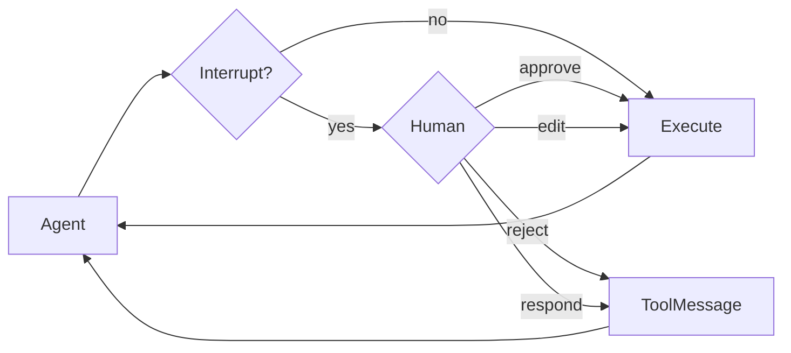

# Human-in-the-loop

Human-in-the-loop组件是基于langgraphd的interrupt_on参数，langchain&deep agent都需要基于langraph底层进行控制。


具体流程如下：



## 基础配置

通过在create_deep_agent的时候传入字典的选项，可以是True、False以及自定义的InterruptOnConfig参数，这个参数可以自定义用户选项，如果是默认的True，那么只有以下选项：
`allowed_decisions` 列表用于控制：人工审核工具调用时，可以执行哪些操作。

| Decision Type | Description | Example Use Case |
| ---- | ---- | ---- |
| **approve** | 使用 Agent 提出的原始参数执行工具。 | 按原文直接发送邮件草稿 |
| **edit** | 在执行前修改工具调用参数。 | 发送邮件前更改收件人 |
| **reject** | 完全跳过本次工具调用，并向 Agent 返回拒绝反馈。 | 拒绝文件删除操作，并说明理由 |
| **respond** | 将人类输入直接作为工具返回结果，**跳过工具执行**。专门用于 `ask_user` 这类工具。 | 直接回复 `ask_user` 提示，回答Agent的提问 |

> 使用说明：
> 当人工拒绝某个待执行动作时，请用 `reject`。
> `respond` **仅用于**人工充当工具的场景，例如回答 `ask_user` 提问。
> **不要**把 `respond` 用来拒绝有副作用的工具调用，因为模型会把它当成一次成功的工具返回结果。

使用示例：

```python
from langchain.tools import tool
from deepagents import create_deep_agent
from langgraph.checkpoint.memory import MemorySaver


@tool
def remove_file(path: str) -> str:
    """Delete a file from the filesystem."""
    return f"Deleted {path}"


@tool
def fetch_file(path: str) -> str:
    """Read a file from the filesystem."""
    return f"Contents of {path}"


@tool
def notify_email(to: str, subject: str, body: str) -> str:
    """Send an email."""
    return f"Sent email to {to}"


# Checkpointer is REQUIRED for human-in-the-loop
checkpointer = MemorySaver()

agent = create_deep_agent(
    model="google_genai:gemini-3.6-flash",
    tools=[remove_file, fetch_file, notify_email],
    interrupt_on={
        "remove_file": True,  # Default: approve, edit, reject, respond
        "fetch_file": False,  # No interrupts needed
        "notify_email": {"allowed_decisions": ["approve", "reject"]},  # No editing
    },
    checkpointer=checkpointer,  # Required!
)
```


## 条件中断

上述的中断是只要使用工具就会导致中断，如果只需要在某些情景下进行中断，那么可以配置when参数配置条件中断

```python
from deepagents import create_deep_agent
from langchain.agents.middleware import ToolCallRequest
from langgraph.checkpoint.memory import MemorySaver


def writes_outside_workspace(request: ToolCallRequest) -> bool:
    """Pause writes to paths outside the workspace directory."""
    path = request.tool_call["args"].get("file_path", "")
    return not path.startswith("/workspace/")


agent = create_deep_agent(
    model="google_genai:gemini-3.6-flash",
    interrupt_on={
        "write_file": {
            "allowed_decisions": ["approve", "edit", "reject"],
            "when": writes_outside_workspace,
        },
    },
    checkpointer=MemorySaver(),
)
```


>这里的when通过write_outside_workspace函数返回的True/False决定是否要中断。


## 处理中断

当触发中断时，智能体会暂停执行并收回控制权。在结果中检查中断并相应地进行处理。如果用户拒绝某项操作，请包含一条清晰的message，告知智能体该工具未执行以及下一步操作。
```python
from langchain_core.utils.uuid import uuid7
from langgraph.types import Command

# Create config with thread_id for state persistence
config = {"configurable": {"thread_id": str(uuid7())}}

# Invoke the agent
result = agent.invoke(
    {"messages": [{"role": "user", "content": "Delete the file temp.txt"}]},
    config=config,
    version="v2",
)

# Check if execution was interrupted
if result.interrupts:
    # Extract interrupt information
    interrupt_value = result.interrupts[0].value  
    action_requests = interrupt_value["action_requests"]
    review_configs = interrupt_value["review_configs"]

    # Create a lookup map from tool name to review config
    config_map = {cfg["action_name"]: cfg for cfg in review_configs}

    # Display the pending actions to the user
    for action in action_requests:
        review_config = config_map[action["name"]]
        print(f"Tool: {action['name']}")
        print(f"Arguments: {action['args']}")
        print(f"Allowed decisions: {review_config['allowed_decisions']}")

    # Get user decisions (one per action_request, in order)
    decisions = [
        {
            "type": "reject",
            "message": "User rejected deleting temp.txt. Do not retry deletion.",
        }
    ]

    # Resume execution with decisions
    result = agent.invoke(
        Command(resume={"decisions": decisions}),
        config=config,  # Must use the same config!
        version="v2",
    )

# Process final result
print(result.value["messages"][-1].content)
```

## 多工具调用

当agent调用多个需要审批的工具的时候，所有中断都会批量合并为一个单独的中断，所以必须按顺序为每个中断做出决策。

```python
config = {"configurable": {"thread_id": str(uuid7())}}

result = agent.invoke(
    {"messages": [{
        "role": "user",
        "content": "Delete temp.txt and send an email to admin@example.com"
    }]},
    config=config,
    version="v2",
)

if result.interrupts:
    interrupt_value = result.interrupts[0].value  
    action_requests = interrupt_value["action_requests"]

    # Two tools need approval
    assert len(action_requests) == 2

    # Provide decisions in the same order as action_requests
    decisions = [
        {"type": "approve"},  # First tool: delete_file
        {
            "type": "reject",
            "message": "User rejected this action. Do not retry this tool call.",
        }  # Second tool: send_email
    ]

    result = agent.invoke(
        Command(resume={"decisions": decisions}),
        config=config,
        version="v2",
    )
```

## Rejection messages

当审核员返回reject决策时，Deep Agents 会跳过工具调用并将拒绝反馈发送回智能体。如果省略message，默认反馈会告知模型该工具未执行，且除非用户要求，否则不得重试相同的工具调用。

当审核员返回reject决策时，Deep Agents 会跳过工具调用并将拒绝反馈发送回智能体。如果省略message，默认反馈会告知模型该工具未执行，且除非用户要求，否则不得重试相同的工具调用。

## 编辑工具参数

上述的interrupt参数可以让用户选择edit参数进而修改agent提出的工具参数


## SubAgent interrupts

**始终强调sub-agent也是编译的子图，同样也可以是使用interrupt_on进行配置sub-agent的中断**

```python
agent = create_deep_agent(
    model="google_genai:gemini-3.6-flash",
    tools=[delete_file, read_file],
    interrupt_on={
        "delete_file": True,
        "read_file": False,
    },
    subagents=[{
        "name": "file-manager",
        "description": "Manages file operations",
        "system_prompt": "You are a file management assistant.",
        "tools": [delete_file, read_file],
        "interrupt_on": {
            # Override: require approval for reads in this subagent
            "delete_file": True,
            "read_file": True,  # Different from main agent!
        }
    }],
    checkpointer=checkpointer
)
```


## 文件系统权限中断(内置工具)

除了通过interrupt_on配置tool的执行中断外，还可以在agent中设置文件权限的时候为interrupt


除了interrupt_on之外，你还可以**通过将权限规则标记为mode="interrupt"来暂停内置的文件系统工具。**当智能体在与中断模式规则匹配的路径上调用write_file或edit_file时，create_deep_agent会触发与已配置工具相同的人工参与中断，并将文件系统工具的名称作为操作名称。

```python
from deepagents import FilesystemPermission, create_deep_agent
from langgraph.checkpoint.memory import MemorySaver


agent = create_deep_agent(
    model=model,
    permissions=[
        FilesystemPermission(
            operations=["write"],
            paths=["/secrets/**"],
            mode="interrupt",
        ),
    ],
    checkpointer=MemorySaver(),  # Required to pause and resume
)

```


**注意：这是Deep agent的特殊的中断方式，当然同样的，你可以直接在create_deep_agent函数中传入interrupt_on包含内置工具名比如write_file等等类似，也同样可以起到中断工具执行的目的**

## 最佳实践

### 1. 始终设置checkpoint

人工参与模式需要一个检查点来在中断和恢复之间持久化智能体状态：

必须要通过持久化状态进行保存，而进行步骤恢复

```python
from langgraph.checkpoint.memory import MemorySaver

checkpointer = MemorySaver()
agent = create_deep_agent(
    model="google_genai:gemini-3.6-flash",
    tools=[...],
    interrupt_on={...},
    checkpointer=checkpointer  # Required for HITL
)
```

### 2. 使用相同线程id


**自然想要恢复到同一个会话的历史状态，那必须使用相同线程配置**

```python
# First call
config = {"configurable": {"thread_id": "my-thread"}}
result = agent.invoke(input, config=config, version="v2")

# Resume (use same config)
result = agent.invoke(Command(resume={...}), config=config, version="v2")
```


### 3. 使决策顺序和操作匹配

决策列表必须与action_requests的顺序一致,**尤其是单个中断多个决策的时候**：

```python
if result.interrupts:
    interrupt_value = result.interrupts[0].value  
    action_requests = interrupt_value["action_requests"]

    # Create one decision per action, in order
    decisions = []
    for action in action_requests:
        decision = get_user_decision(action)  # Your logic
        decisions.append(decision)

    result = agent.invoke(
        Command(resume={"decisions": decisions}),
        config=config,
        version="v2",
    )
```

### 4. 根据不同风险指定配置

根据风险等级配置不同工具：
```python
interrupt_on = {
    # High risk: full control (approve, edit, reject)
    "delete_file": {"allowed_decisions": ["approve", "edit", "reject"]},
    "send_email": {"allowed_decisions": ["approve", "edit", "reject"]},

    # Medium risk: no editing allowed
    "write_file": {"allowed_decisions": ["approve", "reject"]},

    # Low risk: no interrupts
    "read_file": False,
    "ls": False,
}
```