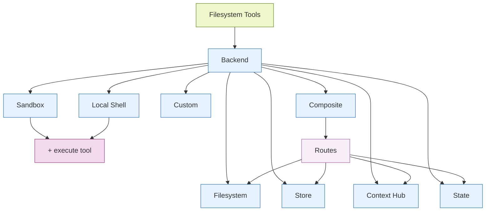

# Backends

由于上节有讲deep agent自带对应的文件操作工具等等，所以至少需要一个完整的文件系统提供给Agent操作，这个就是在创建deep agent需要指定的后端内容,**在 Deep Agents 的架构中，FilesystemMiddleware 和 SubAgentMiddleware 被归类为 “required scaffolding”（必需脚手架）。**


Deep Agents 通过 ls、read_file、write_file、edit_file、delete、glob 和 grep 等工具向智能体暴露文件系统接口。这些工具通过可插拔的后端运行。read_file 工具在所有后端中均原生支持图像文件（.png、.jpg、.jpeg、.gif、.webp），并将其作为多模态内容块返回。




## 1. StateBackend 
```python
from deepagents import create_deep_agent
from deepagents.backends import StateBackend

# By default we provide a StateBackend
agent = create_deep_agent(model="openai:gpt-5.5")

# Under the hood, it looks like
agent2 = create_deep_agent(
    model="openai:gpt-5.5",
    backend=StateBackend(),
)
```


这里就是直接存储到agent的State当中(内存中)，当然可以通过checkpoint进行状态持久化，但是是同线程的state状态持久化，不能**跨线程共享**

**请注意，此后端由主管智能体和子智能体共享，子智能体写入的任何文件都将保留在 LangGraph 智能体状态中，即使该子智能体执行完成后也是如此。这些文件将继续对主管智能体和其他子智能体可用。**


适用场景：
1. agent提供临时文件写入，但不持久化
2. 自动清理大型工具输出，智能体随后可逐段读取这些输出。


## 2. StoreBackend（langgraph的store）

和1对应的就是能够跨线程存储的BaseStore中，也就是实现了跨线程
```python
from deepagents import create_deep_agent
from deepagents.backends import StoreBackend
from langgraph.store.memory import InMemoryStore

agent = create_deep_agent(
    model="openai:gpt-5.5",
    backend=StoreBackend(
        namespace=lambda rt: (rt.server_info.user.identity,),
    ),
    store=InMemoryStore(),  # Good for local dev; omit for LangSmith Deployment
)

```

**StoreBackend 将文件存储在运行时提供的 LangGraph BaseStore 中，支持跨线程持久存储。通过选定的存储字段**

### Namespace factories

`Namespace factories`（命名空间工厂）是 `Deep Agents` 框架中用于**动态决定持久化存储命名空间**的核心机制。它本质上是一个函数，在运行时根据当前上下文（如用户ID、工作区ID等）动态生成一个命名空间元组，从而实现**多用户/多租户的数据隔离**。

### 🎯 含义与核心作用

在 `Deep Agents` 的存储后端（主要是 `StoreBackend`）中，数据是以键值对的形式存储在 `LangGraph` 的 `BaseStore` 里的。**命名空间（Namespace）** 就是这个存储空间里的逻辑分区，用于组织和管理文件，类似于文件系统中的文件夹路径。

**Namespace Factory（命名空间工厂）** 就是一个**可调用对象（通常是 lambda 函数或普通函数）**，它接收运行时上下文，并返回一个字符串元组作为命名空间。其核心作用在于：

*   **实现数据隔离**：这是最主要的作用。通过为不同用户、不同助理或不同工作区生成不同的命名空间，确保每个实体的数据（如记忆、偏好文件）完全独立，互不干扰。
*   **提供灵活性**：相比于固定的静态命名空间，工厂函数允许你根据请求的动态信息（如 `user_id`）来决定数据的存储位置，非常适合 SaaS 或多租户场景。

### ⚙️ 如何使用：参数与类型

`NamespaceFactory` 的类型定义如下（Python）：
```python
NamespaceFactory = Callable[[BackendContext[Any, Any]], tuple[str, ...]]
```
它接收一个 `BackendContext` 对象（在旧版本中）或 `Runtime` 对象（在新版本中），并返回一个字符串元组。

**关键上下文信息**：
工厂函数可以访问以下信息来构建命名空间：
*   **用户ID**：例如 `ctx.runtime.context.user_id` 或 `rt.server_info.user.identity`。
*   **工作区ID**：例如 `ctx.runtime.context.workspace_id`。
*   **助理ID**：用于多智能体场景下的隔离。
*   **组织ID**：例如 `rt.context.org_id`。

**重要提醒**：命名空间组件中**禁止使用通配符 `*`**，以防止意外的数据访问或路径遍历攻击。

### 💻 使用示例

以下是几种常见的使用模式，展示如何利用命名空间工厂实现不同的隔离策略。

#### 1. 最简单的静态命名空间
如果你的应用不需要动态隔离，可以直接提供一个固定的命名空间元组。
```python
from deepagents.backends import StoreBackend

# 所有数据都存储在 ("filesystem",) 这个命名空间下
backend = StoreBackend(rt, namespace=lambda _ctx: ("filesystem",))
```
此示例来自相关提交记录。

#### 2. 按用户隔离（User-Scoped）
这是最常见的用法，为每个用户创建一个独立的存储空间。这可以确保一个用户的偏好、记忆不会泄露给另一个用户。

**方式一：使用命名函数**
```python
from deepagents.backends import StoreBackend, BackendContext

def user_namespace(ctx: BackendContext) -> tuple[str, ...]:
    # 返回 ( "filesystem", "user-alice" ) 这样的元组
    return ("filesystem", ctx.runtime.context.user_id)

backend = StoreBackend(rt, namespace=user_namespace)
```
此示例展示了如何通过命名函数清晰地定义逻辑。

**方式二：使用 Lambda 表达式（新版本写法）**
在新版本的 `Deep Agents` 中，工厂函数直接接收 `Runtime` 对象。
```python
from deepagents.backends import StoreBackend

# 假设当前用户的 ID 是 "user-alice"
# 那么命名空间就是 ("filesystem", "user-alice")
backend = StoreBackend(
    rt, 
    namespace=lambda rt: ("filesystem", rt.server_info.user.identity)
)
```
此写法参考了最新的迁移指南。

#### 3. 多级隔离（工作区 + 用户）
在更复杂的应用中，你可能需要同时按工作区和用户进行隔离。
```python
backend = StoreBackend(
    rt,
    namespace=lambda ctx: (
        "workspace",
        ctx.runtime.context.workspace_id,  # 工作区 ID
        "user",
        ctx.runtime.context.user_id,       # 用户 ID
    ),
)
```
这个例子创建了一个类似 `("workspace", "ws-123", "user", "user-alice")` 的命名空间，实现了两级隔离。

#### 4. 与 `CompositeBackend` 结合路由到不同存储
命名空间工厂的另一个强大之处在于，可以结合 `CompositeBackend` 将文件系统路径路由到不同的后端和命名空间。例如，将 `/memories/` 路径下的文件持久化到以用户为单位的命名空间中。
```python
from deepagents.backends import CompositeBackend, StoreBackend

backend = CompositeBackend(
    default=...,
    routes={
        "/memories/": StoreBackend(
            store=mem_store,
            # 将 /memories/ 下的所有操作都限定在 ("memories",) 命名空间
            namespace=lambda _rt: ("memories",),
        ),
    },
)
```
此示例展示了如何通过命名空间工厂对特定路径的存储进行精细控制。

### 📝 总结

`Namespace factories` 是 `Deep Agents` 中实现**动态数据隔离**的关键抽象。通过一个简单的函数，你就能轻松为每个用户、每个会话或每个工作区创建独立且安全的存储空间，从而构建出可支持多租户的生产级 AI 应用。在实际使用时，请根据你的 `deepagents` 版本选择合适的参数类型（`BackendContext` 或 `Runtime`），并避免在命名空间中使用通配符。


## 3. FilesystemBackend(local disk)

**FilesystemBackend 在可配置的根目录下读写真实文件。**

```python
from deepagents import create_deep_agent
from deepagents.backends import FilesystemBackend

agent = create_deep_agent(
    model="openai:gpt-5.5",
    backend=FilesystemBackend(root_dir=".", virtual_mode=True),
)
```

1. 操作目录韦root_dir读写真实文件
2. 你可以选择设置 virtual_mode=True 以对 root_dir 下的路径进行沙箱化处理和规范化。
3. 适用安全的路径解析方式，尽可能防止不安全的符号链接比案例，可用ripgrep实现快速的grep功能


适用场景：
1. 本地项目
2. CI沙箱
3. 挂载的持久卷

**注意：在单纯使用 FilesystemBackend 的情况下，Agent 产生的所有东西——包括你提到的对话历史等内部数据——都会写入 root_dir 对应的真实文件系统磁盘中。**


在大多数场景下，将FilesystemBackend封装在CompositeBackend中。Deep Agents 会自动将内部数据写入后端，包括卸载的大型工具结果（存储在/large_tool_results/路径下）和对话历史（存储在/conversation_history/路径下）。当你单独使用FilesystemBackend时，这些内部文件会写入root_dir对应的真实磁盘中，导致智能体生成的文件与项目文件混在一起。

```python
from deepagents import create_deep_agent
from deepagents.backends import CompositeBackend, StateBackend, FilesystemBackend

agent = create_deep_agent(
    backend=CompositeBackend(
        default=StateBackend(),
        routes={
            "/workspace/": FilesystemBackend(root_dir="/path/to/project", virtual_mode=True),
        },
    )
)
```

这样一来，智能体在 /workspace/ 目录下的读写操作会指向真实磁盘，而卸载的工具结果及其他内部数据则保留在临时状态中。

**上述就是一个简单的agent操作路由**

## 4. LocalShellBackend(Local shell)

**这个backend会新增execute工具，agent能够在对对应backend执行无限制的shell执行权限**


适用场景：
1. 本地开发命令行界面
2. 新人agent代码的个人开发环境
3. 具备完善密钥管理的CI/CD流水线

非适用场景：
1. 生产环境（例如 Web 服务器、API、多租户系统）
2. 处理不可信的用户输入或执行不可信的代码

**注意安全问题：agent能够执行任意shell命令，可能包括信息泄露、文件修改/删除不可逆等等强风险行为**


```python
from deepagents import create_deep_agent
from deepagents.backends import LocalShellBackend

agent = create_deep_agent(
    model="openai:gpt-5.5",
    backend=LocalShellBackend(root_dir=".", virtual_mode=True, env={"PATH": "/usr/bin:/bin"}),
)
```
**Shell 命令以 root_dir 作为工作目录，但可以访问系统上的任意路径。**


## 5. ContextHubBackend

将你的智能体的文件系统存储在 LangSmith Context Hub 代码仓库中。它可以使用独立的代码仓库，也可以使用指向技能代码仓库的智能体代码仓库。


**通常用不上这个backend**


## 6. CompositeBackend(Router)


```python
from deepagents import create_deep_agent
from deepagents.backends import CompositeBackend, StateBackend, StoreBackend
from langgraph.store.memory import InMemoryStore

agent = create_deep_agent(
    model="openai:gpt-5.5",
    backend=CompositeBackend(
        default=StateBackend(),
        routes={
            "/memories/": StoreBackend(namespace=lambda _rt: ("memories",)),
        },
    ),
    store=InMemoryStore(),  # Store passed to create_deep_agent, not backend
)
```

CompositeBackend 根据路径前缀将文件操作路由到不同的后端。**Agent在需要文件操作的时候需要传入文件路径，然后交给compositeBackend，根据字典中的不同字段匹配到对应的backend进行处理**

在列表和搜索结果中保留原始路径前缀。

适用场景：
1. 当你希望为你的智能体同时提供线程级作用域和跨线程存储时，CompositeBackend 允许你同时配置一个 StateBackend 和 StoreBackend
2. 当你有多个信息源想要作为单个文件系统的一部分提供给你的智能体时。


## 7. Custom Backend

实现一个自定义后端，将深度智能体连接到数据库、对象存储和远程文件系统等存储系统。

**需要实现BackendProtocol这个内部协议，也就是需要定义对应的类继承于BackendProtocol**

可以直接继承BackendProtocol或者继承BackendProtocol的子类，比如上述1-5的所有子类。


# Permissions

使用权限以声明式方式控制智能体可以读取或写入哪些文件和目录。权限适用于内置的文件系统工具，并在调用后端之前进行评估。

```python
from deepagents import create_deep_agent, FilesystemPermission

agent = create_deep_agent(
    model="google_genai:gemini-3.6-flash",
    backend=CompositeBackend(
        default=StateBackend(),
        routes={
            "/memories/": StoreBackend(
                namespace=lambda rt: (rt.server_info.user.identity,),
            ),
            "/policies/": StoreBackend(
                namespace=lambda rt: (rt.context.org_id,),
            ),
        },
    ),
    permissions=[
        FilesystemPermission(
            operations=["write"],
            paths=["/policies/**"],
            mode="deny",
        ),
    ],
)
```