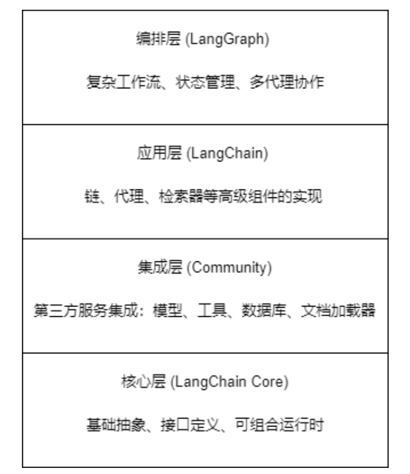

首先，langchain能够满足90%的agent开发，主要原因在于：
    1. langchain 对底层的langchain-core的基类有转发(装饰器@tool、@chain|消息基类BaseMessage、HumanMessage/AIMessage/SystemMessage/ToolMessage|模型抽象基类BaseChatModel、BaseLLM、BaseEmbeddings|工具体系BaseTool、StructuredTool|整套（LCEL）Runnable、RunnableLambda、RunnableParallel、RunnablePassthrough|Prompt | 输出解析ChatPromptTemplate、BaseOutputParser、Json/Pydantic 解析器|RAG 底层抽象|Document、BaseRetriever、BaseVectorStore|通用回调、序列化、基础异常),所以可以直接在langchain中直接引入对应的类或者装饰器，但本质还是对langchain-core的转发。
    2. 除了上述对langchain-core的转发之外，langchain还有对上层业务的封装,节点的快速封装(装饰器中间件部分)，比如init_chat_model，，该函数依赖langchain-core定义的模型抽象基类，同时自动适配langchain-openai、langchain-ollama等第三方模型集成包，然后才能封装，初始化模型
    3. 在上述core基类以及部分零件的封装之后，那么需要最终合成为agent，实现具能够React的agent，就需要使用到langgraph这类图编排器，通过维护全局状态或者函数调用，构建其工作流，比如create_agent(model=?,tools=[]...),然后才是一个完整的agent

综上所述，langchain-core是langchain体系的核心，具有最基础的类定义、装饰器等，然后利用langgraph的图编排(GraphAPI，全局共享State,图节点编排)或者函数式调用(FuncAPI,函数调用、全局无state，通过参数传递数据)功能，将langchian-core中的类或者langchian的中级封装组件(init_chat_model()等函数)对应到一个大的状态图和工作流里面，比如使用create_agent(model=?,tools=[],...)然后才是完整的agent实现


## 🗺️ LangChain 生态三层架构地图

整个生态可以理解为**三层同心圆**，越底层越基础、越稳定，越上层越便捷、越贴近业务。


### 🧱 第一层：`langchain-core` — 基础抽象层

**定位**：整个生态的**地基**，只定义接口和抽象基类，不提供具体实现。它定义了“什么是聊天模型”“什么是工具”，但不知道“用哪个模型”。

| 模块 | 核心内容 | 你会用到的场景 |
| :--- | :--- | :--- |
| `language_models` | `BaseChatModel`、`BaseLLM` | 自   定义模型适配器 |
| `messages` | `HumanMessage`、`AIMessage`、`ToolMessage` | 手动构造对话消息 |
| `runnables` | `Runnable`、`RunnableLambda`、`RunnableSequence` | LCEL 链式组合、流式处理 |
| `prompts` | `ChatPromptTemplate`、`MessagesPlaceholder` | 提示词模板 |
| `tools` | `BaseTool`、`tool` 装饰器 | 定义工具 |
| `output_parsers` | `PydanticOutputParser`、`StrOutputParser` | 结构化输出解析 |
| `vectorstores` | `VectorStore`、`InMemoryVectorStore` | 向量存储接口 |
| `retrievers` | `BaseRetriever` | 检索器接口 |
| `documents` | `Document` | 文档抽象 |
| `embeddings` | `Embeddings` | 嵌入模型接口 |
| `callbacks` | `BaseCallbackHandler` | 追踪、日志、监控 |
| `caches` | `BaseCache`、`InMemoryCache` | 缓存机制 |
| `rate_limiters` | `BaseRateLimiter` | 速率限制 |

> **核心心智模型**：`langchain-core` 回答的是 **“标准是什么”** 。所有生态组件都必须实现这里定义的接口，才能互通。

`langchain-core` 是 **依赖树的根节点**——它不依赖任何其他 LangChain 包，但 `langchain` 和 `langgraph` 都依赖它。


### 🎯 第二层：`langchain` — 代理框架层

**定位**：在 `langchain-core` 之上，提供**开箱即用的代理构建能力**和**丰富的集成实现**。LangChain 1.0 的核心变化是**放弃旧的 Chain 设计，转向以 `create_agent` 为中心的标准化 ReAct 代理**。

#### 核心入口：`langchain.agents`

| 模块 | 内容 | 说明 |
| :--- | :--- | :--- |
| `create_agent()` | 标准 ReAct 代理工厂 | **最高频使用的函数**，一行代码创建代理 |
| `AgentMiddleware` | 中间件基类 | 自定义代理循环行为的核心接口 |
| `middleware` 子模块 | 预构建中间件 | `SummarizationMiddleware`、`HumanInTheLoopMiddleware`、`PIIMiddleware` 等 |

#### 中间件系统（LangChain 1.0 的核心创新）

中间件是你在**不离开上层 API** 的前提下，获得底层控制力的方式。它定义了一组 Hook，让你在代理循环的每个关键点插入自定义逻辑：

| Hook | 触发时机 | 典型用途 |
| :--- | :--- | :--- |
| `before_model` | 模型调用前 | 上下文压缩、PII 脱敏、动态提示词 |
| `wrap_model_call` | 包裹模型调用 | 重试、缓存、模型回退、日志 |
| `wrap_tool_call` | 包裹工具调用 | 参数校验、错误恢复、工具监控 |
| `after_agent` | 代理循环结束后 | 后处理、结果格式化 |

这些中间件最终会被**编译进底层的 LangGraph 图**中执行——你在 `langchain` 层定义行为，`langgraph` 在运行时调用它们。

#### 其他关键子模块

- **`langchain.tools`**：`StructuredTool`、`tool` 装饰器（从 core 重新导出并扩展）
- **`langchain.messages`**：增强的消息类型
- **`langchain.chat_models`**：具体模型集成（`ChatOpenAI`、`ChatAnthropic` 等）
- **`langchain.embeddings`**：具体嵌入模型集成

> **核心心智模型**：`langchain` 回答的是 **“怎么快速搭建标准代理”** 。如果你只需要一个常规的 ReAct 代理，`create_agent` + 几个中间件就够了，**不需要直接接触 LangGraph**。


### ⚙️ 第三层：`langgraph` — 编排运行时层

**定位**：**底层执行引擎**，负责状态管理、流程控制和持久化。它不关心“代理”是什么，只关心“节点和边如何执行”。

#### 核心原语

| 概念 | 是什么 | 类比 |
| :--- | :--- | :--- |
| **State** | 共享数据结构，在节点间流转 | 一个全局的“上下文对象” |
| **Node** | 一个函数，接收 State，返回 State 更新 | 工作流中的一个“步骤” |
| **Edge** | 决定下一个执行哪个 Node 的函数 | “路由规则” |
| **StateGraph** | 主图类，参数化用户定义的 State | 整张工作流的“蓝图” |
| **compile()** | 编译图，检查结构并附加运行时配置 | “编译”成可执行对象 |

> LangGraph 的核心算法受 Google Pregel 启发，以 **“超级步”（super-step）** 为单位推进：同一超级步内并行执行的节点，等待所有节点完成后进入下一步。

#### 持久化层（生产级能力的核心）

| 机制 | 作用范围 | 用途 |
| :--- | :--- | :--- |
| **Checkpointer** | 线程内（thread-scoped） | 短期记忆：对话连续性、人机交互、时间旅行、容错 |
| **Store** | 跨线程（cross-thread） | 长期记忆：用户偏好、学习到的事实、设置 |

Checkpointer 在每个超级步保存状态快照；Store 在图状态之外持久化应用定义的数据。

#### 预构建组件：`langgraph.prebuilt`

- `create_react_agent`：**已弃用**，被 `langchain.agents.create_agent` 取代
- `ToolNode`：工具执行节点
- 验证辅助函数

#### 其他关键模块

- **`langgraph.graph`**：`StateGraph`、`START`、`END`、`Command`
- **`langgraph.checkpoint`**：`MemorySaver`、`SqliteSaver`、`PostgresSaver`
- **`langgraph.store`**：`InMemoryStore`、`PostgresStore`
- **`langgraph.types`**：`Send`、`interrupt`

> **核心心智模型**：`langgraph` 回答的是 **“怎么精确控制每一步”** 。当你需要条件分支、循环、并行、人工干预、故障恢复时，就必须下沉到这一层。


### 🔗 三者关系全景图

```
┌─────────────────────────────────────────────────────────┐
│                    你的应用代码                          │
├─────────────────────────────────────────────────────────┤
│  langchain                                              │
│  ├── create_agent()  ──────────────► 编译为 LangGraph 图 │
│  ├── AgentMiddleware (wrap_model_call, wrap_tool_call)   │
│  ├── 预构建中间件 (Summarization, HITL, PII...)          │
│  └── 集成层 (ChatOpenAI, ChatAnthropic, 工具集成...)     │
├─────────────────────────────────────────────────────────┤
│  langgraph                                              │
│  ├── StateGraph / Node / Edge / State                   │
│  ├── Checkpointer (短期记忆) + Store (长期记忆)          │
│  ├── 条件分支 / 循环 / 并行 / 人机交互                   │
│  └── prebuilt: ToolNode, create_react_agent (已弃用)     │
├─────────────────────────────────────────────────────────┤
│  langchain-core                                         │
│  ├── BaseChatModel / BaseTool / BaseRetriever            │
│  ├── Runnable / messages / prompts / output_parsers      │
│  └── callbacks / caches / embeddings / vectorstores      │
└─────────────────────────────────────────────────────────┘
```

**依赖方向**：`langchain-core` ← `langchain` ← `langgraph`（反向依赖）。`langchain` 和 `langgraph` 都依赖 `langchain-core`，但 `langchain` 的 `create_agent` 在运行时需要 `langgraph` 作为执行引擎。


### 🧭 快速定位：你的需求在哪一层？

| 你的需求 | 应该看哪一层 |
| :--- | :--- |
| 定义一个新的聊天模型适配器 | `langchain-core`（实现 `BaseChatModel`） |
| 创建一个标准的 ReAct 代理 | `langchain`（`create_agent`） |
| 在模型调用前压缩上下文 | `langchain`（`SummarizationMiddleware`） |
| 在每次工具调用时记录日志 | `langchain`（`wrap_tool_call` 中间件） |
| 构建一个条件分支工作流（如 RAG + 回退） | `langgraph`（`StateGraph` + 条件边） |
| 实现代理的故障恢复和断点续跑 | `langgraph`（Checkpointer） |
| 跨会话记住用户偏好 | `langgraph`（Store） |
| 构建多代理协作系统 | `langgraph`（子图 + 并行节点） |
| 在复杂图中嵌入一个标准代理作为节点 | `langgraph` 节点内调用 `langchain` 的 `create_agent` |

**一句话总结**：`langchain-core` 是**词汇表**，`langchain` 是**常用句型手册**，`langgraph` 是**语法引擎**。日常对话用句型手册就够了，但写复杂文章时，你需要直接操控语法。