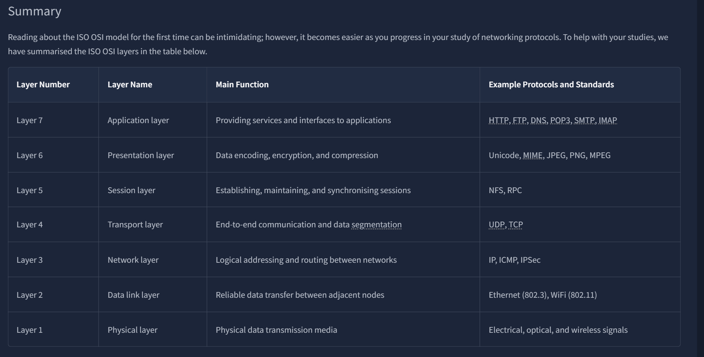
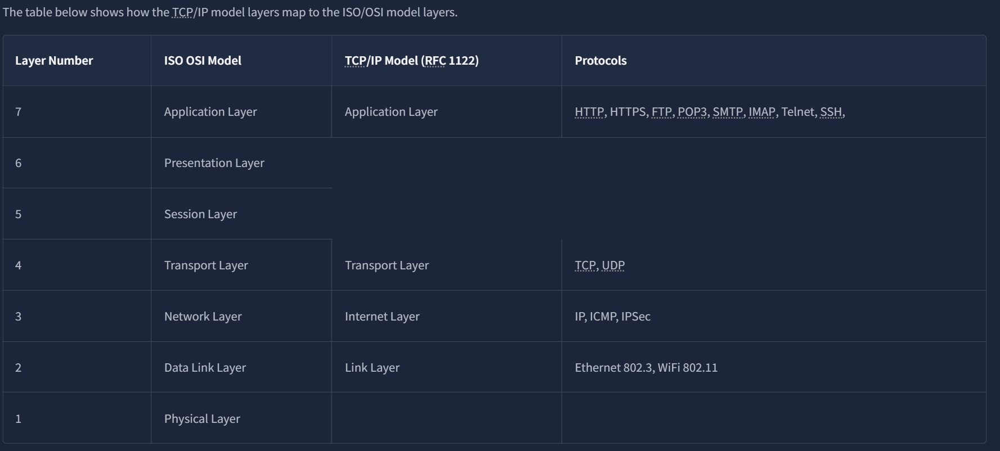

# Networking

> **相关笔记**: [[experience|TryHackMe入门]] | [[commandline|命令行]] | [[../../../../计算机通用/计算机网络/应用层/HTTP协议|HTTP协议]] | [[../../../../计算机通用/计算机网络/传输层/TCP|TCP协议]] | [[../../../渗透/常用服务类型/protocols|常见服务端口]]

## Networking Concepts

### OSI Model

- 应用层
- 表示层
- 会话层
- 传输层
- 网络层
- 链路层
- 物理层

### TCP/IP Model

讲述主要TCP/IP模型

### IP/SUBNET

- ip组成以及子网掩码等知识
- Public IP /Private IP
> Private IP examples
>10.0.0.0 - 10.255.255.255 (10/8)
>172.16.0.0 - 172.31.255.255 (172.16/12)
>192.168.0.0 - 192.168.255.255 (192.168/16)
- 网络寻址

### UDP & TCP

### Encapsulation(封装) 

### telnet

一种用于远程终端的网络协议，允许你连接到远程系统并通信，还可以发送文本命令
