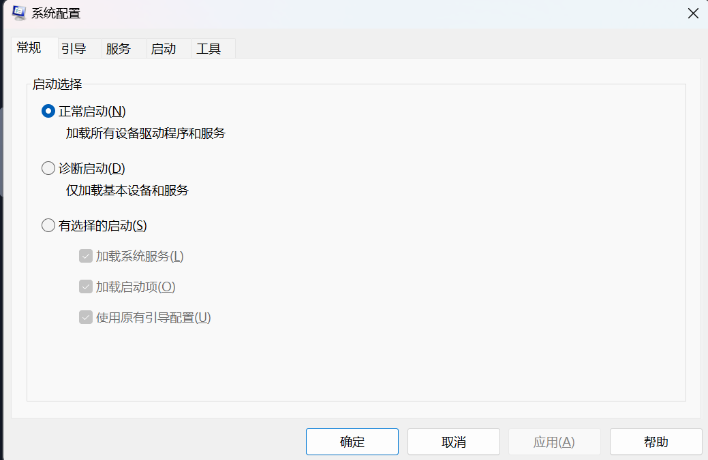
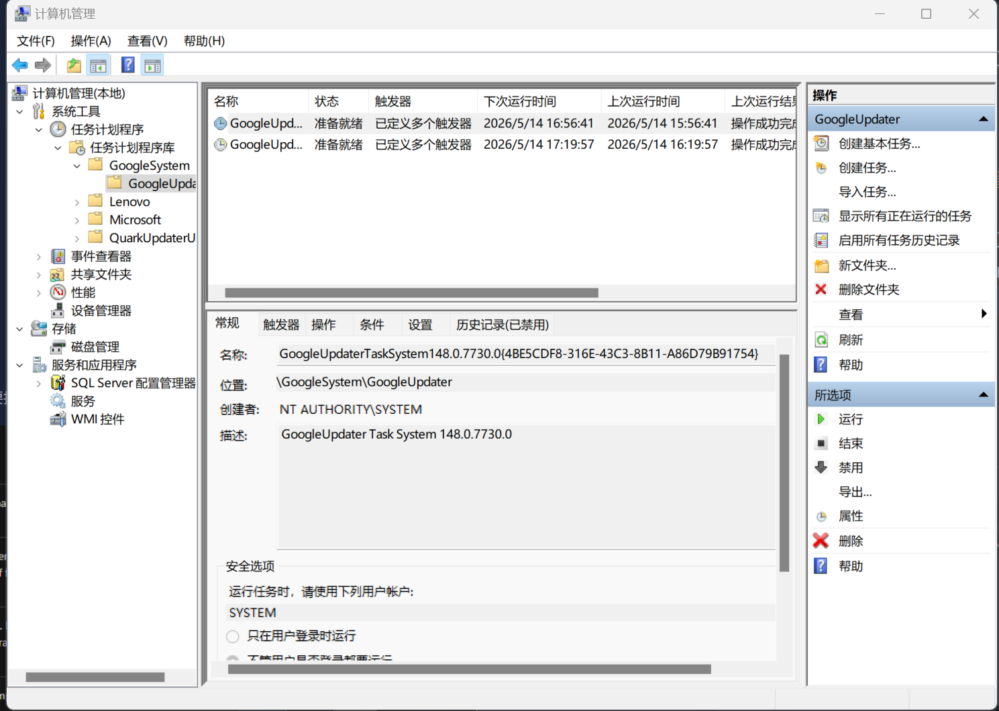
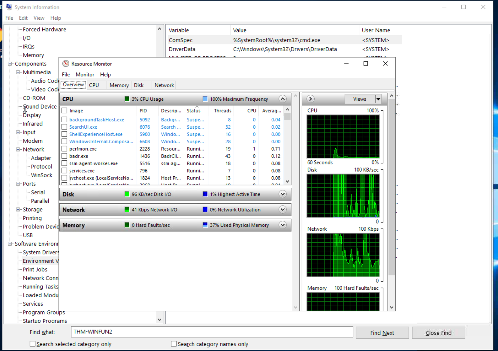
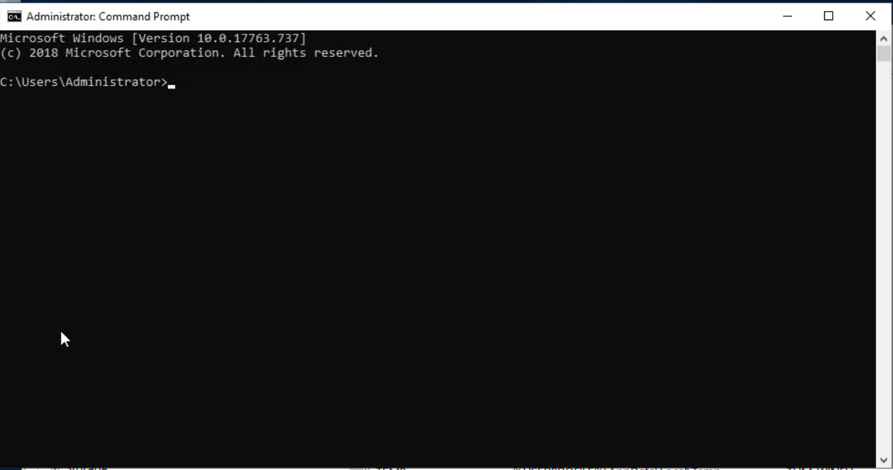
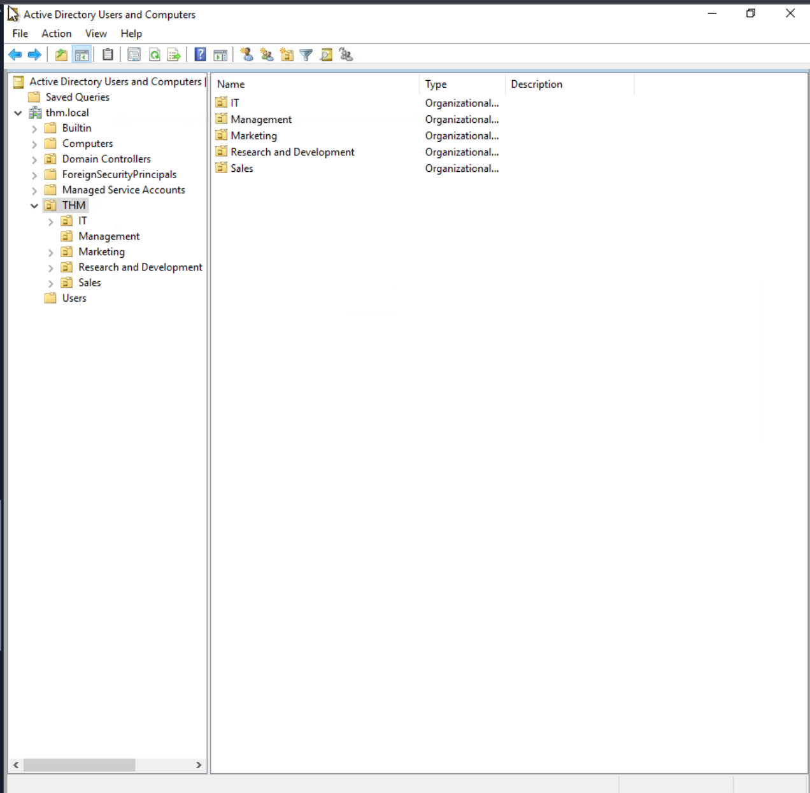

# foudmental one

> **相关笔记**: [[experience|TryHackMe入门]] | [[commandline|命令行]] | [[network|网络基础]]

windows专业版可以使用BitLocker加密功能

简单的ui介绍

文件系统：NFTFS 权限问题（①Full control
②Modify
③Read & Execute
④List folder contents
⑤Read
⑥Write）：备用数据流

 Windows 目录的系统环境变量是%windir%

账户：
- administrator
- users
*初始命令运行lusrmgr.msc window 10及以下可以查看users所有状况，windows11则需要打开：控制面板\用户帐户\用户帐户\管理帐户*

windows的UAC(User Account Control)来管理权限问题

设置与控制面板的使用（两者相通

任务控制器（task manager）或者使用ctrl+shift+esc快捷键打开

# foundamental two

**System Configuration**:MSConfig:诊断启动问题，**需要administrator才能启动**：

- **general**：
    - normal
    - diagnostic
    - slecttive

- **Boot**:
引导程序Boot

- **Services**：

control.exe程序用来打开控制面板

UserAccountControlSetting.exe用于打开User Account Control Setting

**compmgmt.msc程序 计算机管理**：

- 系统工具
    - tesk scheduler
    - event viewer
        - log
    - shared folder

- 存储
    - 磁盘管理

- 服务和应用程序

**System Configuration**

msinfo32.exe--system information **设备信息**

**资源监视器**
resmon.exe

**命令提示符**：
cmd.exe

命令举例：
- hostname
- whoami
- ipconfig 查看网络地址信息
- ipconfig /? 查看ipconfig帮助手册
- cls 等于clear
- netstat 显示协议统计信息和当前的tcp/ip连接
- net 管理网路资源 ，查看帮助信息需要net help

**Registry Editor**：
regedt32.exe 用于打开用户注册

# foundamental 3

## windows security

- virus &threat protection
- firewall & network 
protection
  - WF.msc打开防火墙
-app $browser control
- device security

## bitlocker

## Volume Shadow Copy Service

# Active Directory

## windows domain

Windows 域是指由特定企业管理的一组用户和计算机。域背后的主要思想是将 Windows 计算机网络中常用组件的管理集中到一个称为 Active Directory 的存储库中（广告运行 Active Directory 服务的服务器称为域控制器（DC）

## Active Directory Domain Service (AD DS)

active directory

domain controller

一个domain之下分为多个子单元，每个用于只能从属一个organisation

## ManageUsers in AD

## Manage Computers in AD

## group Policies

## Authentication Methods

## Tree、forest & trust relationship

