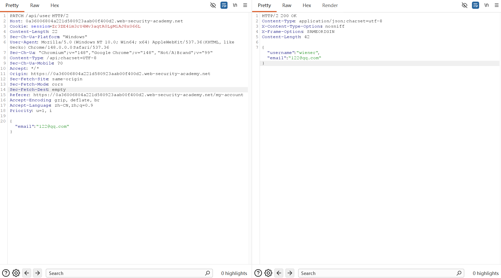
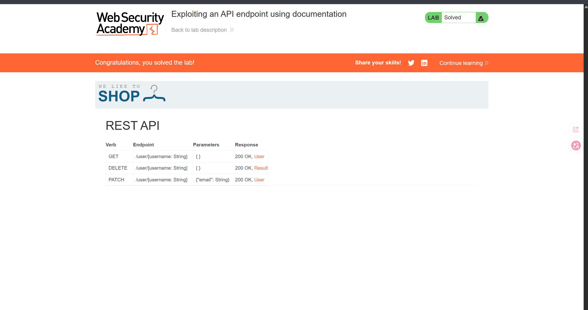
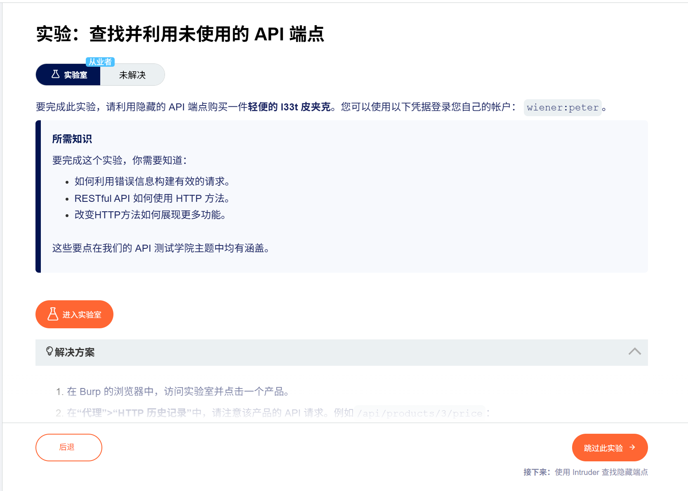
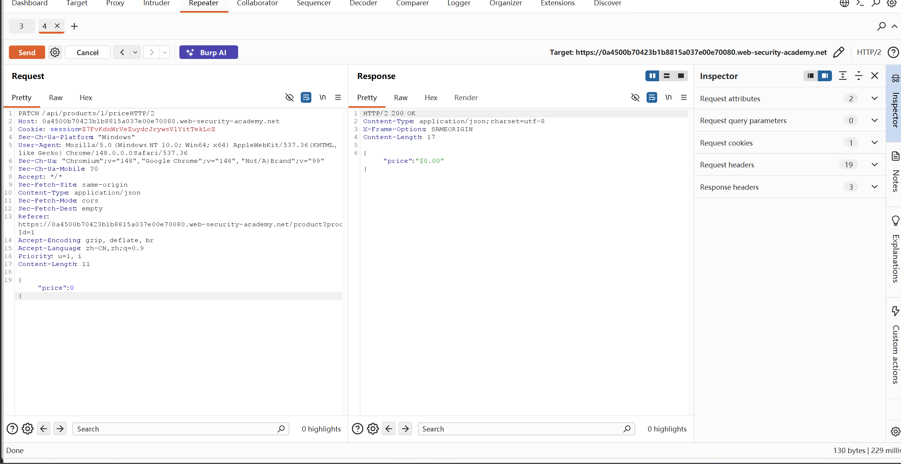

# API

> **相关笔记**: [[../../DVWA/学习路径|DVWA靶场]] | [[../../../../计算机通用/计算机网络/应用层/HTTP协议|HTTP协议]] | [[../SSRF/SSRF|SSRF]] | [[../authentication|认证漏洞]] | [[../webLLMattack|Web LLM攻击]]

API大多数文档都是公开的，尤其是看到请求交互中存在API调用特征，比如：
- /api
- /swagger/index.html
- openai.json

API分为人类可读和机器可读，机器可读的一些交互特征需要仔细甄别，但万变不离其中，都是在请求头的交互当中，比如url、请求头、user-agent,referer、cookie等等

## 实验

### Lab: Exploiting an API endpoint using documentation



可以看到可疑的api请求头，然后修改为api，发现返回了api请求文档，然后删除即可



### Lab2：

api可能支持多种HTTP方法，比如DELETE表示删除，POST表示创建等等特征

API需要固定的格式才能触发，比如需要修改Content-Type等字段，JSON和XML的数据转换等情况


首先登录，然后点击任何商品发现后面有api连接，请求所选商品的价格，那么，通过修改请求头GET->OPTIONS,发现可选的请求头有GET和PATCH，那么利用这个PATCH点击发送，那么会提示‘bad request’，那么休要请求体中包含‘Content-Type： application/json’字段，然后再在请求体中添加{"price":0}后发送，则成功修改当前商品的价格为0，浏览器中重新刷新，则表示jacket为$0,直接点击加入购物车，然后付款即可


### Mass assignment Vulnerability

讲的就是你通过一个请求，然后服务器返回多余的字样比如”isAdmin：False“，然后增加攻击暴露面，产生的漏洞

## APIs的防护

在设计API时，请务必从一开始就将安全性纳入考量。特别要注意以下几点：
- 如果你的API不打算公开访问，请保护好相关文档。
- 确保文档及时更新，以便合法测试人员能够全面了解API的攻击面。
- 对允许使用的HTTP方法采用白名单机制。
- 验证每个请求或响应的内容类型是否符合预期。
- 使用通用错误消息，避免泄露可能对攻击者有用的信息。
- 对所有版本的API采取保护措施，而不仅仅是当前的生产版本。

为防止批量赋值漏洞，请对白名单中用户可更新的属性进行放行，对不应由用户更新的敏感属性进行黑名单拦截。

## 服务端参数污染


### 截断请求字符串

`GET /userSearch?name=peter%23foo&back=/home`
使用%23 -> #为截断字符，可以截断后续内容

### 尝试其他参数
`GET /userSearch?name=peter%26foo=xyz&back=/home`

添加其他参数，观察服务器响应，不过有些牵强，尤其是不知道有什么可能的参数的情况下

### 注入有效参数（已经确定

`GET /userSearch?name=peter%26email=foo&back=/home`
如果已知有email参数就可以直接尝试注入，%26是&的url编码

### 覆盖现有参数

`GET /userSearch?name=peter%26name=carlos&back=/home`

两个参数取决于服务器后端的处理，通常有如下情况：
- PHP 只解析最后一个参数。这将导致用户搜索carlos。
- ASP.NET 会同时使用这两个参数。这会导致用户搜索peter,carlos，从而可能出现Invalid username错误消息。
- Node.js/Express 只会解析第一个参数。这会导致用户搜索“” peter，但返回的结果却不会改变。

### 测试REST路径中的参数污染

假设有一个应用程序，允许用户根据用户名编辑用户个人资料。请求会发送到以下端点：

GET /edit_profile.php?name=peter
这将导致以下服务器端请求：

GET /api/private/users/peter

您可以将 URL 编码后的peter/../admin值作为name参数值提交：

GET /edit_profile.php?name=peter%2f..%2fadmin
这可能会导致以下服务器端请求：

GET /api/private/users/peter/../admin

### 格式化数据中的参数污染

测试结构化数据格式中的服务器端参数污染
攻击者可能能够操纵参数，从而利用服务器处理其他结构化数据格式（例如 JSON 或 XML）时的漏洞。为了测试这一点，可以将意外的结构化数据注入用户输入，并观察服务器的响应。

假设有一个应用程序，允许用户编辑个人资料，然后通过向服务器端 API 发送请求来应用更改。当您编辑姓名时，您的浏览器会发出以下请求：

POST /myaccount
name=peter
这将导致以下服务器端请求：

PATCH /users/7312/update
{"name":"peter"}
您可以尝试access_level按如下方式将参数添加到请求中：

POST /myaccount
name=peter","access_level":"administrator
如果用户输入未经充分验证或清理就被添加到服务器端 JSON 数据中，则会导致以下服务器端请求：

PATCH /users/7312/update
{"name":"peter","access_level":"administrator"}、

##### 转义符转移，还是污染参数

您可以尝试access_level按如下方式将参数添加到请求中：

POST /myaccount
{"name": "peter\",\"access_level\":\"administrator"}
如果用户输入被解码后，没有经过适当的编码就添加到服务器端的 JSON 数据中，这将导致以下服务器端请求：

PATCH /users/7312/update
{"name":"peter","access_level":"administrator"}

防止服务器参数污染（HPP），核心是**拒绝重复参数、严格白名单、统一解析、层层校验**，下面从原理到落地讲清楚。

---

### 一、什么是参数污染（HPP）
攻击者在请求中**重复提交同名参数**（如 `?id=1&id=2`），利用**服务器/中间件/后端解析不一致**，篡改业务逻辑、越权或注入。
- 示例：`/transfer?amount=100&amount=1`
- 危害：金额被篡改为 1、绕过权限、SSRF/注入等。

---

### 二、核心防御原则
1. **零信任**：所有参数都不可信，服务端强制校验。
2. **白名单优先**：只允许已知参数，拒绝未知。
3. **禁止重复**：敏感参数（id/amount/role）不允许数组。
4. **统一解析**：中间件、框架、业务代码解析规则一致。
5. **纵深防御**：WAF→网关→应用→代码多层防护。

---

### 三、分层防御措施

#### 1）网络/网关层（Nginx/WAF）
- **拦截重复参数**：WAF（ModSecurity）配置规则，发现同名参数>1 直接 400。
  ```nginx
  # Nginx 简单拦截（示例）
  if ($query_string ~* "([^&]+)=[^&]+&\1=") { return 403; }
  ```
- **参数白名单**：只放行 `id,amount,page` 等，其余直接丢弃。
- **过滤非法字符**：拦截 `%0d%0a、<、>、'、"、;` 等。
- **统一解析行为**：配置 Nginx 采用“取第一个值”或“拒绝重复”，避免与后端冲突。

#### 2）应用框架层（Java/PHP/Node）
- **强制参数类型**：
  - 标量（int/string）**拒绝数组**；
  - 数组参数（ids/tags）**只允许一次**。
  ```javascript
  // Node.js/Express 示例
  const amount = req.query.amount;
  if (Array.isArray(amount)) return res.status(400).json({err:"重复参数不允许"});
  ```
- **参数名白名单**：
  ```java
  // Java 伪代码
  Set<String> allow = Set.of("id", "amount", "sign");
  request.getParameterMap().forEach((k,v)->{ if (!allow.contains(k)) throw new IllegalArgumentException(); });
  ```
- **禁用危险参数**：`_method、_redirect、debug` 等内部参数禁止外部传入。

#### 3）代码层（业务逻辑）
- **显式获取参数**：不用 `getParameterMap` 遍历，**按名精准获取**。
- **严格值校验**：
  - 数值：范围、非负；
  - 字符串：长度、正则（如手机号/邮箱）；
  - 枚举：只能是预设值（role=user/admin）。
- **避免参数拼接**：内部跳转/URL 生成用**安全构造器**，不要字符串拼接。
  ```python
  # 安全示例（Python） 
  from urllib.parse import urlencode
  safe_url = "/pay?" + urlencode({"id": id, "sign": sign})
  ```

#### 4）监控与响应
- **日志记录**：记录所有**重复参数、未知参数、异常字符**请求，含 IP/时间/参数。
- **告警机制**：短时间内大量 HPP 试探，触发告警并拉黑 IP。
- **安全审计**：定期 review 拦截日志，优化白名单与规则。

---

### 四、典型场景加固
- **敏感接口（支付/转账）**：**最严格**——禁止任何重复参数、参数名白名单、值强校验、签名防篡改。
- **查询接口（列表/搜索）**：允许分页/排序参数，但**拒绝重复**、过滤注入字符。
- **内部接口**：IP 白名单+参数签名+禁止外部参数覆盖。

---

### 五、避坑要点
- ❌ 不要用黑名单（易绕过）；✅ 用白名单。
- ❌ 不要依赖客户端校验；✅ 服务端强制校验。
- ❌ 不要混用解析规则（如 Nginx 取第一个、PHP 取最后一个）；✅ 全链路统一。
- ❌ 不要忽略 POST 表单/JSON 参数；✅ 所有位置都要校验。

---

### 六、快速落地清单
1. WAF/Nginx：拦截重复参数、白名单、过滤非法字符。
2. 框架：参数类型强制、数组检查、参数名白名单。
3. 代码：显式取值、值校验、安全 URL 构造。
4. 监控：日志+告警+定期审计。

