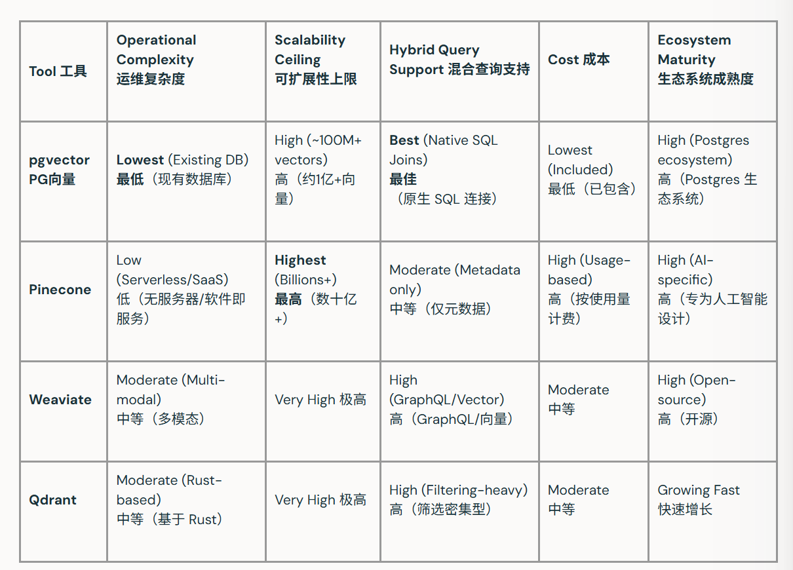

# Pgvector 简介

## 什么是pgvector？

pgvector 是一款开源的 PostgreSQL 扩展，它新增了存储、索引和搜索向量嵌入（数据的数值表示）的功能。它将向量数据和相似性搜索整合到存储应用数据的同一系统中，无需依赖外部 向量数据库，即可为语义搜索、推荐系统以及 检索增强生成（RAG）提供支持。pgvector 对 Postgres 进行扩展，以支持这些人工智能驱动的应用场景。


许多现代人工智能应用依赖于检索语义相似的数据，而非仅匹配完全一致的内容。pgvector 使团队能够在现有的 Postgres 技术栈中，在运行时执行此类检索操作。例如，应用程序通常需要检索与查询在语境上相似的内容，即便表述方式有所不同。这种方法通常被称为余弦相似度检索、最近邻搜索或基于嵌入的搜索。

**电商平台类似商品搜索以及Agent的RAG功能都会有用到向量数据库技术，pgvector只是其中一种，依赖于postgresSQL数据库本身，是PostgreSQL的一个扩展**


## pgvector的工作原理

pgvector 为 Postgres 新增了一种名为 **vector** 的新数据类型。它支持将文本、图像或其他内容的数值表示形式（即嵌入向量）与关系数据一起存储，无需单独的系统。这些嵌入向量通常由 机器学习模型生成，该模型会将文本或图像等内容转换为数值形式。

总体而言，这个过程很简单。嵌入向量会被存储在数据库中。当收到查询请求时，会根据输入生成查询嵌入向量，pgvector 会返回向量与该查询向量最相似、或语义最接近的记录。检索结果不再基于关键词匹配，而是依据语义来获取。

#### 相似度的判断

1. L2:用于衡量向量之间的距离，数值越小表示相似度越高
2. cosine相似度：衡量向量指向同一方向的紧密程度，同常能反映语义上的相似性
3. 内积：衡量向量之间的对齐度，通常与归一化嵌入向量配合使用

## pgvector核心特性

PGVector包含几个使矢量搜索在Postgres中实用的功能。

1. 索引：支持两种索引类型：HNSW 和 IVFFlat。HNSW 优先保证查询速度，会在内存中构建图结构，但需要占用更多内存。IVFFlat 内存效率更高，会通过训练步骤将向量划分为簇，但查询速度可能较慢。

2. 距离指标：L2范数、余弦相似度和内积可满足大多数基于嵌入的应用场景。汉明(Hamming)距离适用于二进制向量，雅卡尔(Jaccard)距离则在更专业的场景中支持稀疏向量。

3. 过滤搜索：向量相似度可与标准关系过滤结合使用。例如，搜索结果可包含语义相似度最高且有库存、处于指定价格区间或属于特定类别的商品。

4. 混合搜索：pgvector 可与 Postgres 全文搜索搭配使用，结合关键词搜索和语义搜索。这使得单次查询就能同时获得上下文相关且文本精准的结果。

5. 其他数据类型： 像 halfvec、sparsevec 和 bit 这类类型，在处理大型嵌入数据集时有助于降低内存占用。


## pgvector的常见用例


### 语义搜索与检索增强(RAG)

应用程序可以基于语义而非关键词检索文档或内容。这是检索增强生成（RAG）的核心组件，在该技术中，大型语言模型会利用检索到的上下文生成准确且相关的回复。由于 pgvector 直接在 Postgres 内部运行相似性搜索，这种检索可以实时完成，无需单独的系统。

### 推荐系统

可以将项目与过往行为或偏好进行匹配，以提供推荐支持。该模式常用于应用中的**商品推荐、内容发现和个性化功能**。pgvector 能够基于用户行为或内容中的模式高效识别相关项目。


### 图像相似度

图像嵌入可以被存储并进行比对，以快速找到视觉上相似的图像。这一技术广泛应用于媒体平台、电子商务和创意工具中。将这些嵌入与应用数据一同存储，能够更便捷地开展相似度检索，且无需额外的基础设施。

### 异常检测

通过在向量空间中找到与典型模式相距较远的数据点，可以识别异常值。这一方法在**欺诈检测、监控和质量控制**中十分实用。pgvector 简化了向量对比流程，助力检测偏差情况。

### 去重

即使内容以不同方式表达或采用不同格式，也能识别出重复或近乎重复的内容。这对**内容管理、搜索质量和数据清理**至关重要。基于相似度的比较使得检测精确匹配之外的重复内容成为可能。(过于去重，可能对精准检索不那么友好)


## 使用pgvector还是专用向量数据库?


```
1. 数据量 > 1亿向量，且还在快速增长？
   ├─ 是 → 需要专用向量库
   │        └─ 想全托管不想运维？→ Pinecone
   │        └─ 想自己开源部署？→ Qdrant/Weaviate
   └─ 否 → 继续往下问

2. 需要向量结果 JOIN 业务表（订单、权限、用户画像）？
   ├─ 是 → pgvector（原生SQL做不到的事，其他工具都要应用层拼接）
   └─ 否 → 继续往下问

3. 需要搜图片/音频/跨模态？
   ├─ 是 → Weaviate
   └─ 否 → 继续往下问

4. 查询模式是"先按条件过滤，再排相似度"（比如"过去7天+某分类+相似"）？
   ├─ 是 → Qdrant（filterable HNSW是它的强项）
   └─ 否 → 默认 pgvector 就够了

```

## 局限性
pgvector 功能强大，但也存在一些权衡：

1. 在极高的向量数量（1000万以上）下，如果没有额外的优化或工具支持，性能可能会下降
2. HNSW 索引对内存需求较高，大规模部署可能需要大量的随机存取存储器（RAM）
3. Postgres 不为向量工作负载提供内置分片功能，因此水平扩展需要借助外部工具或托管服务提供商
4. 搜索速度与召回率之间存在真正的权衡。召回率——即返回的真正相关结果的百分比——需要精心配置才能实现优化。

## pgvector项目地址

[github-pgvector项目地址](https://github.com/pgvector/pgvector)

## 常见问题

1. pgvector 是完整的向量数据库吗？
pgvector 让 Postgres 能够存储嵌入数据并直接对其执行相似性搜索。不过，它并非专门为向量数据库设计的工具。专用的向量数据库可为更大规模的工作负载提供额外的可扩展性和性能优化。

2. pgvector 中的 HNSW 和 IVFFlat 有何区别？
HNSW 针对快速查询性能进行了优化，采用内存中图结构，会占用更多内存。IVFFlat 内存占用更低，会通过训练步骤将向量组织成聚类，但性能会因数据集和工作负载而异。选择哪种方式取决于优先考虑速度还是内存效率。

3. pgvector 能处理多少个向量？
pgvector 通常可处理数百万到数千万个向量，具体取决于硬件、索引策略和查询模式。随着数据集规模扩大，若未进行精细调优或借助额外工具，性能可能会下降。可用内存、索引类型以及查询频率等因素，都会影响其可扩展性。

4. pgvector 是否支持余弦相似度？

pgvector 将余弦相似度作为其主要距离指标之一。它衡量两个向量在同一方向上的指向接近程度，这在基于嵌入的应用中通常能反映语义相似度。这使其非常适用于语义搜索、推荐系统和自然语言处理领域。

5. pgvector 是免费且开源的吗？
pgvector 是一个基于宽松许可证发布的开源项目。它可与标准 Postgres 安装包以及众多托管式 Postgres 服务配合使用。这使其成为添加向量搜索功能的便捷入门选择。

6. pgvector 能否进行混合搜索？
pgvector 可以与 Postgres 全文搜索结合使用，以支持混合搜索。这使得搜索结果能够兼顾语义相关性与关键词匹配，从而提升准确性和可用性。混合搜索在产品搜索和文档搜索等场景中尤为有用，因为在这些场景中，语义含义和精确术语都至关重要。