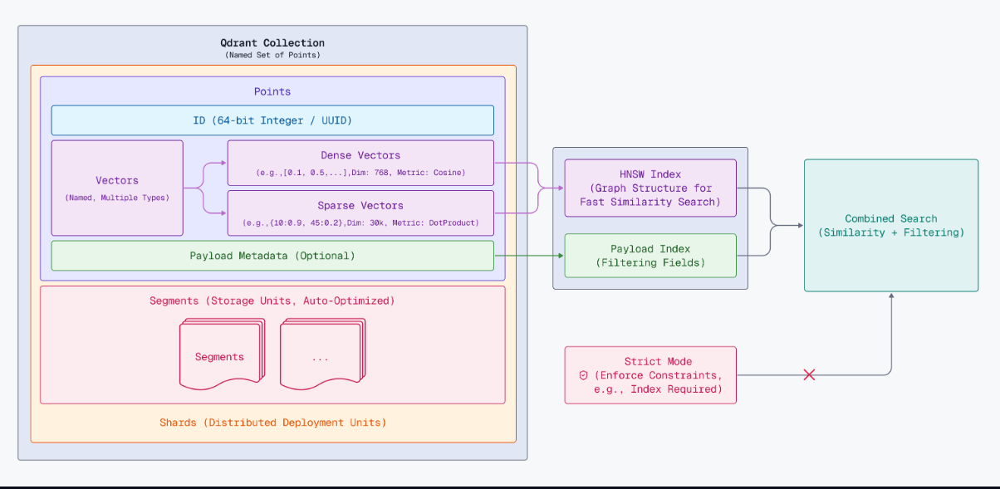
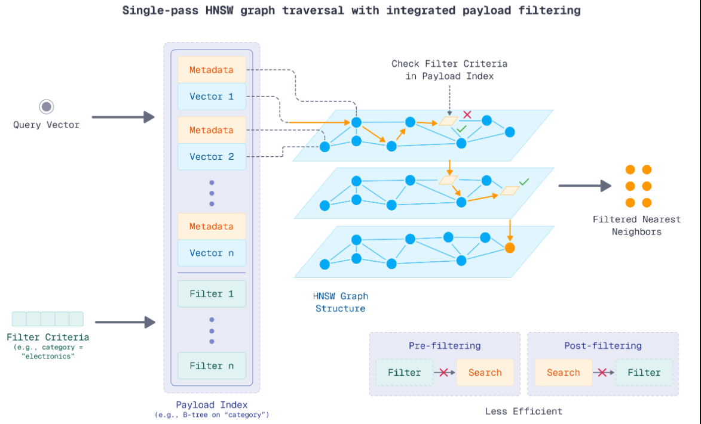

# 概述

Qdrant是比较流行实现对向量存储，尤其是在RAG应用比较广泛，主要存储的是embedding模型产生的向量--对象的**语义/相似度信息**。

主要的检索方式（非检索算法）就是：
1. 关键字匹配（常规的关系型数据库的匹配方式
2. 全文搜索（比如BM25）
3. 向量语义匹配

## 检索过程

向量搜索是一种变革性的信息检索技术，它超越了关键字匹配，以基于语义意义查找数据。它始于**向量模型（嵌入模型，embedding model）**，将非结构化数据（文本、图像、音频）转换为**密集矢量嵌入(dense vector embedding)**

**密集向量虽擅长捕捉上下文，但有时会遗漏特定技术术语或唯一标识符。**为弥补这一不足，Qdrant 还支持词汇搜索，可对特定关键词进行精确匹配。BM25 全文搜索会根据文本字段中的关键词对数据点进行排序，而来自 SPLADE++ 和 miniCOIL 等模型的稀疏向量则会加入学习到的词项权重。

从非结构化数据生成嵌入向量的过程(原始对象经过embedding model推理提取出向量信息。)被称为**推理**。

搜索过程本身核心围绕Top-K检索这一概念展开。当用户提交请求时，请求会立即被转换为**查询向量**。随后，搜索引擎计算该查询向量与文档向量之间的相似度，并返回“Top-K”个最匹配的结果，其中K是用户自定义的数值，代表期望的结果数量。这使得开发者能够微调搜索的广度与答案的精准度之间的平衡。

Qdrant不仅仅支持语义搜索匹配还支持混合检索的方式。

## Qdrant 架构

Qdrants 采用**客户端-服务器架构**运行，为 Python、JavaScript/TypeScript、Rust、Go、.NET 和 Java 提供官方的客户端库。同时，Qdrant 开放 HTTP 与 gRPC 的接口，以实现与几乎所有编程语言的集成。

### 数据结构

1. [Collections](./Collections.md)
2. [Points](./ManageData/Points.md)
3. [Storage](./ManageData/Storage.md)
4. [Vectors](./ManageData/Vectors.md)
5. [Payloads](./ManageData/Payload.md)
6. [Indexing](./ManageData/Indexing.md)
7. [Quantization](./ManageData/Quantization.md)
8. [Multienacy](./ManageData/Multitenacy.md)
9. [BulkUpload](./ManageData/Bulk%20Upload.md)

 

## 部署

Qdrant 支持多种部署模型，以满足不同的基础设施和运营需求。*这里不过多阐述如何部署的问题？本地/云端等等*

## 扩展性考量

在你开始进行概念验证（POC）或个人项目开发时，Qdrant 的默认配置是合理的。但**当项目过渡到生产环境，且数据量和并发用户不断增长时，你对高可用性、延迟或吞吐量的要求会发生变化。如果你预见到需要对服务进行扩容，就应该从一开始就构建能够应对这类挑战的系统**。有几种常见场景需要你留意，尤其是当你刚接触 Qdrant、预计业务会快速增长，且希望打造具备前瞻性的系统时。

### 1.内存需求

在扩展向量搜索时，内存是一项关键资源。默认情况下，Qdrant 将向量存储在内存中以实现最高的搜索性能，但随着集合增长到数百万个向量，将所有数据都保留在内存中的成本会变得很高。Qdrant 允许你通过将数据卸载到磁盘来控制内存使用量，你可以随时启用该机制，即使是对已存在的集合也同样适用。

- 频繁访问的向量会自然保留在缓存中，而其他向量则仅在需要时才从磁盘读取——前提是你将向量存储在磁盘上。
- 如果将 HNSW 索引存储在磁盘上，图遍历可能需要进行 IO 操作

只有在内存严重不足时，才将两者都存储到磁盘上，并确保使用高速的NVMe存储。

### 2. 过滤

仅靠向量搜索就能为用户提供不错的搜索体验；不过，语义相似性很少是你需要考虑的唯一因素。嵌入向量无法捕捉价格之类的属性，通常还需要对特定的负载属性应用筛选。为了实现高效的筛选，你需要了解一些 Qdrant 特有的机制，其中就包括**负载索引（payload部分）**。

负载索引是一种辅助数据结构，可实现对特定负载属性的高效过滤。这是关系数据库中常见的概念——我们会在经常用于过滤的列上创建索引。同样，在 Qdrant 中，你也应该在用于过滤的字段上创建负载索引。

有效载荷索引的一个独特之处在于它扩展了HNSW图，使得语义搜索阶段可以应用过滤条件。这意味着它是**单次图遍历，而非预过滤或后过滤——这两种方式都存在一定缺陷**。

有效载荷索引扩展了 HNSW 图，这意味着在对数据建立索引之前创建它会更高效，因为优化器只需构建一次图。不过在某些情况下，你可能已经拥有一个包含大量向量的集合，并且意识到需要按特定属性进行过滤。在这种情况下，你仍然可以创建有效载荷索引，但它不会立即对 HNSW 图产生影响。

## 扩展

垂直扩展存在天然限制——最终你会达到可用硬件的最大容量，且单节点部署缺乏冗余。通过分片、复制和分段配置选项优化扩展。

### Shard(分片)

Qdrant 使用分片技术将集合分布到多个节点上，每个分片都是独立的向量点存储库。通常建议从12个分片开始配置，这样可灵活地从1个节点扩展至2、3、6或12个节点，而无需重新分片。不过这种方式会在小型集群上限制吞吐量，因为每个节点需要管理多个分片。

### 副本因子

**副本因子**决定了每个分片有多少个副本。对于生产系统，强烈建议副本因子至少为 2。

### 分段配置

每个分片会将数据存储在多个段中。一个段会存储分片中部分点的所有数据结构。段的数量越少，生成的段就越大，搜索吞吐量也越好，因为更大的 HNSW 索引所需的比较次数更少。不过，更大的段的构建和重建耗时更长，会降低写入和优化速度。段的数量越多，索引速度越快，但搜索性能会越低，因为查询需要扫描更多的段。

## 安全(Safety)

部分集合级操作可能会降低 Qdrant 集群的性能。Qdrant 的**严格模式**通过多种控制手段避免低效的使用模式：它会阻止对未建立索引的有效载荷字段进行过滤和更新，限制查询结果大小和超时时长，约束过滤条件的复杂度和数量，限制有效载荷索引的数量，批量更新的大小，强制执行最大集合存储限制（针对向量、有效载荷和点的数量），并对读写操作实施速率限制，以防止系统过载。