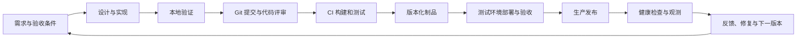

# 软件研发生命周期：从需求到持续运行

软件研发生命周期（SDLC）描述软件从需求、设计、实现、验证、交付到运行维护的连续活动。它不是“代码写完就结束”：用户能持续使用、团队能安全更新，才算完成交付。

## 一次变更如何流动

| 阶段 | 交付物 | 失败时首先检查 |
| --- | --- | --- |
| 需求与设计 | 可验收的行为、接口和风险 | 验收条件是否可测 |
| 实现与本地验证 | 源码、测试、依赖声明 | 本地环境是否可复现 |
| Git 与评审 | 可追溯的提交、变更说明 | 变更范围与敏感信息 |
| CI | 测试结果和构建记录 | 构建环境、依赖与测试日志 |
| 制品 | 带版本与来源的包或镜像 | 能否定位对应提交及依赖 |
| 部署与验收 | 配置、发布记录、验证结果 | 环境差异和依赖可用性 |
| 运行与更新 | 指标、日志、告警、回滚记录 | 健康、流量、资源和下游依赖 |

## 开发者视角的关键交接

源码是修改依据，制品是部署对象；不能把“服务器上临时改代码”当作版本发布。部署时应能回答：运行哪个版本、由哪次提交构建、配置从何而来、何时完成验证、失败如何回退。测试通过只说明已覆盖的条件成立，发布后还要验证真实环境中的入口、配置、外部服务和流量。

变更进入下一轮时，应记录故障与用户反馈，修订测试、配置或发布流程。不同团队可合并阶段，但这些责任不会消失。

## 延伸阅读

- [部署与交付的本质](%E5%BA%94%E7%94%A8%E9%83%A8%E7%BD%B2%E4%B8%8E%E4%BA%A4%E4%BB%98%E7%9A%84%E6%9C%AC%E8%B4%A8.md)
- [工程实践入口](../10-%E9%83%A8%E7%BD%B2%E5%AE%9E%E8%B7%B5%E4%B8%8E%E5%B7%A5%E7%A8%8BSOP/README.md)
