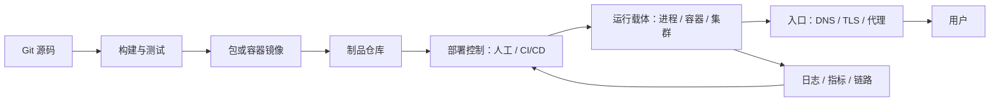

# 部署架构与技术体系

部署体系可以按“产出什么、运行在哪里、如何接入、怎样维持”理解，而不必先记工具清单。

| 能力领域 | 主要责任 | 常见技术及边界 |
| --- | --- | --- |
| 基础设施与服务器 | 提供主机、账号和网络访问 | Linux、SSH、堡垒机不负责应用构建 |
| 构建与制品 | 把源码变成可追溯发布单元 | Python 包、镜像、Harbor；仓库不负责运行 |
| 部署与运行 | 启动和维持应用 | systemd、Supervisor；管理进程，不提供完整集群编排 |
| 容器化 | 打包运行依赖并隔离进程 | Docker；Compose 描述同主机多服务应用 |
| CI/CD | 自动执行质量门禁与交付步骤 | Jenkins、GitHub Actions；不能替代应用测试与发布判断 |
| 网络接入 | 将外部请求送到目标服务 | DNS、TLS、Nginx、网关 |
| 可观测性 | 解释运行状态与故障 | 日志、指标、链路，不能代替验收测试 |
| 集群与自动化 | 管理多节点期望状态与基础设施 | Kubernetes、Helm、Ansible、Terraform，按规模选用 |

单机 FastAPI 可先用虚拟环境 + systemd + Nginx；多服务可用 Docker Compose；需要跨节点调度和高可用时再评估 Kubernetes。它们是不同约束下的选择，并非固定升级路径。

## 延伸阅读

- [学习路线](%E5%AD%A6%E4%B9%A0%E8%B7%AF%E7%BA%BF%E4%B8%8E%E6%8E%8C%E6%8F%A1%E6%A0%87%E5%87%86.md)
- [从场景验证知识](../10-%E9%83%A8%E7%BD%B2%E5%AE%9E%E8%B7%B5%E4%B8%8E%E5%B7%A5%E7%A8%8BSOP/README.md)
