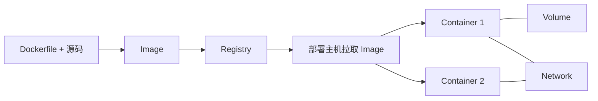

# Docker 核心概念与关系

Docker 把应用及其运行依赖组织为镜像，并以隔离的进程形式运行容器。它改善环境一致性和交付方式，但不会自动解决应用配置、数据备份、网络安全和高可用。

| 概念 | 它是什么 | 与其他对象的关系 |
| --- | --- | --- |
| Image 镜像 | 创建容器的只读模板 | 由 Dockerfile 构建；可按标签或摘要引用 |
| Container 容器 | 镜像启动后的运行实例 | 一个镜像可创建多个容器；运行数据不能只依赖容器可写层 |
| Registry 镜像仓库 | 存储与分发镜像的服务 | 构建端推送，部署端拉取；仓库与镜像仓库中的 repository 不同 |
| Volume 数据卷 | 独立于容器生命周期的数据存储机制 | 容器重建后可继续挂载；仍需备份与访问控制 |
| Network 网络 | 连接容器、主机与外部服务 | 容器名解析和端口发布由网络配置决定 |

客户端向 Docker daemon 发出构建、拉取、运行等请求；daemon 管理本机镜像、容器、网络和卷。镜像标签是可变的命名引用，严格复现发布应记录不可变摘要或明确的版本映射。容器是进程隔离，不等于完整虚拟机；同机容器共享宿主机内核。

开发者可先用单容器理解镜像与运行配置，再用 Compose 描述 FastAPI、数据库等多服务关系。把数据库文件仅留在容器可写层会在重建后丢失；卷让数据生命周期独立，但不能替代备份。

## 最小实验

构建一个返回版本号的简单服务镜像，运行两个容器并分别映射端口；验证相同镜像可生成不同实例。重建一个带卷的测试容器，验证数据是否保留。只在实验数据上操作，记录镜像摘要、日志和端口映射。

## 资料

- [Docker Engine 官方概览](https://docs.docker.com/engine/)
- [Docker Compose 应用模型](https://docs.docker.com/compose/intro/compose-application-model/)

## 延伸阅读

- [Docker 完整学习地图](README.md)
- [Compose 学习地图](../Docker%20Compose/README.md)
- [现有 Docker 笔记](../../../../%E8%AE%A1%E7%AE%97%E6%9C%BA%E9%80%9A%E7%94%A8/%E5%B8%B8%E7%94%A8%E5%B7%A5%E5%85%B7/docker/docker.md)
