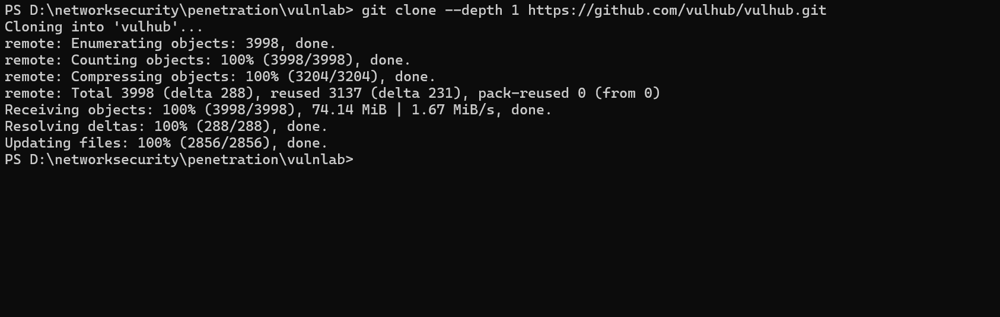

# vulhub的使用

## 本地准备和攻击机连通性测试

本教程使用的是在windows物理机中部署docker容器，然后通过kali虚拟机进行攻击，也可以本地物理机进行攻击测试

首先下载好windows的docker desktop，以及在vmwork station中安装好kali虚拟机，之前文章有讲如何安装kali虚拟机全教程，网络模式选择桥接模式和NAT模式都可以
然后在windows终端中使用ipconfig查看物理机的ip地址如192.168.1.104，然后在kali虚拟机中使用ping 192.168.1.104,如果能ping通，则表示连通性可靠，后续直接在宿主机部署docker容器，kali虚拟机也可以直接访问到。

然后测试宿主机的docker版本，打开终端输入`docker --version`，如果能够正确输出版本号，则表示docker部署成功

## vulhub的本地部署

在终端中输入以下命令：
1. 克隆仓库
```git clone --depth 1 https://github.com/vulhub/vulhub.git```

2. 选择漏洞环境
浏览仓库并选择您想要探索的漏洞。每个目录代表一个不同的漏洞应用程序。
```cd vulhub/spring/CVE-2022-22947```

3. 启动环境
使用Docker Compose构建并启动漏洞环境。
```docker compose up -d```
4. 访问应用程序
环境运行后，通过浏览器访问漏洞应用程序。
```http://your-ip:8080```
5. 探索和学习
按照README文件中的文档理解和利用漏洞


