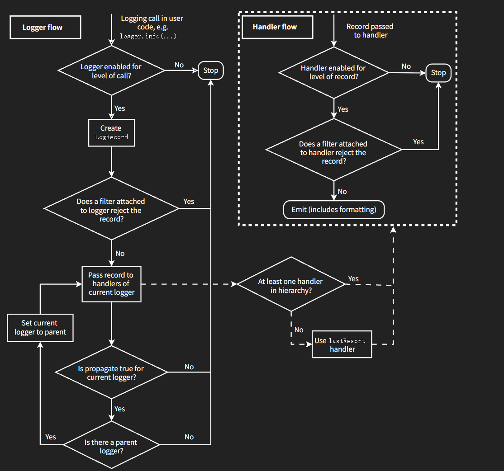

# Python logging 日志指南
日志是对软件执行时所发生事件的一种追踪方式。软件开发人员对他们的代码添加日志调用，借此来指示某事件的发生。一个事件通过一些包含变量数据的描述信息来描述（比如：每个事件发生时的数据都是不同的）。开发者还会区分事件的重要性，重要性也被称为**等级**或**严重性**。


## 日志基础教程
### 什么时候使用日志
创建记录器：`logger = logging.getLogger(__name__)`，调用 `debug()` / `info()` / `warning()` / `error()` / `critical()`。

| 你想要执行的任务 | 此任务最好的工具 |
|---|---|
| 命令行程序输出结果到控制台 | `print()` |
| 程序正常运行时报告事件（状态监控、错误排查） | `info()`；需要详细诊断用 `debug()` |
| 运行时抛出警告：代码可修改消除告警 | `warnings.warn()` |
| 运行时抛出警告：用户无法干预，但需要留意 | 记录器 `warning()` |
| 报告运行时错误，需要中断程序 | 抛出异常 |
| 报告错误但不抛异常（长驻服务进程） | `error()` / `exception()` / `critical()` |

**标准日志级别（从低到高）**

| 级别 | 何时使用 |
|---|---|
| `DEBUG` | 调试细节，仅诊断问题使用 |
| `INFO` | 确认程序正常按预期运行 |
| `WARNING` | 发生/即将发生意外，程序仍可继续运行（磁盘满等） |
| `ERROR` | 严重问题，部分功能无法执行 |
| `CRITICAL` | 致命错误，程序无法继续运行 |

> 默认级别：`WARNING`；只会输出该级别及以上日志。日志可以输出控制台，也可以写入文件。

### 一个简单的例子
```python
import logging
logging.warning('Watch out!')   # 输出到控制台
logging.info('I told you so')   # 默认级别WARNING，不会打印
```
输出：
```
WARNING:root:Watch out!
```
> 直接调用 `logging.warning()` 使用**根记录器**。大型项目建议显式创建 `logger` 对象，方便精细控制配置。

### 记录日志到文件
> ⚠️ `basicConfig()` **必须在所有日志调用之前执行**，否则配置不生效。

```python
import logging
logger = logging.getLogger(__name__)
logging.basicConfig(
    filename='example.log',
    encoding='utf-8',
    level=logging.DEBUG
)
logger.debug('This message should go to the log file')
logger.info('So should this')
logger.warning('And this, too')
logger.error('And non‑ASCII stuff, too, like Øresund and Malmö')
```
example.log 文件内容：
```
DEBUG:__main__:This message should go to the log file
INFO:__main__:So should this
WARNING:__main__:And this, too
ERROR:__main__:And non‑ASCII stuff, too, like Øresund and Malmö
```

- Python3.9+ 支持 `encoding` 参数；
- 默认多次运行脚本，日志会**追加**写入文件；
- 如果每次运行清空日志，设置 `filemode='w'`
```python
logging.basicConfig(filename='example.log', filemode='w', level=logging.DEBUG)
```

**从命令行参数设置日志级别示例**
```python
# loglevel 来自命令行参数如 --log=INFO
numeric_level = getattr(logging, loglevel.upper(), None)
if not isinstance(numeric_level, int):
    raise ValueError('Invalid log level: %s' % loglevel)
logging.basicConfig(level=numeric_level, ...)
```

### 记录变量数据
logging 使用老式 `%` 格式化（向后兼容）。
```python
import logging
logging.warning('%s before you %s', 'Look', 'leap!')
```
输出：
```
WARNING:root:Look before you leap!
```
> `str.format()` / `string.Template` 也支持，但教程不作展开。

### 更改显示消息的格式
通过 `format` 参数自定义输出模板。
```python
import logging
logging.basicConfig(format='%(levelname)s:%(message)s', level=logging.DEBUG)
logging.debug('This message should appear on the console')
logging.info('So should this')
logging.warning('And this, too')
```
输出：
```
DEBUG:This message should appear on the console
INFO:So should this
WARNING:And this, too
```
常用占位符：
- `%(levelname)s`：日志级别名称
- `%(message)s`：日志消息
- `%(asctime)s`：时间
- `%(name)s`：记录器名称

### 在消息中显示日期/时间
使用 `%(asctime)s` 输出时间；`datefmt` 自定义时间格式，语法同 `time.strftime()`。
```python
import logging
logging.basicConfig(format='%(asctime)s %(message)s')
logging.warning('is when this event was logged.')
```
输出示例：
```
2010‑12‑12 11:41:42,612 is when this event was logged.
```

自定义时间格式：
```python
import logging
logging.basicConfig(
    format='%(asctime)s %(message)s',
    datefmt='%m/%d/%Y %I:%M:%S %p'
)
logging.warning('is when this event was logged.')
```
输出：
```
12/12/2010 11:46:36 AM is when this event was logged.
```

### 后续步骤
基础教程足够完成简单脚本日志。复杂场景继续阅读进阶教程。

## 进阶日志教程
logging 是模块化组件：**记录器(Logger)、处理器(Handler)、过滤器(Filter)、格式器(Formatter)**

| 组件 | 作用 |
|---|---|
| Logger（记录器） | 应用直接调用的接口，产生日志事件 |
| Handler（处理器） | 将日志发送到目标（文件、控制台、邮件等） |
| Filter（过滤器） | 细粒度控制哪些日志输出 |
| Formatter（格式器） | 定义日志最终输出文本格式 |

日志事件封装为 `LogRecord` 对象，在组件之间传递。

> 最佳实践：每个模块中创建模块级记录器
```python
logger = logging.getLogger(__name__)
```
记录器名字使用`.`分隔形成层级；`root` 是顶层根记录器。子记录器默认会把日志向上传播给父记录器的处理器，可以设置 `propagate=False` 关闭传播。

### 日志记录流程

记录器和处理器的日志时间信息流程如下图：


### 记录器 Logger
Logger 对象三件事：
1. 对外暴露记录日志的接口；
2. 根据级别/过滤器过滤日志；
3. 将日志交给关联的处理器。

**配置方法**
- `.setLevel()` 设置最低可处理日志等级
- `.addHandler()` / `.removeHandler()` 增删处理器
- `.addFilter()` / `.removeFilter()` 增删过滤器

**输出日志方法**
- `.debug()` / `.info()` / `.warning()` / `.error()` / `.critical()`：输出对应级别日志；支持 `%` 格式化传参。
- `.exception()`：等价 `.error()`，**自动附加异常堆栈**，只能写在 `except` 块内。
- `.log(level, msg, ...)`：手动传入日志级别，适合自定义级别。

> `logging.getLogger(name)`：同名多次调用返回同一个对象。没有name返回根记录器。

> **有效级别规则**：记录器没有显式设置级别，向上找父记录器；根记录器默认 `WARNING`。

### 处理器 Handler
Handler 是抽象基类，负责把日志分发到目标。一个Logger可以挂载多个Handler。

示例场景：
- 全部日志写入文件；
- ERROR以上输出控制台；
- CRITICAL发送邮件。

常用内置实现：`StreamHandler`（控制台流）、`FileHandler`（文件输出）。

处理器配置API：
- `.setLevel()`：处理器自身过滤级别（记录器过滤之后，处理器还可以再过滤）
- `.setFormatter()`：设置格式器
- `.addFilter()` / `.removeFilter()`：增删过滤器

> 不要直接实例化基类`Handler`，使用它的子类。

### 格式器 Formatter
```python
logging.Formatter(fmt=None, datefmt=None, style='%')
```
- `fmt`：消息模板；`datefmt`：时间格式；`style` 支持 `%` / `{` / `$` 三种格式化语法。
- 默认时间格式：`%Y‑%m‑%d %H:%M:%S` 加上毫秒。
- `converter` 属性切换时间为本地时间 `time.localtime()` 或GMT `time.gmtime()`。

示例模板：
```python
'%(asctime)s - %(name)s - %(levelname)s - %(message)s'
```

### 配置日志记录的三种方式
1. Python代码显式构造Logger、Handler、Formatter；
2. 读取配置文件 `logging.config.fileConfig()`；
3. 字典配置 `logging.config.dictConfig()`（推荐新程序使用，可以加载yaml/json）。

**代码方式完整示例**
```python
import logging

logger = logging.getLogger('simple_example')
logger.setLevel(logging.DEBUG)

# 控制台处理器
ch = logging.StreamHandler()
ch.setLevel(logging.DEBUG)

formatter = logging.Formatter('%(asctime)s - %(name)s - %(levelname)s - %(message)s')
ch.setFormatter(formatter)

logger.addHandler(ch)

# 业务代码
logger.debug('debug message')
logger.info('info message')
logger.warning('warn message')
logger.error('error message')
logger.critical('critical message')
```

**ini配置文件方式 logging.conf**
```ini
[loggers]
keys=root,simpleExample
[handlers]
keys=consoleHandler
[formatters]
keys=simpleFormatter

[logger_root]
level=DEBUG
handlers=consoleHandler

[logger_simpleExample]
level=DEBUG
handlers=consoleHandler
qualname=simpleExample
propagate=0

[handler_consoleHandler]
class=StreamHandler
level=DEBUG
formatter=simpleFormatter
args=(sys.stdout,)

[formatter_simpleFormatter]
format=%(asctime)s - %(name)s - %(levelname)s - %(message)s
```
读取配置：
```python
import logging
import logging.config
logging.config.fileConfig('logging.conf')
logger = logging.getLogger('simpleExample')
logger.debug('debug message')
```
> ⚠️ `fileConfig(disable_existing_loggers=True)` 默认会禁用已存在的非root记录器；需要关闭传入 `disable_existing_loggers=False`。`dictConfig` 同样有该默认行为。

YAML字典配置示例：
```yaml
version: 1
formatters:
  simple:
    format: '%(asctime)s - %(name)s - %(levelname)s - %(message)s'
handlers:
  console:
    class: logging.StreamHandler
    level: DEBUG
    formatter: simple
    stream: ext://sys.stdout
loggers:
  simpleExample:
    level: DEBUG
    handlers: [console]
    propagate: no
root:
  level: DEBUG
  handlers: [console]
```

### 如果没有提供配置会发生什么
没有配置任何处理器时，使用内部 `lastResort` 处理器，输出到 `sys.stderr`，级别固定为 `WARNING`。

### 为库配置日志
库代码**不要添加处理器**，只使用 `NullHandler`，避免干扰应用层日志配置。

```python
import logging
logging.getLogger("foo").addHandler(logging.NullHandler())
```
> 最佳实践：库不要使用root记录器，使用包名作为记录器名称。

## 日志级别
| 级别 | 数值 |
|---|---|
| `CRITICAL` | 50 |
| `ERROR` | 40 |
| `WARNING` | 30 |
| `INFO` | 20 |
| `DEBUG` | 10 |
| `NOTSET` | 0 |

> 库开发尽量避免自定义日志级别，不同库自定义级别会造成冲突。

## 有用的处理器（handlers）
| 处理器 | 功能 |
|---|---|
| `StreamHandler` | 输出流（stderr/stdout） |
| `FileHandler` | 输出到文件 |
| `RotatingFileHandler` | 文件大小到达阈值轮转 |
| `TimedRotatingFileHandler` | 按时间轮转日志文件 |
| `SocketHandler` / `DatagramHandler` | TCP/UDP网络发送日志 |
| `SMTPHandler` | 邮件发送日志 |
| `SysLogHandler` | 输出到syslog |
| `HTTPHandler` | http post提交日志 |
| `QueueHandler` | 输出到队列，用于多线程/异步 |
| `NullHandler` | 什么都不做，库使用 |

> 除NullHandler、StreamHandler、FileHandler之外，其余都在`logging.handlers`子模块。

过滤器Filter：可以挂载在Logger或Handler上，实现自定义过滤规则。

## 记录日志时引发的异常
logging模块设计：日志处理过程内部异常，**不使主程序崩溃**。`SystemExit`、`KeyboardInterrupt`除外。
- `raiseExceptions=True`（开发默认）：打印异常堆栈；
- 生产环境建议设置 `raiseExceptions=False`，静默丢弃日志内部错误。

## 使用任意对象作为消息
日志消息参数可以传任意对象，输出时调用对象`__str__()`；网络处理器（SocketHandler）会使用pickle序列化对象。

## 优化
如果debug日志关闭，不希望执行高开销的函数计算：
```python
if logger.isEnabledFor(logging.DEBUG):
    logger.debug('Message %s %s', expensive_func1(), expensive_func2())
```

其他性能开关：
```python
logging._srcfile = None      # 不收集调用栈信息
logging.logThreads = False   # 关闭线程信息
logging.logProcesses = False # 关闭进程ID
logging.logMultiprocessing = False
logging.logAsyncioTasks = False
```
> 不导入`logging.handlers`、`logging.config`就不会加载对应代码，节省内存。

## 其他资源
- `logging` 模块API参考
- `logging.config`、`logging.handlers` 文档
- 日志操作手册
