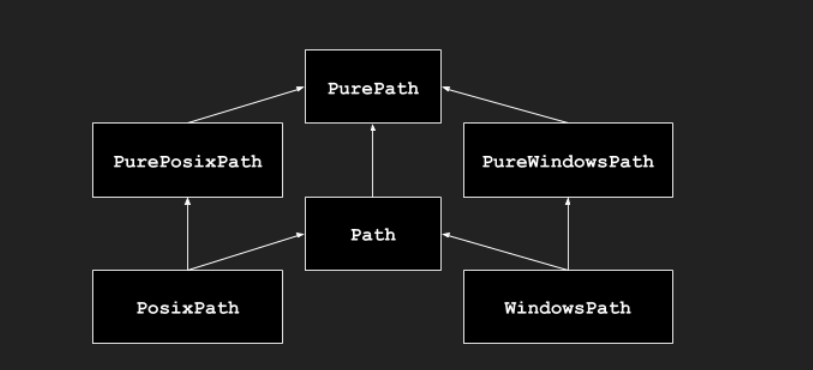

# Pathlib --面向对象的文件系统路径

## 一、简单介绍
该模块提供表示文件系统路径的类，其语义适用于不同的操作系统。路径类被分为提供纯计算操作而没有 I/O 的 纯路径，以及从纯路径继承而来但提供 I/O 操作的 具体路径。

**模块架构图如下:**



如果以前从未用过此模块，或不确定哪个类适合完成任务，那要用的可能就是 Path。它在运行代码的平台上实例化为 具体路径（会根据不同操作系统获取对应的实例）。

在一些用例中纯路径很有用，例如：

如果你想要在 Unix 设备上操作 Windows 路径（或者相反）。你无法在 Unix 上实例化一个 WindowsPath，但是你可以实例化 PureWindowsPath。

你只想操作路径但不想实际访问操作系统。**在这种情况下，实例化一个纯路径是有用的，因为它们没有任何访问操作系统的操作。**

当然对于对操作系统的路径操作属于对操作系统的操作，那么os中的os.path模块也可以起到同样的效果，但日常开发中更多的使用Pathlib，以下列举其不同之处：
1. **os.path面向对象编程，路径只是普通的字符串**，所有的操作都要单独调用函数，数据来回传递嵌套；**pathlib面向对象，路径本身是一个Path对象，**判断是否存在，是否是文件、获取父目录等等都有直接对象调用方法，逻辑内聚。

2. os.path需要反复使用os.path.join()进行拼接路径，容易写错分隔符（本质字符串拼接路径）;pathlib直接使用/运算符进行拼接路径，不同平台自适应(不用手动处理斜杠/反斜杠问题)，跨平台零成本。

3. os.path为历史遗留产物，先多用Pathlib库对文件系统的操作，**pathlib底层依赖Python内置模块os，是对os/os.path的面向对象封装，其路径核心操作最终会落到os模块的系统接口上**

## 二、基础使用

导入主类：
`>>>from pathlib import Path`

列出子目录：
```python
>>>p = Path(".")    #.表示当前目录
>>>[x for x in p.iterdir() if x.is_dir()] #将当前目录下所有的目录文件添加到一个列表中
```

列出当前目录树下所有的Python源代码文件：
```python
>>>list(p.glob('**/*.py'))
```

路径拼接：
```python
p = Path('/etc')
q = p / 'init.d' / 'reboot'
q

q.resolve()
```

查询路径的属性:

```python
q.exists()

q.is_dir()
```

打开文件：
`with q.open() as f: f.readline()`

### 异常
exception pathlib.UnsupportedOperation
一个继承自 NotImplementedError 的异常，当在路径对象上调用不受支持的操作时它将被引发。


## 三、纯路径

纯路径对象提供了不实际访问文件系统的路径处理操作。有三种方式来访问这些类，也是不同的风格：


###  pathlib.PurePath
`class pathlib.PurePath(*pathsegments)`

一个通用的类，代表当前系统的路径风格(实例化为PurePosixPath或者PureWindowsPath)：

pathsegments 的每个元素既可以是代表一个路径段的字符串，也可以是实现了 os.PathLike 接口的对象，其中 __fspath__() 方法返回一个字符串，例如另一个路径对象:

```python
PurePath('foo', 'some/path', 'bar')

PurePath(Path('foo'), Path('bar'))
```

当pathsegements为空时，假定为当前目录。
```py
PurePath()
#PurePosixPath('.')
```
如果某个段为绝对路径，则其前面的所有段都会被忽略：

```python
PurePath('/etc', '/usr', 'lib64')
#PurePosixPath('/usr/lib64')
PureWindowsPath('c:/Windows', 'd:bar')
#PureWindowsPath('d:bar')
```
在 Windows 上，当遇到带根符号的路径段 (如 r'\foo') 时驱动器将不会被重置:
```py
PureWindowsPath('c:/Windows', '/Program Files')
#PureWindowsPath('c:/Program Files')
```

斜杠和单个点号会被消除，但双点号 ('..') 和打头的双斜杠 ('//') 不会，因为这会出于各种原因改变路径的实际含义 (例如符号链接、UNC 路径等):
```py
PurePath('foo//bar')
#PurePosixPath('foo/bar')
PurePath('//foo/bar')
#PurePosixPath('//foo/bar')
PurePath('foo/./bar')
#PurePosixPath('foo/bar')
PurePath('foo/../bar')
#PurePosixPath('foo/../bar')
```
其中..表示父目录，.表示当前目录，自然可以合并

（一个简单天真的做法是让 PurePosixPath('foo/../bar') 等同于 PurePosixPath('bar')，如果 foo 是一个指向其他目录的符号链接那么这个做法就将出错）
### pathlib.PurePosixPath
class pathlib.PurePosixPath(*pathsegments)
一个 PurePath 的子类，路径风格不同于 Windows 文件系统:

```python
PurePosixPath('/etc/hosts')
PurePosixPath('/etc/hosts')
```
pathsegments 参数的指定和 PurePath 相同。

### pathilb.PureWindowsPath

class pathlib.PureWindowsPath(*pathsegments)

PurePath 的一个子类，此路径风格代表 Windows 文件系统路径，包括 UNC paths:
```py
PureWindowsPath('c:/', 'Users', 'Ximénez')
#PureWindowsPath('c:/Users/Ximénez')
PureWindowsPath('//server/share/file')
#PureWindowsPath('//server/share/file')
```
pathsegments 参数的指定和 PurePath 相同。

**无论你正运行什么系统，你都可以实例化这些类，因为它们提供的操作不做任何系统调用。**

### 通用性质

路径是不可变并且 可哈希的。 相同风格的路径可以排序和比较。 这些特性会尊重对应风格的大小写转换语义:
```py
PurePosixPath('foo') == PurePosixPath('FOO')
#False
PureWindowsPath('foo') == PureWindowsPath('FOO')
#True
PureWindowsPath('FOO') in { PureWindowsPath('foo') }
#True
PureWindowsPath('C:') < PureWindowsPath('d:')
#True
```
*注：windows操作系统是大小写不敏感的，而linux系统则是对大小写敏感的*

不同风格的路径比较得到不等的结果并且无法被排序:
```py
PureWindowsPath('foo') == PurePosixPath('foo')
#False
PureWindowsPath('foo') < PurePosixPath('foo')
#Traceback (most recent call last):
#  File "<stdin>", line 1, in <module>
#TypeError: '<' not supported between instances of 'PureWindowsPath' and 'PurePosixPat
```

### 运算符

斜杠操作符可以帮助创建子路径，如 os.path.join()。 **如果参数为一个绝对路径，则之前的路径会被忽略。** 在 Windows 上，当参数为一个带根符号的相对路径 (如 r'\foo') 时驱动器将不会被重置:

```python
p = PurePath('/etc')
#PurePosixPath('/etc')
p / 'init.d' / 'apache2'
#PurePosixPath('/etc/init.d/apache2')
q = PurePath('bin')
'/usr' / q
#PurePosixPath('/usr/bin')
p / '/an_absolute_path'
#PurePosixPath('/an_absolute_path')
PureWindowsPath('c:/Windows', '/Program Files')
#PureWindowsPath('c:/Program Files')
```

注意最后一个windows路径在绝对路径下被重置。

路径的字符串表示法为它自己原始的文件系统路径（以原生形式，例如在 Windows 下使用反斜杠）。你可以传递给任何需要字符串形式路径的函数:
```python
p = PurePath('/etc')
str(p)
#'/etc'
p = PureWindowsPath('c:/Program Files')
str(p)
#'c:\\Program Files'
```
类似地，在路径上调用 bytes 将原始文件系统路径作为字节对象给出，就像被 os.fsencode() 编码一样:
```python
bytes(p)
#b'/etc'
```

备注:只推荐在 Unix 下调用 bytes。在 Windows， unicode 形式是文件系统路径的规范表示法。

### 访问个别部分

可以通过一些方法访问类路径独立的部分，使用以下特征属性：

PurePath.parts
    一个元组，可以访问路径的多个组件:
    ```python
    p = PurePath('/usr/bin/python3')
    p.parts
    ('/', 'usr', 'bin', 'python3')

    p = PureWindowsPath('c:/Program Files/PSF')
    p.parts
    ('c:\\', 'Program Files', 'PSF')
    ```
    （注意盘符和本地根目录是如何重组的）

### 方法和特征属性

1. urePath.drive
一个表示驱动器盘符或命名的字符串，如果存在:
```py
PureWindowsPath('c:/Program Files/').drive
#'c:'
PureWindowsPath('/Program Files/').drive
#''
PurePosixPath('/etc').drive
#''
```

2. PurePath.root
一个表示（本地或全局）根的字符串，如果存在:
```py
PureWindowsPath('c:/Program Files/').root
#'\\'
PureWindowsPath('c:Program Files/').root
#''
PurePosixPath('/etc').root
#'/'
```

如果路径以超过两个连续斜杠打头，PurePosixPath 会合并它们:
```py
PurePosixPath('//etc').root
#'//'
PurePosixPath('///etc').root
#'/'
PurePosixPath('////etc').root
#'/'
```

*注：以连续两个斜杠打头的路径名可能会以具体实现所定义的方式被解读，但是两个以上的前缀斜杠则应当被当作一个斜杠来处理。*


3. PurePath.anchor
驱动器和根的联合:
```py
PureWindowsPath('c:/Program Files/').anchor
#'c:\\'
PureWindowsPath('c:Program Files/').anchor
#'c:'
PurePosixPath('/etc').anchor
#'/'
PureWindowsPath('//host/share').anchor
#'\\\\host\\share\\'
```

##### 5. PurePath.parents
提供访问此路径的逻辑祖先的不可变序列:

```py
p = PureWindowsPath('c:/foo/bar/setup.py')
p.parents[0]
#PureWindowsPath('c:/foo/bar')
p.parents[1]
#PureWindowsPath('c:/foo')
p.parents[2]
#PureWindowsPath('c:/')
```


##### 6. PurePath.parent
此路径的逻辑父路径:
```py
p = PurePosixPath('/a/b/c/d')
p.parent
#PurePosixPath('/a/b/c')
```
你不能超过一个 anchor 或空路径:
```py
p = PurePosixPath('/')
p.parent
#PurePosixPath('/')
p = PurePosixPath('.')
p.parent
#PurePosixPath('.')
```
*备注 这是一个单纯的词法操作，因此有以下行为:
```python
p = PurePosixPath('foo/..')
p.parent
#PurePosixPath('foo')
```
*如果你想要向上遍历任意文件系统路径，建议首先调用 Path.resolve() 以便解析符号链接并消除 ".." 部分。*

##### 7. PurePath.name
一个表示最后路径组件的字符串，排除了驱动器与根目录，如果存在的话:

```py
PurePosixPath('my/library/setup.py').name
#'setup.py'
```

##### 8. PurePath.suffix
最后一个路径组件中以点分割的后一部分（如果有）
```py
PurePosixPath('my/library/setup.py').suffix
#'.py'
PurePosixPath('my/library.tar.gz').suffix
#'.gz'
PurePosixPath('my/library').suffix
#''
```

##### 9. PurePath.suffixes
由路径后缀组成的列表，经常被称作文件扩展名:
```py
PurePosixPath('my/library.tar.gar').suffixes
#['.tar', '.gar']
PurePosixPath('my/library.tar.gz').suffixes
#['.tar', '.gz']
PurePosixPath('my/library').suffixes
#[]
```

##### 10.PurePath.stem
最后一个路径组件，除去后缀:
```py
PurePosixPath('my/library.tar.gz').stem
#'library.tar'
PurePosixPath('my/library.tar').stem
#'library'
PurePosixPath('my/library').stem
#'library'
```

11. PurePath.as_posix()
返回使用正斜杠 (/) 的路径字符串:
```py
p = PureWindowsPath('c:\\windows')
str(p)
#'c:\\windows'
p.as_posix()
#'c:/windows'

```

##### 12. PurePath.is_absolute()
返回此路径是否为绝对路径。如果路径同时拥有驱动器符与根路径（如果风格允许）则将被认作绝对路径:

```py
PurePosixPath('/a/b').is_absolute()
#True
PurePosixPath('a/b').is_absolute()
#False

PureWindowsPath('c:/a/b').is_absolute()
#True
PureWindowsPath('/a/b').is_absolute()
#False
PureWindowsPath('c:').is_absolute()
#False
PureWindowsPath('//some/share').is_absolute()
#True
```

13. PurePath.is_relative_to(other)
返回此路径是否相对于 other 的路径。
```py
p = PurePath('/etc/passwd')
p.is_relative_to('/etc')
#True
p.is_relative_to('/usr')
#False

```

**此方法是基于字符串的；它不会访问文件系统也不会对 ".." 部分进行特殊处理。**

14. PurePath.joinpath(*pathsegments)
调用此方法等同于依次将路径与给定的每个 pathsegments 组合到一起:

```py
PurePosixPath('/etc').joinpath('passwd')
#PurePosixPath('/etc/passwd')
PurePosixPath('/etc').joinpath(PurePosixPath('passwd'))
#PurePosixPath('/etc/passwd')
PurePosixPath('/etc').joinpath('init.d', 'apache2')
#PurePosixPath('/etc/init.d/apache2')
PureWindowsPath('c:').joinpath('/Program Files')
#PureWindowsPath('c:/Program Files')
```
**等价于直接使用/进行路径拼接**

15. PurePath.full_match(pattern, *, case_sensitive=None)
将此路径与所提供的 glob 样式匹配。如果匹配成功，则返回 True，否则返回 False。 例如:
```python
PurePath('a/b.py').full_match('a/*.py')
#True
PurePath('a/b.py').full_match('*.py')
#False
PurePath('/a/b/c.py').full_match('/a/**')
#True
PurePath('/a/b/c.py').full_match('**/*.py')
#True
```
参见 模式语言 文档。
与其他方法一样，是否大小写敏感遵循平台的默认规则:
```python
PurePosixPath('b.py').full_match('*.PY')
#False
PureWindowsPath('b.py').full_match('*.PY')
#True
```
将 case_sensitive 设为 True 或 False 来覆盖此行为。

16. PurePath.match(pattern, *, case_sensitive=None)
将此路径与所提供的非递归 glob 样式匹配。 如果匹配成功，则返回 True，否则返回 False。

此方法与 full_match() 类似，但不允许空模式 (将引发 ValueError)，也不支持递归通配符 "**" (将视为非递归的 "*")，并且如果提供了一个相对格式，则将从右开始匹配:
```python
PurePath('a/b.py').match('*.py')
#True
PurePath('/a/b/c.py').match('b/*.py')
#True
PurePath('/a/b/c.py').match('a/*.py')
#False
```

还有一些及其冷门的方法比如：
PurePath.relative_to(other, walk_up=False)，计算此路径相对于 other 所表示路径的版本；
PurePath.with_name(name)，返回一个新的路径并修改 name。如果原本路径没有 name，ValueError 被抛出；
PurePath.with_stem(stem)，返回一个带有修改后 stem 的新路径。 如果原路径没有名称，则会引发 ValueError；
PurePath.with_suffix(suffix)，返回一个新的路径并修改 suffix。如果原本的路径没有后缀，新的 suffix 则被追加以代替。如果 suffix 是空字符串，则原本的后缀被移除；
PurePath.with_segments(*pathsegments)通过组合给定的 pathsegments 创建一个相同类型的新路径对象。 每当创建派生路径，如从 parent 和 relative_to() 创建时都会调用此方法。

## 四、具体路径

**具体路径是纯路径的子类。除了后者提供的操作之外，它们还提供了对路径对象进行系统调用的方法。**

**具体路径可以和操作系统进行交互，比如真实的写入、删除文件操作，所以大部分对路径的操作都是初始化Path这类具体路径实例，然后对电脑的文件系统进行操作**


### pathlib.Path(*pathsegments)

一个 PurePath 的子类，此类以当前系统的路径风格表示路径 (实例化为 PosixPath 或 WindowsPath):
```python
Path('setup.py')
#PosixPath('setup.py')
```

pathsegments 参数的指定和 PurePath 相同。


### class pathlib.PosixPath(*pathsegments)

一个 Path 和 PurePosixPath 的子类，此类表示一个非 Windows 文件系统的具体路径:

```python
PosixPath('/etc/hosts')
#PosixPath('/etc/hosts')
```

pathsegments 参数的指定和 PurePath 相同。

### class pathlib.WindowsPath(*pathsegments)

Path 和 PureWindowsPath 的子类，此类表示一个 Windows 文件系统的具体路径:
```python
WindowsPath('c:/', 'Users', 'Ximénez')
WindowsPath('c:/Users/Ximénez')
```
pathsegments 参数的指定和 PurePath 相同。


你只能实例化与当前系统风格相同的类（允许系统调用作用于不兼容的路径风格可能在应用程序中导致缺陷或失败）：

```python
import os
os.name
#'posix'
Path('setup.py')
#PosixPath('setup.py')
PosixPath('setup.py')
#PosixPath('setup.py')
WindowsPath('setup.py')
#Traceback (most recent call last):
#  File "<stdin>", line 1, in <module>
#  File "pathlib.py", line 798, in __new__
#    % (cls.__name__,))
#UnsupportedOperation: cannot instantiate 'WindowsPath' on your system
```

**由于是和具体的操作系统打交道，所以具体路径只能实例化对应的类，但是Pure类型的纯路径，由于不操作具体的路径，所以可以实例化，也没有影响**
### 方法与特征属性


#### 解析和生成文件URL
1. classmethod Path.from_uri(uri)
通过解析一个 '文件' URI 来返回新的路径对象。 例如:
```py
p = Path.from_uri('file:///etc/hosts')
#PosixPath('/etc/hosts')
```
**如果 URI 不是以 file: 开头，或者被解析的不是绝对路径则会引发 ValueError。**
2. Path.as_uri()
将路径表示为 'file' URI。 如果路径不是绝对路径则会引发 ValueError。

```python
p = PosixPath('/etc/passwd')
p.as_uri()
#'file:///etc/passwd'
p = WindowsPath('c:/Windows')
p.as_uri()
#'file:///c:/Windows'
```

### 扩展和计算路径

3. classmethod Path.home()
返回一个表示用户家目录的新路径对象（与带 ~ 构造的 os.path.expanduser() 所返回的相同）。 如果无法解析家目录，则会引发 RuntimeError。
```py
Path.home()
#PosixPath('/home/antoine')
```

4. Path.expanduser()
返回带有扩展 ~ 和 ~user 构造的新路径，与 os.path.expanduser() 所返回的相同。 如果无法解析家目录，则会引发 RuntimeError。
```python
p = PosixPath('~/films/Monty Python')
p.expanduser()
#PosixPath('/home/eric/films/Monty Python')
```

##### 5. classmethod Path.cwd()
返回一个新的表示当前目录的路径对象（和 os.getcwd() 返回的相同）:
```py
Path.cwd()
#PosixPath('/home/antoine/pathlib')
```

##### 6. Path.absolute()
**改为绝对路径，不会执行正规化或解析符号链接。** 返回一个新的路径对象:

```py
p = Path('tests')
p
PosixPath('tests')
p.absolute()
#PosixPath('/home/antoine/pathlib/tests')
```

##### 7. Path.resolve(strict=False)
将**路径绝对化，解析任何符号链接**。返回新的路径对象:
```py
p = Path()
p
#PosixPath('.')
p.resolve()
#PosixPath('/home/antoine/pathlib')
```

8. Path.readlink()
返回符号链接所指向的路径（即 os.readlink() 的返回值）:

```py
p = Path('mylink')
p.symlink_to('setup.py')
p.readlink()
#PosixPath('setup.py')
```

### 查询文件类型和状态

9. Path.stat(*, follow_symlinks=True)
返回一个 os.stat_result 对象，其中包含有关此路径的信息，就像 os.stat()。 结果会在每次调用此方法时被查找。

此方法通常会跟随符号链接；要对 symlink 使用 stat 请添加参数 follow_symlinks=False，或者使用 lstat()。
```py
p = Path('setup.py')
p.stat().st_size
#956
p.stat().st_mtime
#1327883547.852554
```

##### 10. Path.exists(*, follow_symlinks=True)
如果路径指向已存在的文件或目录，则返回 True。 如果路径无效、不可访问或缺失，将返回 False。 使用 Path.stat() 来区分这些情况。

此方法通常会跟随符号链接；要检查符号链接是否存在，请添加参数 follow_symlinks=False。

```py
Path('.').exists()
#True
Path('setup.py').exists()
#True
Path('/etc').exists()
#True
Path('nonexistentfile').exists()
#False
```

##### 11. Path.is_file(*, follow_symlinks=True)
如果路径指向一个常规文件，则返回 True。 如果路径无效、不可访问或缺失，或如果它指向的不是一个常规文件，将返回 False。 使用 Path.stat() 来区分这些情况。

##### 12. Path.is_dir(*, follow_symlinks=True)
如果路径指向一个目录，则返回 True。 如果路径无效、不可访问或缺失，或如果它指向的不是一个目录，将返回 False。 使用 Path.stat() 来区分这些情况。

##### 13. Path.is_symlink()
如果路径指向一个符号链接，则返回 True，即使该符号链接已损坏。 如果路径无效、不可访问或缺失，或如果它指向的不是一个符号链接，将返回 False。 使用 Path.stat() 来区分这些情况。

14. Path.is_junction()
如果路径是指向一个接合点则返回 True，如果是其他文件类型则返回 False。 目前只有 Windows 支持接合点。

15. Path.is_mount()
如果路径是一个 挂载点: 在文件系统中被其他不同文件系统挂载的位置则返回 True。 在 POSIX 上，此函数将检查 path 的上一级 path/.. 是否位于和 path 不同的设备中，或者 path/.. 和 path 是否指向位于相同设备的相同 i-node --- 这应当能检测所有 Unix 和 POSIX 变种上的挂载点。 在 Windows 上，挂载点是被视为驱动器盘符的根目录 (例如 c:\)、UNC 共享目录 (例如 \\server\share) 或已挂载的文件系统目录。

16. Path.is_socket()
如果路径指向一个 Unix 套接字，则返回 True。 如果路径无效、不可访问或缺失，或如果它指向的不是一个 Unix 套接字，将返回 False。 使用 Path.stat() 来区分这些情况。

17. Path.is_fifo()
如果路径指向一个 FIFO（先进先出），则返回 True。 如果路径无效、不可访问或缺失，或如果它指向的不是一个 FIFO，将返回 False。 使用 Path.stat() 来区分这些情况。

18. Path.is_block_device()
如果路径指向一个块设备，则返回 True。 如果路径无效、不可访问或缺失，或如果它指向的不是一个块设备，将返回 False。 使用 Path.stat() 来区分这些情况。

19. Path.is_char_device()
如果路径指向一个字符设备，则返回 True。 如果路径无效、不可访问或缺失，或如果它指向的不是一个字符设备，将返回 False。 使用 Path.stat() 来区分这些情况。

20. Path.samefile(other_path)
返回此路径是否指向与 other_path 相同的文件，other_path 可以是一个字符串或者另一个路径对象。语义类似于 os.path.samefile() 与 os.path.samestat()。


##### 21. Path.info

支持查询文件类型信息的 PathInfo 对象。 该对象公开了缓存其结果的方法，这有助于在切换文件类型时减少所需的系统调用数量。 例如:

```python
p = Path('src')
if p.info.is_symlink():
    print('symlink')
elif p.info.is_dir():
    print('directory')
elif p.info.exists():
    print('something else')
else:
    print('not found')
#directory
```
如果路径是由 Path.iterdir() 生成的，那么这个属性会初始化一些通过扫描父目录收集到的关于文件类型的信息。 仅仅访问 Path.info 不会执行任何文件系统查询。

**要获取最新的信息，最好调用 Path.is_dir()、is_file() 和 is_symlink()，而不是调用该属性的方法。 没有办法重置缓存；相反，您可以通过 p = Path(p) 创建一个空信息缓存的新路径对象。**

### 读写文件

##### 22. Path.open(mode='r', buffering=-1, encoding=None, errors=None, newline=None)
打开路径指向的文件，就像内置的 open() 函数所做的一样(*打开 file 并返回对应的 file object。如果该文件不能被打开，则引发 OSError。*):
```py
p = Path('setup.py')
with p.open() as f:
    f.readline()

'#!/usr/bin/env python3\n'
```

##### 23. Path.read_text(encoding=None, errors=None, newline=None)
以字符串形式返回路径指向的文件的解码后文本内容:

```py
p = Path('my_text_file')
p.write_text('Text file contents')
#18
p.read_text()
#'Text file contents'
```
##### 24. Path.read_bytes()
以字节对象的形式返回路径指向的文件的二进制内容:

```py
p = Path('my_binary_file')
p.write_bytes(b'Binary file contents')
#20
p.read_bytes()
#b'Binary file contents'
```

##### 25. Path.write_text(data, encoding=None, errors=None, newline=None)
将文件以文本模式打开，写入 data 并关闭:
```py
p = Path('my_text_file')
p.write_text('Text file contents')
#18
p.read_text()
#'Text file contents'
```


##### 26. Path.write_bytes(data)
将文件以二进制模式打开，写入 data 并关闭:

```py
p = Path('my_binary_file')
p.write_bytes(b'Binary file contents')
#20
p.read_bytes()
#b'Binary file contents'
```
一个同名的现存文件将被覆盖。


### 读取目录

##### 27. Path.iterdir()
当路径指向一个目录时，产生该路径下的对象的路径:
```py
p = Path('docs')
for child in p.iterdir(): child

#PosixPath('docs/conf.py')
#PosixPath('docs/_templates')
#PosixPath('docs/make.bat')
#PosixPath('docs/index.rst')
#PosixPath('docs/_build')
#PosixPath('docs/_static')
#PosixPath('docs/Makefile')
```
**子条目会以任意顺序产生，并且不包括特殊条目 '.' 和 '..'。**如果迭代器创建之后有文件在目录中被移除或添加，是否要包括该文件所对应的路径对象并没有明确规定。


##### 28. Path.glob(pattern, *, case_sensitive=None, recurse_symlinks=False)
解析相对于此路径的通配符 pattern，产生所有匹配的文件:

```py
sorted(Path('.').glob('*.py'))
#[PosixPath('pathlib.py'), PosixPath('setup.py'), PosixPath('test_pathlib.py')]
sorted(Path('.').glob('*/*.py'))
#[PosixPath('docs/conf.py')]
sorted(Path('.').glob('**/*.py'))
#[PosixPath('build/lib/pathlib.py'),
 PosixPath('docs/conf.py'),
 PosixPath('pathlib.py'),
 PosixPath('setup.py'),
 PosixPath('test_pathlib.py')]

```

**备注 路径不会以特定的顺序返回。 如果你需要特定的顺序，请对结果进行排序。**


###### 29. Path.rglob(pattern, *, case_sensitive=None, recurse_symlinks=False)
递归地对给定的相对 pattern 执行 glob 通配。 这类似于调用 Path.glob() 时在 pattern 之前加上 "**/"。

30. Path.walk(top_down=True, on_error=None, follow_symlinks=False)
通过对目录树自上而下或自下而上的遍历来生成其中的文件名。

### 创建文件和目录

##### 31. Path.touch(mode=0o666, exist_ok=True)
使用给定的路径创建文件。 如果给出了 mode，它将与进程的 umask 值合并以确定文件模式和访问旗标。 如果文件已存在，则当 exist_ok 为真值时函数将成功执行（并且其修改时间将更新为当前时间），在其他情况下则会引发 FileExistsError。

##### 32. Path.mkdir(mode=0o777, parents=False, exist_ok=False)
使用给定的路径新建目录。 如果给出了 mode，它将与进程的 umask 值合并来决定文件模式和访问旗标。 如果路径已存在，则会引发 FileExistsError。

如果 parents 为真值，任何找不到的父目录都会伴随着此路径被创建；它们会以默认权限被创建，而不考虑 mode 设置（模仿 POSIX 的 mkdir -p 命令）。

如果 parents 为假值（默认），则找不到的父级目录会引发 FileNotFoundError。

如果 exist_ok 为 false（默认），则在目标已存在的情况下抛出 FileExistsError。

##### Path.symlink_to(target, target_is_directory=False)
使该路径成为一个指向 target 的符号链接。

在 Windows，符号链接可以代表文件或者目录，并且不会动态适应目标。 如果目标存在，则将创建相匹配的符号链接类型。 在其他情况下，如果 target_is_directory 为真值则符号链接将创建为目录类型否则将创建为文件符号链接。 在非 Windows 平台上，target_is_directory 将被忽略。
```python
p = Path('mylink')
p.symlink_to('setup.py')
p.resolve()
#PosixPath('/home/antoine/pathlib/setup.py')
p.stat().st_size
#956
p.lstat().st_size
#8
```

##### 33. Path.hardlink_to(target)
将此路径设为一个指向与 target 相同文件的硬链接。

备注 参数顺序 (link, target) 和 os.link() 是相反的。
**关于软硬链接的区别，可以在《操作系统》中找到答案**

### 拷贝、移动和删除

##### 34. Path.copy(target, *, follow_symlinks=True, preserve_metadata=False)
将此文件或目录树拷贝到给定的 target，并返回一个指向 target 的新的 Path 实例。

如果源是一个文件，则当目标是一个已存在的文件时目标将被替换。如果源是一个符号链接，并且 follow_symlinks 为真值（默认），则复制该符号链接的目标。否则，将在目的地重新创建符号链接。

如果 preserve_metadata 为假值（默认），则只保证复制目录结构和文件数据。将 preserve_metadata 设为真值，以确保在支持的平台上复制文件和目录权限、标志、最后访问和修改时间以及扩展属性。此参数在 Windows 上复制文件时不起作用（会始终保留元数据）。

*备注 在操作系统和文件系统支持的情况下，此方法执行轻量级复制，数据块仅在被修改时才会被复制。这就是所谓的写时复制。*

##### 35. Path.copy_into(target_dir, *, follow_symlinks=True, preserve_metadata=False)
将这个文件或目录树复制到给定的 target_dir 中，它应该是一个现有的目录。 其他参数的处理方式与 Path.copy() 相同。 返回一个新的指向副本的 Path 实例。

###### 36. Path.rename(target)
将此文件或目录重命名为给定的 target，并返回一个新的指向 target 的 Path 实例。 在 Unix 上，如果 target 存在且为一个文件，那么如果用户具有相应权限则它将静默地替换。 在 Windows 上，如果 target 存在，则会引发 FileExistsError。 target 可以是一个字符串或者另一个路径对象:
```py
p = Path('foo')
p.open('w').write('some text')
#9
target = Path('bar')
p.rename(target)
#PosixPath('bar')
target.open().read()
#'some text'
```
目标路径可能为绝对或相对路径。 相对路径将被解读为相对于当前工作目录，而 不是 相对于 Path 对象的目录。

##### 37. Path.replace(target)
将此文件或目录重命名为给定的 target，并返回一个新的指向 target 的 Path 实例。**如果 target 指向一个现有文件或空目录，则它将被无条件地替换。(无条件重命名)**

目标路径可能为绝对或相对路径。 相对路径将被解读为相对于当前工作目录，而 不是 相对于 Path 对象的目录。


##### 38. Path.move(target)
将此文件或目录树移动到给定的 target，并返回一个指向 target 的新的 Path 实例。

如果 target 不存在，它将被创建。 如果该路径和 target 都是现有文件，则覆盖目标。 如果两个路径都指向相同的文件或目录，或者 target 是非空目录，则引发 OSError。

如果两个路径都在同一个文件系统上，则使用 os.replace() 执行移动。 否则，该路径将被复制（保留元数据和符号链接），再被删除。

##### 39. Path.move_into(target_dir)
将这个文件或目录树移动到给定的 target_dir 中，它应该是一个现有的目录。 返回一个新的指向移动后路径的 Path 实例。

##### 40. Path.unlink(missing_ok=False)
**移除此文件或符号链接。**如果路径指向目录，则用 Path.rmdir() 代替。

如果 missing_ok 为假值（默认），则如果路径不存在将会引发 FileNotFoundError。

如果 missing_ok 为真值，则 FileNotFoundError 异常将被忽略（和 POSIX rm -f 命令的行为相同）。


##### 41. Path.rmdir()¶
移除此目录。此目录必须为空的。

**由于pathlib中没有强制删除非空目录，要么先使用unlink()删除文件夹中的文件，然后再rmdir()删除空目录，要么使用`import shutil shutil.rmtree("文件路径")`进行直接删除**

### 访问权限和所有权

##### 42. Path.owner(*, follow_symlinks=True)
返回拥有此文件的用户名。 如果文件的用户标识 (UID) 无法在系统数据库中找到则会引发 KeyError。

此方法通常会跟随符号链接；要获取符号链接的所有者，请添加参数 follow_symlinks=False。

##### 43. Path.group(*, follow_symlinks=True)
返回拥有此文件的用户组名。 如果文件的用户组标识 (GID) 无法在系统数据库中找到则会引发 KeyError。

此方法通常会跟随符号链接；要获取符号链接的用户组，请添加参数 follow_symlinks=False。

##### 44. Path.chmod(mode, *, follow_symlinks=True)
改变文件模式和权限，和 os.chmod() 一样。

此方法通常会跟随符号链接。 某些 Unix 变种支持改变 symlink 本身的权限；在这些平台上你可以添加参数 follow_symlinks=False，或者使用 lchmod()。


##### 45. Path.lchmod(mode)
就像 Path.chmod() 但是如果路径指向符号链接则是修改符号链接的模式，而不是修改符号链接的目标。

至此，几乎所有的pathlib中的相关类和方法就全部列举完成了。你可以进行

## 五、语言模式

以下通配符在用于 full_match(), glob() 和 rglob() 的模式中是受支持的：

** (整个分段)
匹配任意数量的文件或目录分段，包括零个。

* (整个分段)
匹配一个文件或目录分段。

* (分段的一部分)
匹配任意数量的非分隔符型字符，包括零个。

?
匹配一个不是分隔符的字符。

[seq]
匹配 seq 中的一个字符，seq 是一个字符序列。 支持区间表达式；例如，[a-z] 匹配任意小写 ASCII 字母。 多个区间可以合并：如 [a-zA-Z0-9_] 匹配任意 ASCII 字母、数字或下划线。

[!seq]
匹配不在 seq 中的一个字符，seq 遵循与上一通配符相同的规则。

对于字面值匹配，请将元字符用方括号括起来。 例如，"[?]" 将匹配字符 "?"。

"**" 通配符将启用递归 glob。 下面是几个例子：

|模式 |含意|
|---|---|
|"**/*"|任何具有至少一个分段的路径。|
|"**/*.py"|最后部分以 ".py" 结尾的任意路径。|
|"assets/**"|以 "assets/" 开头的任意路径。|
|"assets/**/*"|以 "assets/" 开头，但不包括 "assets/" 本身的任意路径。|


## 五、与 os 和 os.path 模块的比较
pathlib 使用 PurePath 和 Path 对象来实现路径操作，因此它被认为是 面向对象的。 而在另一方面，os 和 os.path 模块提供与低层级 str 和 bytes 对象配合使用的函数，它更接近于 面向过程的 方式。 某些用户认为面向对象的风格可读性更好。

- os 和 os.path 中的许多函数都支持 bytes 路径和 相对于目录描述符的路径。 这些特性在 pathlib 中均不可用。

- Python 的 str 和 bytes 类型，以及 os 和 os.path 模块的各个部分都是用 C 编写的因而非常快速。 pathlib 是用纯 Python 编写的因而往往较慢，但很少会慢到引人注意。

- pathlib 的路径规范化比 os.path 更有主见也更一致。 例如，os.path.abspath() 会删除路径中的 ".." 段，因为当涉及符号链接时这可能会改变其含义；而 Path.absolute() 则会保留这些段以提高安全性。

- pathlib 的路径规范化可能使其不适合某些应用程序：
    1. pathlib 会将 Path("my_folder/") 规范化为 Path("my_folder")，这改变了路径在提供给各种操作系统 API 和命令行工具时的含义。 具体来说，缺少末尾分隔符可能会使路径被解析为文件或目录，而非只是目录。

    2. pathlib 会将 Path("./my_program") 规范化为 Path("my_program")，这改变了路径在被用作可执行文件搜索路径，例如在 shell 中或者在产生子进程时的含义。 具体来说，缺少路径中的分隔符可能会迫使其在 PATH 而不是在当前目录中查找。

由于这些差异的影响，pathlib 并不是 os.path 的直接替代品。

#### Path.func->os.func的映射

| os 和 os.path                  | pathlib                          |
| ------------------------------ | -------------------------------- |
| os.path.dirname()              | PurePath.parent                  |
| os.path.basename()            | PurePath.name                    |
| os.path.splitext()             | PurePath.stem, PurePath.suffix   |
| os.path.join()                 | PurePath.joinpath()              |
| os.path.isabs()                | PurePath.is_absolute()           |
| os.path.relpath()              | PurePath.relative_to() [1]       |
| os.path.expanduser()           | Path.expanduser() [2]            |
| os.path.realpath()             | Path.resolve()                   |
| os.path.abspath()              | Path.absolute() [3]              |
| os.path.exists()               | Path.exists()                    |
| os.path.isfile()               | Path.is_file()                   |
| os.path.isdir()                | Path.is_dir()                    |
| os.path.islink()               | Path.is_symlink()                |
| os.path.isjunction()           | Path.is_junction()               |
| os.path.ismount()              | Path.is_mount()                  |
| os.path.samefile()             | Path.samefile()                  |
| os.getcwd()                    | Path.cwd()                       |
| os.stat()                      | Path.stat()                      |
| os.lstat()                     | Path.lstat()                     |
| os.listdir()                   | Path.iterdir()                   |
| os.walk()                      | Path.walk() [4]                  |
| os.mkdir(), os.makedirs()      | Path.mkdir()                     |
| os.link()                      | Path.hardlink_to()               |
| os.symlink()                   | Path.symlink_to()                |
| os.readlink()                  | Path.readlink()                  |
| os.rename()                    | Path.rename()                    |
| os.replace()                   | Path.replace()                   |
| os.remove(), os.unlink()       | Path.unlink()                    |
| os.rmdir()                     | Path.rmdir()                     |
| os.chmod()                     | Path.chmod()                     |
| os.lchmod()                    | Path.lchmod()                    |


## 六、协议

协议
pathlib.types 块提供了用于静态类型检查的类型。

class pathlib.types.PathInfo
描述 Path.info 属性的 typing.Protocol。 各种实现可以从它们的方法返回缓存的结果。

exists(*, follow_symlinks=True)
如果路径是一个已存在的文件或目录，或任何其他类型的文件，则返回 True；如果路径不存在，返回 False。

如果 follow_symlinks 为 False ，则对符号链接返回 True，而不检查符号链接的目标是否存在。

is_dir(*, follow_symlinks=True)
如果路径是一个目录，或是一个指向目录的符号链接，则返回 True。如果路径是（或指向）任何其他类型的文件，或者路径不存在，则返回 False。

如果 follow_symlinks 是 False，那么仅当该路径为目录时返回 True （不跟踪符号链接）；如果该路径是任何类型的文件，或该路径不存在，则返回 False。

is_file(*, follow_symlinks=True)
如果该路径是文件，或是指向一个文件的符号链接，则返回 True。如果该路径是（或指向）一个目录或其他非文件，或该路径不存在，则返回 False。

如果 follow_symlinks 是 False，仅当该路径是一个文件时返回 True （不跟踪符号链接）；如果该路径是一个目录或其他非文件，或该路径不存在，则返回 False。

is_symlink()
如果该路径是符号链接（即使已断开）则返回 True；如果该路径是目录或任何种类的文件，或者已不存在则返回 False。

## 七、写到最后

恭喜你，你已成功完成Pathlib的学习，其能够至少协助你完成日常对文件操作的需求，当然常用的方法就那么一些，不必记住所有类和所有方法，一些不常用的在需要的时候进行搜索查找即可，祝一切顺利~

参考文本：[Python官网pathlib的使用](https://docs.python.org/zh-cn/3.14/library/pathlib.html#module-pathlib)


