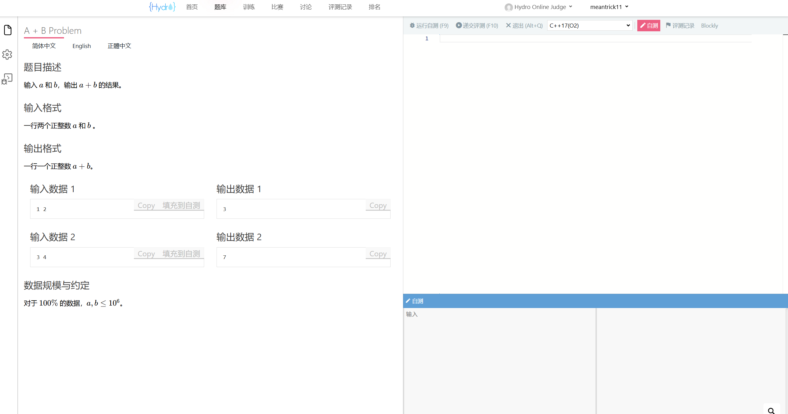

# ACM和leetcode模式

## leetcode模式

leetcode模式就是不需要你写完整的代码实现，你只需要完成对应的模块主要核心逻辑实现，不包括从标准输入中读取以及输出到标准输出中去，

整个过程是让实现核心类别，其余分支末节已经给你准备好了，比如从标准输入(样例文件)中读取输入，然后后续运行代码也已经写好，你只需要完成对应的类的实现，然后由其自动调用，其获取标准输出之后和对应的正确的输出文件做对比，最后返回结果。

## ACM模式

此模式要求更多，不仅仅是核心代码逻辑的实现，更是需要你完成整个运行代码(你可以直接写从头到尾的执行文件，也可以写main函数实现，再调用)，但本质上就是它会拿去你整个提交文件去获取标准输入，然后交给你文件执行，再对比你的执行结果

上图展示的就是一个OJ模式样例，左侧是题目描述，右侧上方是你的代码文件实现，右侧下侧则是模拟标准输入和模拟标准输入，你可以在这里输入数据测试。

**总结：leetcode模式只需要你实现核心代码类逻辑，获取输入->核心实现->实现调用->输出等流程已经被封装好了，你的类实现会后续被嵌入到测试的执行文件；而ACM模式需要你写一个能够完整实现上述流程的代码文件，后续平台直接测试你写的代码文件。**

*注：绝大多数的互联网公司的笔试和面试都要求ACM模式**