# 第一章 操作系统概述

## 1.1.1&1.1.2 操作系统的概念和功能

**操作系统**是指控制和管理整个计算机系统的硬件和软件资源；并合理地阻止调度计算机的工作和资源分配，以提供给用户和其他软件方便的接口和环境；它是计算机系统中最基本的系统软件；

1. 作为系统资源的管理者
  - 提供的功能
    - 处理机管理
    - 存储器管理
    - 文件管理
    - 设备管理
  - 目标
    - 安全、高效
2. 向上层提供方便易用的服务
    - GUI：图形化用户接口（Graphical User Interface）
    用户可以使用形象的图形界面进行操作，而不再需要记忆复杂的命令、参数。
    例子：在 Windows 操作系统中，删除一个文件只需要把文件“拖拽”到回收站即可。

    - 命令接口
        - 联机命令接口实例（Windows系统）  联机命令接口=交互式命令接口
        Step 1: win键+R
        Step 2: 输入cmd，按回车，打开命令解释器
        Step 3: 尝试使用 time 命令
        （用户说一句，系统做一件）
        
        - 脱机命令接口实例（Windows系统）  脱机命令接口=批处理命令接口
        使用windows系统的搜索功能，搜索C盘中的 *.bat 文件，用记事本任意打开一个（用户说一堆，系统做一堆）

    - 程序接口：可以在程序中进行**系统调用**来使用程序接口。普通用户不能直接使用程序接口，只能通过程序代码**间接**使用。
3. 作为最接近硬件的层次

需要实现**对硬件机器的拓展**

没有任何软件支持的计算机成为**裸机**。在裸机上安装的操作系统，可以提供资源管理功能和方便用户的服务功能，将裸机改造成功能更强、使用更方便的机器

通常把覆盖了软件的机器成为**扩充机器**，又称之为**虚拟机**


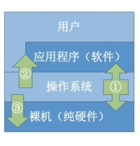

## 1.1.3 操作系统的特征

### 特征一：并发
**并发**：指两个或多个事件在同一时间间隔内发生。这些事件宏观上是同时发生的，但微观上是交替发生的。

常考易混概念——**并行**：指两个或多个事件在同一时刻同时发生。

操作系统的并发性指计算机系统中“同时”运行着多个程序，这些程序宏观上看是同时运行着的，而微观上看是交替运行的。
操作系统就是伴随着“多道程序技术”而出现的。因此，操作系统和程序并发是一起诞生的。

注意（重要考点）：
- 单核CPU同一时刻只能执行一个程序，各个程序只能并发地执行
- 多核CPU同一时刻可以同时执行多个程序，多个程序可以并行地执行

比如Intel的第八代i3处理器就是4核CPU，意味着可以并行地执行4个程序

即使是对于4核CPU来说，只要有4个以上的程序需要“同时”运行，那么并发性依然是必不可少的，因此**并发性是操作系统一个最基本的特性**

### 特征二：共享

共享即资源共享，是指系统中的资源可供内存中多个并发执行的进程共同使用。

- 两种资源共享方式
  - 互斥共享方式：系统中的某些资源，虽然可以提供给多个进程使用，但一个时间段内只允许一个进程访问该资源
  - 同时共享方式：系统中的某些资源，允许一个时间段内由多个进程“同时”对它们进行访问

所谓的“**同时**”往往是宏观上的，而在微观上，这些进程可能是交替地对该资源进行访问的（即分时共享）

### 特征三：虚拟

**虚拟**是指把一个物理上的实体变为若干个逻辑上的对应物。物理实体（前者）是实际存在的，而逻辑上对应物（后者）是用户感受到的。

- 虚拟技术
  - 空分复用技术（如虚拟存储器技术）
  - 时分复用技术（如虚拟处理器）

显然，如果失去了并发性，则一个时间段内系统中只需运行一道程序，那么就失去了实现虚拟性的意义了。因此，**没有并发性，就谈不上虚拟性**

Yo~用一个例子来理解
背景知识：一个程序需要放入内存并给它分配CPU才能执行

### 特征四：异步

**异步**是指，在多道程序环境下，允许多个程序并发执行，但由于资源有限，进程的执行不是一贯到底的，而是走走停停，以不可预知的速度向前推进，这就是进程的异步性。

老渣要和两个女孩并发约会

- 第一道程序（与一号的约会）
  - 一号的指令1：老渣陪我吃饭
  - 一号的指令2：老渣把心给我
- 第二道程序（与二号的约会）
  - 二号的指令1：老渣把心给我
  - 二号的指令2：老渣陪我吃饭

与一、二号的约会 = 两道并发执行的程序
老渣的心 = 有限的系统资源

由于并发运行的程序会争抢着使用系统资源，而系统中的资源有限，因此进程的执行不是一贯到底的，而是走走停停的，以不可预知的速度向前推进

如果失去了并发性，即系统只能串行地运行各个程序，那么每个程序的执行会一贯到底。**只有系统拥有并发性，才有可能导致异步性。**

## 1.2 操作系统的发展和分类

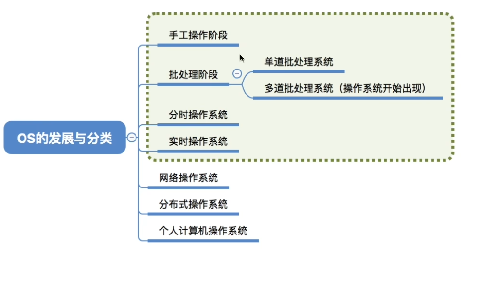


### 1. 工作流程示意

用户 → 纸带机（输入输出速度慢） → 计算机（计算速度快） → 纸带机（输入输出速度慢） → 用户

速度标注：
- 用户 ↔ 纸带机：**超慢**
- 纸带机 ↔ 计算机：**慢**
- 计算机 ↔ 纸带机：**慢**
- 纸带机 ↔ 用户：**超慢**

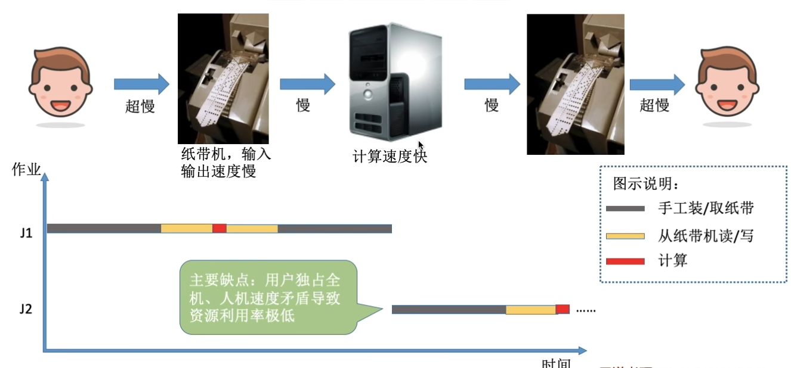

### 2. 批处理--单道批处理系统(操作系统的雏形)

纸带录入外围机->监督程序从外围机直接读取(速度提升)

- 引入**脱机输入/输出技术**，并由**监督程序**负责控制作业的输入、输出

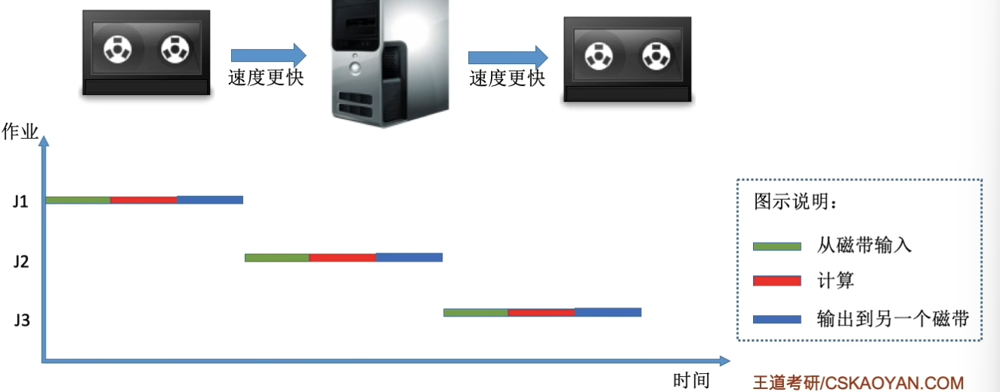

##### 主要优点：
缓解了一定程度的人机速度矛盾，资源利用率有所提升。

##### 主要缺点：
- 内存中仅能有一道程序运行，只有该程序运行结束之后才能调入下一道程序。
- CPU有大量的时间是在空闲等待I/O完成，资源利用率依然很低。

### 3. 批处理阶段--多道批处理系统

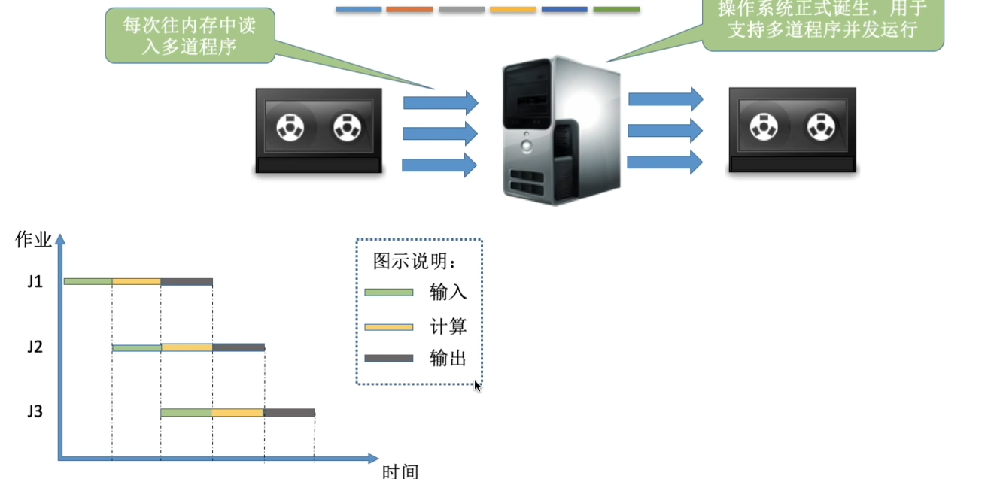

#### 多道批处理系统的优缺点

##### 主要优点：
多道程序并发执行，共享计算机资源。资源利用率大幅提升，CPU和其他资源更能保持“忙碌”状态，系统吞吐量增大。

##### 主要缺点：
用户响应时间长，没有人机交互功能（用户提交自己的作业之后就只能等待计算机处理完成，中间不能控制自己的作业执行。
例：无法调试程序/无法在程序运行过程中输入一些参数）


### 4. 分时操作系统

#### 分时操作系统

- 定义：计算机以**时间片**为单位**轮流为各个用户/作业服务**，各个用户可通过终端与计算机进行交互。

##### 主要优点：
用户请求可以被即时响应，**解决了人机交互问题**。允许多个用户同时使用一台计算机，并且用户对计算机的操作相互独立，感受不到别人的存在。

##### 主要缺点：
不能优先处理一些紧急任务。操作系统对各个用户/作业都是完全公平的，循环地为每个用户/作业服务一个时间片，不区分任务的紧急性。

### 5. 实时操作系统

- 定义：能够优先响应一些紧急任务，某些紧急任务不需时间片排队。
- 核心特点：在实时操作系统的控制下，计算机  系统接收到外部信号后及时进行处理，并且**要在严格的时限内处理完事件**。实时操作系统的主要特点是**及时性和可靠性**。

##### 分类：
1.  **硬实时系统**
    - 特点：必须在绝对严格的规定时间内完成处理
    - 例子：导弹控制系统、自动驾驶系统
2.  **软实时系统**
    - 特点：能接受偶尔违反时间规定
    - 例子：12306火车订票系统

### 6. 其他

##### 网络操作系统
伴随着计算机网络的发展而诞生，能把网络中各个计算机有机地结合起来，实现数据传送等功能，**实现网络中各种资源的共享（如文件共享）和各台计算机之间的通信**。
- 例子：Windows NT（网站服务器可使用）

##### 分布式操作系统
主要特点是**分布性和并行性**。系统中的各台计算机地位相同，**任何工作都可以分布在这些计算机上，由它们并行、协同完成这个任务**。

##### 个人计算机操作系统
方便个人使用。
- 例子：Windows XP、MacOS


## 1.3.1 操作系统的运行机制

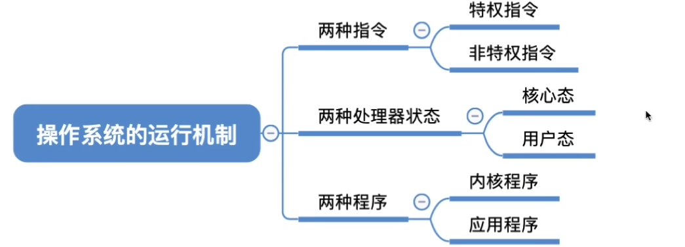

### 操作系统中程序是如何运行的？

C语言代码 →（编译器“翻译”）→ 机器指令（二进制）
说明：一条高级语言的代码翻译过来可能会对应多条机器指令

示例代码：
```c
int x = 1;
x++;
```
→ 翻译为机器指令 → 被 CPU 执行

“指令” 就是处理器（CPU）能识别、执行的最基本命令程序运行的过程其实就是 CPU 执行一条一条的机器指令的过程
注：很多人习惯把 Linux、Windows、MacOS 的 “小黑框” 中使用的命令也称为 “指令”，其实这是 “交互式命令接口”，注意与本节的 “指令” 区别开。本节中的 “指令” 指二进制机器指令

### 内核程序 vs 应用程序

普通程序-->'应用程序'

微软、苹果等实现操作系统，所写的是“内核程序”，由很多内核程序组成“操作系统内核”，简称**内核(Kernel)**，内核时操作系统的最核心的部分，最接近硬件的部分

### 特权指令 vs 非特权指令

我们普通程序员写的程序就是“应用程序”

应用程序只能使用“非特权指令”，如：加法指令、减法指令等

微软、苹果有一帮人负责实现操作系统，他们写的就是“内核程序”

操作系统内核作为“管理者”，有时会让CPU执行一些“特权指令”，如：内存清零指令。这些指令影响重大，只允许“管理者”——即操作系统内核来使用

### 内核态 vs 用户态

CPU 有两种状态，“内核态”和“用户态”
处于内核态时，说明此时正在运行的是内核程序，此时可以执行特权指令
处于用户态时，说明此时正在运行的是应用程序，此时只能执行非特权指令

拓展：CPU 中有一个寄存器叫程序状态字寄存器（PSW），其中有个二进制位，1 表示“内核态”，0 表示“用户态”

*内核态=核心态=管态；用户态=目态*

#### 状态的切换

内核态→用户态：执行一条特权指令——修改**PSW的标志位**为“用户态”，这个动作意味着操作系统将主动让出CPU使用权
用户态→内核态：由“**中断**”引发，硬件自动完成变态过程，触发中断信号意味着操作系统将强行夺回CPU的使用权

除了非法使用特权指令之外，还有很多事件会触发中断信号。一个共性是，但凡需要操作系统介入的地方，都会触发中断信号

一个故事：
① 刚开机时，CPU 为“内核态”，操作系统内核程序先上CPU运行
② 开机完成后，用户可以启动某个应用程序
③ 操作系统内核程序在合适的时候主动让出 CPU，让该应用程序上CPU运行
④ 应用程序运行在“用户态”
⑤ 此时，一位猥琐黑客在应用程序中植入了一条特权指令，企图破坏系统...
⑥ CPU发现接下来要执行的这条指令是特权指令，但是自己又处于“用户态”
⑦ 这个非法事件会引发一个中断信号
⑧ “中断”使操作系统再次夺回CPU的控制权
⑨ 操作系统会对引发中断的事件进行处理，处理完了再把CPU使用权交给别的应用程序

操作系统内核在让出CPU之前，会用一条特权指令把 PSW 的标志位设置为“用户态”

CPU检测到中断信号后，会立即变为“核心态”，并停止运行当前的应用程序，转而运行处理中断信号的内核程序

## 1.3.2 中断和异常

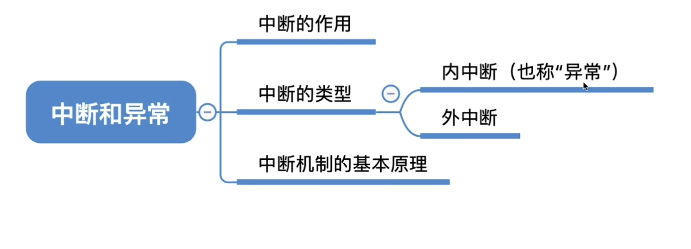

### 中断的作用

CPU 上会运行两种程序，一种是**操作系统内核程序**，一种是**应用程序**
- 操作系统内核程序：是整个系统的管理者

在合适的情况下，操作系统内核会把 CPU 的使用权主动让给应用程序（第二章进程管理相关内容）

**“中断”是让操作系统内核夺回 CPU 使用权的唯一途径**

如果没有“中断”机制，那么一旦应用程序上 CPU 运行，CPU 就会一直运行这个应用程序，既如此，何来“并发”！？

- 内核态→用户态：执行一条**特权指令**——修改PSW的标志位为“用户态”，这个动作意味着操作系统将主动让出 CPU 使用权
- 用户态→内核态：由“中断”引发，硬件自动完成变态过程，触发中断信号意味着操作系统将强行夺回 CPU 的使用权

“中断”会使 CPU 由用户态变为内核态，使操作系统重新夺回对 CPU 的控制权

### 中断的类型

- 内中断(异常、例外)：与当前执行的指令**有关**，中断信号来源于CPU**内部**
  - 陷入：
  由陷入指令引发，是程序故意导致
  - 故障（fault）：
  由错误条件引起的，可能被内核程序修复。内核程序修复故障后会把 CPU 使用权还给应用程序，让它继续执行下去。如：缺页故障。

  - 终止（abort）：
  由致命错误引起，内核程序无法修复该错误，因此一般不再将 CPU 使用权还给引发终止的应用程序，而是直接终止该应用程序。如：整数除0、非法使用特权指令

- 外中断(中断)：与当前执行的指令**无关**，中断信号来源于CPU**外部**

### 内中断的例子

1. 当前指令或者参数是非法，就会发出中断指令

2. 当应用程序想请求操作系统的服务，会执行特殊的指令**陷入指令**，会引发一个内中断信号

### 外中断例子

1. 时钟中断--由时钟内部发送的中断信号
2. I/O中断--由输入和输出设备发来的外部中断信号

### 中断机制的基本原理

不同的中断信号，需要用不同的中断处理程序来处理。当CPU检测到中断信号后，会根据中断信号的类型去查询“中断向量表”，以此来找到相应的中断处理程序在内存中的存放位置。
- 内中断在执行指令时会检查是发生
- 外中断时在每个周期末尾，CPU会检查是否有外中断信号处理
**中断处理程序一定是内核程序，需要运行在"内核态"**

## 1.3.3 系统调用

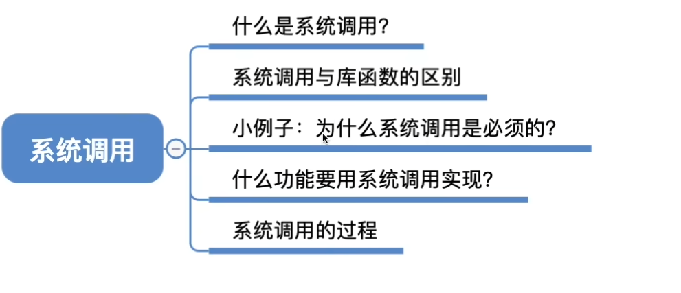

“系统调用”是操作系统提供给应用程序（程序员/编程人员）使用的接口，可以理解为一种可供应用程序调用的特殊函数，应用程序可以通过系统调用来请求获得操作系统内核的服务。

### 系统调用和库函数的区别

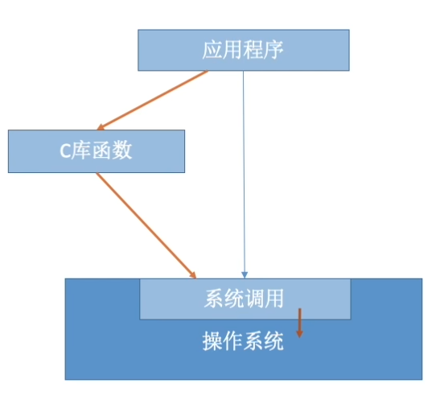

| 层级           | 说明                                                                 |
|----------------|----------------------------------------------------------------------|
| 普通应用程序   | 可直接进行系统调用，也可使用库函数。有的库函数涉及系统调用，有的不涉及 |
| 编程语言       | 向上提供库函数。有时会将系统调用封装成库函数，以隐藏系统调用的一些细节，使程序员编程更加方便。 |
| 操作系统       | 向上提供系统调用，使得上层程序能请求内核的服务                       |
| 裸机           |                                                                      |

- 不涉及系统调用的库函数：如“取绝对值”的函数
- 涉及系统调用的库函数：如“创建一个新文件”的函数

### 系统调用的分类

应用程序通过系统调用请求操作系统的服务。而系统中的各种共享资源都由操作系统内核统一掌管，因此凡是与共享资源有关的操作（如存储分配、I/O操作、文件管理等），都必须通过系统调用的方式向操作系统内核提出服务请求，由操作系统内核代为完成。这样可以保证系统的稳定性和安全性，防止用户进行非法操作。

- 设备管理：完成设备的 请求/释放/启动 等功能
- 文件管理：完成文件的 读/写/创建/删除 等功能
- 进程控制：完成进程的 创建/撤销/阻塞/唤醒 等功能
- 进程通信：完成进程之间的 消息传递/信号传递 等功能
- 内存管理：完成内存的 分配/回收 等功能

### 系统调用的过程

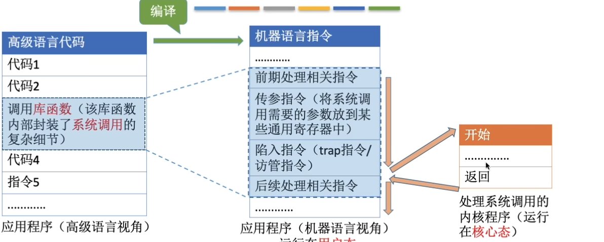

传递系统调用参数 → 执行陷入指令/Trap指令/仿管指令（用户态） → 执行相应的内核程序处理系统调用（核心态） → 返回应用程序

注意：
1. 陷入指令是在用户态执行的，执行陷入指令之后立即引发一个内中断，使CPU进入核心态
2. 发出系统调用请求是在用户态，而对系统调用的相应处理在核心态下进行


## 1.4 操作系统体系结构（上）

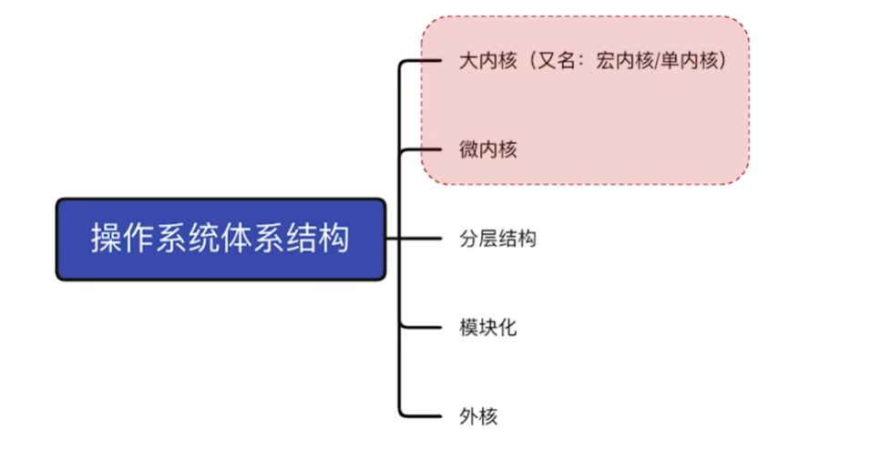

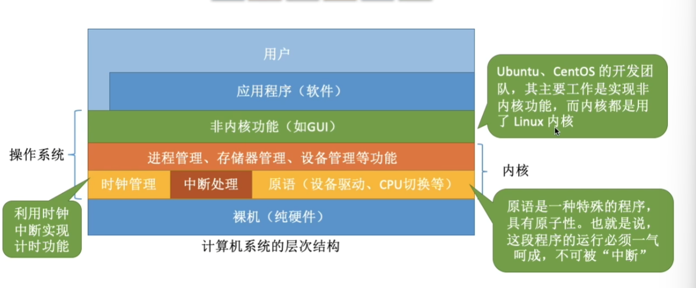

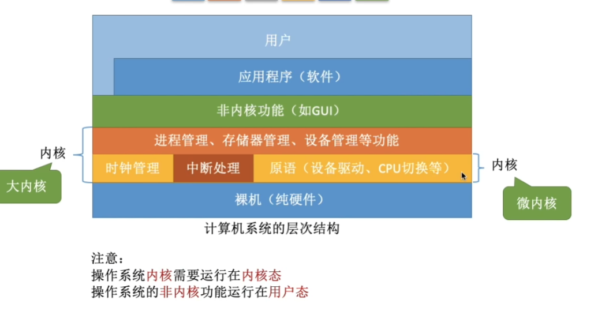

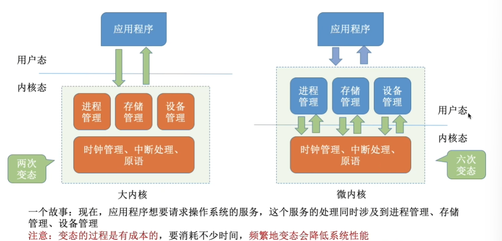

- 大内核
  - 定义：将操作系统的主要功能模块都作为系统内核，运行在核心态
  - 优点：高性能
  - 缺点：内核代码庞大，结构混乱，难以维护
- 微内核
  - 定义：只把最基本的功能保留在内核
  - 优点：内核功能少，结构清晰，方便维护
  - 缺点：需要频繁地在核心态和用户态之间切换，性能低

典型的大内核/宏内核/单内核 操作系统： Linux、UNIX
典型的微内核操作系统： Windows NT

## 1.4 操作系统体系结构(下)

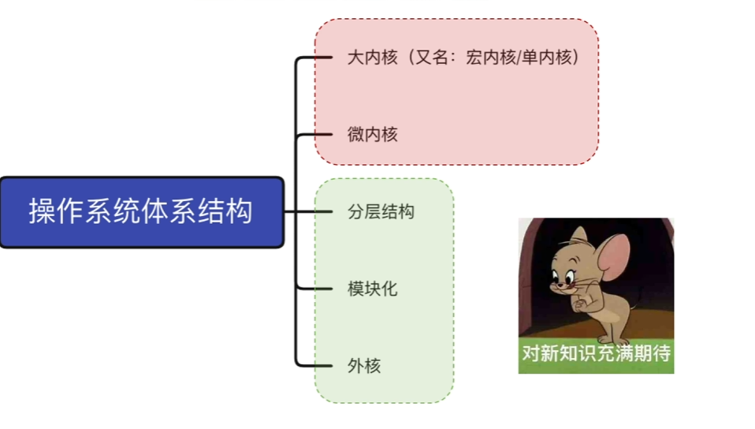

### 各种体系结构的对比

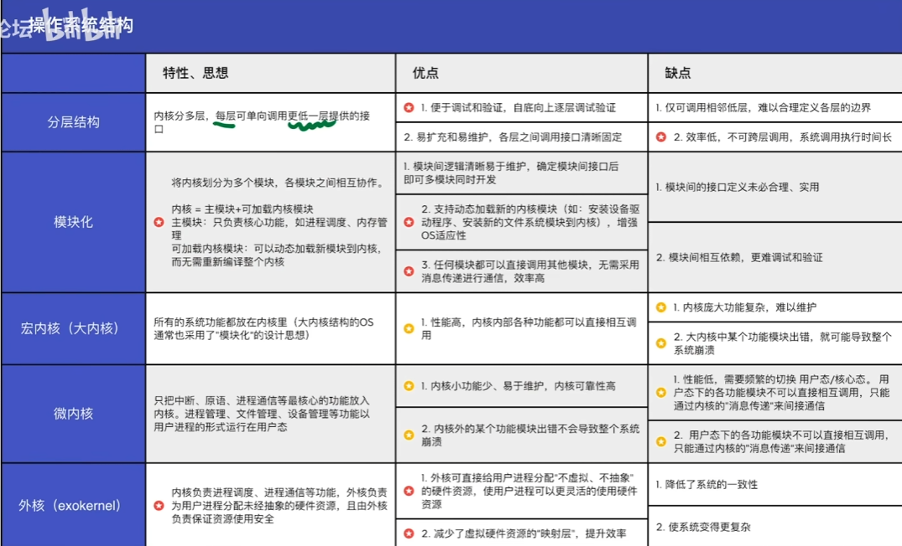

## 1.5 操作系统的引导

- 什么是操作系统引导？
- 磁盘里边有哪些相关数据？
- 操作系统引导的过程

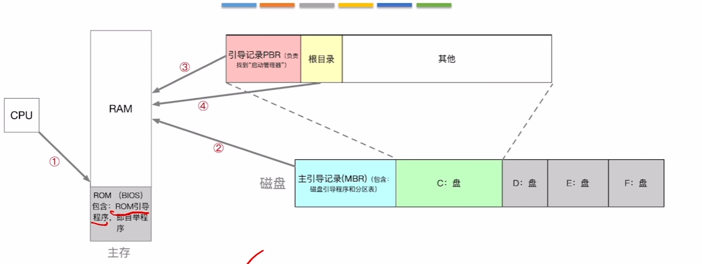

操作系统引导：
①CPU从一个特定主存地址开始，取指令，执行ROM中的引导程序（先进行硬件自检，再开机）
②将磁盘的第一块——主引导记录 读入内存，执行磁盘引导程序，扫描分区表
③从活动分区（又称主分区，即安装了操作系统的分区）读入分区引导记录，执行其中的程序
④从根目录下找到完整的操作系统初始化程序（即 启动管理器）并执行，完成“开机”的一系列动作

## 1.6 虚拟机

虚拟机：使用虚拟化技术，将一台物理机器虚拟化为多台虚拟机器（Virtual Machine, VM），每个虚拟机器都可以独立运行一个操作系统

- 分时划分
- 分空间划分

同义术语：虚拟机管理程序/虚拟机监控程序/Virtual Machine Monitor/Hypervisor

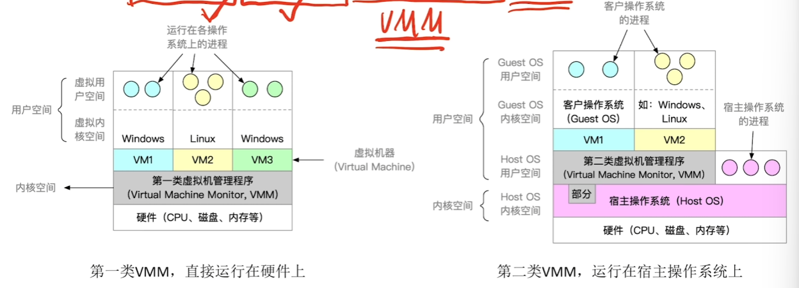

*VMware VirtualBox都是属于第二类VMM*

### 两类虚拟机管理程序的对比

| 对比维度 | 第一类VMM | 第二类VMM |
| :--- | :--- | :--- |
| 对物理资源的控制权 | 直接运行在硬件之上，能直接控制和分配物理资源 | 运行在Host OS之上，依赖于Host OS为其分配物理资源 |
| 资源分配方式 | 在安装Guest OS时，VMM要在原本的硬盘上自行分配存储空间，类似于“外核”的分配方式，分配未经抽象的物理硬件 | GuestOS 拥有自己的虚拟磁盘，该盘实际上是Host OS 文件系统中的一个大文件。GuestOS分配到的内存是虚拟内存 |
| 性能 | 性能更好 | 性能更差，需要HostOS作为“中介” |
| 可支持的虚拟机数量 | 更多，不需要和 Host OS 竞争资源，相同的硬件资源可以支持更多的虚拟机 | 更少，Host OS 本身需要使用物理资源，Host OS 上运行的其他进程也需要物理资源 |
| 虚拟机的可迁移性 | 更差 | 更好，只需导出虚拟机镜像文件即可迁移到另一台 HostOS 上，商业化应用更广泛 |
| 运行模式 | 第一类VMM运行在最高特权级（Ring 0），可以执行最高特权的指令。 | 第二类VMM部分运行在用户态、部分运行在内核态。GuestOS发出的系统调用会被 VMM 截获，并转化为 VMM 对 HostOS 的系统调用 |


