# 内存

----
## 3.1.1_1 内存的基础知识

**总览**：
1. 什么是内存，有何作用
2. 进程运行的基本原理
    - 指令的工作原理
    - 逻辑地址 vs 物理地址
    - 如何实现地址转换
    - 从写程序到程序运行的过程

### 什么是内存？有什么作用？

内存可存放数据。程序执行前**需要先放到内存中才能被CPU处理**——缓和CPU与硬盘之间的速度矛盾

思考：在多道程序环境下，系统中会有多个程序并发执行，也就是说会有多个程序的数据需要同时放到内存中。那么，如何区分各个程序的数据是放在什么地方的呢？

方案：给内存的存储单元编地址

### 几个常用的数量单位

一台手机/电脑有 4GB 内存，是什么意思？

是指该内存中可以存放 $4*2^{30}$ 个字节。如果是按字节编址的话，也就是有 $4*2^{30} = 2^{32}$ 个“小房间”

这么多“小房间”，需要 $2^{32}$ 个地址才能一一标识，所以地址需要用 32 个二进制位来表示（$0\sim 2^{32}-1$）

**补充知识：**
$2^{10} = 1K$ 　　（千）
$2^{20} = 1M$ 　　（兆，百万）
$2^{30} = 1G$ 　　（十亿，千兆）

注：有的题目会告诉我们内存的大小，让我们确定地址长度应该是多少（即要多少个二进制位才能表示相应数目的存储单元）

### 指令的工作原理
程序经过编译、链接后生成的指令中指明的是**逻辑地址（相对地址）**，即：相对于进程的起始地址而言的地址

C语言程序经过编译、链接处理后，生成装入模块，即可执行文件：
```c
int x = 10;
x = x + 1;
```

可执行文件 *.exe）示例
| 偏移 | 指令内容 |
| ---- | -------- |
| 0    | 指令0：往地址为79的存储单元中写入10 |
| 1    | 指令1：把地址79中的数据读入寄存器3 |
| …    | … |
| 179  | …… |

### 如何将逻辑地址转为物理地址？(三种装入方式)

#### 1. 绝对装入

**绝对装入**：在编译时，如果知道程序将放到内存中的哪个位置，编译程序将产生绝对地址的目标代码。**直接将对应的写入内存的地址写死，后续都装入内存的绝对地址中**

装入程序按照装入模块中的地址，将程序和数据装入内存。

**只适用于单道程序环境，更换电脑，程序便不能运行**

#### 2. 可重定位装入（静态重定位）
**静态重定位**：又称**可重定位装入**。编译、链接后的装入模块的地址都是从0开始的，指令中使用的地址、数据存放的地址都是相对于起始地址而言的逻辑地址。可根据内存的当前情况，将装入模块装入到内存的适当位置。装入时对地址进行**重定位**，将逻辑地址变换为物理地址（地址变换是在装入时一次完成的）。
比如所有指令的地址整体+100
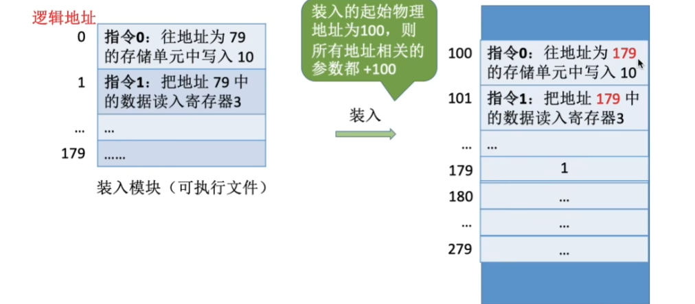

静态重定位的特点是在一个作业装入内存时，**必须分配其要求的全部内存空间**，如果没有足够的内存，就不能装入该作业。
作业一旦进入内存后，在运行期间不能再移动（内存的地址已定），也不能申请内存空间。
#### 3. 动态运行时装入（动态重定位）
**动态重定位**：又称**动态运行时装入**。编译、链接后的装入模块的地址都是从0开始的。装入程序把装入模块装入内存后，并不会立即把逻辑地址转换为物理地址，而是把地址转换推迟到程序真正要执行时才进行。因此装入内存后所有的地址依然是逻辑地址。这种方式需要一个**重定位寄存器**的支持。
**每次取地址等需要和存储寄存器交互，然后获取真实地址**


### 从程序到程序运行

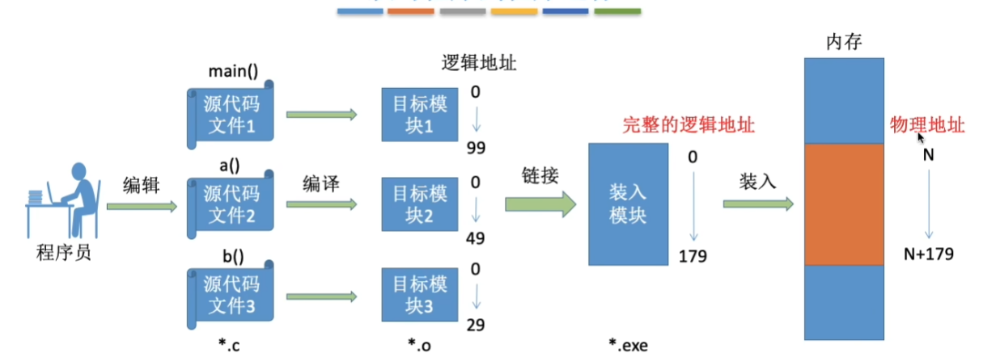

编译：由编译程序将用户源代码编译成若干个目标模块（编译就是把高级语言**翻译**为机器语言）
链接：由链接程序将编译后形成的一组目标模块，以及所需库函数链接在一起，形成一个完整的装入模块
装入（装载）：由装入程序将装入模块装入内存运行

### 链接的三种方式
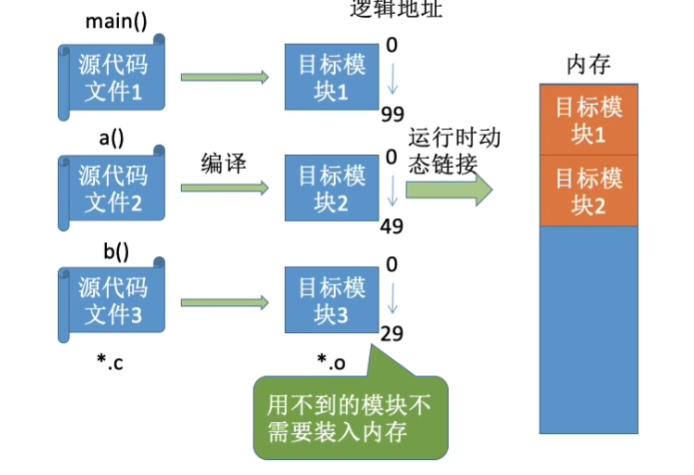

1. **静态链接**：在程序运行之前，先将各目标模块及它们所需的库函数连接成一个完整的可执行文件（装入模块），之后不再拆开。
2. **装入时动态链接**：将各目标模块装入内存时，边装入边链接的链接方式。
3. **运行时动态链接**：在程序执行中需要该目标模块时，才对它进行链接。其优点是便于修改和更新，便于实现对目标模块的共享。

### 总结


---
## 3.1.1_2 内存管理的概念

**总览**：

1. 内存空间的分配与回收
2. 内存空间的扩充
3. 地址转换
4. 存储保护

### 1. 内存空间的分配和回收

### 2. 内存空间的扩展

通过该某种技术从逻辑上对地址进行扩充(**虚拟性**)

### 3. 地址转换

为了使编程更方便，程序员写程序时应该只需要关注指令、数据的逻辑地址。而逻辑地址到物理地址的转换（这个过程称为地址重定位）应该由操作系统负责，这样就保证了程序员写程序时不需要关注物理内存的实际情况。


### 4. 内存保护

让进程只能访问对应的内存空间，不能访问其他进程的内存空间

#### 两种保护方法

内存保护可采取两种方法：
方法一：在CPU中设置一对上、下限寄存器，存放进程的上、下限地址。进程的指令要访问某个地址时，CPU检查是否越界。


方法二：采用重定位寄存器（又称基址寄存器）和界地址寄存器（又称限长寄存器）进行越界检查。**重定位寄存器**中存放的是进程的起始物理地址。**界地址寄存器**中存放的是进程的最大逻辑地址。


---
## 3.1.1_3 进程的内存映像

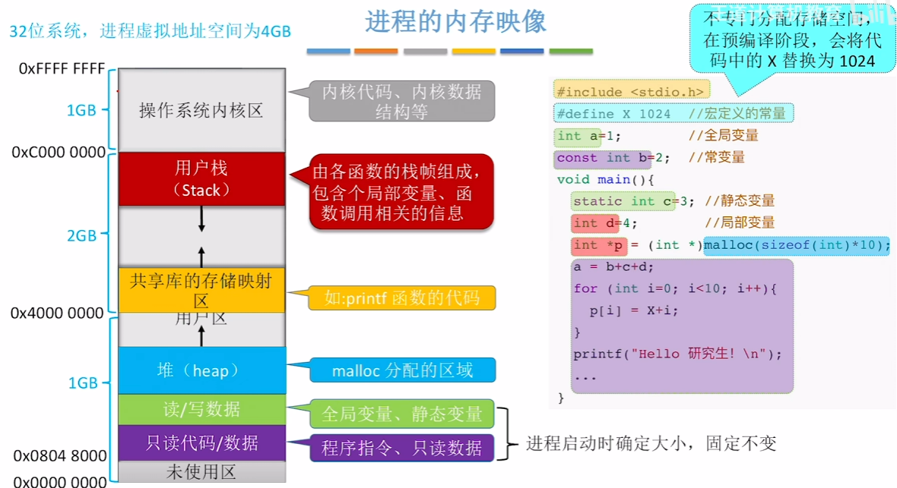

### 总结

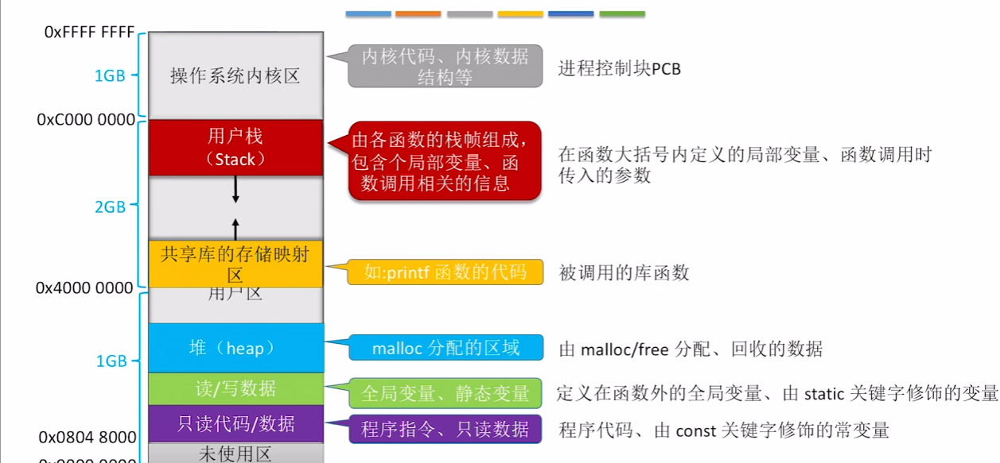

----
## 3.1.1.4 内存空间的扩容(覆盖与交换)

对内存管理中的的内存扩充技术

**总览**：
1. 内存空间的分配与回收
2. 内存空间的扩充
   - 覆盖技术
   - 交换技术
   - 虚拟存储技术
3. 地址转换
4. 存储保护

### 1. 覆盖技术

#### 背景
早期的计算机内存很小，比如 IBM 推出的第一台PC机最大只支持 1MB 大小的内存。因此经常会出现内存大小不够的情况。

#### 覆盖技术引入目的
后来人们引入了**覆盖技术**，用来解决“程序大小超过物理内存总和”的问题

#### 覆盖技术核心思想
将程序分为多个段（多个模块）。
常用的段常驻内存，不常用的段在需要时调入内存。

内存中分为一个**固定区**和若干个**覆盖区**。

需要常驻内存的段放在**固定区**中，调入后就不再**调出**（除非运行结束）
不常用的段放在**覆盖区**，需要用到时调入内存，用不到时**调出**内存

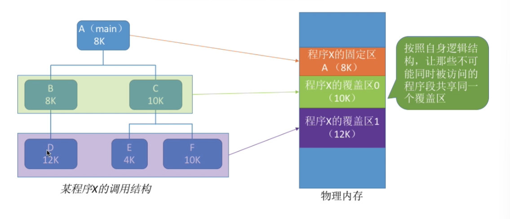

**优点**：必须由程序员声明**覆盖结构**，操作系统完成自动覆盖。
**缺点**：对用户不透明，增加了用户编程负担。
*已不再使用*

### 2. 交换技术

交换（对换）技术的设计思想：内存空间紧张时，系统将内存中某些进程暂时**换出**外存，把外存中某些已具备运行条件的进程**换入**内存（进程在内存与磁盘间动态调度）

**中级调度（内存调度）**，就是要决定将哪个处于挂起状态的进程重新调入内存。

暂时换出外存等待的进程状态为**挂起状态**（**挂起态**，**suspend**）
挂起态又可以进一步细分为**就绪挂起**、**阻塞挂起**两种状态


### 交换技术三个核心问题
1. 应该在外存（磁盘）的什么位置保存被换出的进程？
2. 什么时候应该交换？
3. 应该换出哪些进程？

#### 1. 存放位置：磁盘分为文件区、对换区
具有对换功能的操作系统中，通常把磁盘空间分为**文件区**和**对换区**两部分。
- 文件区：主要用于存放文件，追求存储空间利用率，采用离散分配方式；
- 对换区：存放被换出的进程数据，追求换入/换出速度，采用连续分配方式；
总结：**对换区的I/O速度比文件区更快**。

#### 2. 交换时机
交换通常在多进程并发、内存资源紧张时执行，系统负载降低则暂停：
- 频繁缺页 → 内存紧张，执行换出；
- 缺页率明显下降 → 暂停换出。

#### 3. 换出进程选择策略
1. 优先换出**阻塞进程**；
2. 换出**优先级低**的进程；
3. 兼顾进程在内存的**驻留时间**，避免刚换入就再次换出。

**注意：PCB会常驻内存，并不是进程的所有数据全被调出**

### 总结


----
## 3.1.2_1 连续分配管理方式

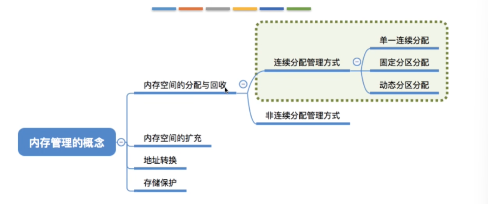

**连续分配**：指为用户进程分配的必须是一个连续的内存空间。

### 1. 单一连续分配

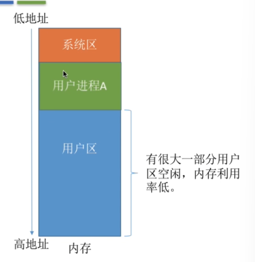

在单一连续分配方式中，内存被分为**系统区**和**用户区**。
系统区通常位于内存的低地址部分，用于存放操作系统相关数据；用户区用于存放用户进程相关数据。
内存中**只能有一道用户程序**，用户程序独占整个用户区空间。

**优点**：实现简单；**无外部碎片**；可以采用覆盖技术扩充内存；不一定需要采取内存保护（eg：早期的 PC 操作系统 MS-DOS）。

**缺点**：只能用于单用户、单任务的操作系统中；**有内部碎片**；存储器利用率极低。

> 分配给某进程的内存区域中，如果有些部分没有用上，就是“内部碎片”

### 2. 固定分区分配

20世纪60年代出现了支持多道程序的系统，为了能在内存中装入多道程序，且这些程序之间又不会相互干扰，于是将整个**用户空间**划分为**若干个固定大小的分区**，在**每个分区中只装入一道作业**，这样就形成了最早的、最简单的一种可运行多道程序的内存管理方式。

#### 分类

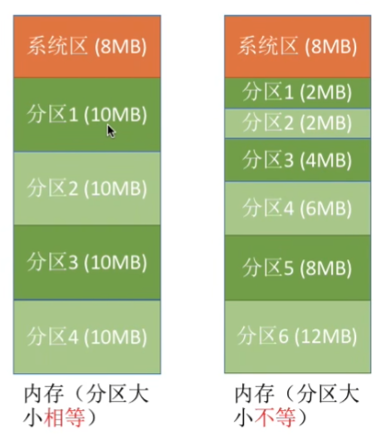

###### 分区大小相等


分区大小相等：缺乏灵活性，但是很**适合用于用一台计算机控制多个相同对象的场合**（比如：钢铁厂有n个相同的炼钢炉，就可把内存分为n个大小相等的区域存放n个炼钢炉控制程序）
##### ②分区大小不等
操作系统需要建立一个数据结构——**分区说明表**，来实现各个分区的分配与回收。每个表项对应一个分区，通常按分区大小排列。每个表项包括对应分区的**大小**、**起始地址**、**状态**（是否已分配）。

| 分区号 | 大小（MB） | 起始地址（M） | 状态   |
| ------ | ---------- | ------------- | ------ |
| 1      | 2          | 8             | 未分配 |
| 2      | 2          | 10            | 未分配 |
| 3      | 4          | 12            | 已分配 |
| ……     | ……         | ……            | ……     |

> 用数据结构的数组（或链表）即可表示这个表

当某用户程序要装入内存时，由操作系统内核程序根据用户程序大小检索该表，从中找到一个能满足大小的、未分配的分区，将之分配给该程序，然后修改状态为“已分配”。

**优点**：实现简单，**无外部碎片**。

**缺点**：
a. 当用户程序太大时，可能所有的分区都不能满足需求，此时不得不采用覆盖技术来解决，但这又会降低性能；
b. **会产生内部碎片**，内存利用率低。
>(内部碎片表示的是分配给某个程序的内存并没有被使用完，但是他是固定分区，所以多多少少会产生一些内部碎片，很少能100%利用)

### 3. 动态分区分配

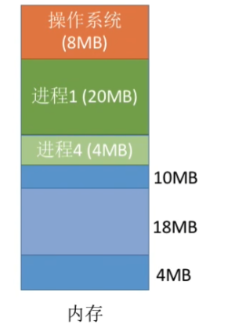
**动态分区分配**又称为**可变分区分配**。这种分配方式**不会预先划分内存分区**，而是在进程装入内存时，**根据进程的大小动态地建立分区**，并使分区的大小正好适合进程的需要。因此系统分区的大小和数目是可变的。

（eg：假设某计算机内存大小为64MB，系统区8MB，用户区共56MB…）

#### 使用什么数据结构记录内存的使用情况？

##### 两种常用的数据结构
分为：**空闲分区表**、**空闲分区链**

1. 空闲分区表
| 分区号 | 分区大小（MB） | 起始地址（M） | 状态 |
| ---- | ---- | ---- | ---- |
| 1 | 20 | 8 | 空闲 |
| 2 | 10 | 32 | 空闲 |
| 3 | 4 | 60 | 空闲 |
说明：每个空闲分区对应一个表项。表项中包含分区号、分区大小、分区起始地址等信息。

2. 空闲分区链
说明：每个分区的起始部分和末尾部分分别设置前向指针和后向指针。起始部分处还可记录分区大小等信息。

#### 当很多空闲分区都满足需求时，应该选择哪个分区进行分配？

把一个新作业装入内存时，须按照一定的**动态分区分配算法**，从空闲分区表（或空闲分区链）中选出一个分区分配给该作业。由于分配算法算法对系统性能有很大的影响，因此人们对它进行了广泛的研究。

#### 如何进行分区的分配与回收操作？

**空闲分区表**：修改对应的分区大小以及起始和结束指向。有时候可能需要新增一行或者合并多行表示内存的最新空闲情况。

分配与回收：
| 分区号 | 分区大小（MB） | 起始地址（M） | 状态 |
| ---- | ---- | ---- | ---- |
| 1 | 10 | 32 | 空闲 |
| 2 | 4 | 60 | 空闲 |


注：各表项的顺序不一定按照地址递增顺序排列，具体的排列方式需要依据动态分区分配算法来确定。
动态分区分配**没有内部碎片**，但是**有外部碎片**。

### 内外部碎片

**内部碎片**：分配给某进程的内存区域中，如果有些部分没有用上。
**外部碎片**：是指内存中的某些空闲分区由于太小而难以利用。

如果内存中空闲空间的总和本来可以满足某进程的要求，但由于进程需要的是一整块连续的内存空间，因此这些“碎片”不能满足进程的需求。
可以通过**紧凑（拼凑，Compaction）**技术来解决外部碎片。

### 总结


----

## 3.1.2_2 动态分区算法


**总览：**
动态分区分配算法：在动态分区分配方式中，当很多个空闲分区都能满足需求时，应该选择哪个分区进行分配？
1. 首次适应算法（First Fit）
2. 最佳适应算法（Best Fit）
3. 最坏适应算法（Worst Fit）
4. 邻近适应算法（Next Fit）

### 1. 首次适应算法（First Fit）

**算法思想**：每次都从低地址开始查找，找到第一个能满足大小的空闲分区。

**如何实现**：空闲分区以地址递增的次序排列。每次分配内存时顺序查找空闲分区链（或空闲分区表），找到大小能满足要求的第一个空闲分区。

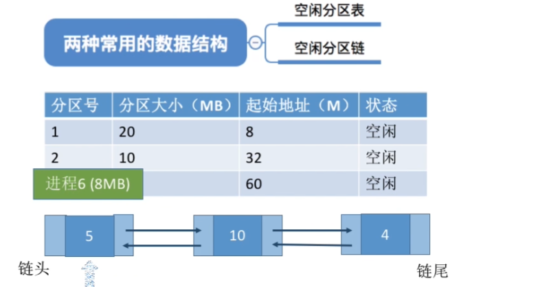


### 2. 最佳适应算法（Best Fit）
**算法思想**：由于动态分区分配是一种连续分配方式，为各进程分配的空间必须是连续的一整片区域。因此为了保证当“大进程”到来时能有连续的大片空间，可以尽可能多地留下大片的空闲区，即，优先使用更小的空闲区。

**如何实现**：空闲分区**按容量递增次序链接**。每次分配内存时顺序查找**空闲分区链**（或空闲分区表），找到大小能满足要求的第一个空闲分区。

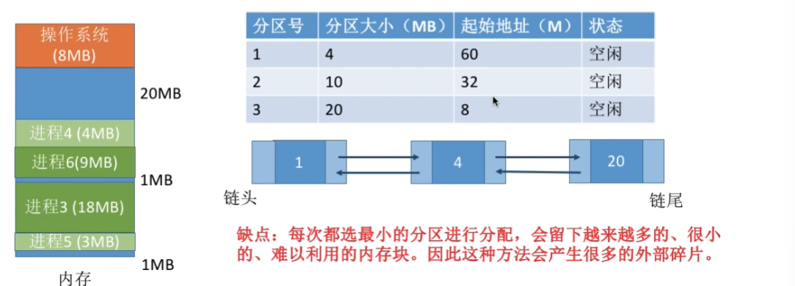

**缺点**:容易出现很多极小的内存无法利用

### 3. 最坏适应算法（又称**最大适应算法** Largest Fit）
**算法思想**：为了解决最佳适应算法的问题——即留下太多难以利用的小碎片，可以在每次分配时优先使用最大的连续空闲区，这样分配后剩余的空闲区就不会太小，更方便使用。

**如何实现**：空闲分区**按容量递减次序链接**。每次分配内存时顺序查找空闲分区链（或空闲分区表），找到大小能满足要求的第一个空闲分区。

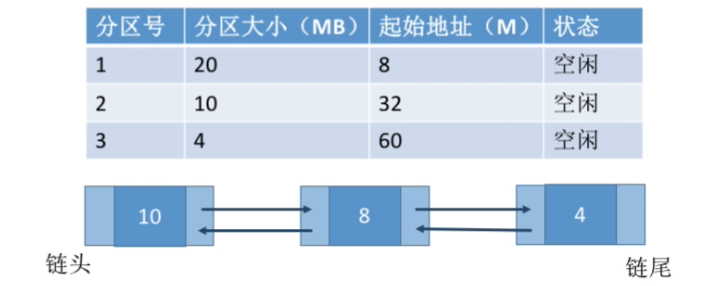

缺点：每次都选最大的分区进行分配，虽然可以让分配后留下的空闲区更大，更可用，但是这种方式会导致较大的连续空闲区被迅速用完。如果之后有“大进程”到达，就没有内存分区可用了。

首次适应算法每次都要从头查找，每次都需要检索低地址的小分区。
但是这种规则也决定了当低地址部分有更小的分区可以满足需求时，会更有可能用到低地址部分的小分区，也会更有可能把高地址部分的大分区保留下来（最佳适应算法的优点）

邻近适应算法的规则可能会导致无论低地址、高地址部分的空闲分区都有相同的概率被使用，也就导致了高地址部分的大分区更可能被使用，划分为小分区，最后导致无大分区可用（最大适应算法的缺点）

综合来看，**四种算法中，首次适应算法的效果反而更好**

### 总结


## 3.1.3_1 内存空间的分配和回收1(基本分页存储管理的概念)

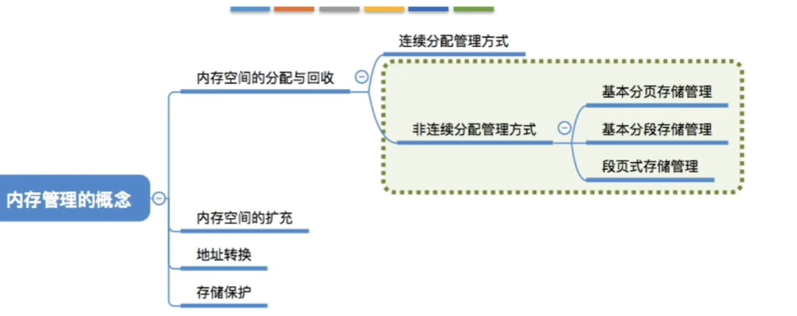

### 1. 分页存储

**连续分配**：为用户进程分配的必须是一个连续的内存空间。

**非连续分配**：为用户进程分配的可以是一些分散的内存空间。

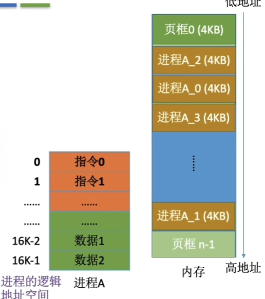

将内存空间分为一个个**大小相等**的分区（比如：每个分区4KB），每个分区就是一个“**页框**”（页框=页帧=内存块=物理块=物理页面）。每个页框有一个编号，即“**页框号**”（页框号=页帧号=内存块号=物理块号=物理页号），页框号从0开始。

将进程的逻辑地址空间也分为与**页框大小相等**的一个个部分，每个部分称为一个“**页**”或“**页面**”。每个页面也有一个编号，即“**页号**”，页号也是从0开始。

Tips：初学易混——页、页面 vs 页框、页帧、物理页
页号、页面号 vs 页框号、页帧号、物理页号

操作系统**以页框为单位**为各个进程分配内存空间。进程的每个页面分别放入一个页框中。也就是说，进程的页面与内存的页框有一一对应的关系。
各个页面不必连续存放，可以放到不相邻的各个页框中。

### 页表

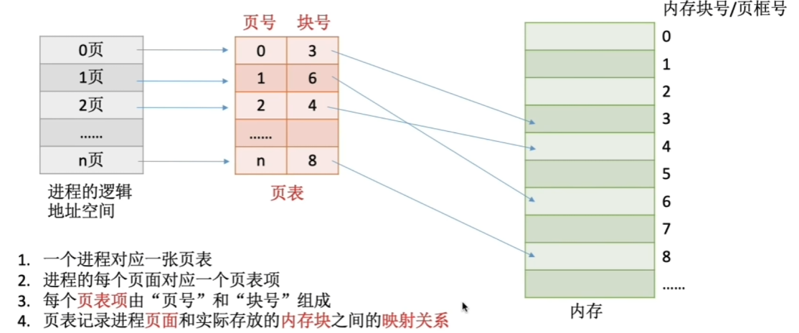

为了能知道进程的每个页面在内存中存放的位置，操作系统要为每个进程建立一张**页表**。

注：**页表**通常存在PCB（进程控制块）中

#### 每个页表项占多少字节？

Eg：假设某系统物理内存大小为4GB，页面大小为4KB，则每个页表项至少应该为多少字节？

**内存块大小=页面大小=4KB=2¹² B**
→4GB 的内存总共会被分为 2³² / 2¹² = 2²⁰ 个内存块
→内存块号的范围应该是 0 ~ 2²⁰ -1
→内存块号至少要用 20 bit 来表示
→至少要用**3B**来表示**块号**（3*8=24bit）**1Byte=8bit**
->由于页号是隐含的，因此每个表项占3B，存储整个页表至少需要3*(n+1)B

注意：页表记录的只是内存块号，而不是内存块的起始地址！
J号内存块的起始地址 = J * 内存块大小

#### 如何实现地址的转换？


特点：虽然进程的各个页面是离散存放的，但是页面内部是连续存放的

如果要访问逻辑地址 A，则
①确定逻辑地址A对应的“**页号**” P
②找到P号页面在内存中的起始地址（需要查页表）
③确定逻辑地址A的“**页内偏移量**” W

逻辑地址A对应的物理地址 = P号页面在内存中的起始地址+页内偏移量W

##### 如何确定一个逻辑地址对应的页号、页内偏移量？

Eg：在某计算机系统中，页面大小是50B。某进程逻辑地址空间大小为200B，则逻辑地址110对应的页号、页内偏移量是多少？
如何计算：
**页号** = 逻辑地址 / 页面长度（取除法的**整数**部分）
**页内偏移量** = 逻辑地址 % 页面长度（取除法的**余数**部分）

页号 = 110 / 50 = 2
页内偏移量 = 110 % 50 = 10

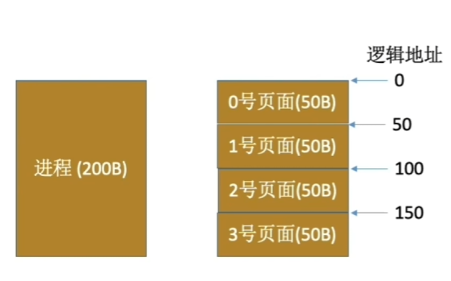

页号 = 逻辑地址 / 页面长度（取除法的整数部分）
页内偏移量 = 逻辑地址 % 页面长度（取除法的余数部分）

> 在计算机内部，地址是用二进制表示的，如果页面大小刚好是2的整数幂，则计算机硬件可以很快速的把逻辑地址拆分成（页号，页内偏移量）

假设某计算机用32个二进制位表示逻辑地址，页面大小为4KB = 2¹²B = 4096B

0号页的逻辑地址范围应该是0~4095，用二进制表示应该是：
00000000000000000000000000000000 ~ 00000000000000000000111111111111

1号页的逻辑地址范围应该是4096~8191，用二进制表示应该是：
00000000000000000001000000000000 ~ 000000000000000000011111111111

2号页的逻辑地址范围应该是8192~12287，用二进制表示应该是：
00000000000000000010000000000000 ~ 000000000000000000101111111111

Eg：逻辑地址2，用二进制表示应该是 00000000000000000000000000000010
页号 = 2/4096 = 0 = 00000000000000000000，页内偏移量 = 2%4096 = 2 = 000000000010

Eg：逻辑地址4097，用二进制表示应该是 00000000000000000001000000000001
页号 = 4097/4096 = 1 = 00000000000000000001，页内偏移量 = 4097%4096 = 1 = 000000000001

**二进制左移和右移**

**结论**：如果页面大小刚好是2的整数幂，则只需把页表中记录的**物理块号**拼接上**页内偏移量**就能得到对应的**物理地址**

### 逻辑地址结构


## 3.1.3_2 基本分页存储管理的概念2(本地址变换机构)

**总览**：

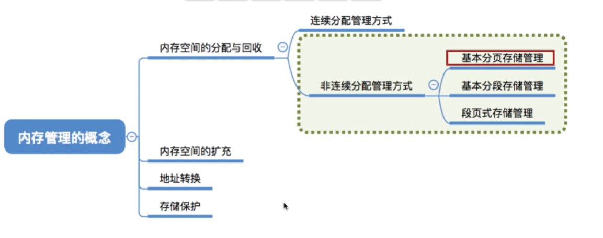

#### 基本地址变换机构

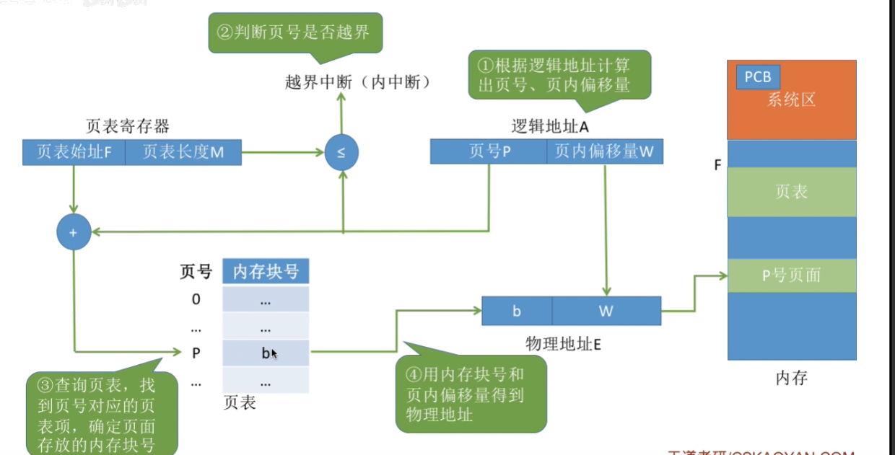

基本地址变换机构可以借助进程的页表将逻辑地址转换为物理地址。
通常会在系统中设置一个**页表寄存器（PTR）**，存放页表在内存中的起始地址F 和页表长度M。
进程未执行时，页表的始址 和 页表长度 放在进程控制块（PCB）中，当进程被调度时，操作系统内核会把它们放到页表寄存器中。

注意：页面大小是2的整数幂
设页面大小为L，逻辑地址A到物理地址E的变换过程如下：
①计算页号 P 和页内偏移量W（如果用十进制数手算，则 P=A/L，W=A%L；但是在计算机实际运行时，逻辑地址结构是固定不变的，因此计算机硬件可以更快地得到二进制表示的页号、页内偏移量）
②比较页号P 和页表长度M，若 P≥M，则产生越界中断，否则继续执行。（注意：页号是从0开始的，而页表长度至少是1，因此 P=M 时也会越界）
③页表中页号P对应的**页表项地址** = 页表起始地址F + 页号P * 页表项长度，取出该页表项内容b，即为内存块号。（注意区分页表项长度、页表长度、页面大小的区别。页表长度指的是这个页表中总共有几个页表项，即总共有几个页；页表项长度指的是每个页表项占多大的存储空间；页面大小指的是一个页面占多大的存储空间）
④计算 E = b * L + W，用得到的物理地址E 去访存。（如果内存块号、页面偏移量是用二进制表示的，那么把二者拼接起来就是最终的物理地址了）

#### 举例

例：若页面大小L为1K字节，页号2对应的内存块号 b = 8，将逻辑地址 A=2500 转换为物理地址E。
等价描述：某系统按字节寻址，逻辑地址结构中，页内偏移量占10位，页号2对应的内存块号 b = 8，将逻辑地址 A=2500 转换为物理地址E。
> 说明一个页面的大小为 $2^{10}\ \text{B} = 1\text{KB}$

①计算页号、页内偏移量
页号$\text{P} = \text{A}/\text{L} = 2500/1024 = 2$； 页内偏移量 $\text{W} = \text{A}\%\text{L} = 2500\%1024 = 452$

②根据题中条件可知，页号2没有越界，其存放的内存块号 b = 8

③物理地址 $\text{E} = \text{b} * \text{L} + \text{W} = 8 * 1024 + 452 = 8644$

在分页存储管理（页式管理）的系统中，只要确定了每个页面的大小，逻辑地址结构就确定了。因此，**页式管理中地址是一维的**。即，只要给出一个逻辑地址，系统就可以自动地算出页号、页内偏移量两个部分，并不需要显式地告诉系统这个逻辑地址中，页内偏移量占多少位。

### 页表项大小的进一步探讨

Eg：假设某系统物理内存大小为4GB，页面大小为4KB，内存总共会被分为 $2^{32} / 2^{12} = 2^{20}$ 个内存块，因此内存块号的范围应该是 $0 \sim 2^{20}-1$
因此至少要20个二进制位才能表示这么多的内存块号，因此至少要3个字节才够
（每个字节8个二进制位，3个字节共24个二进制位）

### 页表存储说明
各页表项会按顺序连续地存放在内存中
如果该页表在内存中存放的起始地址为 X，则
M 号页对应的页表项是存放在内存地址为 $\boldsymbol{X + 3*M}$

1. 页表项占3字节场景
一个页面为4KB，则每个页框可以存放 $4096/3 = 1365$ 个页表项，但是这个页框会剩余 $4096 \% 3 = 1\ \text{B}$ 页内碎片
因此，1365 号页表项存放的地址为 $\boldsymbol{X + 3*1365 + 1}$

2. 页表项占4字节场景
如果每个页表项占4字节，则每个页框刚好可存放 1024 个页表项
1024 号页表项虽然是存放在下一个页框中的，但是它的地址依然可以用 $\boldsymbol{X + 4*1024}$ 得出

### 结论
理论上，页表项长度为3B即可表示内存块号的范围，但是，为了方便页表的查询，常常会让一个页表项占更多的字节，使得每个页面恰好可以装得下整数个页表项。

页表结构示意：
| 页号 | 块号(3字节) |
| ---- | ----------- |
| 0    | 3字节       |
| 1    | 3字节       |
| ……   | 3字节       |
| n    | 3字节       |

### 总结


## 3.1.3_3 具有快表的地址变换机构


### 什么是快表？

**快表**，又称联想寄存器（**TLB**，translation lookaside buffer），是一种访问速度比内存快很多的高速缓存（**TLB不是内存！**），用来存放**最近访问的页表项**的副本，可以加速地址变换的速度。
与此对应，内存中的页表常称为**慢表**。

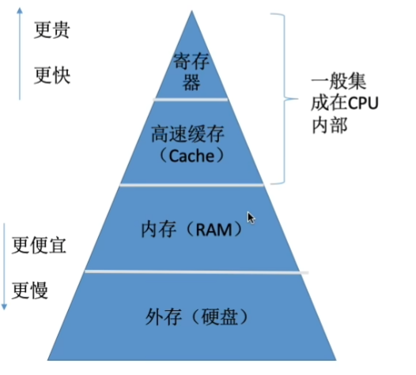

#### 能否把整个页表都放在TLB中？

快表（寄存器）速度快，但偏贵

#### 快表查询流程

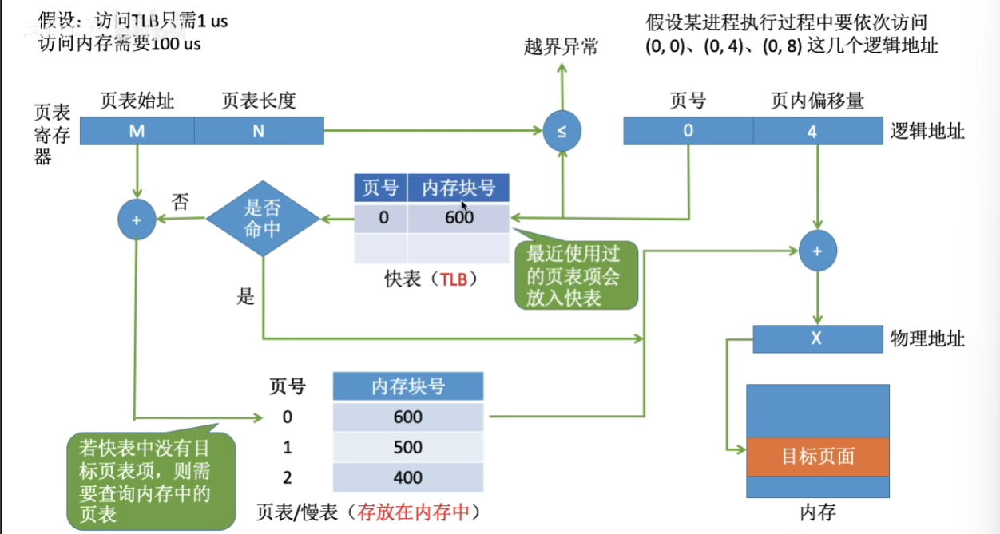


### 引入快表过程后，地址的变换过程


① CPU给出逻辑地址，由某个硬件算得页号、页内偏移量，将页号与快表中的所有页号进行比较。
② 如果找到匹配的页号，说明要访问的页表项在快表中有副本，则直接从中取出该页对应的内存块号，再将内存块号与页内偏移量拼接形成物理地址，最后，**访问该物理地址对应的内存单元**。因此，若**快表命中**，则访问某个逻辑地址仅需**一次访存**即可。
③ 如果没有找到匹配的页号，则需要访问内存中的页表，找到对应页表项，得到页面存放的内存块号，再将内存块号与页内偏移量拼接形成物理地址，最后，**访问该物理地址对应的内存单元**。因此，若**快表未命中**，则访问某个逻辑地址需要**两次访存**（注意：在找到页表项后，应同时将其存入快表，以便后面可能的再次访问。但若快表已满，则必须按照一定的算法对旧的页表项进行替换）

由于查询快表的速度比查询页表的速度快很多，因此只要快表命中，就可以节省很多时间。
因为局部性原理，一般来说快表的命中率可以达到 90% 以上。

例：某系统使用基本分页存储管理，并采用了具有快表的地址变换机构。访问一次快表耗时 1us，访问一次内存耗时 100us。若快表的命中率为 90%，那么访问一个逻辑地址的平均耗时是多少？
$(1+100) * 0.9 + (1+100+100) * 0.1 = 111\ \text{us}$

有的系统支持**快表和慢表同时查找**，如果是这样，平均耗时应该是 $(1+100) * 0.9 + (100+100) * 0.1 = \boldsymbol{110.9}\ \text{us}$

若未采用快表机制，则访问一个逻辑地址需要 $100+100 = \boldsymbol{200}\ \text{us}$

#### 快表慢表同时查询

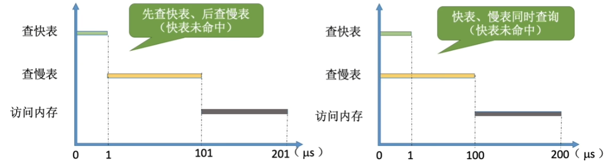

### 局部性原理(为什么一点缓存就速度大大提升？)

**时间局部性**：如果执行了程序中的某条指令，那么不久后这条指令很有可能再次执行；如果某个数据被访问过，不久之后该数据很可能再次被访问。（因为程序中存在大量的循环）

**空间局部性**：一旦程序访问了某个存储单元，在不久之后，其附近的存储单元也很有可能被访问。（因为很多数据在内存中都是连续存放的）

上小节介绍的**基本地址变换机构**中，每次要访问一个逻辑地址，都需要查询**内存中的页表**。由于局部性原理，**可能连续很多次查到的都是同一个页表项**


TLB和普通Cache的区别——TLB中只有页表项的副本，而普通Cache中可能会有其他各种数据

## 3.1.3_4 两级页表


### 单级页表的问题？

**问题一**：页表必须连续存放，因此当页表很大时，需要占用很多个连续的页框。

**问题二**：没有必要让整个页表常驻内存，因为进程在一段时间内可能只需要访问某几个特定的页面。

可将长长的页表进行分组，使每个内存块刚好可以放入一个分组（比如上个例子中，页面大小 4KB，每个页表项 4B，每个页面可存放 1K 个页表项，因此每 1K 个连续的页表项为一组，每组刚好占一个内存块，再将各组离散地放到各个内存块中）

另外，要为离散分配的页表再建立一张页表，称为**页目录表**，或称**外层页表**，或称**顶层页表**

### 两级页表的原理、地址结构

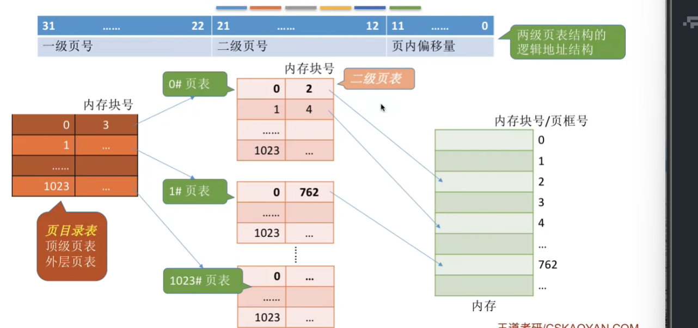

### 如何实现地址变换？


可参考小节的两级页表图

**过程**：
① 按照地址结构将逻辑地址拆分成三部分
② 从PCB 中读出页目录表始址，再根据一级页号查页目录表，找到下一级页表在内存中的存放位置
③ 根据二级页号查表，找到最终想访问的内存块号
④ 结合页内偏移量得到物理地址

### 问题二的解决

可以在需要访问页面时才把页面调入内存（虚拟存储技术）。可以在页表项中增加一个标志位，用于表示该页面是否已经调入内存

### 注意细节

1. 若采用多级页表机制，则各级页表的大小不能超过一个页面

例：某系统按字节编址，采用 40 位逻辑地址，页面大小为 4KB，页表项大小为 4B，假设采用纯页式存储，则要采用（）级页表，页内偏移量为（）位？

页面大小 = 4KB = $2^{12}$B，按字节编址，因此页内偏移量为12位
页号 = 40 - 12 = 28 位
页面大小 = $2^{12}$B，页表项大小 = 4B，则每个页面可存放 $2^{12}/4 = 2^{10}$ 个页表项
因此各级页表最多包含 $2^{10}$ 个页表项，需要 10 位二进制位才能映射到 $2^{10}$ 个页表项，因此每一级的页表对应页号应为10位。总共28位的页号至少要分为三级

逻辑地址分段1：【页号 28位】 | 【页内偏移量 12位】
逻辑地址分段2：【一级页号 8位】 | 【二级页号 10位】 | 【三级页号 10位】 | 【页内偏移量 12位】

补充说明：
如果只分为两级页表，则一级页号占18位，也就是说页目录表中最多可能有 $2^{18}$ 个页表项，显然，一个页面是放不下这么多页表项的。

2. 两级页表的**访存次数**分析（假设没有快表机构）
第一次访存：访问内存中的页目录表
第二次访存：访问内存中的二级页表
第三次访存：访问目标内存单元

### 总结


## 3.1.4 基本分段存储方式


### 分段

进程的地址空间：按照程序**自身的逻辑关系**划分为若干个**段**，每个段都有一个段名（在低级语言中，程序员使用段名来编程），**每段从0开始编址**

内存分配规则：以段为单位进行分配，**每个段在内存中占据连续空间**，但**各段之间可以不相邻**


分段系统的逻辑地址结构由段号（段名）和段内地址（段内偏移量）所组成。如：

| 31         ……  16 | 15         ……0  |
| --------- | --------- |
| 段号          | 段内地址     |

**段号的位数决定了每个进程最多可以分几个段**
**段内地址位数决定了每个段的最大长度是多少**

在上述例子中，若系统是按字节寻址的，则
段号占16位，因此在该系统中，每个进程最多有 $2^{16} = 64\mathrm{K}$ 个段
段内地址占16位，因此每个段的最大长度是 $2^{16} = 64\mathrm{KB}$。

```
LOAD 1, [D] | <A>;    //将分段D中A单元内的值读入寄存器1
STORE 1, [X] | <B>;    //将寄存器1的内容存入X 分段的B单元中
```

- 左侧绿色框：写程序时使用的段名 [D]、[X] 会被编译程序翻译成对应段号
- 右侧绿色框：<A>单元、<B>单元会被编译程序翻译成段内地址

### 段表

问题：程序分多个段，各段离散地装入内存，为了保证程序能正常运行，就必须能从物理内存中找到各个逻辑段的存放位置。为此，需为每个进程建立一张段映射表，简称“**段表**”。


### 地址转换过程

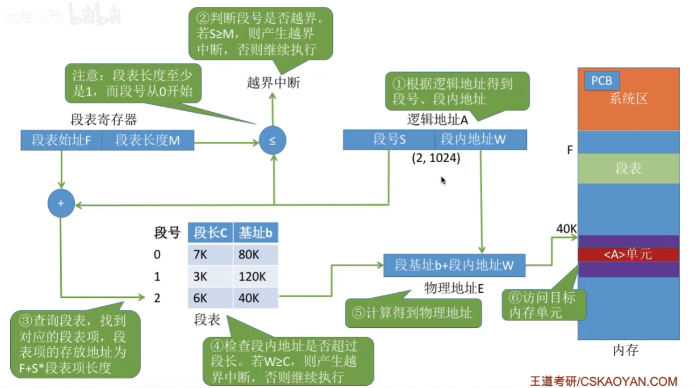

### 分段和分页管理的对比

**页是信息的物理单位**。分页的主要目的是为了实现离散分配，提高内存利用率。分页仅仅是系统管理上的需要，完全是系统行为，**对用户是不可见的**。

**段是信息的逻辑单位**。分段的主要目的是更好地满足用户需求。一个段通常包含着一组属于一个逻辑模块的信息。**分段对用户是可见的**，用户编程时需要显式地给出段名。

页的大小固定且由系统决定。段的长度却不固定，决定于用户编写的程序。

**分页的用户进程地址空间是一维的**，程序员只需给出一个记忆符即可表示一个地址。
**分段的用户进程地址空间是二维的**，程序员在标识一个地址时，既要给出段名，也要给出段内地址。
**分段比分页更容易实现信息的共享和保护**。不能被修改的代码称为**纯代码或可重入代码**（不属于临界资源），这样的代码是可以共享的。可修改的代码是不能共享的

访问一个逻辑地址需要几次访存？
**分页（单级页表）**：第一次访存——查内存中的页表，第二次访存——访问目标内存单元。总共**两次访存**
**分段**：第一次访存——查内存中的段表，第二次访存——访问目标内存单元。总共**两次访存**

与分页系统类似，分段系统中也**可以引入快表机构**，将近期访问过的段表项放到快表中，这样**可以少一次访问**，加快地址变换速度。

#### 分段实现共享

**分段比分页更容易实现信息的共享和保护。**

不能被修改的代码称为**纯代码或可重入代码**（不属于临界资源），这样的代码是可以共享的。可修改的代码是不能共享的（比如，有一个代码段中有很多变量，各进程并发地同时访问可能造成数据不一致）
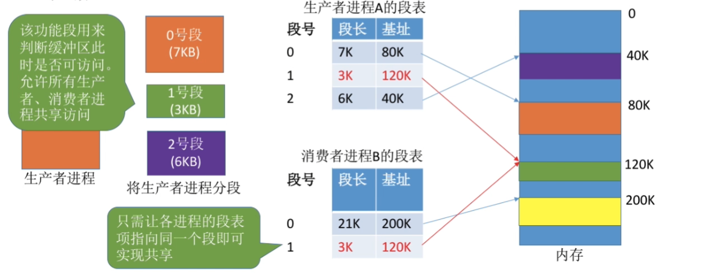

由于页面不是按照逻辑地址块划分的，因此就会存在某个页面某一部分可能允许其他进程访问，而一部分不允许访问，难以实现标记是否允许某页面可以被访问，分段更容易标记。


## 总结


## 3.1.5 段页式管理方式


### 分页、分段的优缺点


|          | 优点                                                         | 缺点                                                                 |
| -------- | ------------------------------------------------------------ | -------------------------------------------------------------------- |
| 分页管理 | 内存空间利用率高，**不会产生外部碎片**，只会有少量的页内碎片 | 不方便按照逻辑模块实现信息的共享和保护                               |
| 分段管理 | 很方便按照逻辑模块实现信息的共享和保护                       | 如果段长过大，为其分配很大的连续空间会很不方便。另外，段式管理**会产生外部碎片** |


### 分段+分页=段页式管理

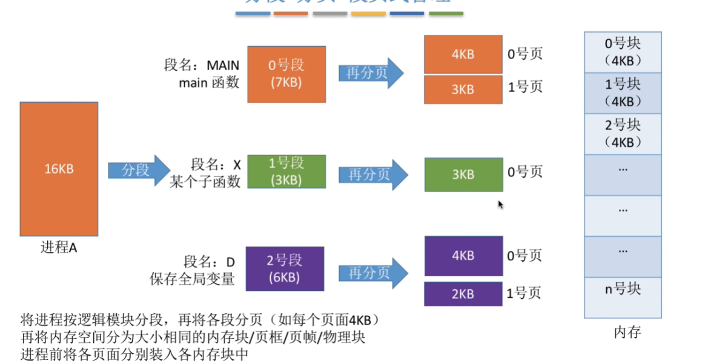

### 段页式管理的逻辑结构

分段系统的逻辑地址结构由段号和段内地址（段内偏移量）组成。如：

| 31        | …… | 16 | 15        | …… | 0  |
| --------- | -- | -- | --------- | -- | -- |
| 段号      |    |    | 段内地址  |    |    |

段页式系统的逻辑地址结构由段号、页号、页内地址（页内偏移量）组成。如：

| 31        | …… | 16 | 15  | …… | 12 | 11        | …… | 0  |
| --------- | -- | -- | --- | -- | -- | --------- | -- | -- |
| 段号      |    |    | 页号 |    |    | 页内偏移量 |    |    |

**段号的位数决定了每个进程最多可以分几个段**
**页号位数决定了每个段最大有多少页**
**页内偏移量决定了页面大小、内存块大小是多少**

在上述例子中，若系统是按字节寻址的，则
段号占16位，因此在该系统中，每个进程最多有 $2^{16} = 64\mathrm{K}$ 个段
页号占4位，因此每个段最多有 $2^4 = 16$ 页
页内偏移量占12位，因此每个页面\每个内存块大小为 $2^{12} = 4096 = 4\mathrm{KB}$

### 段表、页表

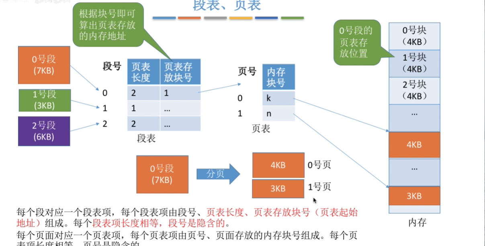

### 段页式地址转换过程

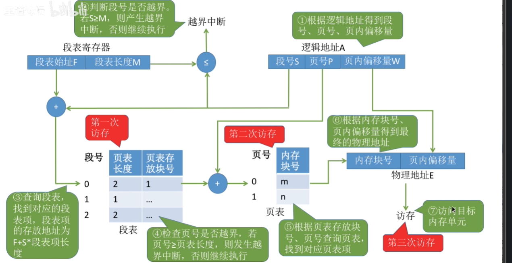
同样可以引入快表机构，用短号和页号作为查询快表的关键字，若快表命中则仅需一次访存

### 总结


## 3.2.1 内存的扩充（虚拟内存的基本概念）


### 传统存储管理方式的特征、缺点


**一次性**：作业必须**一次性**全部装入内存后才能开始运行。这会造成两个问题：①作业很大时，不能全部装入内存，导致**大作业无法运行**；②当大量作业要求运行时，由于内存无法容纳所有作业，因此只有少量作业能运行，导致**多道程序并发度下降**。
**驻留性**：一旦作业被装入内存，就会**一直驻留在内存**中，直至作业运行结束。事实上，在一个时间段内，只需要访问作业的一小部分数据即可正常运行，这就导致了内存中会驻留大量的、暂时用不到的数据，浪费了宝贵的内存资源。

### 局部性原理

**时间局部性**：如果执行了程序中的某条指令，那么不久后这条指令很有可能再次执行；如果某个数据被访问过，不久之后该数据很可能再次被访问。（因为程序中存在大量的循环）

**空间局部性**：一旦程序访问了某个存储单元，在不久之后，其附近的存储单元也很有可能被访问。（因为很多数据在内存中都是连续存放的，并且程序的指令也是顺序地在内存中存放的）

### 虚拟内存的定义和特征


基于局部性原理，在程序装入时，可以将程序中**很快会用到的部分**装入内存，**暂时用不到的部分**留在外存，就可以让程序开始执行。

在程序执行过程中，当所访问的**信息不在内存**时，由**操作系统负责**将所需信息从外存调入内存，然后继续执行程序。

若内存空间不够，由**操作系统负责**将内存中**暂时用不到的信息**换出到外存。

在操作系统的管理下，在用户看来似乎有一个比实际内存大得多的内存，这就是**虚拟内存**

虚拟内存有一下三个主要特征：
**多次性**：无需在作业运行时一次性全部装入内存，而是允许被分成多次调入内存。
**对换性**：在作业运行时无需一直常驻内存，而是允许在作业运行过程中，将作业换入、换出。
**虚拟性**：从逻辑上扩充了内存的容量，使用户看到的内存容量，远大于实际的容量。

### 如何实现虚拟内存技术？

虚拟内存技术，允许一个作业分多次调入内存。如果采用连续分配方式，会不方便实现。因此，虚拟内存的实现需要建立在**离散分配**的内存管理方式基础上。


**请求调页&页面置换功能**

### 总结


## 3.2.2 请求分页管理方式

请求分页存储管理与基本分页存储管理的主要区别：
在程序执行过程中，当所访问的**信息不在内存**时，由**操作系统负责**将所需信息从外存调入内存，然后继续执行程序。
> 操作系统要提供请求调页功能，将缺失页面从外存调入内存

若内存空间不够，由**操作系统负责**将内存中**暂时用不到的信息**换出到外存。
> 操作系统要提供页面置换的功能，将暂时用不到的页面换出外存

### 页表机制
与基本分页管理相比，请求分页管理中，为了实现“请求调页”，操作系统需要知道每个页面是否已经调入内存；如果还没调入，那么也需要知道该页面在外存中存放的位置。

当内存空间不够时，要实现“页面置换”，操作系统需要通过某些指标来决定到底换出哪个页面；有的页面没有被修改过，就不用再浪费时间写回外存。有的页面修改过，就需要将外存中的旧数据覆盖，因此，操作系统也需要记录各个页面是否被修改的信息。

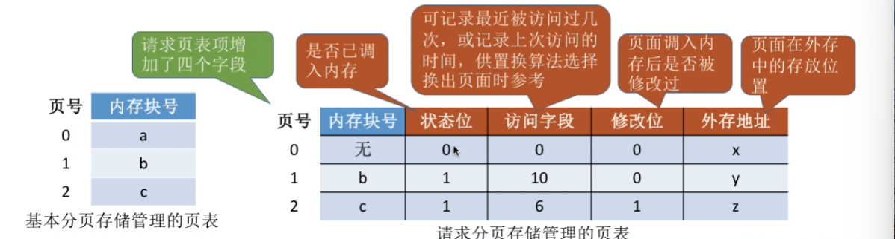

### 缺页中断机制

假设此时要访问逻辑地址=（页号，页内偏移量）=（0, 1024）

在请求分页系统中，每当要访问的**页面不在内存**时，便产生一个**缺页中断**，然后由操作系统的缺页**中断处理程序**处理中断。
此时**缺页的进程阻塞**，放入阻塞队列，**调页完成后再将其唤醒**，放回就绪队列。

如果内存中有**空闲块**，则为进程**分配一个空闲块**，将所缺页面装入该块，并修改页表中相应的页表项。
如果内存中**没有空闲块**，则由页面置换算法选择一个**页面淘汰**，若该页面在内存期间**被修改过**，则要将其**写回外存**。未修改过的页面不用写回外存。

**缺页中断**是因为当前执行的指令想要访问的目标页面未调入内存而产生的，因此**属于内中断**

一条指令在执行期间，**可能产生多次缺页中断**。（如：copy A to B，即将逻辑地址A中的数据复制到逻辑地址B，而A、B属于不同的页面，则有可能产生两次中断）

### 地址变换地址

请求分页存储管理与基本分页存储管理的主要区别：
在程序执行过程中，当所访问的**信息不在内存**时，由**操作系统负责**将所需信息从外存调入内存，然后继续执行程序。
> 操作系统要提供请求调页功能，将缺失页面从外存调入内存

若内存空间不够，由**操作系统负责**将内存中**暂时用不到的信息**换出到外存。
> 操作系统要提供页面置换的功能，将暂时用不到的页面换出外存

#### 请求分页页表结构
| 页号 | 内存块号 | 状态位 | 访问字段 | 修改位 | 外存地址 |
| ---- | -------- | ------ | -------- | ------ | -------- |
| 0    | 无       | 0      | 0        | 0      | x        |
| 1    | b        | 1      | 10       | 0      | y        |
| 2    | c        | 1      | 6        | 1      | z        |

#### 请求分页新增步骤
1. 新增步骤1：请求调页（查到页表项时进行判断）
2. 新增步骤2：页面置换（需要调入页面，但没有空闲内存块时进行）
3. 新增步骤3：需要修改请求页表中新增的表项

#### 过程

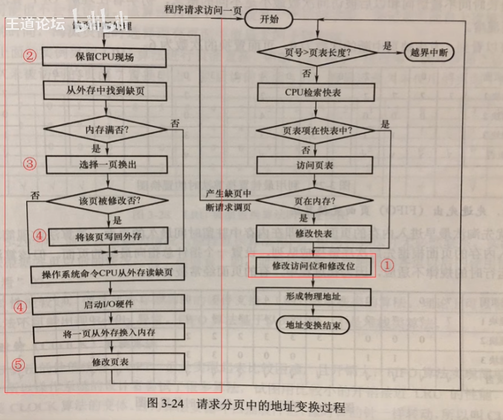

补充细节：
①只有“写指令”才需要修改“修改位”。并且，一般来说只需修改快表中的数据，只有要将快表项删除时才需要写回内存中的慢表。这样可以减少访存次数。

②和普通的中断处理一样，缺页中断处理依然需要保留CPU现场。

③需要用某种“页面置换算法”来决定一个换出页面（下节内容）

④换入/换出页面都需要启动慢速的I/O操作，可见，如果换入/换出太频繁，会有很大的开销。

⑤页面调入内存后，需要修改慢表，同时也需要将表项复制到快表中。

### 总结


## 3.2.3 页面置换算法

在程序执行过程中，当所访问的**信息不在内存**时，由**操作系统负责**将所需信息从外存调入内存，然后继续执行程序。

若内存空间不够，由**操作系统负责**将内存中**暂时用不到的信息**换出到外存。
> 用页面置换算法
### 总览


### 最佳置换算法(OPT)

**最佳置换算法（OPT，Optimal）**：每次选择淘汰的页面将是以后永不使用，或者在最长时间内不再被访问的页面，这样可以保证最低的缺页率。

**注意：缺页时未必发生页面置换，若还有可用空闲内存块，就不进行页面置换，直接从外存调入内存就可以了**

最佳置换算法可以保证最低的缺页率，但实际上，只有在进程执行的过程中才能知道接下来会访问到的是哪个页面。操作系统无法提前预判页面访问序列。因此，**最佳置换算法是无法实现的**。

### 先进先出置换算法(FIFO)

先进先出置换算法（FIFO）：每次选择淘汰的页面是**最早进入内存的页面**

实现方法：把调入内存的页面根据调入的先后顺序排成一个队列，需要换出页面时选择队头页面即可。
队列的最大长度取决于系统为进程分配了多少个内存块。

#### Belady异常
Belady异常——当为进程分配的物理块数增大时，缺页次数不减反增的异常现象。

只有FIFO算法会产生Belady异常。另外，FIFO算法虽然实现简单，但是该算法与进程实际运行时的规律不适应，因为先进入的页面也有可能最经常被访问。因此，**算法性能差**

### 最近最久未使用置换算法（LRU）
最近最久未使用置换算法（LRU，least recently used）：每次**淘汰的页面是最近最久未使用的页面**

#### LRU实现方法
赋予每个页面对应的页表项中，用访问字段记录该页面自上次被访问以来所经历的时间t。
当需要淘汰一个页面时，选择现有页面中t值最大的，即最近最久未使用的页面。

#### 请求分页页表结构
| 页号 | 内存块号 | 状态位 | 访问字段 | 修改位 | 外存地址 |
| ---- | -------- | ------ | -------- | ------ | -------- |

该算法的实现需要专门的硬件支持，虽然算法**性能好**，但是**实现困难，开销大**

在手动做题时，若需要淘汰页面，可以逆向检查此时在内存中的几个页面号。在逆向扫描过程中最后一个出现的页号就是要淘汰的页面。

### 时钟置换算法(CLOCK)

最佳置换算法性能最好，但无法实现；先进先出置换算法实现简单，但算法性能差；最近最久未使用置换算法性能好，是最接近OPT算法性能的，但是实现起来需要专门的硬件支持，算法开销大。
时钟置换算法是一种性能和开销较均衡的算法，又称CLOCK算法，或最近未用算法（NRU，Not Recently Used）

简单的CLOCK算法实现方法：为每个页面设置一个访问位，再将内存中的页面都通过链接指针链接成一个循环队列。当某页被访问时，其访问位置为1。当需要淘汰一个页面时，只需检查页的访问位。
如果是0，就选择该页换出；如果是1，则将它置为0，暂不换出，继续检查下一个页面，若第一轮扫描中所有页面都是1，则将这些页面的访问位依次置为0后，再进行第二轮扫描（第二轮扫描中一定会有访问位为0的页面，因此简单的CLOCK算法选择一个淘汰页面最多会经过两轮扫描）

#### 页表结构
| 页号 | 内存块号 | 状态位 | 访问位 | 修改位 | 外存地址 |
| ---- | -------- | ------ | ------ | ------ | -------- |

### 改进的时钟置换算法

简单的时钟置换算法仅考虑到一个页面最近是否被访问过。事实上，如果被淘汰的页面没有被修改过，就不需要执行I/O操作写回外存。只有被淘汰的页面被修改过时，才需要写回外存。
因此，除了考虑一个页面最近有没有被访问过之外，操作系统还应考虑页面有没有被修改过。在其他条件都相同时，应优先淘汰没有修改过的页面，避免I/O操作。这就是改进型的时钟置换算法的思想。
修改位=0，表示页面没有被修改过；修改位=1，表示页面被修改过。
为方便讨论，用（访问位，修改位）的形式表示各页面状态。如（1，1）表示一个页面近期被访问过，且被修改过。

### 算法规则：将所有可能被置换的页面排成一个循环队列
第一轮：从当前位置开始扫描到第一个（0,0）的帧用于替换。本轮扫描不修改任何标志位
第二轮：若第一轮扫描失败，则重新扫描，查找第一个（0,1）的帧用于替换。本轮将所有扫描过的帧访问位设为0
第三轮：若第二轮扫描失败，则重新扫描，查找第一个（0,0）的帧用于替换。本轮扫描不修改任何标志位
第四轮：若第三轮扫描失败，则重新扫描，查找第一个（0,1）的帧用于替换。

由于第二轮已将所有帧的访问位设为0，因此经过第三轮、第四轮扫描一定会有一个帧被选中，因此改进型CLOCK置换算法选择一个淘汰页面最多会进行四轮扫描

### 总结

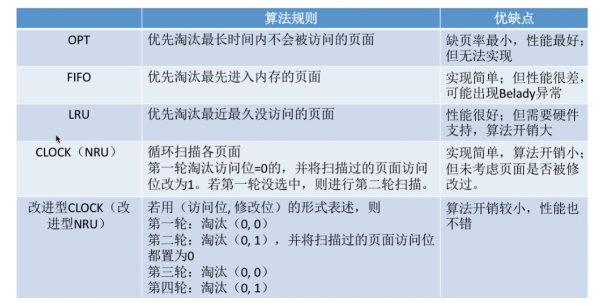