# 第二章 进程管理

## 2.1.1+2.1.2 进程的概念、组成

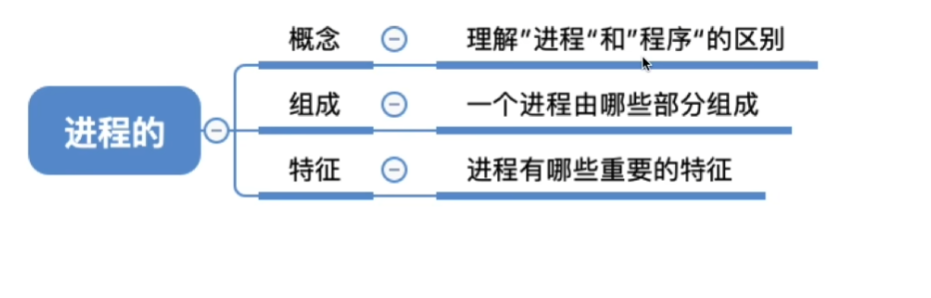

### 进程的概念

程序：是**静态**的，就是个存放在磁盘里的可执行文件，就是一系列的指令集合。

进程（Process）：是**动态**的，是程序的一次执行过程

> 同一个程序多次执行会对应多个进程

### 进程的组成

进程的组成
- PCB
  - 进程描述信息
  - 进程控制和管理信息
  - 资源分配清单
  - 处理机相关信息
- 程序段
  - 程序的代码（指令序列）
- 数据段
  - 运行过程中产生的各种数据（如：程序中定义的变量）

#### 进程的组成--PCB

思考：操作系统是这些进程的管理者，它要怎么区分各个进程？

当进程被创建时，操作系统会为该进程分配一个唯一的、不重复的“身份证号”—— **PID**（Process ID，进程ID）

操作系统要记录PID、进程所属用户ID（UID）
基本的进程描述信息，可以让操作系统区分各个进程

还要记录给进程分配了**哪些资源**（如：分配了多少内存、正在使用哪些I/O设备、正在使用哪些文件）
可用于实现操作系统对资源的管理

还要记录**进程的运行情况**（如：CPU使用时间、磁盘使用情况、网络流量使用情况等）
可用于实现操作系统对进程的控制、调度

这些信息都被保存在一个数据结构PCB（Process Control Block）中，即进程控制块
操作系统需要对各个并发运行的进程进行管理，但凡管理时所需要的信息，都会被放在PCB中

#### 具体的PCB

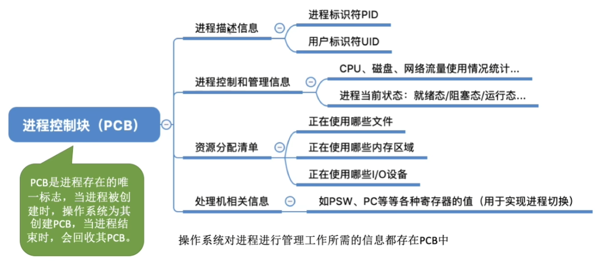

### 进程的组成--程序段(程序代码)、数据段(程序运行中的各种数据)

PCB 是给操作系统用的。
程序段、数据段是给进程自己用的。

**程序段、数据段、PCB三部分组成了进程实体（进程映像）**
引入进程实体的概念后，可把进程定义为：
进程是进程实体的运行过程，是系统进行资源分配和调度的一个独立单位。

**注意： PCB是进程存在的唯一标志！**

### 进程的特征

程序是静态的，进程是动态的，相比于程序，进程拥有以下特征：

进程的特征：
- **动态性**：进程是程序的一次执行过程，是动态地产生、变化和消亡的**基本特性**
  - 动态性是进程最基本的特征
- **并发性**：内存中有多个进程实体，各进程可并发执行
- **独立性**：进程是能独立运行、独立获得资源、独立接受调度的基本单位
- **异步性**：各进程按各自独立的、不可预知的速度向前推进，操作系统要提供“进程同步机制”来解决异步问题
  - 异步性会导致并发程序执行结果的不确定性。具体会在“进程同步”相关小节进行学习
- **结构性**：每个进程都会配置一个PCB。结构上看，进程由程序段、数据段、PCB组成

## 2.1.3 进程的状态和转换

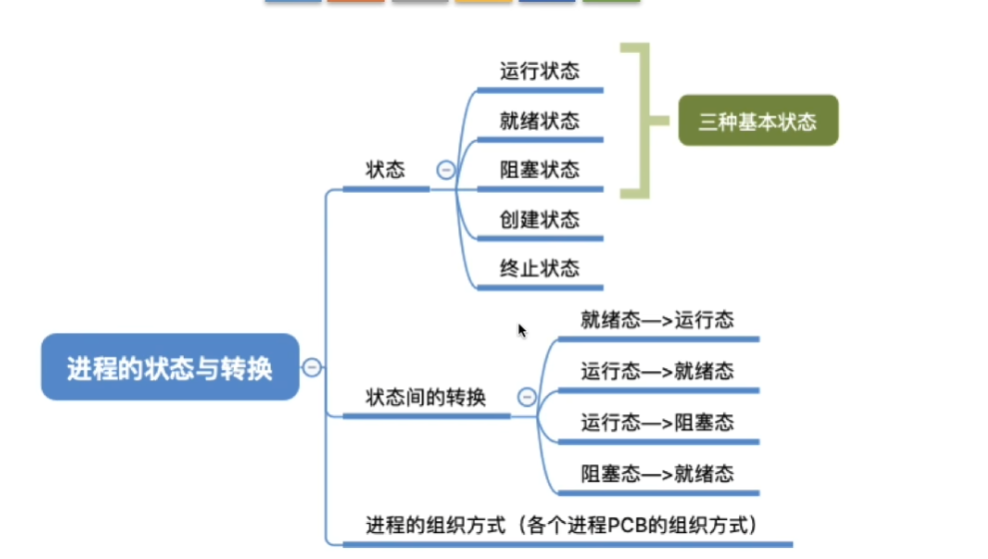

### 进程的状态--创建态(新建态)、就绪态

进程正在被创建时，它的状态是“**创建态**”，在这个阶段操作系统会为进程分配资源、初始化PCB

当进程创建完成后，便进入“**就绪态**”，处于就绪态的进程已经具备运行条件，但由于没有空闲CPU，就暂时不能运行

### 进程的状态--运行态

如果一个进程此时在CPU上运行，那么这个进程处于“**运行态**”
CPU会执行该进程对应的程序（执行指令序列）

### 进程的状态——阻塞态(等待态)

在进程运行的过程中，可能会请求等待某个事件的发生（如等待某种系统资源的分配，或者等待其他进程的响应）。
在这个事件发生之前，进程无法继续往下执行，此时操作系统会让这个进程下CPU，并让它进入“**阻塞态**”

### 进程的状态——终止态（结束态）

一个进程可以执行 exit 系统调用，请求操作系统终止该进程。此时该进程会进入“**终止态**”，操作系统会让该进程下CPU，并回收内存空间等资源，最后还要回收该进程的PCB。

### 状态的转换

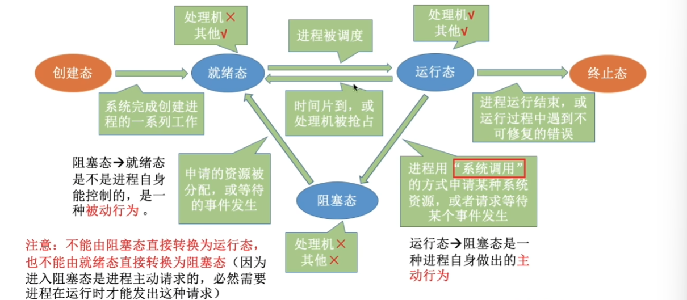

运行态、就绪态、阻塞态是三种基本状态，是进程大部分时间都处于的基本状态

### 进程的组织--链式方式

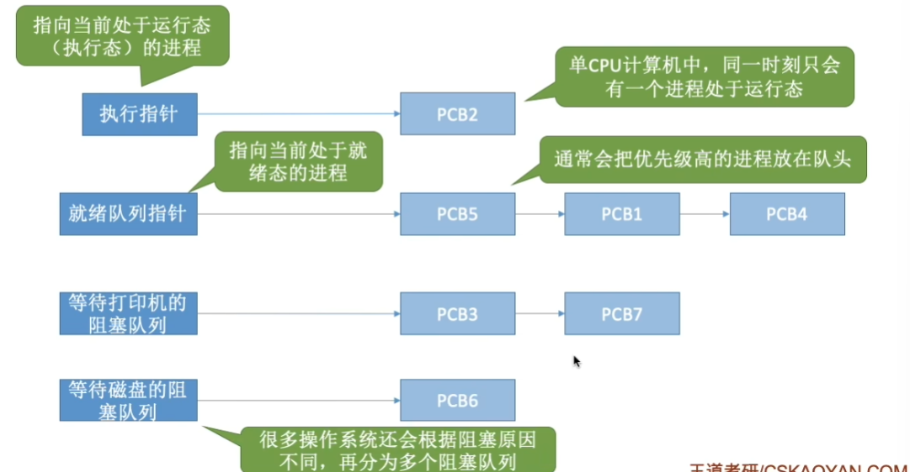

### 进程组织--索引方式

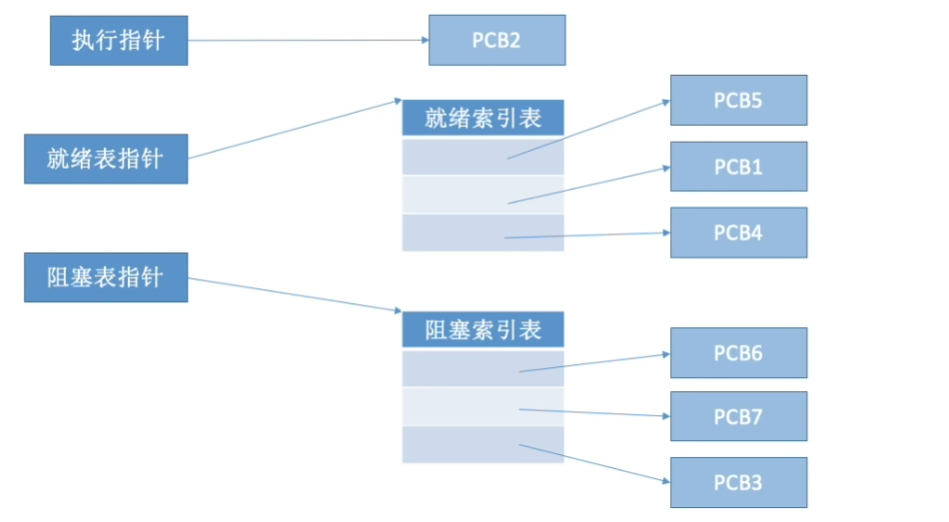

## 2.1.4 进程控制

进程控制的主要功能是对系统中的所有进程实施有效的管理，它具有创建新进程、撤销已有进程、实现进程状态转换等功能。
*简化理解：进程控制就是要实现进程状态的转换*
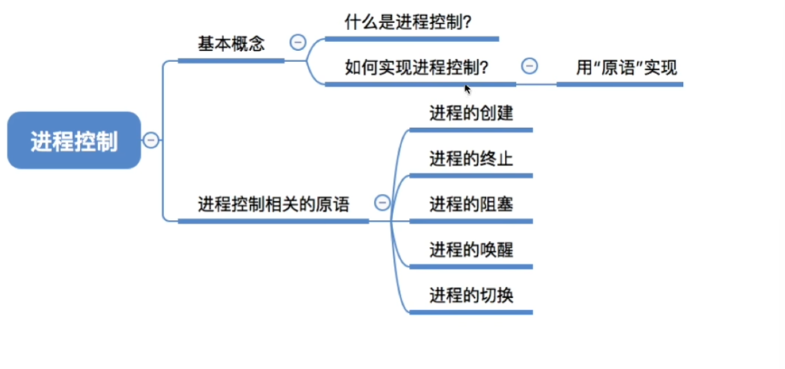

### 如何实现进程控制？

进程控制通过原语实现，原语的执行具有原子性，即操作一气呵成、不可分割。

进程控制（状态转换）的过程必须“一气呵成”，若不能做到，可能导致操作系统中的某些关键数据结构信息不统一，影响操作系统进行别的管理工作。

示例：假设PCB中的变量state表示进程当前所处状态，1表示就绪态，2表示阻塞态。
就绪队列包含PCB5、PCB1、PCB4（state = 1）；阻塞队列包含PCB2、PCB3、PCB6（PCB2的state为1，PCB3、PCB6的state为2）。

假设此时进程2等待的事件发生，操作系统中负责进程控制的内核程序至少需要做两件事：
①将PCB2的state设为1
②将PCB2从阻塞队列放到就绪队列

如果完成了第一步后收到中断信号，那么PCB2的state=1，但是它却被放在阻塞队列里，造成数据不一致。

### 如何实现原语的“原子性”？

原语的执行具有原子性，即执行过程只能一气呵成，期间不允许被中断。
可以用 “关中断指令” 和 “开中断指令” 这两个特权指令实现原子性

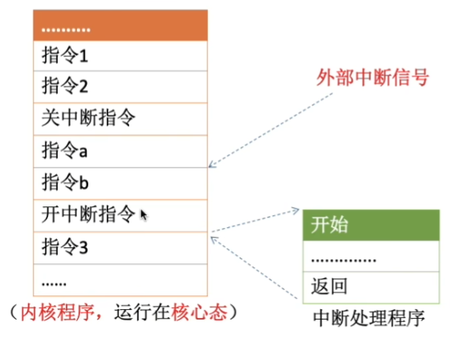

CPU执行了关中断指令之后，就不再例行检查中断信号，直到执行开中断指令之后才会恢复检查。

这样，关中断、开中断之间的这些指令序列就是不可被中断的，这就实现了“原子性”

思考：如果这两个特权指令允许用户程序使用的话，会发生什么情况？(**单个程序霸占CPU**)

### 进程控制相关的原语

**创建原语**：
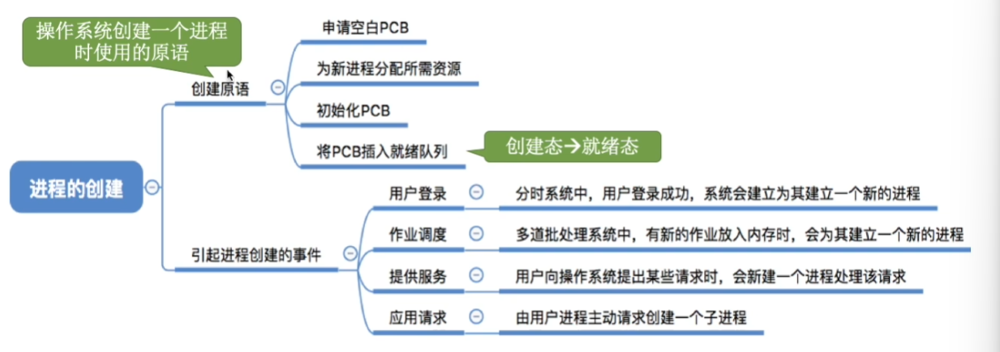

**进程终止原语**：
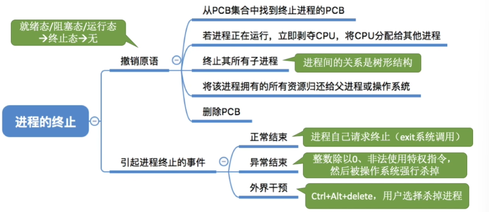

**进程的阻塞和唤醒原语**：
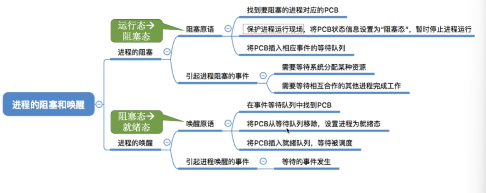
*阻塞和唤醒原语要成对出现*

**进程的切换原语**
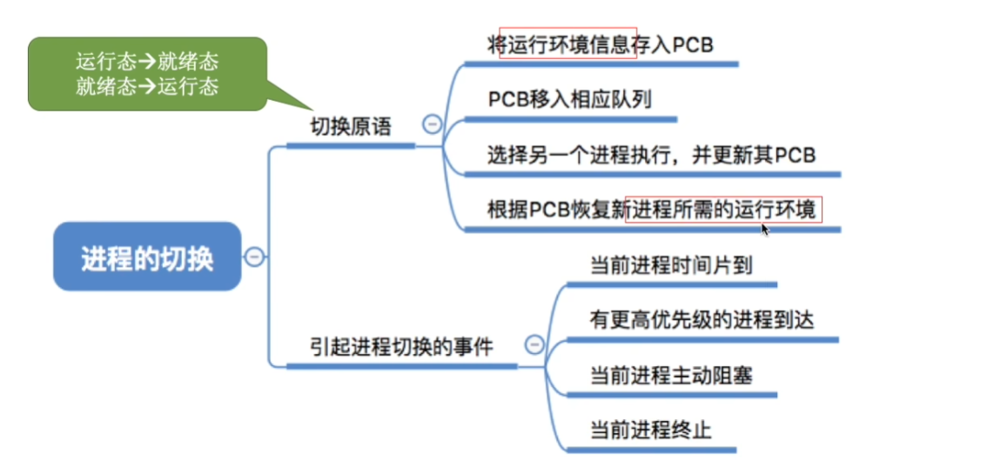

### 程序的运行

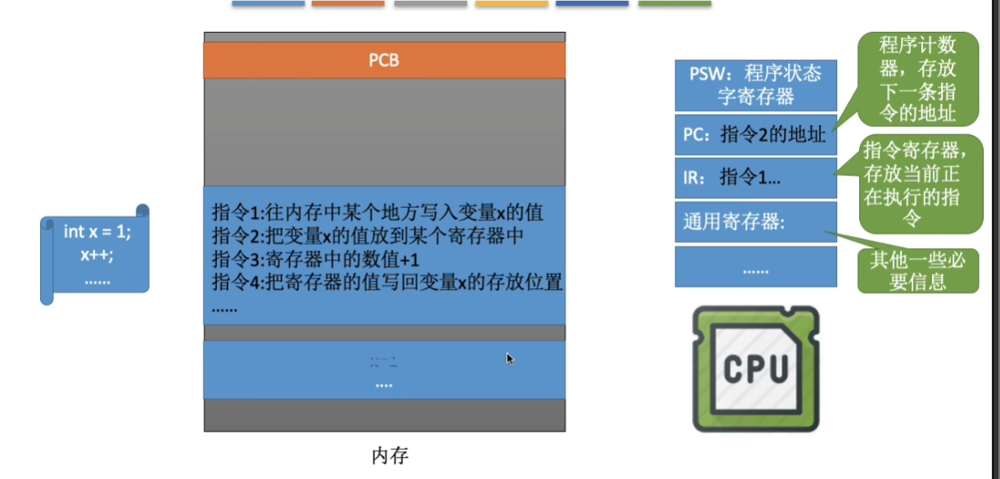

在一个进程执行过程中如果遇到其他进程切换，需要将当前的寄存器参数等信息记录，可记录到PCB当中，然后阻塞+唤醒，进而实现并发的可能。

## 2.1.5.1 进程通信

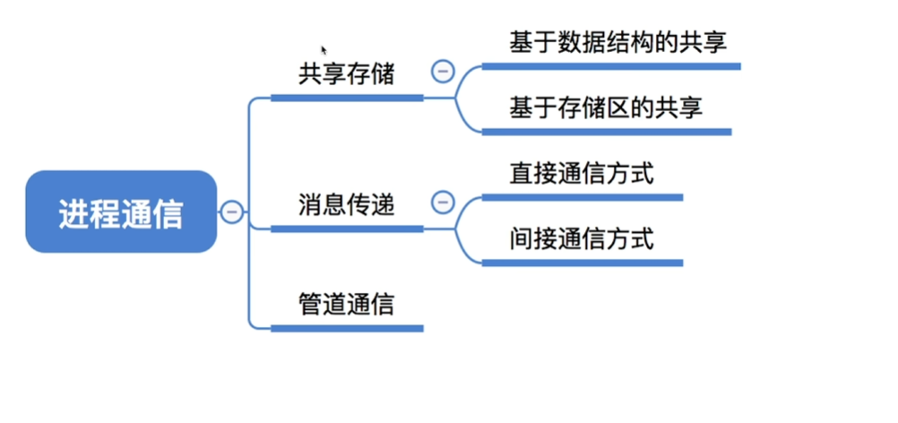

进程间通信（Inter-Process Communication, **IPC**）是指两个进程之间产生数据交互。

### 为什么进程通信需要操作系统的支持？

进程是分配系统资源的单位（包括内存地址空间），因此各进程拥有的内存地址空间相互独立。
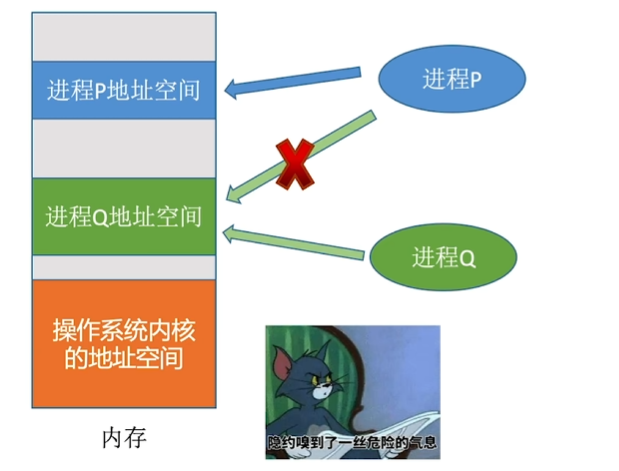

为了保证个进程之间的独立安全，一个进程不能直接访问另一个进程的地址空间。
### 进程通信的实现方式

#### 1. 共享存储

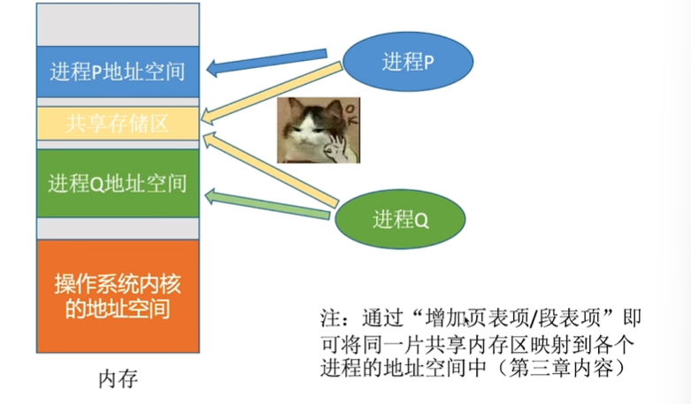

为避免出错，各个进程对共享空间的**访问**应该是**互斥**的。

各个进程可使用操作系统内核提供的**同步互斥工具**（如P、V操作）

Linux 中，如何实现共享内存：

int shm_open(......);   //通过 shm_open 系统调用，申请一片共享内存区
void * mmap (......);   //通过 mmap 系统调用，将共享内存区映射到进程自己的地址空间

##### 基于存储区的共享

基于存储区的共享：操作系统在内存中划出一块共享存储区，数据的形式、存放位置都由通信进程控制，而不是操作系统。这种共享方式速度很快，是一种**高级通信方式**。

##### 基于数据结构的共享

基于数据结构的共享：比如共享空间里只能放一个长度为10的数组。这种共享方式速度慢、限制多，是一种**低级通信方式**

#### 2. 消息传递

进程间的数据交换以**格式化的消息（Message）**为单位。进程通过操作系统提供的“发送消息/接收消息”两个**原语**进行数据交换。

##### 消息结构：
- 消息头：发送进程ID、接受进程ID、消息长度等格式化的信息
- 消息体

##### 消息传递方式：
1. 直接通信方式：消息发送进程要指明接收进程的ID
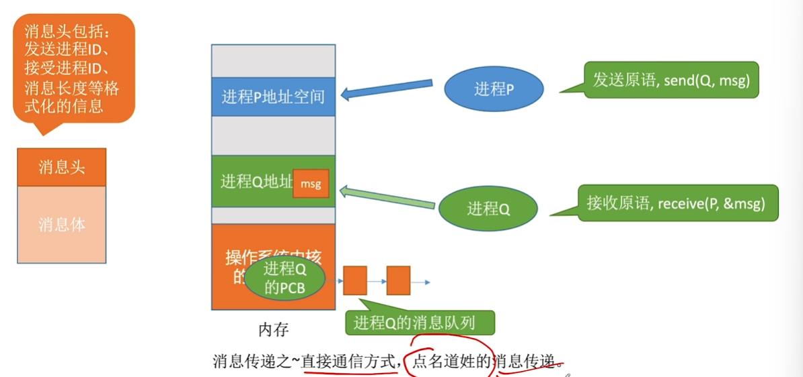

2. 间接通信方式：通过“信箱”间接地通信，因此又称“信箱通信方式”
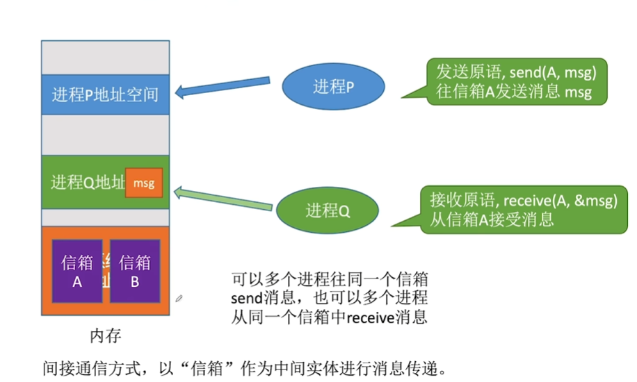

#### 3. 管道通信

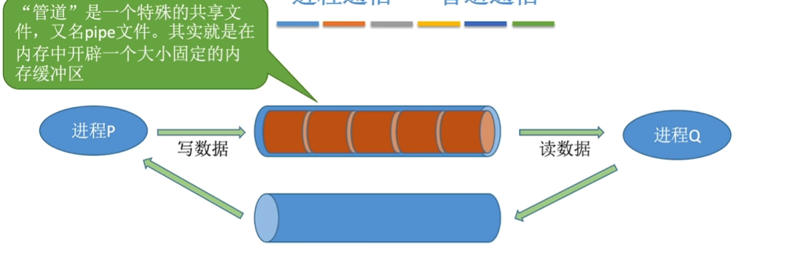

1. 管道只能采用**半双工通信**，某一时间段内只能实现单向的传输。如果要实现**双向同时通信**，则需要设置**两个管道**。
2. 各进程要**互斥**地访问管道（由操作系统实现）
3. 当**管道写满**时，**写进程**将**阻塞**，直到读进程将管道中的数据取走，即可唤醒写进程。
4. 当**管道读空**时，**读进程**将**阻塞**，直到写进程往管道中写入数据，即可唤醒读进程。
5. 管道中的数据一旦被读出，就彻底消失。因此，当多个进程读同一个管道时，可能会错乱。对此，通常有两种解决方案：①一个管道允许**多个写进程**，**一个读进程**（2014年408真题高教社官方答案）；②允许有**多个写进程**，**多个读进程**，但系统会让各个读进程轮流从管道中读数据（Linux的方案）。

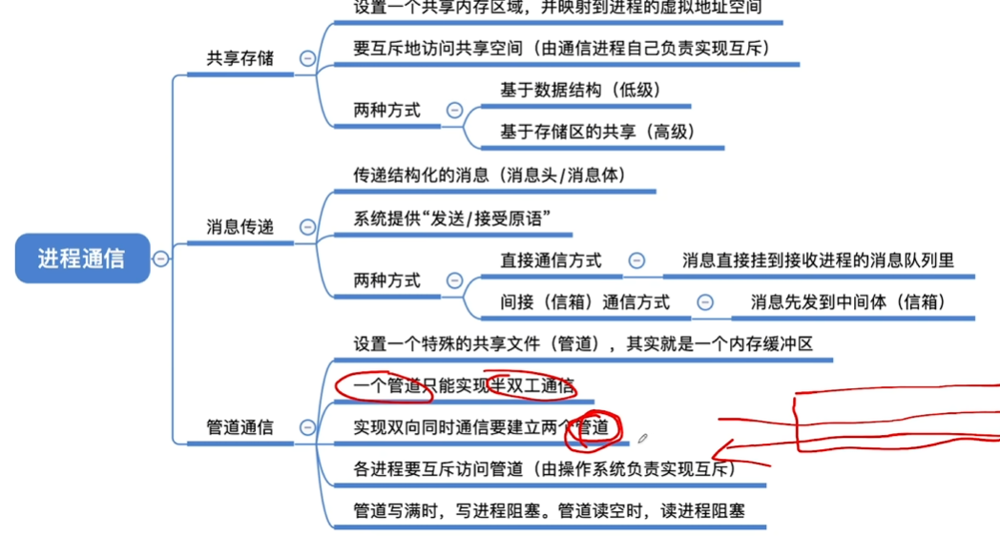

## 2.1.5.2 信号

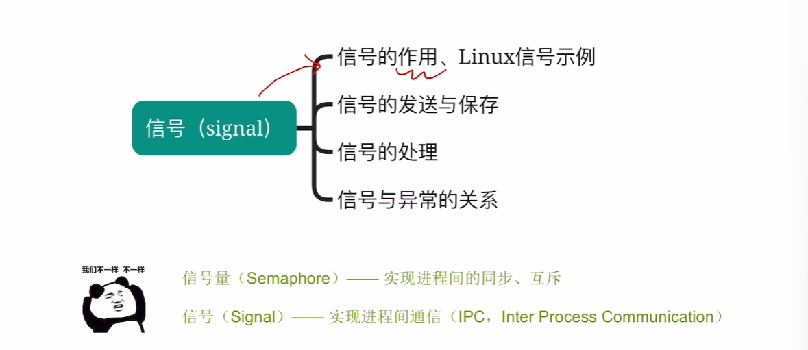

### 信号的作用

**信号（signal）**:用于通知进程某个特定事件已经发生。进程收到一个信号后，对该信号进行处理。
Linux操作系统定义了30种POSIX标准信号类型

| 序号 | 信号名   | 信号对应的事件                 | 默认处理         |
| ---- | -------- | ------------------------------ | ---------------- |
| 1    | SIGHUP   | ...                            | ...              |
| 2    | SIGINT   | 来自键盘的中断（Control-C）    | 终止             |
| 3    | SIGQUIT  | ...                            | ...              |
| ...  | ...      | ...                            | ...              |
| 8    | SIGFPE   | 浮点异常（如：除以0）          | 终止并转储内存   |
| 9    | SIGKILL  | 杀死进程（如：父进程杀子进程） | 终止             |
| ...  | ...      | ...                            | ...              |
| 28   | SIGWINCH | 窗口大小变化                   | 忽略             |
| ...  | ...      | ...                            | ...              |
| 30   | SIGPWR   | ...                            | ...              |

### 实现原理--信号的发送与保存

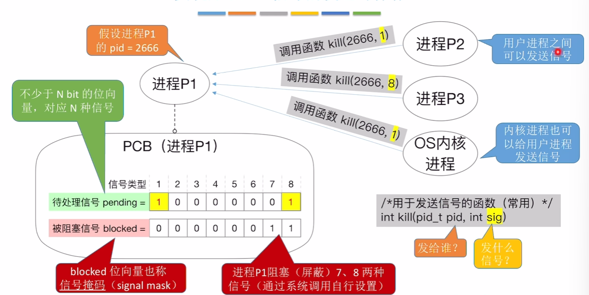
*注：进程之间发送的信号是有限制的如父子进程*

### 什么时候处理信号？
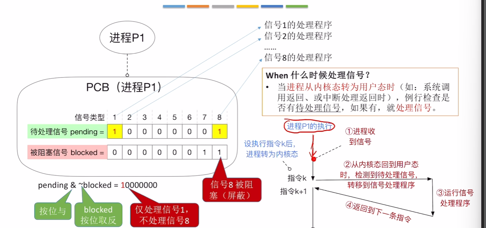
- 当进程从内核态转为用户态时（如：系统调用返回、或中断处理返回时），例行检查是否有待处理信号，如果有，就处理信号。

### How 怎么处理信号？
1.  执行操作系统为此类信号设置的缺省（默认）信号处理程序（某些信号默认忽略，不作处理）
2.  执行进程为此类信号设置用户自定义信号处理程序（自定义信号处理程序将覆盖①）

- 信号处理程序运行结束后，通常会返回进程的下一条指令继续执行（除非信号处理程序将进程阻塞或终止）
- 一旦处理了某个信号，就将pending位置重置为0
- 重复收到的同类信号，将被简单地丢弃（因为仅有1bit记录一类待处理信号）
- 当同时收到多个不同类信号时，通常先处理序号更小的信号。

### 疑难点1：各个进程的信号处理有何区别
操作系统规定每种信号的默认处理程序：
```c
sig1_default(){...}   //信号1的默认处理程序
sig2_default(){...}   //信号2的默认处理程序
……
sig8_default(){...}   //信号8的默认处理程序
```

### 疑难点2：信号与异常有什么关系？
“信号”可以作为“异常”的配套机制，让进程对操作系统的异常处理进行补充。

在进程运行过程中，某些特殊事件可能引发“异常”，操作系统内核负责捕获并处理异常
- 有些异常可以由内核完成全部处理（如：缺页异常），此时就不必再使用信号机制。
- **有些异常无法由内核完成全部处理，可能还需要用户进程配合**，此时就可以用“信号机制”与“异常机制”相互配合（如：在Linux中，发生除以0异常时，内核的异常处理程序会向用户进程发送SIGFPE信号。SIGFPE信号的默认处理程序会将进程终止并转储内存；当然进程可以自定义SIGFPE信号处理程序）。

### 知识回顾

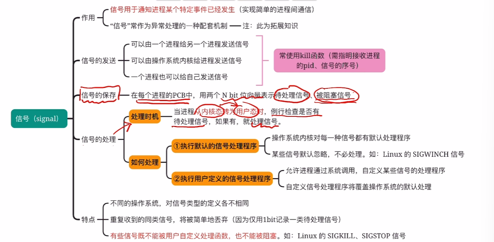

## 2.1.6_1 线程的概念与特点

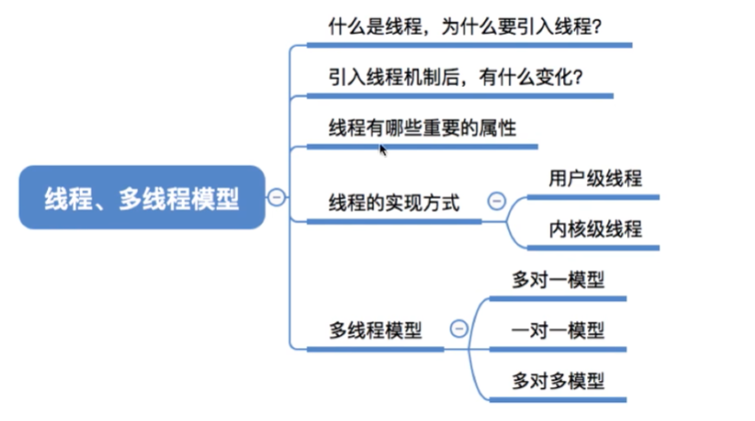

### 什么是线程，为什么要引入线程？

有的进程可能需要“同时”做很多事，而传统的进程只能串行地执行一系列程序。为此，引入了“线程”，来增加并发度。

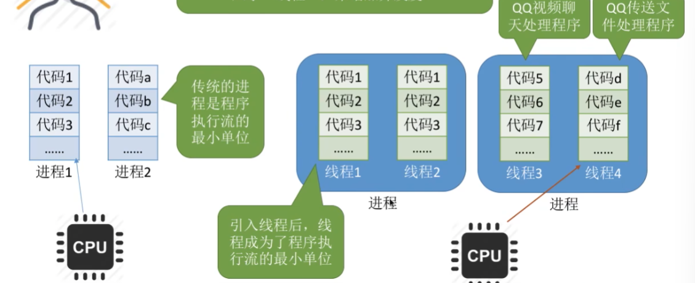

可以把线程理解为“轻量级进程”。

线程是一个基本的CPU执行单元，也是程序执行流的最小单位。
引入线程之后，不仅是进程之间可以并发，进程内的各线程之间也可以并发，从而进一步提升了系统的并发度，使得一个进程内也可以并发处理各种任务（如QQ视频、文字聊天、传文件）

引入线程后，进程只作为除CPU之外的系统资源的分配单元（如打印机、内存地址空间等都是分配给进程的）。

### 引入线程机制后，有什么变化？
#### 带来的变化
##### 1. 资源分配、调度
- 传统进程机制中，进程是资源分配、调度的基本单位
- 引入线程后，进程是资源分配的基本单位，线程是调度的基本单位

##### 2. 并发性
- 传统进程机制中，只能进程间并发
- 引入线程后，各线程间也能并发，提升了并发度

##### 3. 系统开销
- 传统的进程间并发，需要切换进程的运行环境，系统开销很大
- 线程间并发，如果是同一进程内的线程切换，则不需要切换进程环境，系统开销小
- 引入线程后，并发所带来的系统开销减小

### 线程的属性
- 线程是处理机调度的单位
- 多CPU计算机中，各个线程可占用不同的CPU
- 每个线程都有一个线程ID、线程控制块（TCB）
- 线程也有就绪、阻塞、运行三种基本状态
- 线程几乎不拥有系统资源
- 同一进程的不同线程间共享进程的资源
- 由于共享内存地址空间，同一进程中的线程间通信甚至无需系统干预
- 同一进程中的线程切换，不会引起进程切换
- 不同进程中的线程切换，会引起进程切换
- 切换同进程内的线程，系统开销很小
- 切换进程，系统开销较大


## 2.1.6_2 线程的实现方式和多线程模型

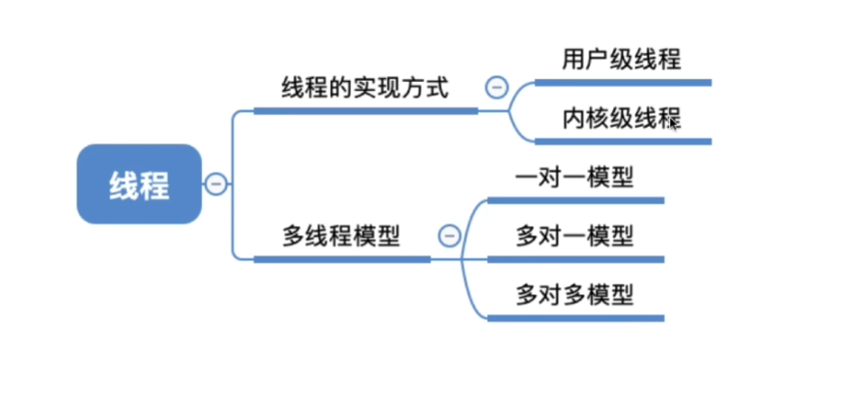

### 线程的实现方式

```c
int main() {
    int i = 0;
    while (true) {
        if (i==0){处理视频聊天的代码;}
        if (i==1){处理文字聊天的代码;}
        if (i==2){处理文件传输的代码;}
        i = (i+1)%3;  //i的值为 0,1,2,0,1,2...
    }
}
```
QQ进程

从代码的角度看，线程其实就是一段代码逻辑。
上述三段代码逻辑上可以看作三个“线程”。
while 循环就是一个最弱智的“线程库”，线程库完成了对线程的管理工作（如调度）。

#### 1. 用户级线程
**由用户支持的线程**

只有用户能感知到线程的存在，在操作系统层面只有单一对应的进程
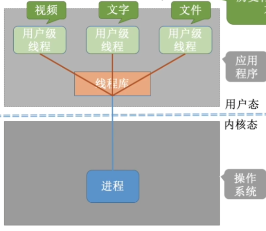

#### 1 用户级线程核心特性
1. 用户级线程由应用程序通过线程库实现，所有的线程管理工作都由应用程序负责（包括线程切换）
2. 用户级线程中，线程切换可以在用户态下即可完成，无需操作系统干预。
3. 在用户看来，是有多个线程。但是在操作系统内核看来，并意识不到线程的存在。
“用户级线程”就是“从用户视角看能看到的线程”

#### 2 用户级线程优缺点
##### 2.1 优点
用户级线程的切换在用户空间即可完成，不需要切换到核心态，线程管理的系统开销小，效率高

##### 2.2 缺点
当一个用户级线程被阻塞后，整个进程都会被阻塞，并发度不高。多个线程不可在多核处理机上并行运行。

#### 2. 内核级线程

**由操作系统支持的线程**
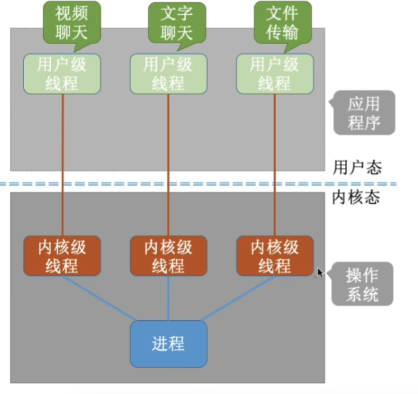

#### 1 内核级线程核心特性
1. 内核级线程的管理工作由操作系统内核完成。
2. 线程调度、切换等工作都由内核负责，因此内核级线程的切换必然需要在核心态下才能完成。
3. 操作系统会为每个内核级线程建立相应的TCB（Thread Control Block，线程控制块），通过TCB对线程进行管理。“内核级线程”就是“从操作系统内核视角看能看到的线程”

#### 2 内核级线程优缺点
##### 2.1 优点
当一个线程被阻塞后，别的线程还可以继续执行，并发能力强。多线程可在多核处理机上并行执行。

##### 2.2 缺点
一个用户进程会占用多个内核级线程，线程切换由操作系统内核完成，需要切换到核心态，因此线程管理的成本高，开销大。

### 多线程模型

#### 1. 一对一模型

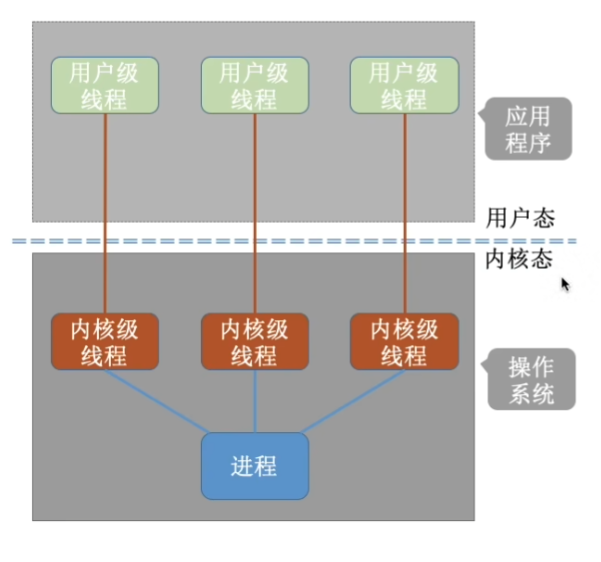

#### 一对一模型
一个用户级线程映射到一个内核级线程。每个用户进程有与用户级线程同数量的内核级线程。

##### 优点
当一个线程被阻塞后，别的线程还可以继续执行，并发能力强。多线程可在多核处理机上并行执行。

##### 缺点
一个用户进程会占用多个内核级线程，线程切换由操作系统内核完成，需要切换到核心态，因此线程管理的成本高，开销大。

#### 2. 多对一模型

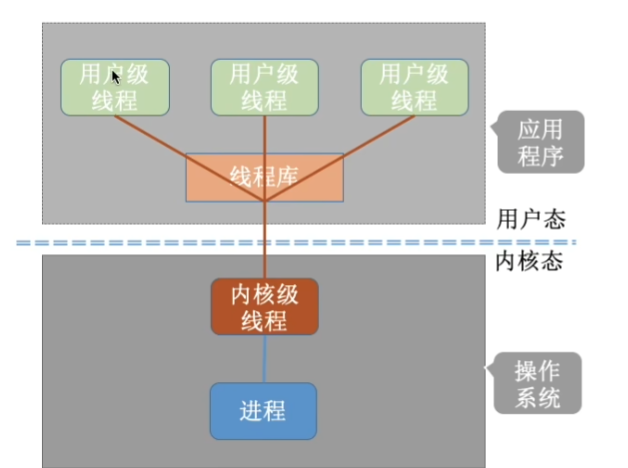

#### 多对一模型
多个用户级线程映射到一个内核级线程。且一个进程只被分配一个内核级线程。

##### 优点
用户级线程的切换在用户空间即可完成，不需要切换到核心态，线程管理的系统开销小，效率高

##### 缺点
当一个用户级线程被阻塞后，整个进程都会被阻塞，并发度不高。多个线程不可在多核处理机上并行运行

#### 多对多线程

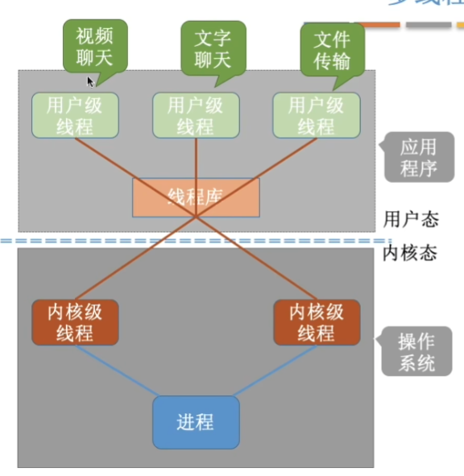

#### 多对多模型
n个用户级线程映射到m个内核级线程（n>=m）。每个用户进程对应m个内核级线程。

克服了多对一模型并发度不高的缺点（一个阻塞全体阻塞），又克服了一对一模型中一个用户进程占用太多内核级线程，开销太大的缺点。

可以这么理解：
用户级线程是“代码逻辑”的载体
内核级线程是“运行机会”的载体

内核级线程才是处理机分配的单位。例如：多核CPU环境下，左边这个进程最多能被分配两个核。

一段“代码逻辑”只有获得了“运行机会”才能被CPU执行

内核级线程中可以运行任意一个有映射关系的用户级线程代码，只有两个内核级线程中正在运行的代码逻辑都阻塞时，这个进程才会阻塞

### 知识回顾

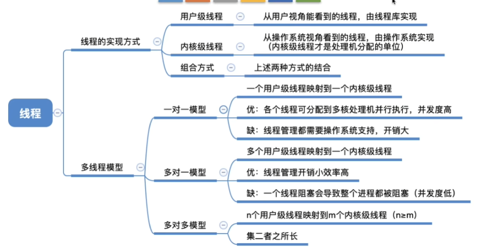

## 2.1.6_3 线程的状态和转换

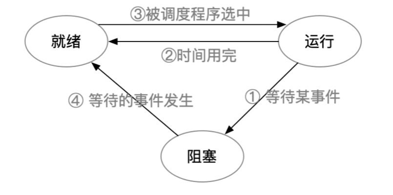

### 线程的组织和控制

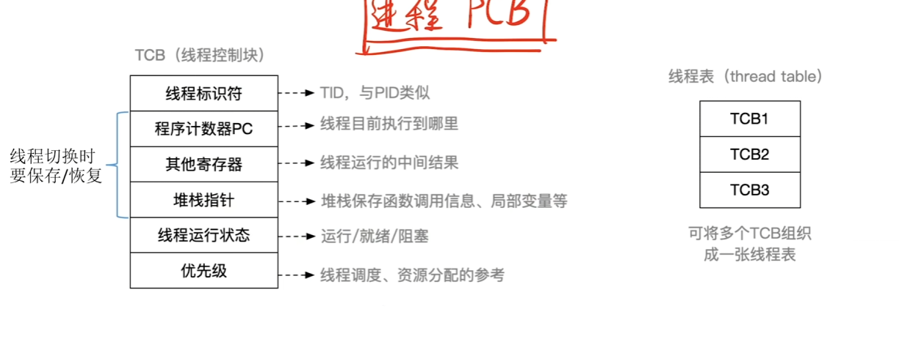

线程的组织按照一定的要求？状态？等进行组织

## 2.2.1 调度的概念、层次

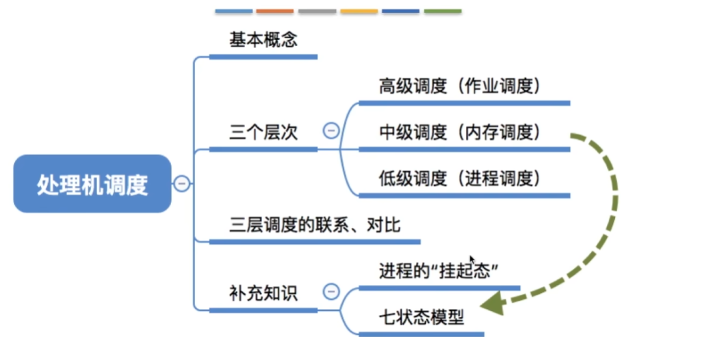

### 调度的概念

当有一堆任务要处理，但由于资源有限，这些事情没法同时处理。这就需要确定某种规则来决定处理这些任务的顺序，这就是“调度”研究的问题。

### 调度的三个层次
#### 高级调度


作业：一个具体的任务
用户向系统提交一个作业 ≈ 用户让操作系统启动一个程序（来处理一个具体的任务）

简化理解：好几个程序需要启动，到底先启动哪个

高级调度（作业调度）。按一定的原则从外存的作业后备队列中挑选一个作业调入内存，并创建进程。每个作业只调入一次，调出一次。作业调入时会建立PCB，调出时才撤销PCB。
#### 低级调度

低级调度（进程调度/处理机调度）——按照某种策略从就绪队列中选取一个进程，将处理机分配给它。

进程调度是操作系统中最基本的一种调度，在一般的操作系统中都必须配置进程调度。
进程调度的频率很高，一般几十毫秒一次。

#### 中级调度

内存不够时，可将某些进程的数据调出外存。等内存空闲或者进程需要运行时再重新调入内存。

暂时调到外存等待的进程状态为挂起状态。被挂起的进程PCB会被组织成挂起队列

中级调度（内存调度）——按照某种策略决定将哪个处于挂起状态的进程重新调入内存。

##### 挂起状态和七状态模型

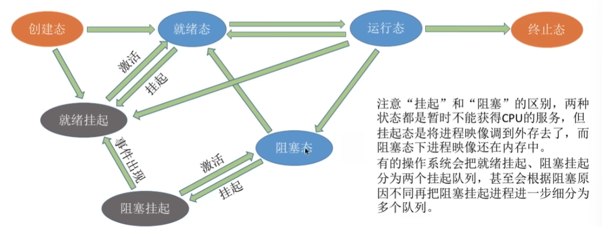

#### 三层调度的联系、对比

|                          | 要做什么                                                                 | 调度发生在..          | 发生频率 | 对进程状态的影响                     |
| ------------------------ | ------------------------------------------------------------------------ | --------------------- | -------- | ------------------------------------ |
| 高级调度<br>（作业调度） | 按照某种规则，从后备队列中选择合适的作业将其调入内存，并为其创建进程       | 外存→内存（面向作业） | 最低     | 无→创建态→就绪态                    |
| 中级调度<br>（内存调度） | 按照某种规则，从挂起队列中选择合适的进程将其数据调回内存                 | 外存→内存（面向进程） | 中等     | 挂起态→就绪态<br>（阻塞挂起→阻塞态） |
| 低级调度<br>（进程调度） | 按照某种规则，从就绪队列中选择一个进程为其分配处理机                     | 内存→CPU              | 最高     | 就绪态→运行态                       |

**作业：**
作业是用户在一次计算任务中提交给操作系统的一组程序、数据及控制命令的集合。操作系统将整个作业作为整体从外存调入内存，并为其创建一个或多个进程来执行。

**作业的组成**
一个作业通常包含：
- 程序代码：可执行文件或源代码（需编译）。
- 数据文件：程序运行所需的输入数据。
- 作业控制语句：用作业控制语言（JCL）写的命令，说明如何编译、链接、运行程序，以及出错处理等。

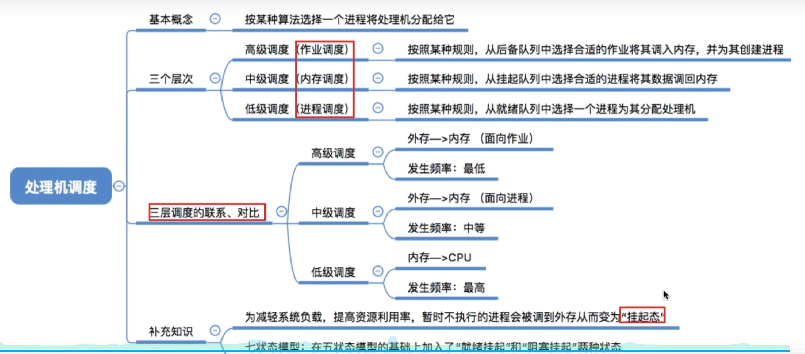

## 2.2.2-4 进程调度的时机、切换、过程

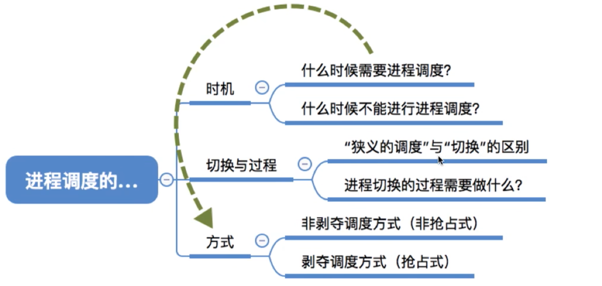

### 进程调度的时机

进程调度（低级调度），就是按照某种算法从就绪队列中选择一个进程为其分配处理机。

**需要进行进程调度与切换的情况**
1. 当前运行的进程主动放弃处理机
- 进程正常终止
- 运行过程中发生异常而终止
- 进程主动请求阻塞（如 等待I/O）

2. 当前运行的进程被动放弃处理机
- 分给进程的时间片用完
- 有更紧急的事需要处理（如I/O中断）
- 有更高优先级的进程进入就绪队列

**不能进行进程调度与切换的情况**
1. 在处理中断的过程中。中断处理过程复杂，与硬件密切相关，很难做到在中断处理过程中进行进程切换。
2. 进程在操作系统内核程序临界区中。
3. 在原子操作过程中（原语）。原子操作不可中断，要一气呵成（如之前讲过的修改PCB中进程状态标志，并把PCB放到相应队列）

### 进程调度的方式
#### 非剥夺调度方式（非抢占方式）
只允许进程主动放弃处理机。在运行过程中即便有更紧迫的任务到达，当前进程依然会继续使用处理机，直到该进程终止或主动要求进入阻塞态。
实现简单，系统开销小但是无法及时处理紧急任务，适合于早期的批处理系统。

#### 剥夺调度方式（抢占方式）
当一个进程正在处理机上执行时，如果有一个更重要或更紧迫的进程需要使用处理机，则立即暂停正在执行的进程，将处理机分配给更重要紧迫的那个进程。
可以优先处理更紧急的进程，也可实现让各进程按时间片轮流执行的功能（通过时钟中断）。适合于分时操作系统、实时操作系统。


### 进程的切换与过程
#### “狭义的进程调度”与“进程切换”的区别
狭义的进程调度指的是从就绪队列中选中一个要运行的进程。（这个进程可以是刚刚被暂停执行的进程，也可能是另一个进程，后一种情况就需要进程切换）
进程切换是指一个进程让出处理机，由另一个进程占用处理机的过程。

广义的进程调度包含了选择一个进程和进程切换两个步骤。

#### 进程切换的过程主要完成了
1. 对原来运行进程各种数据的保存
2. 对新的进程各种数据的恢复
（如：程序计数器、程序状态字、各种数据寄存器等处理机现场信息，这些信息一般保存在进程控制块）

**注意：进程切换是有代价的，因此如果过于频繁的进行进程调度、切换，必然会使整个系统的效率降低，使系统大部分时间都花在了进程切换上，而真正用于执行进程的时间减少。**

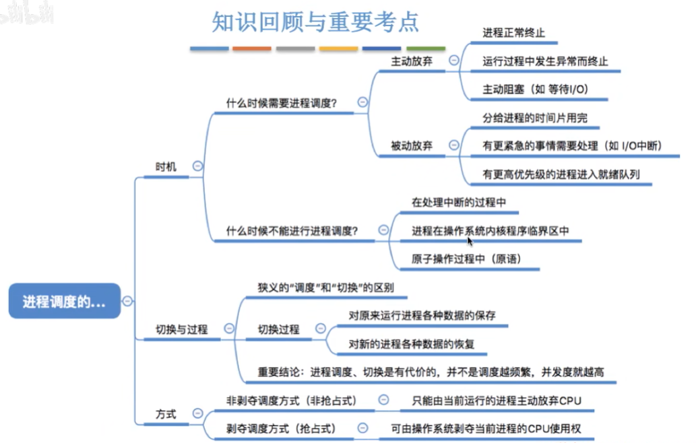

## 2.2.2_2 调度器和闲逛进程

### 调度器/调度程序

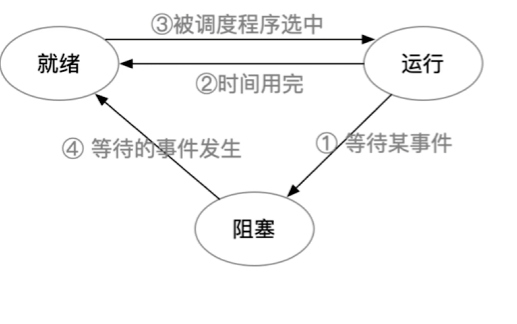
②、③由调度程序引起，调度程序决定：
让谁运行？——调度算法
运行多长时间？——时间片大小

调度时机——什么事件会触发“调度程序”？
- 创建新进程
- 进程退出
- 运行进程阻塞
- I/O中断发生（可能唤醒某些阻塞进程）

- 非抢占式调度策略，只有运行进程阻塞或退出才触发调度程序工作
- 抢占式调度策略，每个时钟中断或k个时钟中断会触发调度程序工作

**调度程序在支持内核级线程的操作系统，处理对象是内核线程（进程成为资源分配的单位，线程成为了调度单位），在不支持的操作系统的中，只能处理对应的进程**

### 闲逛进程
调度程序永远的备胎，没有其他就绪进程时，运行闲逛进程（idle）

idle
英 ['aɪdl]  美 ['aɪdl]
adj. 无事可做的；懒惰的；闲置的；空闲的；琐碎无聊的，毫无意义的；虚张声势的，唬人的；（钱）现金保存的，存于无息账户的
v. 闲混，无所事事；使……停止工作，使闲散；（发动机、车辆）空转

闲逛进程的特性：
- 优先级最低
- 可以是0地址指令，占一个完整的指令周期（指令周期末尾例行检查中断）
- 能耗低

## 2.2.3 调度的目标（调度算法的评价指标）


### CPU利用率
由于早期的CPU造价极其昂贵，因此人们会希望让CPU尽可能多地工作

CPU利用率：指CPU“忙碌”的时间占总时间的比例。

利用率 = 忙碌的时间 / 总时间
> 有的题目还会要求计算某种设备的利用率

Eg：某计算机只支持单道程序，某个作业刚开始需要在CPU上运行5秒，再用打印机打印输出5秒，之后再执行5秒，才能结束。在此过程中，CPU利用率、打印机利用率分别是多少？

CPU利用率 = (5+5) / (5+5+5) = 66.66%

### 系统吞吐量
对于计算机来说，希望能用尽可能少的时间处理完尽可能多的作业

系统吞吐量：单位时间内完成作业的数量

\[
系统吞吐量=\frac{总共完成了多少道作业}{总共花了多少时间}
\]

Eg：某计算机系统处理完10道作业，共花费100秒，则系统吞吐量为？
\[
10/100 = 0.1 \text{ 道/秒}
\]

### 周转时间
对于计算机的用户来说，他很关心自己的作业从提交到完成花了多少时间。

**周转时间**，是指**从作业被提交给系统开始，到作业完成为止的这段时间间隔**。
它包括四个部分：作业在外存后备队列上等待作业调度（高级调度）的时间、进程在就绪队列上等待进程调度（低级调度）的时间、进程在CPU上执行的时间、进程等待I/O操作完成的时间。后三项在一个作业的整个处理过程中，可能发生多次。

（作业）周转时间 = 作业完成时间 − 作业提交时间
> 对于用户来说，更关心自己的单个作业的周转时间

平均周转时间 = $\frac{各作业周转时间之和}{作业数}$
> 对于操作系统来说，更关心系统的整体表现，因此更关心所有作业周转时间的平均值

### 带权周转时间
\[
\text{带权周转时间}
=\frac{\text{作业周转时间}}{\text{作业实际运行的时间}}
=\frac{\text{作业完成时间}-\text{作业提交时间}}{\text{作业实际运行的时间}}
\]

对于周转时间相同的两个作业，实际运行时间长的作业在相同时间内被服务的时间更多，带权周转时间更小，用户满意度更高。

对于实际运行时间相同的两个作业，周转时间短的带权周转时间更小，用户满意度更高。

带权周转时间必然 $\ge 1$
带权周转时间与周转时间都是越小越好

### 等待时间
计算机的用户希望自己的作业尽可能少的等待处理机
等待时间，指进程/作业处于等待处理机状态时间之和，等待时间越长，用户满意度越低。

- 作业在外存后备队列等待被服务（调度）
- 作业调入内存后，建立对应的进程。这个进程会被CPU服务、会被I/O设备服务，当然也会有等待被服务的时候

对于进程来说，等待时间就是指进程建立后等待被服务的时间之和，在等待I/O完成的期间其实进程也是在被服务的，所以不计入等待时间。
对于作业来说，不仅要考虑建立进程后的等待时间，还要加上作业在外存后备队列中等待的时间。

一个作业总共需要被CPU服务多久，被I/O设备服务多久一般是确定不变的，因此调度算法其实只会影响作业/进程的等待时间。当然，与前面指标类似，也有“平均等待时间”来评价整体性能。

### 响应时间
对于计算机用户来说，会希望自己的提交的请求（比如通过键盘输入了一个调试命令）尽早地开始被系统服务、回应。

响应时间，指从用户提交请求到首次产生响应所用的时间。

## 2.2.5_1 调度算法(FCFS\SJF\HRRN)

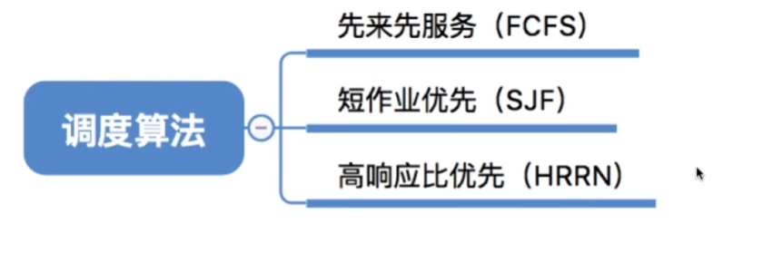

### FCFS 先来先服务调度算法--公平
#### 1. 算法思想
主要从“公平”的角度考虑（类似于我们生活中排队买东西的例子）

#### 2. 算法规则
按照作业/进程到达的先后顺序进行服务

#### 3. 用于作业/进程调度
用于作业调度时，考虑的是哪个作业先到达后备队列；用于进程调度时，考虑的是哪个进程先到达就绪队列

#### 4. 是否可抢占？
非抢占式的算法

#### 5. 优缺点
优点：公平、算法实现简单
缺点：排在长作业（进程）后面的短作业需要等待很长时间，带权周转时间很大，对短作业来说用户体验不好。即，FCFS算法对长作业有利，对短作业不利（Eg：排队买奶茶…）

#### 6. 是否会导致饥饿
不会
补充说明：某进程/作业长期得不到服务

### 短作业优先（SJF, Shortest Job First）--尽块短任务，平局等待/周转时间参数优
#### 1. 算法思想
追求最少的平均等待时间，最少的平均周转时间、最少的平均带权周转时间

#### 2. 算法规则
最短的作业/进程优先得到服务（所谓“最短”，是指要求服务时间最短）

#### 3. 用于作业/进程调度
即可用于作业调度，也可用于进程调度。用于进程调度时称为“短进程优先（SPF, Shortest Process First）算法”

#### 4. 是否可抢占？
SJF和SPF是非抢占式的算法。但是也有抢占式的版本——最短剩余时间优先算法（SRTN, Shortest Remaining Time Next）**抢占式有时候可能更具优势，但总体的运行时间差不多**

#### 5. 优缺点
优点：获得更短的平均等待时间、平均周转时间
缺点：不公平。对短作业有利，对长作业不利。可能产生饥饿现象。另外，作业/进程的运行时间是由用户提供的，并不一定真实，不一定能做到真正的短作业优先

#### 6. 是否会导致饥饿
会。如果源源不断地有短作业/进程到来，可能使长作业/进程长时间得不到服务，产生“饥饿”现象。如果一直得不到服务，则称为“饿死”

### 补充细节要点
1. 如果题目中未特别说明，所提到的“短作业/进程优先算法”默认是**非抢占式**的
2. 很多书上都会说“SJF调度算法的平均等待时间、平均周转时间最少”
严格来说，这个表述是错误的，不严谨的。之前的例子表明，最短剩余时间优先算法得到的平均等待时间、平均周转时间还要更少
应该加上一个条件“在所有进程同时可运行时，采用SJF调度算法的平均等待时间、平均周转时间最少”；
或者说“在所有进程都几乎同时到达时，采用SJF调度算法的平均等待时间、平均周转时间最少”；
如果不加上述前提条件，则应该说“抢占式的短作业/进程优先调度算法（最短剩余时间优先，SRNT算法）的平均等待时间、平均周转时间最少”
3. 虽然严格来说，SJF的平均等待时间、平均周转时间并不一定最少，但相比于其他算法（如FCFS），SJF依然可以获得较少的平均等待时间、平均周转时间

### 高响应比优先（HRRN, Highest Response Ratio Next）
#### 1. 算法思想
要综合考虑作业/进程的等待时间和要求服务的时间

#### 2. 算法规则
在每次调度时先计算各个作业/进程的响应比，选择响应比最高的作业/进程为其服务
\[
\text{响应比} = \frac{\text{等待时间}+\text{要求服务时间}}{\text{要求服务时间}}
\]
补充：响应比 $\ge 1$

#### 3. 用于作业/进程调度
即可用于作业调度，也可用于进程调度

#### 4. 是否可抢占？
非抢占式的算法。因此只有当前运行的作业/进程主动放弃处理机时，才需要调度，才需要计算响应比

#### 5. 优缺点
综合考虑了等待时间和运行时间（要求服务时间）
- 等待时间相同时，要求服务时间短的优先（继承SJF的优点）
- 要求服务时间相同时，等待时间长的优先（继承FCFS的优点）
- 对于长作业来说，随着等待时间越来越久，其响应比也会越来越大，从而避免了长作业饥饿的问题

#### 6. 是否会导致饥饿
不会

### 知识回顾与重要考点
|算法|思想&规则|可抢占？|优点|缺点|考虑到等待时间&运行时间？|会导致饥饿？|
| ---- | ---- | ---- | ---- | ---- | ---- | ---- |
|FCFS|自己回忆|非抢占式|公平；实现简单|对短作业不利|等待时间√<br>运行时间×|不会|
|SJF/SPF|自己回忆|默认为非抢占式，也有SJF的抢占式版本最短剩余时间优先算法（SRTN）|“最短的”平均等待/周转时间；|对长作业不利，可能导致饥饿；难以做到真正的短作业优先|等待时间×<br>运行时间√|会|
|HRRN|自己回忆|非抢占式|上述两种算法的权衡折中，综合考虑的等待时间和运行时间|无|等待时间√<br>运行时间√|不会|

注：这几种算法主要关心对用户的公平性、平均周转时间、平均等待时间等评价系统整体性能的指标，但是不关心“响应时间”，也并不区分任务的紧急程度，因此对于用户来说，交互性很糟糕。因此这三种算法一般适合用于**早期的批处理系统**，当然，FCFS算法也常结合其他的算法使用，在现在也扮演着很重要的角色。而适合用于**交互式系统**的调度算法将在下个小节介绍…

## 2.2.5_2 调度算法2


### 时间片轮转(RR,Round-Robin)--进程都能及时响应

- **算法思想**：公平地、轮流地为各个进程服务，让每个进程在一定时间间隔内都可以得到响应
- **算法规则**：按照各进程到达就绪队列的顺序，轮流让各个进程执行一个时间片（如100ms）。若进程未在一个时间片内执行完，则剥夺处理机，将进程重新放到就绪队列队尾重新排队。
- **用于作业/进程调度**：用于进程调度（只有作业放入内存建立了相应的进程后，才能被分配处理机时间片）
- **是否可抢占？**：若进程未能在时间片内运行完，将被强行剥夺处理机使用权，因此时间片轮转调度算法属于抢占式的算法。由时钟装置发出时钟中断来通知CPU时间片已到
- **优缺点**：优点：公平；响应快，适用于分时操作系统；缺点：由于高频率的进程切换，因此有一定开销；不区分任务的紧急程度。
- **是否会导致饥饿**：不会
- **时间片大小的影响**：
*时间片太大，就会退化为先来先服务调度算法，会增大进程响应时间(如果系统中有是个进程并发执行，时间片为1s，那么另外一个新进程需要等待9s才能被系统相应)，因此时间片不能太大*
*如果时间片太小，进程切换过于频繁，系统会花大量的实践来处理进程切换，而运行时间很少*

### 优先级调度算法--灵活调整进程的服务优先级

- **算法思想**：随着计算机的发展，特别是实时操作系统的出现，越来越多的应用场景需要根据任务的紧急程度来决定处理顺序
- **算法规则**：调度时选择优先级最高的作业/进程
- **用于作业/进程调度**：既可用于作业调度，也可用于进程调度。甚至，还会用于在之后会学习的I/O调度中
- **是否可抢占？**：抢占式、非抢占式都有。做题时的区别在于：非抢占式只需在进程主动放弃处理机时进行调度即可，而抢占式还需在就绪队列变化时，检查是否会发生抢占。
*抢占式：关注进程完成主动放弃处理机和新任务到达就绪队列*
*非抢占式：关注进程完成主动放弃处理机，按就绪队列中的的优先级数，进行选择。*
- **优缺点**：优点：用优先级区分紧急程度、重要程度，适用于实时操作系统。可灵活地调整对各种作业/进程的偏好程度。缺点：若源源不断地有高优先级进程到来，则可能导致饥饿
- **是否会导致饥饿**：会


补充：
就绪队列未必只有一个，可以按照不同优先级来组织。另外，也可以把优先级高的进程排在更靠近队头的位置
根据优先级是否可以动态改变，可将优先级分为静态优先级和动态优先级两种。
静态优先级：创建进程时确定，之后一直不变。
动态优先级：创建进程时有一个初始值，之后会根据情况动态地调整优先级。


#### 如何合理地设置各类进程的优先级？

通常：
系统进程优先级 高于 用户进程
前台进程优先级 高于 后台进程
操作系统更偏好 I/O型进程（或称 I/O繁忙型进程）因为I/O可以并行，然后提高系统资源的利用率

注： 与I/O型进程相对的是计算型进程（或称 CPU繁忙型进程）
### 如果采用的是动态优先级，什么时候应该调整？

可以从追求公平、提升资源利用率等角度考虑
如果某进程在就绪队列中等待了很长时间，则可以适当提升其优先级
如果某进程占用处理机运行了很长时间，则可适当降低其优先级

### 多级反馈队列调度算法--折中平衡

- **算法思想**：对其他调度算法的折中权衡
- **算法规则**：
  1. 设置多级就绪队列，各级队列优先级从高到低，时间片从小到大
  2. 新进程到达时先进入第1级队列，按FCFS原则排队等待被分配时间片，若用完时间片进程还未结束，则进程进入下一级队列队尾。如果此时已经是在最下级的队列，则重新放回该队列队尾
  3. 只有第k级队列为空时，才会为k+1级队头的进程分配时间片
- **用于作业/进程调度**：用于进程调度
- **是否可抢占？**：抢占式的算法。在k级队列的进程运行过程中，若更上级的队列（1~k-1级）中进入了一个新进程，则由于新进程处于优先级更高的队列中，因此新进程会抢占处理机，原来运行的进程放回k级队列队尾。
- **优缺点**：对各类型进程相对公平（FCFS的优点）；每个新到达的进程都可以很快就得到响应（RR的优点）；短进程只用较少的时间就可完成（SPF的优点）；不必实现估计进程的运行时间（避免用户作假）；可灵活地调整对各类进程的偏好程度，比如CPU密集型进程、I/O密集型进程（拓展：可以将因I/O而阻塞的进程重新放回原队列，这样I/O型进程就可以保持较高优先级）
- **是否会导致饥饿**：会

*设置多级就绪队列，各级队列优先级从高到低，时间片从小到大*
*新进程到达时先进入第1级队列，按FCFS原则排队等待被分配时间片。若用完时间片进程还未结束，则进程进入下一级队列队尾。如果此时已经在最下级的队列，则重新放回最下级队列队尾*
*只有第k级队列为空时，才会为k+1级队头的进程分配时间片被抢占处理机的进程重新放回原队列队尾*
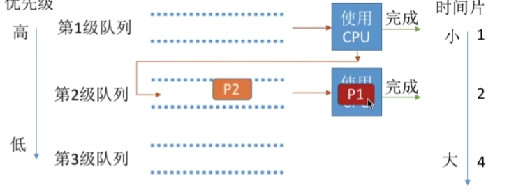

#### 总结
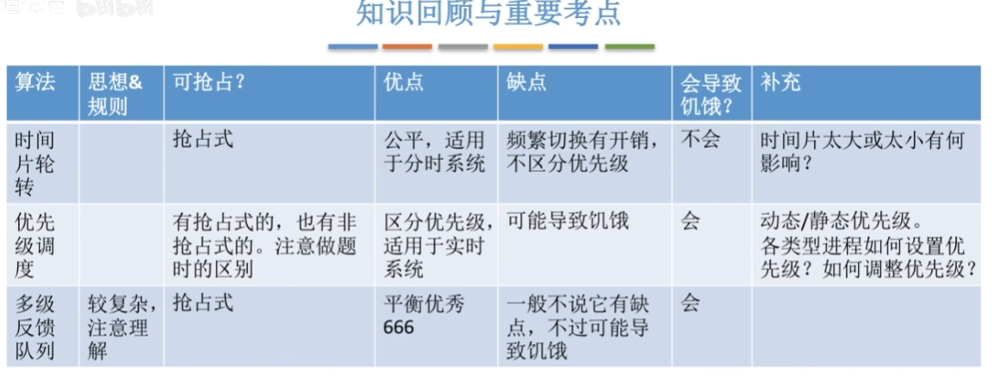
注：比起早期的批处理操作系统来说，由于计算机造价大幅降低，因此之后出现的交互式操作系统（包括分时操作系统、实时操作系统等）更注重系统的响应时间、公平性、平衡性等指标。而这几种算法恰好也能较好地满足交互式系统的需求。因此这三种算法适合用于交互式系统。（比如UNIX使用的就是多级反馈队列调度算法）

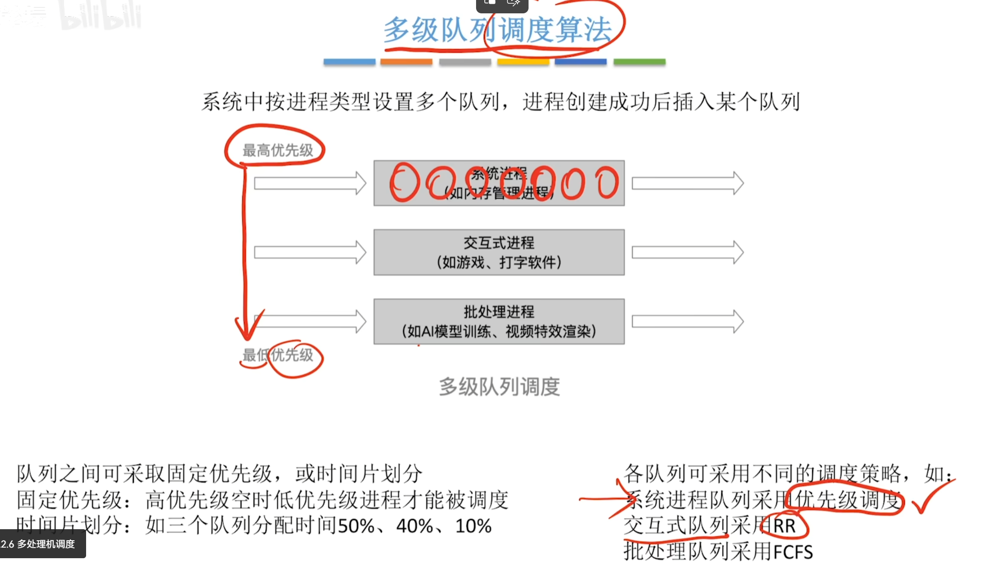

## 2.2.6 多处理机(多核CPU)调度

**多处理机调度**
1. 与单处理调度相比，需要面临哪些新问题？
2. 方案一：公共就绪队列
3. 方案二：私有就绪队列

### 单处理调度 vs 多处理机调度


**多处理机调度**：
①用调度算法决定让哪个就绪进程优先上处理机；
②还需决定被调度的进程到底上哪个处理机

**单处理机调度**：只需决定让哪个就绪进程优先上处理机即可。

### 新调度目标

#### 负载均衡、处理机亲和性

多处理机调度中，应追求的目标：

1. 负载均衡——尽可能让每个CPU都同等忙碌(不能一忙多闲)
2. 处理机亲和性——尽量让一个进程调度到同一个CPU上运行，以发挥CPU中缓存的作用（Cache）

### 方案一:公共就绪队列
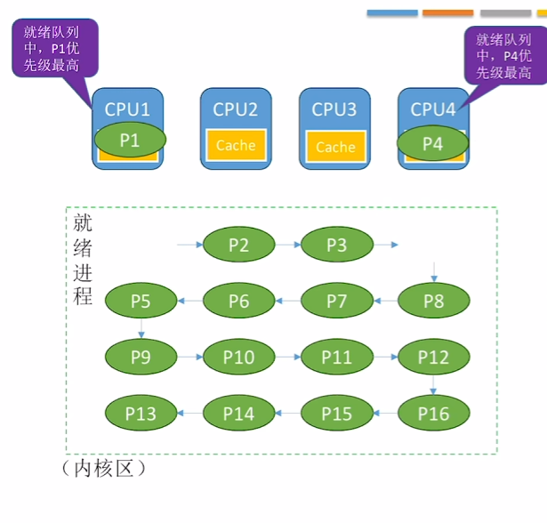
#### 公共就绪队列
- 所有CPU共享同一个就绪进程队列（位于内核区）
- 每个CPU时运行调度程序，从公共就绪队列中选择一个进程运行
- 每个CPU访问公共就绪队列时需要上锁（确保互斥）

优点：可以天然地实现负载均衡
缺点：各个进程频繁地换CPU运行，“亲和性”不好

##### 如何提升处理机亲和性？
- 软亲和：由进程调度程序尽量保证“亲和性”
- 硬亲和：由用户进程通过系统调用，主动要求操作系统分配固定的CPU，确保“亲和性”

### 私有就绪队列


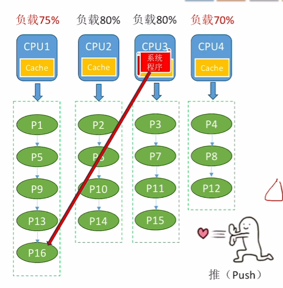

- 每个CPU都有一个私有就绪队列
- CPU空闲时运行调度程序，从私有就绪队列中选择一个进程运行

> 目标一：如何实现负载均衡？

####  推迁移（Push）策略
一个特定的系统程序周期性检查每个处理器的负载，如果负载不平衡，就从忙碌CPU的就绪队列中“推”一些就绪进程到空闲CPU的就绪队列

推迁移 = 有一个包工头专门负责派活

#### 拉迁移（pull）策略：
每个CPU运行调度程序时，周期性检查自身负载与其他CPU负载。如果一个CPU负载很低，就从其他高负载CPU的就绪队列中“拉”一些就绪进程到自己的就绪队列

拉迁移 = 一群互帮互助的同事（看到其他同事很忙，主动揽活过来，分担任务）

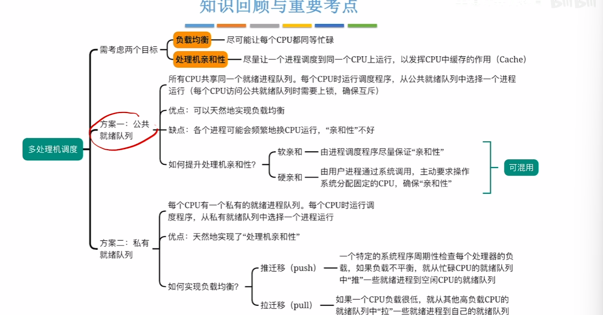

## 2.3.1 同步和互斥的基本概念

同步、互斥问题
- 什么是进程同步
- 什么是进程互斥

### 什么是进程同步
知识点回顾：**进程具有异步性的特征**。**异步性**是指，**各并发执行的进程以各自独立的、不可预知的速度向前推进**。

eg.进程通信--管道通信
写进程->(写数据)->管道->(读数据)->读进程

读进程和写进程并发地运行，由于并发必然导致异步性，因此“写数据”和“读数据”两个操作执行的先后顺序是不确定的。而实际应用中，又必须按照“写数据→读数据”的顺序来执行的。如何解决这种异步问题，就是“进程同步”所讨论的内容。

同步亦称**直接制约关系**，它是指**为完成某种任务而建立的两个或多个进程，这些进程因为需要在某些位置上协调它们的工作次序而产生的制约关系。**进程间的直接制约关系就是源于它们之间的相互合作。

### 什么是进程互斥
进程的“并发”需要“共享”的支持。各个并发执行的进程不可避免的需要共享一些系统资源（比如内存，又比如打印机、摄像头这样的I/O设备）

#### 两种资源共享方式
- 互斥共享方式：系统中的某些资源，虽然可以提供给多个进程使用，但一个时间段内只允许一个进程访问该资源
- 同时共享方式：系统中的某些资源，允许一个时间段内由多个进程“同时”对它们进行访问

我们把**一个时间段内只允许一个进程使用的资源**称为**临界资源**。许多物理设备（比如摄像头、打印机）都属于临界资源。此外还有许多变量、数据、内存缓冲区等都属于临界资源。
对临界资源的访问，必须互斥地进行。互斥，亦称间接制约关系。**进程互斥指当一个进程访问某临界资源时，另一个想要访问该临界资源的进程必须等待**。当前访问临界资源的进程访问结束，释放该资源之后


### 临界资源互斥访问四部分
对临界资源的互斥访问，可以在逻辑上分为如下四个部分：
```c
do {
    entry section;    //进入区
    critical section; //临界区
    exit section;     //退出区
    remainder section;//剩余区
} while(true)
```
1. **进入区（entry section）**
负责检查是否可进入临界区，若可进入，则应设置正在访问临界资源的标志（可理解为“上锁”），以阻止其他进程同时进入临界区
2. **临界区（critical section）**
访问临界资源的那段代码
3. **退出区（exit section）**
负责解除正在访问临界资源的标志（可理解为“解锁”）
4. **剩余区（remainder section）**
做其他处理

### 临界区互斥访问四大原则
为了实现对临界资源的互斥访问，同时保证系统整体性能，需要遵循以下原则：
1. **空闲让进**。临界区空闲时，可以允许一个请求进入临界区的进程立即进入临界区；
2. **忙则等待**。当已有进程进入临界区时，其他试图进入临界区的进程必须等待；
3. **有限等待**。对请求访问的进程，应保证能在有限时间内进入临界区（保证不会饥饿）；
4. **让权等待**。当进程不能进入临界区时，应立即释放处理机，防止进程忙

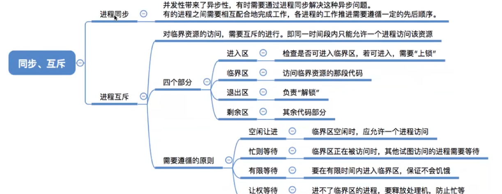

## 2.3.1_1 进程互斥的软件实现方法


### 单标志法

#### 算法思想
两个进程在访问完临界区后会把使用临界区的权限转交给另一个进程。也就是说**每个进程进入临界区的权限只能被另一个进程赋予**

```c
int turn = 0; //turn 表示当前允许进入临界区的进程号

// P0 进程
while (turn != 0);        // ① 进入区
critical section;         // ② 临界区
turn = 1;                 // ③ 退出区
remainder section;       // ④ 剩余区

// P1 进程
while (turn != 1);        // ⑤ 进入区
critical section;         // ⑥ 临界区
turn = 0;                 // ⑦ 退出区
remainder section;       // ⑧ 剩余区
```
**可以实现同一时刻最多只允许一个进程访问临界区**

### 双标志先检查法
#### 算法思想
设置一个布尔型数组 `flag[]`，数组中各个元素用来标记各进程想进入临界区的意愿，比如 `flag[0] = true` 意味着0号进程P0现在想要进入临界区。每个进程在进入临界区之前先检查当前有没有别的进程想进入临界区，如果没有，则把自身对应的标志 `flag[i]` 设为 `true`，之后开始访问临界区。

```c
bool flag[2];   // 表示进入临界区意愿的数组
flag[0] = false;
flag[1] = false; // 初始两个进程都不想进入临界区

// P0 进程
while (flag[1]);        // ① 进入区：检查P1是否想进入
flag[0] = true;         // ② 进入区：标记自身想要进入
critical section;       // ③ 临界区
flag[0] = false;        // ④ 退出区：取消自身进入意愿
remainder section;

// P1 进程
while (flag[0]);        // ⑤ 进入区：检查P0是否想进入
flag[1] = true;         // ⑥ 进入区：标记自身想要进入
critical section;       // ⑦ 临界区
flag[1] = false;        // ⑧ 退出区：取消自身进入意愿
remainder section;
```
**违反了“忙则等待”的原则，原因在于进入区的检查和上锁不一连贯，则可能产生并发状态下的多进程访问临界区的情况**

### 双标志后检查法
#### 算法思想
双标志先检查法的改版。前一个算法的问题是先“检查”后“上锁”，但是这两个操作又无法一气呵成，因此导致了两个进程同时进入临界区的问题。因此，人们又想到先“上锁”后“检查”的方法，来避免上述问题。

```c
bool flag[2];   // 表示进入临界区意愿的数组
flag[0] = false;
flag[1] = false; // 初始两个进程都不想进入临界区

// P0 进程
flag[0] = true;         // ① 进入区：标记自身想要进入临界区
while (flag[1]);        // ② 进入区：若P1也想进入，则循环等待
critical section;       // ③ 临界区：访问临界区
flag[0] = false;        // ④ 退出区：取消自身进入意愿
remainder section;

// P1 进程
flag[1] = true;         // ⑤ 进入区：标记自身想要进入临界区
while (flag[0]);        // ⑥ 进入区：若P0也想进入，则循环等待
critical section;       // ⑦ 临界区：访问临界区
flag[1] = false;        // ⑧ 退出区：取消自身进入意愿
remainder section;
```

#### 算法缺陷
若按照 ①⑤②⑥… 的顺序执行，P0 和 P1 将都无法进入临界区。
因此，双标志后检查法虽然解决了“忙则等待”的问题，但是又违背了“空闲让进”和“有限等待”原则，会因各进程都长期无法访问临界资源而产生**饥饿**现象。

### Peterson算法
#### 算法思想
结合双标志法、单标志法的思想。如果双方都争着想进入临界区，那可以让进程尝试“孔融让梨”（谦让），做一个有礼貌的进程。

```c
bool flag[2];   // 表示进入临界区意愿的数组，初始值都是false
int turn = 0;   // turn 表示优先让哪个进程进入临界区

// P0 进程
flag[0] = true;                  // ①
turn = 1;                        // ②
while (flag[1] && turn == 1);    // ③
critical section;                // ④
flag[0] = false;                 // ⑤
remainder section;

// P1 进程
flag[1] = true;                  // ⑥
turn = 0;                        // ⑦
while (flag[0] && turn == 0);    // ⑧
critical section;                // ⑨
flag[1] = false;                 // ⑩
remainder section;
```

#### 进入区三步逻辑
1. 主动争取；
2. 主动谦让；
3. 检查对方是否也想使用，且最后一次是不是自己说了“客气话”。

#### 动手推导思考题
按不同的顺序穿插执行会发生什么？
- ①②③⑥⑦⑧…
- ①⑥②③…
- ①③⑥⑦⑧…
- ①⑥②⑦⑧…

#### 算法评价
1. Peterson算法用软件方法解决了进程互斥问题，遵循了**空闲让进、忙则等待、有限等待**三个原则，但是依然未遵循**让权等待**的原则。
2. Peterson算法相较于之前三种软件解决方案来说，是最好的，但依然不够好。

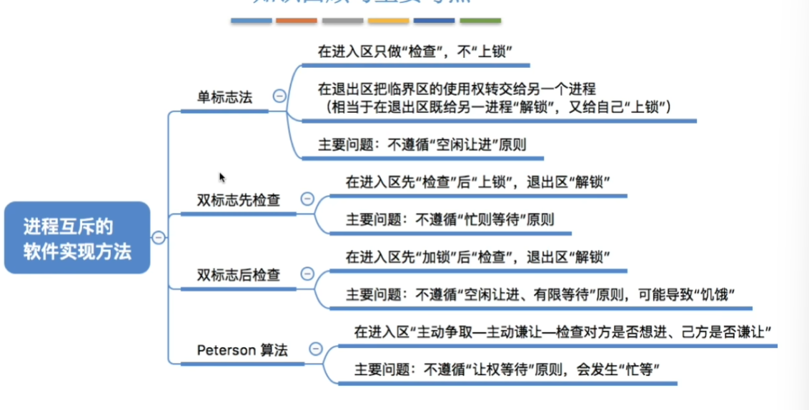

## 2.3.1_2 进程互斥的硬件实现

### 一、开关中断实现
### 中断屏蔽方法
#### 实现原理
利用“开/关中断指令”实现（与原语的实现思想相同）：某进程从开始访问临界区到结束访问为止全程禁止中断，无法触发进程切换，因此不会出现多个进程同时访问临界区的情况。

```c
...
关中断;    // 关中断后不允许当前进程被中断，不会发生进程切换
临界区;
开中断;    // 访问完临界区再开中断，其他进程才可能占用处理机访问临界区
...
```

#### 优缺点
- **优点**：简单、高效
- **缺点**
  1. 不适用于多处理机；
  2. 仅适用于操作系统内核进程，不能用于用户进程；
  3. 开/关中断指令属于内核态指令，若开放给用户随意调用存在安全风险。

### 二、原子指令实现
### TestAndSet（TSL/TS）指令
#### 基础说明
简称TS指令，又称TestAndSetLock、TSL指令；
TSL指令由**硬件实现**，执行全程不可中断，属于原子操作。

#### 1. TSL指令逻辑（C语言伪代码）
```c
// 布尔共享变量lock：标记临界区加锁状态
// true=已加锁，false=未加锁
bool TestAndSet(bool *lock){
    bool old;
    old = *lock;        // 保存lock原有值
    *lock = true;       // 强制将lock置为已加锁
    return old;         // 返回lock修改前的值
}
```

#### 2. 使用TSL实现进程互斥模板
```c
while (TestAndSet (&lock));  // 原子完成“上锁+检查”
临界区代码段...
lock = false;                // 解锁
剩余区代码段...
```

#### 3. 执行流程说明
1. 初始`lock = false`（无进程占用临界区）：
    TSL返回`old=false`，while循环条件不成立，直接进入临界区；
2. 当前`lock = true`（已有进程占用）：
    TSL返回`old=true`，while循环持续自旋等待，直到占用进程执行`lock=false`解锁。

#### 4. 核心优势
1. “检查”与“上锁”合并为硬件原子操作，无软件逻辑漏洞；
2. 实现简单；
3. 支持多处理机环境。

### Swap指令（Exchange/XCHG指令）
#### 基础说明
又称Exchange指令、XCHG指令；
Swap指令由**硬件实现**，执行全程不可中断，属于原子操作。

#### 1. Swap指令逻辑（C语言伪代码）
```c
// 交换两个布尔变量的值
Swap (bool *a, bool *b) {
    bool temp;
    temp = *a;
    *a = *b;
    *b = temp;
}
```

#### 2. 使用Swap指令实现进程互斥模板
```c
// lock：标记临界区加锁状态
bool old = true;
while (old == true)
    Swap (&lock, &old);
临界区代码段...
lock = false;                // 解锁
剩余区代码段...
```

#### 3. 执行逻辑说明
Swap 和 TSL 逻辑本质一致：
1. 通过原子交换操作读取当前`lock`上锁状态并存入`old`；
2. 交换操作会强制将`lock`置为`true`（上锁）；
3. 若`old=false`：代表临界区空闲，跳出循环进入临界区；
4. 若`old=true`：代表已有进程占用，持续循环自旋等待。

#### 4. 优缺点
- **优点**
  1. 原子硬件操作，无软件互斥算法的逻辑漏洞；
  2. 实现简单；
  3. 支持多处理机环境。
- **缺点**
  不满足**让权等待**原则，等待进程持续占用CPU循环自旋，存在**忙等**问题。


## 2.3.3 进程互斥：锁
#### 1. 互斥锁 mutex lock
解决临界区最简单的工具。
- 进入临界区前调用 `acquire()` 获取锁；
- 退出临界区时调用 `release()` 释放锁。

##### 变量说明
布尔变量 `available`，标记锁是否可用：
- `true`：锁空闲可用
- `false`：锁已被占用

##### 伪代码实现
```c
acquire() {
    while (!available)
        ; // 忙等待，自旋循环
    available = false; // 获取锁，标记占用
}

release() {
    available = true;  // 释放锁，标记空闲
}
```

##### 关键要求
`acquire()`、`release()` 内部操作必须是**原子操作**，因此互斥锁一般依托硬件指令实现。

##### 缺点与适用场景
1. 核心缺陷：**忙等待**
   已有进程占用临界区时，其他进程会循环自旋抢占CPU，单核场景下浪费CPU周期。
2. 适用场景：多处理器系统
   等待线程单独占用一个处理器自旋，不会阻塞其他处理器上线程的运行。

#### 自旋锁 spin lock
需要循环忙等的互斥锁统称为自旋锁。
例：TSL指令、Swap指令、单标志法实现的锁。

#### 自旋锁特性
- 需忙等，进程时间片用完才让出处理机，违反“让权等待”
- 优点：等待期间不用切换进程上下文，多处理器系统中，若上锁的时间短，则等待代价很低
- 常用于多处理器系统，一个核忙等，其他核照常工作，并快速释放临界区
- 不太适用于单处理机系统，忙等的过程中不可能解锁

## 2.3.4_1 信号量机制

信号量机制
- 整型信号量
- 记录型信号量

### 1. 信号量定义
信号量其实就是一个变量（可以是一个整数，也可以是更复杂的记录型变量），可以用一个信号量来表示系统中某种资源的数量，比如：系统中只有一台打印机，就可以设置一个初值为1的信号量。

### 2. 原语概念
原语是一种特殊的程序段，其执行只能一气呵成，不可被中断。原语是由关中断/开中断指令实现的。软件解决方案的主要问题是由“进入区的各种操作无法一气呵成”，因此如果能把进入区、退出区的操作都用“原语”实现，使这些操作能“一气呵成”就能避免问题。

### 3. 配套操作原语
一对原语：`wait(S)检查并分配资源` 原语和 `signal(S)释放资源` 原语，可以把原语理解为我们自己写的函数，函数名分别为 wait 和 signal，括号里的信号量 S 其实就是函数调用时传入的一个参数。

### 4. P、V操作简称

wait、signal 原语常简称为 P、V操作（来自荷兰语 `proberen` 和 `verhogen`）。因此，做题的时候常把 `wait(S)`、`signal(S)` 两个操作分别写为 `P(S)`、`V(S)`。

### 信号量机制--整形信号量


用一个**整型**的变量作为信号量，用来**表示**系统中某种资源的数量。
Eg：某计算机系统中有一台打印机...

与普通整数变量的区别：
对信号量的操作只有三种，即 初始化、P操作、V操作

```c
int S = 1;  //初始化整型信号量s，表示当前系统中可用的打印机资源数

void wait (int S) {  //wait 原语，相当于"进入区"
  while (S <= 0);    //如果资源数不够，就一直循环等待
  S=S-1;             //如果资源数够，则占用一个资源
}

void signal (int S) { //signal 原语，相当于"退出区"
  S=S+1;              //使用完资源后，在退出区释放资源
}
```

"检查"和"上锁"一气呵成，避免了并发、异步导致的问题
存在的问题：不满足"让权等待"原则，会发生"忙等"

### 信号量机制--记录型信号量(记录可用资源的数量)

```markdown
整型信号量的缺陷是存在“忙等”问题，因此人们又提出了“记录型信号量”，即用记录型数据结构表示的信号量。

```c
/*记录型信号量的定义*/
typedef struct {
  int value;        // 剩余资源数
  struct process *L;// 等待队列
} semaphore;

/*某进程需要使用资源时，通过 wait 原语申请*/
void wait (semaphore S) {
  S.value--;
  if (S.value < 0) {
    block (S.L);
  }
}
```
说明：如果剩余资源数不够，使用block原语使进程从运行态进入阻塞态，并把挂到信号量S的等待队列（即阻塞队列）中

```c
/*进程使用完资源后，通过 signal 原语释放*/
void signal (semaphore S) {
  s.value++;
  if (S.value <= 0) {
    wakeup(S.L);
  }
}
```
说明：释放资源后，若还有别的进程在等待这种资源，则使用wakeup原语唤醒等待队列中的一个进程，该进程从阻塞态变为就绪态

```markdown
```c
/*记录型信号量的定义*/
typedef struct {
  int value;        // 剩余资源数
  Struct process *L;// 等待队列
} semaphore;

/*某进程需要使用资源时，通过 wait 原语申请*/
void wait (semaphore S) {
  S.value--;
  if (S.value < 0) {
    block (S.L);
  }
}

/*进程使用完资源后，通过 signal 原语释放*/
void signal (semaphore S) {
  s.value++;
  if (S.value <= 0) {
    wakeup(S.L);
  }
}
```

在考研题目中 wait(S)、signal(S) 也可以记为 P(S)、V(S)，这对原语可用于实现系统资源的“申请”和“释放”。

**S.value 的初值表示系统中某种资源的数目。**

对信号量 S 的一次 P 操作意味着进程请求一个单位的该类资源，因此需要执行 S.value--，表示资源数减1，当 S.value < 0 时表示该类资源已分配完毕，因此进程应调用 block 原语进行自我阻塞（当前运行的进程从运行态→阻塞态），主动放弃处理机，并插入该类资源的等待队列 S.L 中。可见，该机制遵循了“让权等待”原则，不会出现“忙等”现象。

对信号量 S 的一次 V 操作意味着进程释放一个单位的该类资源，因此需要执行 S.value++，表示资源数加1，若加1后仍是 S.value <= 0，表示依然有进程在等待该类资源，因此应调用 wakeup 原语唤醒等待队列中的第一个进程（被唤醒进程从阻塞态→就绪态）。


## 2.3.4_2 用信号量实现互斥、同步、前驱关系

**总览**：
信号量机制
- 实现进程互斥
- 实现进程同步
- 实现进程的前驱关系

### 信号量机制实现进程互斥

理解：信号量 mutex 表示“进入临界区的名额”
1. 分析并发进程的关键活动，划定临界区（如：对临界资源打印机的访问就应放在临界区）
2. 设置**互斥信号量** mutex，初值为**1**
3. 在进入区 P(mutex)——**申请资源**
4. 在退出区 V(mutex)——**释放资源**

注意：对**不同的临界资源**需要设置**不同的互斥信号量**。
P、V操作必须成对出现。缺少 P(mutex) 就不能保证临界资源的互斥访问。缺少 V(mutex) 会导致资源永不被释放，等待进程永不被唤醒。

补充说明：要会自己定义记录型信号量，但如果题目中没特别说明，可以把信号量的声明简写成示例形式。

```c
typedef struct {
    int value;        //剩余资源数
    struct process *L;//等待队列
} semaphore;

/*信号量机制实现互斥*/
semaphore mutex=1;  //初始化信号量

P1(){
    ...
    P(mutex);        //使用临界资源前需要加锁
    临界区代码段...
    V(mutex);        //使用临界资源后需要解锁
    ...
}
```

### 信号量机制实现进程同步

进程同步：要让各并发进程按照要求有序地推进

用信号量实现进程同步：
1. 分析什么地方需要实现“同步关系”，即必须保证“一前一后”执行的两个操作（或两句代码）
2. 设置**同步信号量**S，初始为0
3. 在“前操作”之后执行V(S)
4. 在“后操作”执行P(S)
**只有在前操作"创造/释放"资源后，才能执行后操作**

理解：信号量S代表“某种资源”，刚开始是没有这种资源的。P2需要使用这种资源，而又只能由P1产生这种资源

```c
/*信号量机制实现同步*/
semaphore S=0;  //初始化同步信号量，初始值为0

P1(){
  代码1;
  代码2;
  V(S); //释放资源
  代码3;
}

P2(){
  P(S);
  代码4;
  代码5;
  代码6;
}
```
保证了 代码4 一定是在 代码2 之后执行

逻辑说明：
1. 若先执行到V(S)操作，则S++后S=1。之后当执行到P(S)操作时，由于S=1，表示有可用资源，会执行S--，S的值变回0，P2进程不会执行block原语，而是继续往下执行代码4。
2. 若先执行到P(S)操作，由于S=0，S--后S=-1，表示此时没有可用资源，因此P操作中会执行block原语，主动请求阻塞。之后当执行完代码2，继而执行V(S)操作，S++，使S变回0，由于此时有进程在该信号量对应的阻塞队列中，因此会在V操作中执行wakeup原语，唤醒P2进程。这样P2就可以继续执行代码4了

### 信号量实现前驱关系


进程 P1 中有句代码 S1，P2 中有句代码 S2，P3中有句代码S3 …… P6 中有句代码 S6。这些代码要求按如下前驱图所示的顺序来执行：

其实每一对前驱关系都是一个进程同步问题（需要保证一前一后的操作）
因此，
1. 要**为每一对前驱关系各设置一个同步信号量**
2. 在“前操作”之后对相应的同步信号量执行 V 操作
3. 在“后操作”之前对相应的同步信号量执行 P 操作


## 2.3.5_1_1 生产者-消费者问题(同类产品：双同步、单互斥问题)

### 问题描述
系统中有一组生产者进程和一组消费者进程，生产者进程每次生产一个产品放入缓冲区，消费者进程每次从缓冲区中取出一个产品并使用。（注：这里的“产品”理解为某种数据）
生产者、消费者共享一个初始为空、大小为n的缓冲区。
只有缓冲区没满时，生产者才能把产品放入缓冲区，否则必须等待。(**缓冲区没满->生产者生产**)
只有缓冲区不空时，消费者才能从中取出产品，否则必须等待(**缓冲区没空->消费者消费**)
缓冲区是临界资源，各个进程必须互斥地访问(多个生产/消费进程不能同时获取缓冲区中的同一资源，**互斥关系**)


### 如何实现
#### 问题约束
生产者、消费者共享一个**初始为空、大小为n**的缓冲区。
只有**缓冲区没满**时，生产者才能把产品放入缓冲区，否则必须等待。
只有**缓冲区不空**时，消费者才能从中取出产品，否则必须等待。
缓冲区是临界资源，各进程必须互斥地访问。

#### 信号量定义
```c
semaphore mutex = 1;    //互斥信号量，实现对缓冲区的互斥访问
semaphore empty = n;    //同步信号量，表示空闲缓冲区的数量,用于生产者生产检查
semaphore full = 0;     //同步信号量，表示产品的数量，也即非空缓冲区的数量，用于消费者消费检查
```

#### 进程框架
##### 生产者进程
```c
producer () {
    while (1) {
        生产一个产品；
        把产品放入缓冲区；
    }
}
```

##### 消费者进程
```c
consumer () {
    while (1) {
        从缓冲区取出一个产品；
        使用产品；
    }
}
```

### 思考：能否改变相邻P、V操作的顺序？
```c
producer () {
    while(1){
        生产一个产品;
        P(mutex);    ①
        P(empty);    ②
        把产品放入缓冲区;
        V(mutex);
        V(full);
    }
}
```
> mutex的P操作在前

```c
consumer () {
    while(1){
        P(mutex);    ③
        P(full);     ④
        从缓冲区取出一个产品;
        V(mutex);
        V(empty);
        使用产品;
    }
}
```

若此时缓冲区内已经放满产品，则 empty=0，full=n。
则生产者进程执行① 使mutex变为0，再执行②，由于已没有空闲缓冲区，因此生产者被阻塞。
由于生产者阻塞，因此切换回消费者进程。消费者进程执行③，由于mutex为0，即生产者还没释放对临界资源的“锁”，因此消费者也被阻塞。
这就造成了生产者等待消费者释放空闲缓冲区，而消费者又等待生产者释放临界区的情况，生产者和消费者循环等待被对方唤醒，出现**死锁**。

同样的，若缓冲区中没有产品，即full=0，empty=n。按③④①的顺序执行就会发生死锁。

因此，**实现互斥的P操作一定要在实现同步的P操作之后**，否则出现死锁的情况。

### 总结

1. 关系分析。找出题目中描述的各个进程，分析它们之间的同步、互斥关系。
2. 整理思路。根据各进程的操作流程确定P、V操作的大致顺序。
3. 设置信号量。设置需要的信号量，并根据题目条件确定信号量初值。（互斥信号量初值一般为1，同步信号量的初始值要看对应资源的初始值是多少）

生产者消费者问题是一个互斥、同步的综合问题。
对于初学者来说最难的是发现题目中隐含的两对同步关系。
有时候是消费者需要等待生产者生产，有时候是生产者要等待消费者消费，这是两个不同的“一前一后问题”，因此也需要设置两个同步信号量。

## 2.3.5_1_2 多生产者-多消费者问题(多类产品)

### 问题描述
桌子上有一只盘子，每次只能向其中放入一个水果。爸爸专向盘子中放苹果，妈妈专向盘子中放橘子，儿子专等着吃盘子中的橘子，女儿专等着吃盘子中的苹果。只有盘子空时，爸爸或妈妈才可向盘子中放一个水果。仅当盘子中有自己需要的水果时，儿子或女儿可以从盘子中取出水果。

1. 关系分析。找出题目中描述的各个进程，分析它们之间的同步、互斥关系。
2. 整理思路。根据各个进程的操作流程确定P、V操作
3. 设置信号量。设置需要的信号量，并根据题目条件去顶信号量初值（互斥信号量初始值一般为1，同步信号量的初值要看对应资源的初始值是多少）

互斥关系：
对缓冲区（盘子）的访问要互斥地进行

同步关系（一前一后）：
1. 父亲将苹果放入盘子后，女儿才能取苹果
2. 母亲将橘子放入盘子后，儿子才能取橘子
3. 只有盘子为空时，父亲或母亲才能放入水果

“盘子为空”这个事件可以由儿子或女儿触发，事件发生后才允许父亲或母亲放水果

### 如何实现

```c
// 信号量定义
semaphore mutex = 1;    //实现互斥访问盘子（缓冲区）
semaphore apple = 0;    //盘子中有几个苹果
semaphore orange = 0;   //盘子中有几个橘子
semaphore plate = 1;    //盘子中还可以放多少个水果

// 爸爸进程
dad () {
    while (1) {
        准备一个苹果;
        P(plate);
        P(mutex);
        把苹果放入盘子;
        V(mutex);
        V(apple);
    }
}

// 妈妈进程
mom () {
    while (1) {
        准备一个橘子;
        P(plate);
        P(mutex);
        把橘子放入盘子;
        V(mutex);
        V(orange);
    }
}

// 女儿进程
daughter () {
    while (1) {
        P(apple);
        P(mutex);
        从盘中取出苹果;
        V(mutex);
        V(plate);
        吃掉苹果;
    }
}

// 儿子进程
son () {
    while (1) {
        P(orange);
        P(mutex);
        从盘中取出橘子;
        V(mutex);
        V(plate);
        吃掉橘子;
    }
}
```

父亲P(plate)，可以访问盘子→母亲P(plate)，可以访问盘子→父亲在往盘子里放苹果，同时母亲也可以往盘子里放橘子。于是就出现了两个进程同时访问缓冲区的情况，有可能导致两个进程写入缓冲区的数据相互覆盖的情况。
因此，**如果缓冲区大小大于1，就必须专门设置一个互斥信号量mutex来保证互斥访问缓冲区**。

### 总结

解决“多生产者-多消费者问题”的关键在于理清复杂的同步关系。
在分析同步问题（一前一后问题）的时候不能从单个进程行为的角度来分析，要把“一前一后”发生的事看做是两种“事件”的前后关系。

比如，如果从单个进程行为的角度来考虑的话，我们会有以下结论：
如果盘子里装有苹果，那么一定要女儿取走苹果后父亲或母亲才能再放入水果
如果盘子里装有橘子，那么一定要儿子取走橘子后父亲或母亲才能再放入水果

这么看是否就意味着要设置四个同步信号量分别实现这四个“一前一后”的关系了？
正确的分析方法应该从“事件”的角度来考虑，我们可以把上述四对“进程行为的前后关系”抽象为一对“事件的前后关系”
盘子变空事件→放入水果事件。“盘子变空事件”既可由儿子引发，也可由女儿引发；“放水果事件”既可能是父亲执行，也可能是母亲执行。这样的话，就可以用一个同步信号量解决问题了

## 2.3.5_2 读者-写者问题(对共享变量影响不一)

### 问题描述
有读者和写者两组并发进程，共享一个文件，当两个或两个以上的读进程同时访问共享数据时不会产生副作用，但若某个写进程和其他进程（读进程或写进程）同时访问共享数据时则可能导致数据不一致的错误。因此要求：
①允许多个读者可以同时对文件执行读操作；
②只允许一个写者往文件中写信息；
③任一写者在完成写操作之前不允许其他读者或写者工作；
④写者执行写操作前，应让已有的读者和写者全部退出。

### 如何实现？

1. 关系分析。找出题目中描述的各个进程，分析它们之间的同步、互斥关系。
2. 整理思路。根据各进程的操作流程确定P、V操作的大致顺序
3. 设置信号量。设置需要的信号量，并根据题目条件确定信号量初值。（互斥信号量初值一般为1，同步信号量的初始值要看对应资源的初始值是多少）

两类进程：写进程、读进程
互斥关系：写进程—写进程、写进程—读进程。读进程与读进程不存在互斥问题。

#### 代码

```c
semaphore rw=1;        //用于实现对共享文件的互斥访问
int count = 0;         //记录当前有几个读进程在访问文件
semaphore mutex = 1;   //用于保证对count变量的互斥访问

// 写进程
writer () {
    while (1) {
        P(rw);        //写之前“加锁”
        写文件...
        V(rw);        //写完了“解锁”
    }
}

// 读进程
reader () {
    while (1) {
        P(mutex);        //各读进程互斥访问count
        if (count==0)    //由第一个读进程负责
            P(rw);      //读之前“加锁”
        count++;         //访问文件的读进程数+1
        V(mutex);

        读文件...

        P(mutex);        //各读进程互斥访问count
        count--;         //访问文件的读进程数-1
        if (count==0)    //由最后一个读进程负责
            V(rw);      //读完了“解锁”
        V(mutex);
    }
}
```
潜在的问题：只要有读进程还在读，写进程就要一直阻塞等待，可能“饿死”。因此，这种算法中，读进程是优先的

思考：若两个读进程并发执行，则count=0时两个进程也许都能满足if条件，都会执行P(rw)，从而使第二个读进程阻塞的情况。
如何解决：出现上述问题的原因在于对count变量的检查和赋值无法一气呵成，因此可以设置另一个互斥信号量来保证各读进程对count的访问是互斥的。

...

## 2.3.5_3 哲学家进餐问题(一个进程多个临界资源)

一张圆桌上坐着5名哲学家，每两个哲学家之间的桌上摆一根筷子，桌子的中间是一碗米饭。哲学家们倾注毕生的精力用于思考和进餐，哲学家在思考时，并不影响他人。只有当哲学家饥饿时，才试图拿起左、右两根筷子（一根一根地拿起）。如果筷子已在他人手上，则需等待。饥饿的哲学家只有同时拿起两根筷子才可以开始进餐，当进餐完毕后，放下筷子继续思考。

如何防止死锁的发生呢？
①可以对哲学家进程施加一些限制条件，比如最多允许四个哲学家同时进餐。这样可以保证至少有一个哲学家是可以拿到左右两只筷子的
②要求奇数号哲学家先拿左边的筷子，然后再拿右边的筷子，而偶数号哲学家刚好相反。用这种方法可以保证如果相邻的两个奇偶号哲学家都想吃饭，那么只会有其中一个可以拿起第一只筷子，另一个会直接阻塞。这就避免了占有一支后再等待另一只的情况。
③仅当一个哲学家左右两支筷子都可用时才允许他抓起筷子。

### 总结

哲学家进餐问题的关键在于解决进程死锁。
这些进程之间只存在互斥关系，但是与之前接触到的互斥关系不同的是，每个进程都需要同时持有两个临界资源，因此就有“死锁”问题的隐患。

如果在考试中遇到了一个进程需要同时持有多个临界资源的情况，应该参考哲学家问题的思想，分析题中给出的进程之间是否会发生循环等待，是否会发生死锁。
可以参考哲学家就餐问题解决死锁的三种思路。

## 2.3.6 管程

**总览**
1. 为什么要引入管程
2. 管程的定义和基本特征
3. 拓展1：用管程解决生产者消费者问题
4. 拓展2：Java 中类似于管程的机制

### 为什么要引入管程

1. 信号量机制存在的问题：编写程序困难、易出错
2. 能不能设计一种机制，让程序员写程序时不需要再关注复杂的PV操作，让写代码更轻松呢？
3. 1973年，Brinch Hansen 首次在程序设计语言 (Pascal) 中引入了“管程”成分——一种高级同步机制

### 管程的定义和基本特征

*管理P、V操作的一组程序*
#### 管程组成
管程是一种特殊的软件模块，由以下部分组成：
1. 局部于管程的**共享数据结构**说明；
2. 对该数据结构进行操作的**一组过程；**
3. 对局部于管程的共享数据设置初始值的语句；
4. 管程有一个名字。

跨考Tips：“过程”其实就是“函数”

#### 管程的基本特征
1. 局部于管程的数据只能被局部于管程的过程所访问；
2. 一个进程只有通过调用管程内的过程才能进入管程访问共享数据；
3. **每次仅允许一个进程在管程内执行某个内部过程。**

#### 拓展1：用管程解决生产者消费者问题
管程中**设置条件变量和等待/唤醒操作**，以解决同步问题
由编译器负责实现各进程互斥地进入管程中的过程
```c
monitor ProducerConsumer
condition full, empty; //条件变量用来实现同步（排队）
int count=0; //缓冲区中的产品数
void insert (Item item) { //把产品item放入缓冲区
    if (count == N)
        wait (full);
    count++;
    insert_item (item);
    if (count == 1)
        signal(empty);
}
Item remove () { //从缓冲区中取出一个产品
    if (count == 0)
        wait (empty);
    count--;
    if (count == N-1)
        signal(full);
    return remove_item();
}
end monitor;

//生产者进程
producer (){
    while(1){
        item = 生产一个产品;
        ProdecerConsumer.insert (item);
    }
}

//消费者进程
consumer (){
    while(1){
        item = ProdecerConsumer.remove ();
        消费产品item;
    }
}
```
等待队列示意：empty → consumer1 → consumer2
每次仅允许一个进程在管程内执行某个内部过程。
例1：两个生产者进程并发执行，依次调用了insert过程...
例2：两个消费者进程先执行，生产者进程后执行...


**引入管程的目的无非就是要更方便地实现进程互斥和同步。**
1. 需要在管程中定义共享数据（如生产者消费者问题的缓冲区）
2. 需要在管程中定义用于访问这些共享数据的“入口”——其实就是一些函数（如生产者消费者问题中，可以定义一个函数用于将产品放入缓冲区，再定义一个函数用于从缓冲区取出产品）
3. 只有通过这些特定的“入口”才能访问共享数据
4. 管程中有很多“入口”，但是**每次只能开放其中一个“入口”**，并且**只能让一个进程或线程进入**（如生产者消费者问题中，各进程需要互斥地访问共享缓冲区。管程的这种特性即可保证一个时间段内最多只会有一个进程在访问缓冲区。注意：这种**互斥特性是由编译器负责实现的**，**程序员不用关心**）
5. 可在管程中设置条件变量及等待/唤醒操作以解决同步问题。可以让一个进程或线程在条件变量上等待（此时，该进程应先释放管程的使用权，也就是让出“入口”）；可以通过唤醒操作将等待在条件变量上的进程或线程唤醒。

程序员可以用某种特殊的语法定义一个管程（比如: monitor ProducerConsumer ...... end monitor;），之后其他程序员就可以使用这个管程提供的特定“入口”很方便地使用实现进程同步/互斥了。

#### Java中类似管程的机制

使用synchronized来描述一个函数


## 2.4.1 死锁的概念

**总览**：
1. 什么是死锁
2. 进程死锁、饥饿、死循环的区别
3. 死锁产生的必要条件
4. 什么时候会发生死锁
5. 死锁的处理策略

### 什么是死锁

在并发环境下，各进程因竞争资源而造成的一种**互相等待对方手里的资源，导致各进程都阻塞，都无法向前推进的现象**（必须是多进程循环等待对方的资源），就是“死锁”。
发生死锁后若无外力干涉，这些进程都将无法向前推进。

### 死锁、饥饿、死循环的区别

| | 共同点 | 区别 |
| ---- | ---- | ---- |
| 死锁 | 都是进程无法顺利向前推进的现象（故意设计的死循环除外） | 死锁一定是“循环等待对方手里的资源”导致的，因此如果有死锁现象，那**至少有两个或两个以上的进程同时发生死锁**。另外，发生死锁的进程一定处于阻塞态。 |
| 饥饿 | 同上 | **可能只有一个进程发生饥饿**。发生饥饿的进程既可能是阻塞态(如长期得不到需要的I/O设备)，也可能是就绪态(长期得不到处理机) |
| 死循环 | 同上 | 可能只有一个进程发生死循环。死循环的进程可以上处理机运行（可以是运行态），只不过无法像期待的那样顺利推进。死锁和饥饿问题是由于操作系统分配资源的策略不合理导致的，而死循环是由代码逻辑的错误导致的。**死锁和饥饿是管理者（操作系统）的问题，死循环是被管理者的问题**。 |

### 死锁产生的条件

产生死锁必须同时满足以下四个条件，只要其中任一条件不成立，死锁就不会发生。
**互斥条件**：只有对必须互斥使用的资源的争抢才会导致死锁（如哲学家的筷子、打印机设备）。像内存、扬声器这样可以同时让多个进程使用的资源是不会导致死锁的（因为进程不用阻塞等待这种资源）。

**不剥夺条件**：进程所获得的资源在未使用完之前，不能由其他进程强行夺走，只能主动释放。

**请求和保持条件**：进程已经保持了至少一个资源，但又提出了新的资源请求，而该资源又被其他进程占有，此时请求进程被阻塞，但又对自己已有的资源保持不放。

**循环等待条件**：存在一种进程资源的循环等待链，链中的每一个进程已获得的资源同时被下一个进程所请求。

**注意！发生死锁时一定有循环等待，但是发生循环等待时未必死锁**（循环等待是死锁的必要不充分条件）
*如果同类型资源数大于1，即使有循环等待，也未必发生死锁。单如果系统中每类资源都只有一个，那循环等待就是死锁的充分必要条件了*

### 什么时候发生死锁？

1. 对系统资源的竞争。各进程对不可剥夺的资源（如打印机）的竞争可能引起死锁，对可剥夺的资源（CPU）的竞争是不会引起死锁的。
2. 进程推进顺序非法。请求和释放资源的顺序不当，也同样会导致死锁。例如，并发执行的进程P1、P2分别申请并占有了资源R1、R2，之后进程P1又紧接着申请资源R2，而进程P2又申请资源R1，两者会因为申请的资源被对方占有而阻塞，从而发生死锁。
3. 信号量的使用不当也会造成死锁。如生产者-消费者问题中，如果实现互斥的P操作在实现同步的P操作之前，就有可能导致死锁。（可以把互斥信号量、同步信号量也看做是一种抽象的系统资源）

总之，对不可剥夺资源的不合理分配，可能导致死锁。


### 死锁的处理策略

1. 预防死锁。破坏死锁产生的四个必要条件中的一个或几个。
2. 避免死锁。用某种方法防止系统进入不安全状态，从而避免死锁（银行家算法）
3. 死锁的检测和解除。允许死锁的发生，不过操作系统会负责检测出死锁的发生，然后采取某种措施解除死锁。

### 总结


## 2.4.2 死锁的处理策略--预防死锁

**总览**
1. 不允许死锁发生
    1.1 静态策略：预防死锁
        - 破坏互斥条件
        - 破坏不剥夺条件
        - 破坏请求和保持条件
        - 破坏循环等待条件
    1.2 动态策略：避免死锁
2. 允许死锁发生
    2.1 死锁的检测和解除

### 破坏互斥条件

**互斥条件**：只有对必须互斥使用的资源的争抢才会导致死锁。

如果把只能互斥使用的资源改造为允许共享使用，则系统不会进入死锁状态。比如: **SPOOLing技术**。
操作系统可以采用 SPOOLing 技术把独占设备在逻辑上改造成共享设备。比如，用SPOOLing技术将打印机改造为共享设备…


**缺点**：并不是所有的资源都可以改造成共享使用的资源。并且为了系统安全，很多地方还必须保护这种互斥性，**因此，此方法适用性不高**

### 破坏不剥夺条件

**不剥夺条件**：进程所获得的资源在未使用完之前，不能由其他进程强行夺走，只能主动释放。

破坏不剥夺条件：
方案一：当某个进程请求新的资源得不到满足时，它必须立即释放保持的所有资源，待以后需要时再重新申请。也就是说，即使某些资源尚未使用完，也需要主动释放，从而破坏了不可剥夺条件。
方案二：当某个进程需要的资源被其他进程所占有的时候，可以由操作系统协助，将想要的资源强行剥夺。这种方式一般需要考虑各进程的优先级（比如：剥夺调度方式，就是将处理机资源强行剥夺给优先级更高的进程使用）

该策略的**缺点**：
1. 实现起来比较复杂。
2. 释放已获得的资源可能造成前一阶段工作的失效。因此这种方法一般只适用于易保存和恢复状态的资源，如CPU。
3. 反复地申请和释放资源会增加系统开销，降低系统吞吐量。
4. 若采用方案一，意味着只要暂时得不到某个资源，之前获得的那些资源就都需要放弃，以后再重新申请。如果一直发生这样的情况，就会导致进程饥饿。

### 破坏请求和保持条件

**请求和保持条件**：进程已经保持了至少一个资源，但又提出了新的资源请求，而该资源又被其他进程占有，此时请求进程被阻塞，但又对自己已有的资源保持不放。
可以采用静态分配方法，即进程在运行前一次申请完它所需要的全部资源，在它的资源未满足前，不让它投入运行。一旦投入运行后，这些资源就一直归它所有，该进程就不会再请求别的任何资源了。
该策略实现起来简单，但也有明显的缺点：
有些资源可能只需要用很短的时间，因此如果进程的整个运行期间都一直保持着所有资源，就会造成严重的资源浪费，**资源利用率极低**。另外，该策略也**有可能导致某些进程饥饿**。

### 破坏循环等待条件

**循环等待条件**：存在一种进程资源的循环等待链，链中的每一个进程已获得的资源同时被下一个进程所请求。
可采用顺序资源分配法。首先给系统中的资源编号，规定每个进程必须按编号递增的顺序请求资源，同类资源（即编号相同的资源）一次申请完。
原理分析：一个进程只有已占有小编号的资源时，才有资格申请更大编号的资源。按此规则，已持有大编号资源的进程不可能逆向地回来申请小编号的资源，从而就不会产生循环等待的现象。

该策略的**缺点**：
1. 不方便增加新的设备，因为可能需要重新分配所有的编号；
2. 进程实际使用资源的顺序可能和编号递增顺序不一致，会导致资源浪费；
3. 必须按规定次序申请资源，用户编程麻烦。


## 2.4.3 死锁的处理策略--死锁的处理

**死锁的处理**
1. 不允许死锁发生
    1.1 静态策略：预防死锁
    1.2 动态策略：避免死锁
        - 什么是安全序列
        - 什么是系统的不安全状态，与死锁有何联系
        - 如何避免系统进入不安全状态——银行家算法
2. 允许死锁发生
    2.1 死锁的检测和解除

### 安全序列

所谓**安全序列**，就是指如果系统按照这种序列分配资源，则每个进程都能顺利完成。只要能找出一个安全序列，系统就是**安全状态**。当然，**安全序列可能有多个**。
如果分配了资源之后，系统中找不出任何一个安全序列，系统就进入了**不安全状态**。这就意味着之后**可能**所有进程都无法顺利的执行下去。当然，如果有进程提前归还了一些资源，那**系统也有可能重新回到安全状态**，不过我们在分配资源之前总是要考虑到最坏的情况。

如果系统处于**安全状态**，就一定**不会发生死锁**。如果系统进入**不安全状态**，就**可能发生死锁**（处于不安全状态未必就是发生了死锁，但发生死锁时一定是在不安全状态）

因此可以**在资源分配之前预先判断这次分配是否会导致系统进入不安全状态**，以此决定是否答应资源分配请求。这也是“**银行家算法**”的核心思想。

### 银行家算法

银行家算法是荷兰学者 Dijkstra 为银行系统设计的，以确保银行在发放现金贷款时，不会发生不能满足所有客户需要的情况。后来该算法被用在操作系统中，用于**避免死锁**。
**核心思想**：在进程提出资源申请时，先预判此次分配是否会导致系统进入不安全状态。如果会进入不安全状态，就暂时不答应这次请求，让该进程先阻塞等待。

思考：BAT 的例子中，只有一种类型的资源——钱，但是在计算机系统中会有多种多样的资源，应该怎么把算法拓展为多种资源的情况呢？
可以把单维的数字拓展为多维的向量。比如：系统中有5个进程 P0~P4，3种资源 R0~R2，初始数量为 (10, 5, 7)


### 总结


## 2.4.4 死锁的处理策略--检测和解除
**总览**
1. 不允许死锁发生
    - 静态策略：预防死锁
    - 动态策略：避免死锁
2. 允许死锁发生
    - 死锁的检测和解除
        1. 死锁的检测
        2. 死锁的解除

如果系统中既不采取预防死锁的措施，也不采取避免死锁的措施，系统就很**可能发生死锁**。在这种情况下，系统应当提供两个算法：
①死锁检测算法：用于检测系统状态，以确定系统中是否发生了死锁。

### 死锁的检测

为了能对系统是否已发生了死锁进行检测，必须：
①用**某种数据结构**来保存资源的请求和分配信息；
②提供**一种算法**，利用上述信息来检测系统是否已进入死锁状态。

#### 数据结构：资源分配图
两种结点
- 进程结点：对应一个进程
- 资源结点：对应一类资源，一类资源可能有多个

两种边
- 进程结点——>资源结点：表示进程想申请几个资源（每条边代表一个）
- 资源节点——>进程结点：表示已经为进程分配了几个资源（每条边代表一个）

#### 检测思想
为了能对系统是否已发生了死锁进行检测，必须：
①用**某种数据结构**来保存资源的请求和分配信息；
②提供**一种算法**，利用上述信息来检测系统是否已进入死锁状态。

如果系统中剩余的可用资源数足够满足进程的需求，那么这个进程暂时是不会阻塞的，可以顺利地执行下去。
如果这个进程执行结束了把资源归还系统，就可能使某些正在等待资源的进程被激活，并顺利地执行下去。
相应的，这些被激活的进程执行完了之后又会归还一些资源，这样可能又会激活另外一些阻塞的进程…

如果按上述过程分析，最终**能消除所有边**，就称这个图是**可完全简化的**。此时一定**没有发生死锁**（相当于能找到一个安全序列）
如果最终**不能消除所有边**，那么此时就是**发生了死锁**
**最终还连着边的那些进程就发生了死锁**

#### 死锁的检测算法

1）在资源分配图中，找出既不阻塞又不是孤点的进程Pi（即找出一条有向边与它相连，且该有向边对应资源的申请数量小于等于系统中已有空闲资源数量。如下图中，R1没有空闲资源，R2有一个空闲资源。若所有的连接该进程的边均满足上述条件，则这个进程能继续运行直至完成，然后释放它所占有的所有资源）。消去它所有的请求边和分配边，使之成为孤立的结点。在下图中，P1是满足这一条件的进程结点，于是将P1的所有边消去。
2）进程Pi所释放的资源，可以唤醒某些因等待这些资源而阻塞的进程，原来的阻塞进程可能变为非阻塞进程。在下图中，P2就满足这样的条件。根据1）中的方法进行一系列简化后，若能消去图中所有的边，则称该图是**可完全简化的**。

**死锁定理**：如果某时刻系统的资源分配图是**不可完全简化的**，那么此时系统**死锁**

### 死锁的解除

一旦检测出死锁的发生，就应该立即解除死锁。
补充：并不是系统中所有的进程都是死锁状态，用死锁检测算法化简资源分配图后，还连着边的那些进程就是死锁进程

解除死锁的主要方法有：
1. **资源剥夺法**。挂起（暂时放到外存上）某些死锁进程，并抢占它的资源，将这些资源分配给其他的死锁进程。但是应防止被挂起的进程长时间得不到资源而饥饿。
2. **撤销进程法（或称终止进程法）**。强制撤销部分、甚至全部死锁进程，并剥夺这些进程的资源。这种方式的优点是实现简单，但所付出的代价可能会很大。因为有些进程可能已经运行了很长时间，已经接近结束了，一旦被终止可谓功亏一篑，以后还得从头再来。
3. **进程回退法**。让一个或多个死锁进程回退到足以避免死锁的地步。这就要求系统要记录进程的历史信息，设置还原点。

#### 如何决定“对谁动手”
1. 进程优先级
2. 已执行多长时间
3. 还要多久能完成
4. 进程已经使用了多少资源
5. 进程是交互式的还是批处理式的

### 总结

